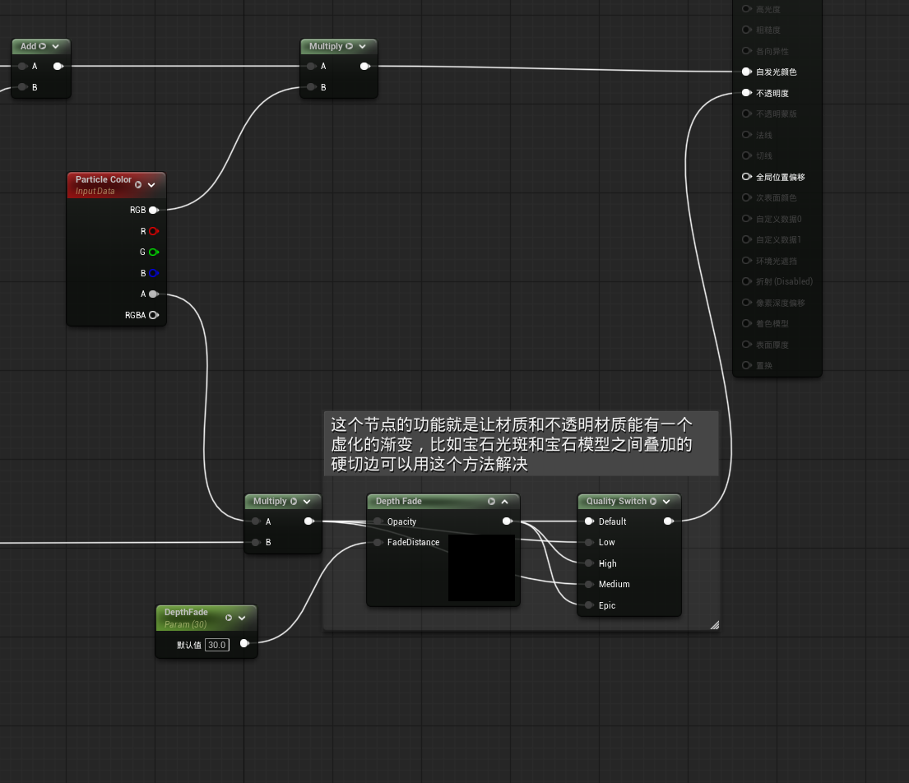
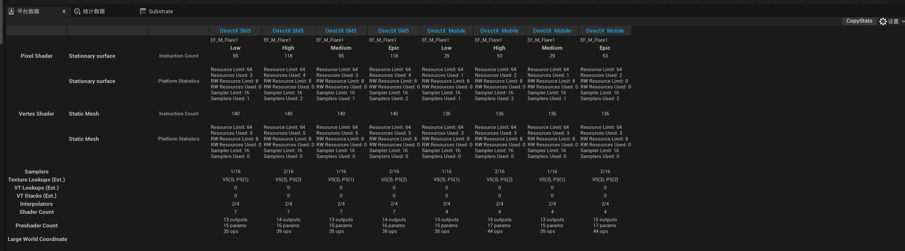
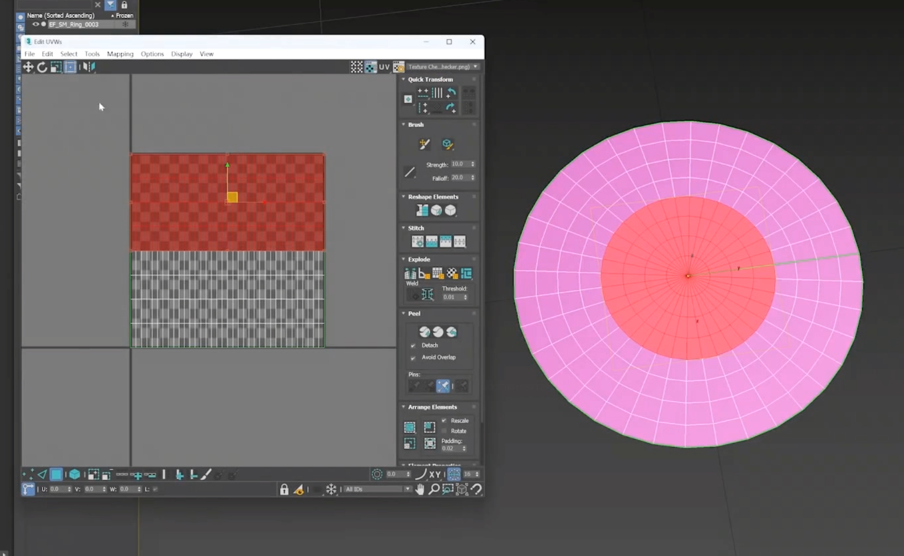
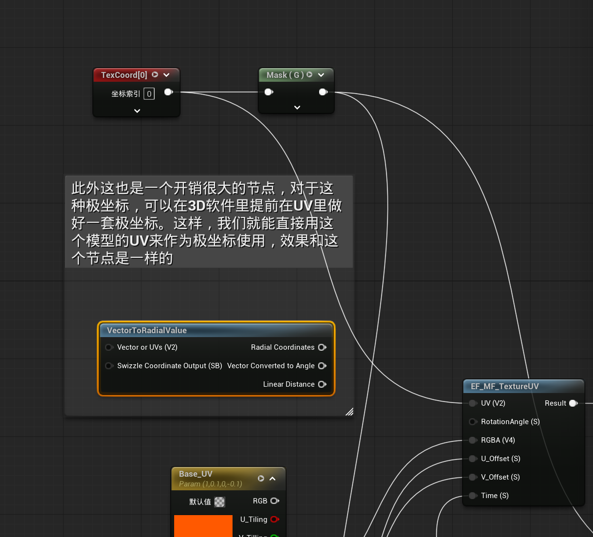
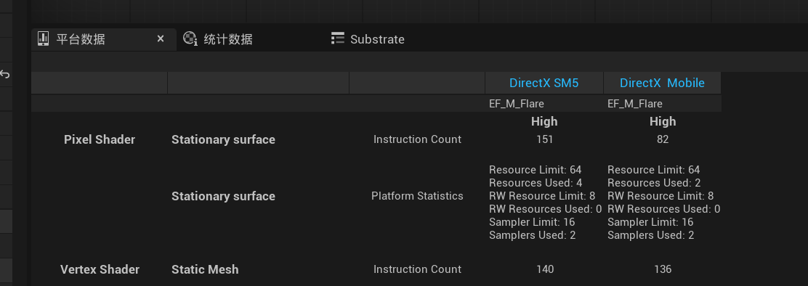
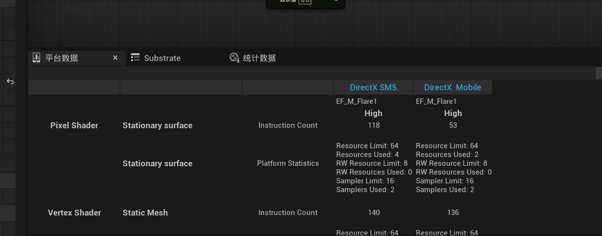

# 特效优化方案小技巧

## 1. 按材质质量等级取舍 DepthFade

### 功能与开销

DepthFade 用来柔化透明特效与不透明物体相交的位置。光斑、烟雾等效果与地面、墙体或角色相交时，深度淡化可以减轻直接裁切形成的硬边。它根据场景深度与当前像素深度的差，调整输入的不透明度。[DepthFade 官方说明](https://dev.epicgames.com/documentation/unreal-engine/depth-material-expressions-in-unreal-engine)

其作用可概括为：

```text
淡化系数 ≈ saturate((场景深度 - 当前像素深度) / FadeDistance)
输出不透明度 = 基础不透明度 × 淡化系数
```

交界处深度差接近零，特效逐渐淡出；深度差达到淡化距离后，恢复原有强度。FadeDistance 是世界空间距离，示例中的 30 对应常用厘米单位下的 30 厘米。

这项功能需要读取深度并计算淡化系数。**减小 FadeDistance 只会缩短视觉过渡范围，不会取消这段计算。** 对交界柔化要求较低的特效，可以在较低材质质量下绕过 DepthFade。

### 优化思路与节点连接

通过 QualitySwitch 保留完整效果和简化效果两条分支：高质量保留深度淡化，较低质量直接使用淡化前的基础不透明度。

```text
基础不透明度 A ────────────────────→ 简化分支
基础不透明度 A → DepthFade(A, 30) ─→ 完整分支
两条分支 → QualitySwitch → 材质 Opacity
```

示例采用以下分级方式：

| QualitySwitch 输入 | 接入内容 | 深度淡化 |
| --- | --- | --- |
| Default | DepthFade 输出 | 保留，作为未连接质量分支的回退 |
| Low | 淡化前的基础不透明度 | 关闭 |
| Medium | 淡化前的基础不透明度 | 关闭 |
| High | DepthFade 输出 | 保留 |
| Epic | DepthFade 输出 | 保留 |

简化分支接回的是原有基础不透明度，包含粒子 Alpha 和原有遮罩，而不是常量 1。因此降级只去掉交界处的深度柔化，仍能保留粒子的透明度变化。

QualitySwitch 在编译相应材质质量版本时选择表达式网络，未选中的独立分支可以被裁剪；它不需要逐像素计算两套完整结果再混合。前提是 DepthFade 没有通过其他有效连线继续参与最终输出。[QualitySwitch 官方说明](https://dev.epicgames.com/documentation/en-us/unreal-engine/utility-material-expressions-in-unreal-engine#qualityswitch)



### 优化效果

下面的数据来自同一优化材质的各质量版本。Pixel Shader 对应 Stationary surface，Vertex Shader 对应 Static Mesh。

| 平台 | 质量 | Pixel Shader 指令数 | 像素阶段资源数 | 采样器数量 | 像素纹理读取估计数 | Vertex Shader 指令数 |
| --- | --- | ---: | ---: | ---: | ---: | ---: |
| DirectX SM5 | Low / Medium | 95 | 3 | 1 | 1 | 140 |
| DirectX SM5 | High / Epic | 118 | 4 | 2 | 2 | 140 |
| DirectX Mobile | Low / Medium | 29 | 1 | 1 | 1 | 136 |
| DirectX Mobile | High / Epic | 53 | 2 | 2 | 2 | 136 |

在这个示例中，关闭 DepthFade 后：

- **DirectX SM5：** 像素指令数减少 23，约 19.5%。
- **DirectX Mobile：** 像素指令数减少 24，约 45.3%。
- 两个平台的像素阶段资源数、采样器数量和纹理读取估计数均各减少 1，顶点指令数保持不变。

这说明优化既减少了像素计算，也移除了这个示例中与深度淡化相关的一组读取需求。这里的减少量是当前材质在对应平台上的编译结果，不是 DepthFade 在所有材质中的固定成本。



Low 与 Medium 数值相同、High 与 Epic 数值相同，是因为各组连接了相同的表达式网络。**质量标签本身不会自动产生额外优化，实际差异来自各分支的计算内容。**

### 视觉取舍与适用场景

该技巧适合允许交界稍硬的特效，例如短促闪光、远距离小光斑，或低配设备上的简化效果。持续烟雾、贴地大光圈等效果的交界更明显，保留深度柔化的视觉价值也更高。

DepthFade 优化减少的是像素阶段的深度读取与计算，不会直接减少粒子数量或透明叠加层数。在 Additive 材质中，Opacity 调节的是叠加贡献强度，交界柔化表现为光效逐渐减弱。

## 2. 用预制模型 UV 替代 VectorToRadialValue

### 功能与开销

VectorToRadialValue 将二维向量或 UV 转换为极坐标，提供径向坐标、角度和线性距离。其内部包括 `atan2` 角度计算，以及分量平方、相加、开平方等长度计算。

当输入是围绕中心的二维坐标时，可以概括为：

```text
角度 = atan2(y, x)
距离 = sqrt(x² + y²)
径向坐标 = 按约定顺序组合的角度与距离
```

角度通常还会被转换为可循环的纹理坐标。默认 UV 输入使用 `UV × 2 - 1` 将中心移到原点，因此距离的数值范围也取决于这一步缩放。

对于固定形状的环形模型，这些角度与径向数据可以在制作模型时预先编码进 UV，避免运行时逐像素重复转换。

### 优化思路：将固定坐标预制到 UV

在 3D 软件中，把环形模型沿圆周和半径展开，使两个 UV 通道分别承载角度和径向信息：

```text
U：沿圆周变化的角度坐标
V：从中心向外变化、与材质遮罩匹配的径向值
```

这样普通纹理坐标就能承担原本极坐标函数的作用。贴图沿 U 滚动对应绕圆周运动，沿 V 滚动对应径向运动；模型的 UV 插值为像素提供坐标，不再需要原来的角度和长度转换。



### 节点替换

完整替换需要同时处理二维径向坐标和单独的距离输出：

| 原来的坐标来源 | 替换后 | 用途 |
| --- | --- | --- |
| Radial Coordinates | TexCoord[0] | 作为纹理 UV，继续参与平铺、偏移等运算 |
| Linear Distance | TexCoord[0] → Mask(G) | 作为径向遮罩、中心亮度和透明度衰减的输入 |

Mask(G) 提取 UV 的第二通道 V。在这套 UV 约定中，V 承担径向值的作用，例如 `1 - V` 可以形成向外衰减的基础梯度。



只替换纹理 UV、却继续使用函数的 Linear Distance，会保留距离计算。因此要让该函数的输出全部退出最终材质计算链。未连接到最终输出的节点，即使仍留在编辑图中，也不会因此产生对应的运行时计算。

这项优化改变的是基础坐标来源，后续的纹理采样、颜色、强度、偏移和动画运算仍可沿用。

### 优化效果

以下为 **High 材质质量**下的像素指令对比。两种方案都保留 DepthFade，因此这组数据主要体现预制 UV 替代极坐标转换的收益。

| 平台 | 运行时极坐标转换 | 预制 UV | 指令数减少 | 减少比例 |
| --- | ---: | ---: | ---: | ---: |
| DirectX SM5 | 151 | 118 | 33 | 21.9% |
| DirectX Mobile | 82 | 53 | 29 | 35.4% |

优化前：



优化后：



两个平台的顶点指令数分别保持为 140 和 136，材质采样器数量保持为 2。说明这个示例的收益主要来自省去像素阶段的坐标转换，并未增加一套顶点 Shader 极坐标计算，也未减少原有材质纹理采样器。

上述百分比描述的是对应 Shader 的指令数量变化，不等于 GPU 耗时同比下降。透明特效的实际成本还受屏幕覆盖面积、叠加层数、指令类型和设备影响。

### 适用条件

这项技巧适合光环、冲击波、径向光斑等固定结构的 Mesh 特效，依赖模型 UV 与材质之间一致的坐标约定。

- **通道与范围：** 角度和距离的通道顺序、方向及缩放必须与原材质匹配。把 UV 展成矩形，并不自动保证效果一致。
- **圆周接缝：** U 从 1 回到 0 的位置需要合理的 UV 接缝和纹理寻址，否则滚动或过滤时容易出现断线。
- **中心与插值：** 极坐标中心的角度不唯一，三角形 UV 插值也不严格等同于解析极坐标转换；模型结构与细分会影响中心拉伸及边缘平滑度。
- **复用范围：** 专用环形 UV 不能直接当作任意平面或普通 Sprite 的通用极坐标。若坐标中心需要实时移动，运行时计算会更灵活。

本质上，这项技巧用制作阶段的固定数据替代运行时数学计算，适合坐标结构稳定、可以配套制作模型的特效。
