# 闪烁特效

闪烁技能首先需要实现角色的溶解与显现。本阶段使用灰度噪声和 Step 构建裁切遮罩，再通过两次 Step 的差提取溶解亮边，最后修正亮边的渐变方向及随溶解进度产生的亮度偏移，实现外侧亮、向角色内部逐渐变暗的过渡。接着分别尝试 WorldAlignedTexture 世界平铺和第二套 UV，改善溶解纹理排布，并记录第二套 UV 在 3ds Max 中的整理方式。

## 1. 角色溶解的材质设置

本次针对角色原本不透明的表面制作溶解，不复用项目中已有的 `/Game/Effect/Common/MaterialFunction/EF_MF_Dissolve`，而是直接使用阈值比较生成二值遮罩。

这里的“不透明材质溶解”描述的是角色表面的效果需求。实际节点截图中，材质的 **Blend Mode 为 Masked**，通过 **Opacity Mask（不透明蒙版）**决定像素保留或裁切。纯 Opaque 模式不能直接通过这一输入裁切像素。[Opacity Mask 官方说明](https://dev.epicgames.com/documentation/en-us/unreal-engine/material-inputs-in-unreal-engine#opacitymask)

截图中的预览材质使用 `Surface / Masked / Unlit`，便于单独观察遮罩和自发光。接回角色材质时，保留角色所需的基础颜色、法线等表面属性，并合入溶解遮罩与亮边自发光。

后文统一使用以下符号：

| 参数或符号 | 含义 |
| --- | --- |
| `N` | 噪声纹理的灰度值，前文截图取 Texture Sample 的 R 通道；第 8 节使用世界投射结果的 R 通道，第 9 节改用第二套 UV 采样噪声的 R 通道 |
| `D` | 原始 `Dissolve` 参数，约定 1 为不溶解、0 为溶解结束 |
| `T = 1 - D` | 送入 Step 比较的溶解阈值 |
| `W` | `DissolveEdgeWidth`，两次比较之间的阈值差，控制亮边宽度 |
| `C` | `DissolveEdgeColor`，亮边颜色 |

`W` 控制的是噪声灰度区间的宽度，实际显示的空间宽度还取决于纹理局部的灰度变化速度。

## 2. 使用 Step 实现溶解核心

### 2.1 If 与 Step 的比较

最初用 If 将噪声灰度与溶解阈值比较：噪声大于或等于阈值时输出 1，小于阈值时输出 0。输出接入 Opacity Mask，就能让噪声中较暗的区域先消失。

```text
Texture Sample.R → If.A
溶解阈值          → If.B
1                 → If 的 A > B 与 A == B
0                 → If 的 A < B
If 输出           → Opacity Mask
```


本次只需要 0 和 1 两种结果，因此用 Step 替换 If。UE 材质编辑器中的 Step 将 **X 与 Y 比较：X 小于 Y 时输出 0，否则输出 1**。连接时，噪声接 X，阈值接 Y。[Step 官方说明](https://dev.epicgames.com/documentation/en-us/unreal-engine/math-material-expressions-in-unreal-engine#step)

```text
Texture Sample.R → Step.X
溶解阈值          → Step.Y
Step 输出         → Opacity Mask
```

两种方式都能完成这里的二值溶解。If 可以为不同比较结果指定具体输出值；本次不需要这项灵活性，选择 Step 即可。

截图中的平台统计如下，均为 `High` 质量的 `Pixel Shader / Stationary surface`：

| 平台 | If 版本指令数 | Step 版本指令数 | 变化 |
| --- | ---: | ---: | --- |
| DirectX SM5 | 108 | 108 | 相同 |
| DirectX Mobile | 15 | 11 | 减少 4 条，约 26.7% |

这个示例中 Step 在 Mobile 上的编译指令更少。性能收益应以目标平台的编译和运行结果为准，不能把这组指令差当成所有材质中的固定差值。


### 2.2 用 OneMinus 统一参数方向

直接增大 Step 的阈值，会让更多像素被裁掉。为了符合操作习惯，将对外的 `Dissolve` 参数先做一次 `1-x`：

```text
T = 1 - D
Dissolve → OneMinus → Step.Y
```

这样 `D` 从 1 减小到 0 时，阈值 `T` 从 0 增大到 1，溶解逐渐加深；反向调整则逐渐显现。后续两条 Step 分支都使用这一反相后的阈值。


## 3. 两次 Step 相减提取亮边

溶解核心只有保留和裁切两种结果。要得到边缘带，再建立一条阈值降低 `W` 的 Step 分支：阈值较低的分支溶解较少，保留范围更大；阈值较高的分支溶解较多，保留范围更小。

用大范围减去小范围，剩下的就是两条边界之间的区域。

```text
DissolveMin = Step 节点（X = N，Y = T - W）  // 溶解少，保留范围大
DissolveMax = Step 节点（X = N，Y = T）      // 溶解多，保留范围小
EdgeMask    = DissolveMin - DissolveMax
```

这里的 `DissolveMin` 和 `DissolveMax` 沿用截图中的命名，表示两种溶解程度，不是数学 Min、Max 节点。相减顺序必须是 **溶解少的结果减去溶解多的结果**。

按上述比较关系推导，亮边对应的灰度区间为：

```text
T - W ≤ N < T
```

初步将 `EdgeMask × C` 接入 Emissive Color，便能得到一圈纯色亮边。截图早期直接用 Dissolve 作为阈值，加入 OneMinus 后，提取亮边的原理保持一致。


**最终截图将 DissolveMin 接入 Opacity Mask。** 因此实际保留的表面包括亮边带，以及亮边内侧未溶解的区域。如果在这套区间定义下改接 DissolveMax，亮边所在的区域就会被裁掉。

此时亮边内部几乎是统一亮度，带状区域的边界很硬，还没有“最外侧最亮、向内逐渐变暗”的层次。


## 4. 利用噪声灰度制作边缘渐变

### 4.1 将噪声与亮边相乘

噪声纹理本身包含连续灰度，而 EdgeMask 只负责选出边缘区域。先预览两者的乘积：

```text
初步渐变 = N × EdgeMask
```

这会保留亮边区域内原有的灰度信息，使纯色带出现亮暗变化。


但直接使用 `N`，渐变方向与目标相反：靠近已溶解区域的外侧偏暗，靠角色内部的一侧反而更亮。

原因是暗处先溶解。在亮边区间 `T-W ≤ N < T` 中，外侧的噪声值更小，向内的噪声值更大；直接乘噪声就会得到“外暗内亮”。


### 4.2 反相噪声改变渐变方向

给噪声灰度再加一个 OneMinus：

```text
反相噪声 Q = 1 - N
初步亮边   = Q × EdgeMask
```

外侧较小的噪声值被反相为较大的亮度值，内侧则相反，渐变方向就变为外亮内暗。

这里有两次不同用途的 `1-x`：**`1-D` 用于统一溶解参数方向，`1-N` 用于反转边缘亮度方向。**


虽然方向正确了，但反相噪声的亮度仍随着溶解进度整体变化。溶解初期边缘偏亮，灰度层次不明显；溶解后期边缘整体变暗，渐变才更容易看出来。

## 5. 使用 Lerp 检查亮度随进度的变化

用颜色代替灰度观察数值分布，可以更直观地判断问题。调试时让较暗的值显示红色、较亮的值显示蓝色：

```text
Lerp.A     = 红色
Lerp.B     = 蓝色
Lerp.Alpha = 1 - N
```

再用边缘遮罩限制显示区域。Alpha 越接近 0 越偏红，越接近 1 越偏蓝。[Lerp 官方说明](https://dev.epicgames.com/documentation/en-us/unreal-engine/math-material-expressions-in-unreal-engine#linearinterpolate)


调节 Dissolve 后可以观察到：

| 阶段 | 截图参数 | 调试颜色 | 对应现象 |
| --- | --- | --- | --- |
| 溶解初期 | `D = 0.95` | 偏蓝 | 反相噪声数值整体较高 |
| 溶解后期 | `D = 0.25` | 偏红、偏紫红 | 反相噪声数值整体降低 |


这说明随着阈值移动，亮边取到的是噪声中不同的灰度区间。纹理没有随时间改变，但当前被选中的边缘灰度发生了整体偏移，并不是只有溶解后期才存在灰度信息。

## 6. 减去原始 Dissolve 抵消亮度偏移

为了让边缘渐变在不同溶解进度下保持一致，从反相噪声中减去**未经 OneMinus 的原始 Dissolve 参数**：

```text
G = (1 - N) - D
  = T - N
```

这个计算将绝对噪声灰度转换为相对于当前阈值的差值。按亮边区间推导，`G` 的范围为：

```text
外侧边界：N = T - W  → G = W，亮度最高
向内过渡：N 逐渐增大 → G 逐渐减小
内侧边界：N 接近 T   → G 接近 0，逐渐变暗
```

只要 `W` 固定，完整亮边区间中的 `G` 就保持在 `0～W`，不再随 `D` 整体偏亮或偏暗。这里减去的是 `D`，如果误接反相后的 `T`，就无法得到上述相对梯度。

例如保持 `W = 0.2`，取亮边上相同的三个相对位置：

| 原始 D | 阈值 T | 外侧 N 与 G | 中间 N 与 G | 接近内侧 N 与 G |
| --- | --- | --- | --- | --- |
| 0.65 | 0.35 | `N=0.15，G=0.20` | `N=0.25，G=0.10` | `N=0.34，G=0.01` |
| 0.25 | 0.75 | `N=0.55，G=0.20` | `N=0.65，G=0.10` | `N=0.74，G=0.01` |

两种进度下的渐变结果一致。接着将 `G` 乘以亮边颜色，形成截图中的 `DissolveColorGradient`：

```text
DissolveColorGradient = G × DissolveEdgeColor
```


## 7. 最终节点整理与输出

### 7.1 按截图保留的连接

最终节点分为两组：一组提取溶解边缘，另一组计算颜色渐变。截图中的 `DissolveEdge` 在 Step 差值之外，还保留了前面测试时的反相噪声乘法。

```text
N = Texture Sample.R
D = Dissolve
W = DissolveEdgeWidth
T = 1 - D

DissolveMin = Step 节点（X = N，Y = T - W）
DissolveMax = Step 节点（X = N，Y = T）
EdgeMask    = DissolveMin - DissolveMax

DissolveEdge          = EdgeMask × (1 - N)
DissolveColorGradient = ((1 - N) - D) × DissolveEdgeColor

Emissive Color = DissolveColorGradient × DissolveEdge
Opacity Mask   = DissolveMin
```


上述连接复现截图效果。**保持范围稳定的是补偿后的梯度 `G`；额外乘上的 `1-N` 仍会影响最终发光强度。** 如果目标是让同一边缘相对位置的发光值也不随进度改变，可以仅使用二值 EdgeMask 限定渐变：

```text
Emissive Color = EdgeMask × G × DissolveEdgeColor
```

这属于在截图连接基础上的进一步整理。若还希望边缘宽度改变时峰值亮度保持独立，可将 `G` 除以大于零的 `W` 后限制到 0～1，再单独乘发光强度；截图本身没有进行这一步归一化。

### 7.2 参数端点与检查要点

`D=1` 不溶解、`D=0` 完全消失是对外参数的目标约定。按截图最终的 `Opacity Mask = DissolveMin`，当 `D=0` 时阈值实际为 `1-W`，仍可能保留噪声高值区域及尾部亮边。需要严格完全消失时，应额外处理终点遮罩，或重新映射阈值使其越过噪声最大值；重新映射后，渐变应统一使用实际阈值计算 `G=T-N`。第 14 节记录了本次使用 RemapValueRange 优化参数端点的做法。

制作完成后重点检查以下连接：

- 噪声接 Step.X，比较阈值接 Step.Y；较暗的区域应先溶解。
- `DissolveMin - DissolveMax` 的顺序正确，亮边由保留范围较大的结果减去较小的结果。
- 最终 Opacity Mask 接 DissolveMin，确保亮边带处于可见区域。
- 渐变补偿使用 `(1-N)-D`，其中 D 是原始参数；红蓝 Lerp 只用于调试。
- 对比溶解初期、中期、后期的边缘层次，并单独确认完全显现和完全消失两个端点。

## 8. 使用 WorldAlignedTexture 改善 UV 接缝

### 8.1 模型 UV 对溶解纹理的影响

将溶解材质应用到角色后，直接按模型 UV 采样噪声，纹理排布会受到 UV 展开的影响。不同 UV 岛之间的采样位置不连续，可能让溶解图案在拼接处突然断开；局部 UV 的拉伸或缩放也可能让噪声疏密不一致。

下图中，角色背部中间连接处的溶解纹理有明显的拼接感，左右图案衔接不够自然。即使前面的溶解遮罩和亮边计算正确，这类采样问题仍会影响整体观感。

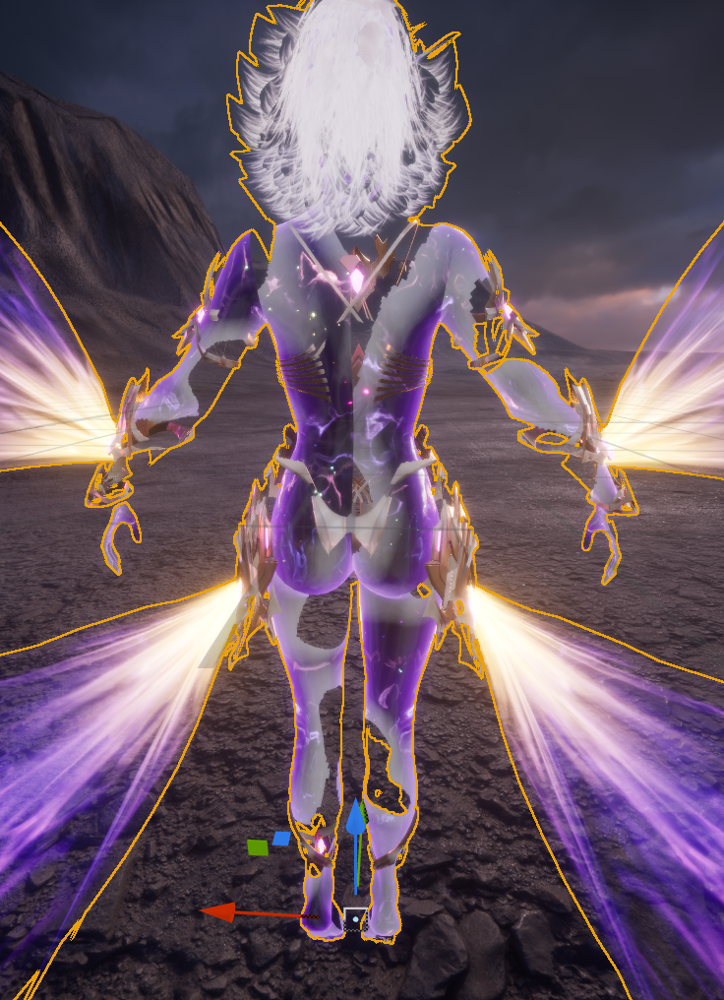

### 8.2 用世界平铺替换原来的噪声采样

使用 **WorldAlignedTexture**，将噪声按世界空间坐标投射到角色表面。它不依赖模型的 UV 展开，并可将 X、Y、Z 方向的投射结果混合，减轻 UV 接缝处的图案断裂，使纹理排布和方向过渡更柔和。[WorldAlignedTexture 官方说明](https://dev.epicgames.com/documentation/en-us/unreal-engine/texturing-material-functions-in-unreal-engine#worldalignedtexture)

截图中的连接如下：

```text
溶解噪声 Texture Object → WorldAlignedTexture.TextureObject
常量 65                → WorldAlignedTexture.TextureSize
WorldAlignedTexture 的 XYZ Texture 输出 → 后续溶解计算
```

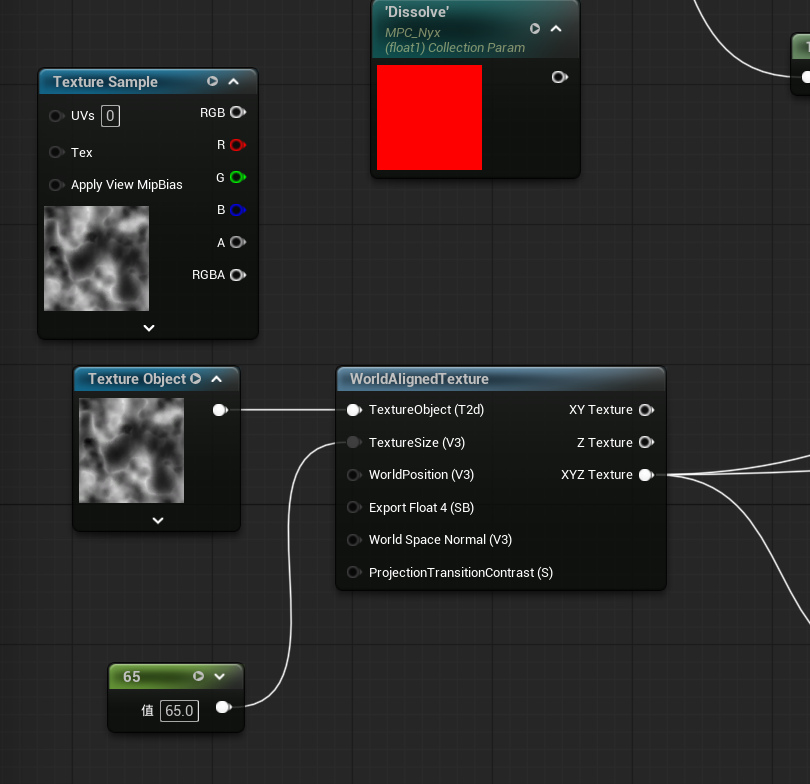

| 节点或引脚 | 本次设置与作用 |
| --- | --- |
| `Texture Object` | 使用原来的溶解噪声纹理，为函数提供纹理对象；不能直接用 Texture Sample 的 RGB 采样值替代这一输入 |
| `TextureSize (V3)` | 控制纹理沿世界 X、Y、Z 轴的平铺尺寸，单位为世界单位；截图输入标量 `65`，会扩展为 `(65, 65, 65)` |
| `XYZ Texture` | 使用三个方向混合后的投射结果，覆盖角色不同朝向的表面 |

`TextureSize` 越大，同一块噪声图案覆盖的世界空间范围越大，溶解块越大、排布越疏；数值越小则越细密。这里的 `65` 是本次效果使用的尺寸，可按角色大小和期望的溶解块尺寸调整。

为沿用前文统一的标量灰度 `N`，可在 `XYZ Texture` 输出后通过 **ComponentMask（仅勾选 R）**取出 R 通道，替换原来的 `Texture Sample.R`：

```text
N = WorldAlignedTexture.XYZ Texture 的 R 通道

N → 两个 Step 的 X 输入
N → 亮边分支中的 OneMinus（1 - N）
N → 渐变补偿计算 G = (1 - N) - D
```

替换时，遮罩与亮边各分支应使用同一份世界投射噪声，避免裁切边界和发光边缘错位。前面的 Dissolve 参数方向、两次 Step 相减以及渐变补偿公式均保持不变。

### 8.3 替换后的效果

改用世界投射后，背部原先沿 UV 拼接处断开的图案明显缓和，溶解纹理在角色表面的分布更连贯，没有原先直接的接缝感。

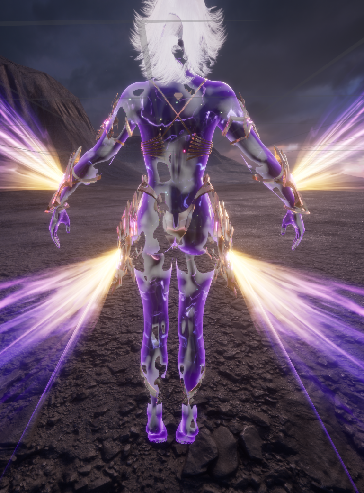

世界投射改善的是噪声的空间排布，不会改变模型 UV 本身。默认投射固定在世界空间，角色移动或骨骼动画时，表面可能相对纹理产生滑动；应用到闪烁技能时，还需在实际动作中检查这一表现。[世界空间纹理的运动特性](https://dev.epicgames.com/documentation/en-us/unreal-engine/texturing-material-functions-in-unreal-engine#worldalignedtexture)

## 9. 使用第二套 UV 采样溶解纹理

### 9.1 在 UE 材质中切换 UV 通道

除了世界对齐投射，还可以为溶解纹理指定模型的**第二套 UV**。这套 UV 可以单独为特效整理，不必沿用角色基础贴图的 UV 排布。本次使用第二套 UV 后，溶解纹理的分布效果也比较自然。

在材质中添加 **TextureCoordinate（TexCoord）** 节点，将 **Coordinate Index（坐标索引）设为 1**，再接入溶解噪声 Texture Sample 的 UVs 输入。UE 的 UV 索引从 0 开始，因此 `TexCoord[1]` 表示第二套 UV。[TextureCoordinate 官方说明](https://dev.epicgames.com/documentation/en-us/unreal-engine/coordinates-material-expressions-in-unreal-engine#texturecoordinate)

```text
TexCoord（Coordinate Index = 1）→ 溶解噪声 Texture Sample.UVs
Texture Sample.R              → N → 原有溶解遮罩与亮边计算
```

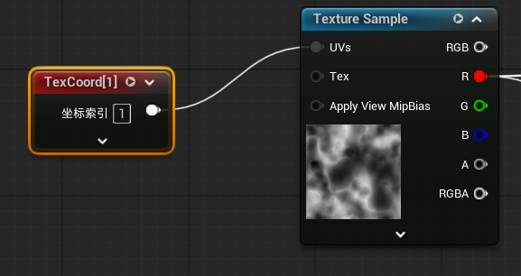

这里替换的是噪声采样所使用的坐标。前面的 Step 比较、亮边提取和渐变补偿仍然使用同一份灰度 `N`，无需更改公式。模型导入 UE 时需要保留第二套 UV，角色基础颜色等贴图继续使用各自原有的 UV 设置。

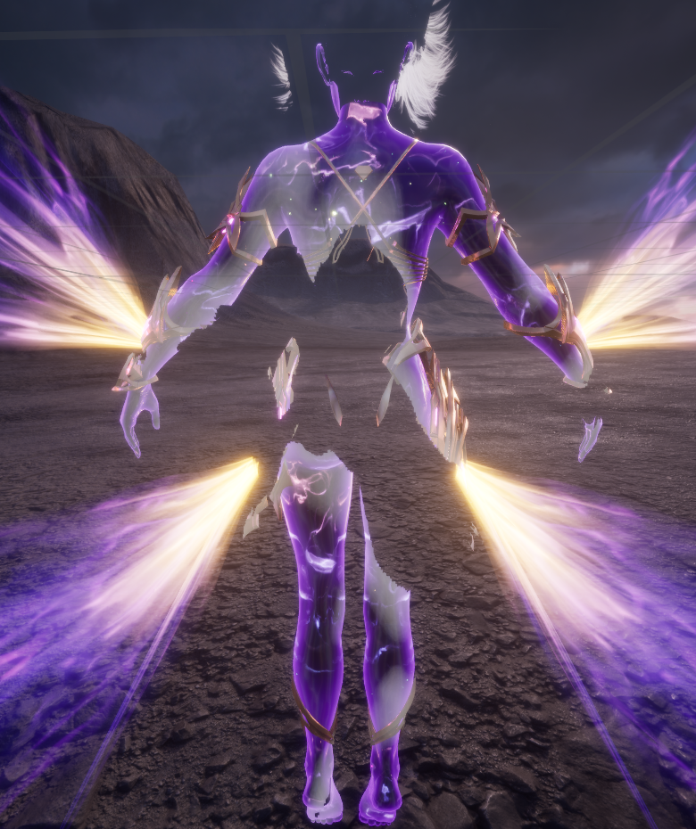

### 9.2 在 3ds Max 中查看两套 UV

回到 **3ds Max**，在 **Unwrap UVW（UVW 展开）**修改器的“通道”区域查看“贴图通道”，并打开 UV 编辑器。对于本模型的这两套 UV，通道对应关系如下：

| 用途 | 3ds Max 贴图通道 | UE 的 Coordinate Index |
| --- | ---: | ---: |
| 第一套 UV | 1 | 0 |
| 第二套 UV | 2 | 1 |

先选择**贴图通道 1**。下图是模型的第一套 UV，可以看到大量拆分、打包后的 UV 岛。

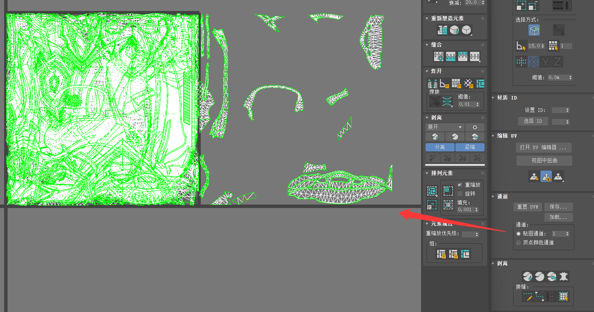

将**贴图通道切换为 2**，即可查看已经制作好的第二套 UV。这一步是在查看已有通道，并不代表只修改通道编号就能自动生成图中的排布。

第二套 UV 的主体按角色从头到脚的上下关系展开排列，更容易观察纹理在角色表面的分布。同时，把飘带、裙摆等元素对应的 UV 移到了主体下方，形成分开的区域。

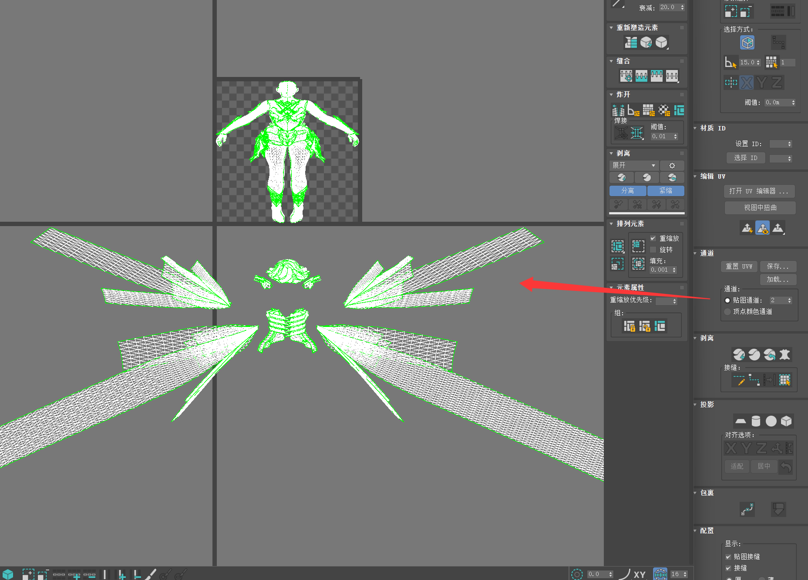

### 9.3 选择并移动飘带、裙摆等元素的 UV

在第二套 UV 中，先选中需要整理的部分，再在 UV 编辑器里将其向下拖动。下图展示了飘带等附属元素与其 UV 的对应关系：模型面和相应 UV 都以红色高亮。

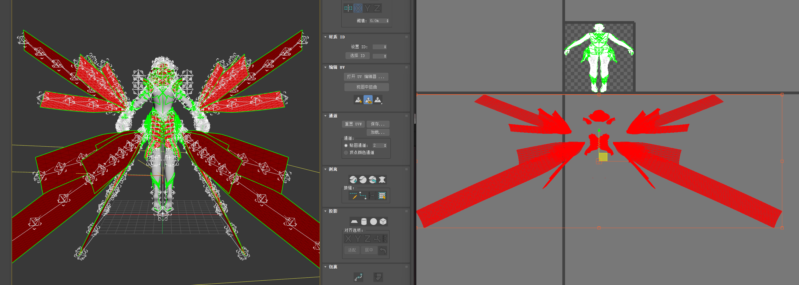

选择时可以采用两种方式：

- **在 UV 编辑器中选择**需要平移的 UV 部分，再使用移动工具向下拖动。整理完整 UV 岛时，应选全该岛，保持内部形状不变。
- **在 3D 视口中选择模型面**，通过高亮找到对应的 UV，然后回到 UV 编辑器移动这些 UV。这里移动的是纹理坐标，模型面的位置不变。

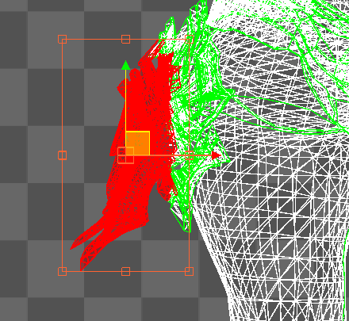

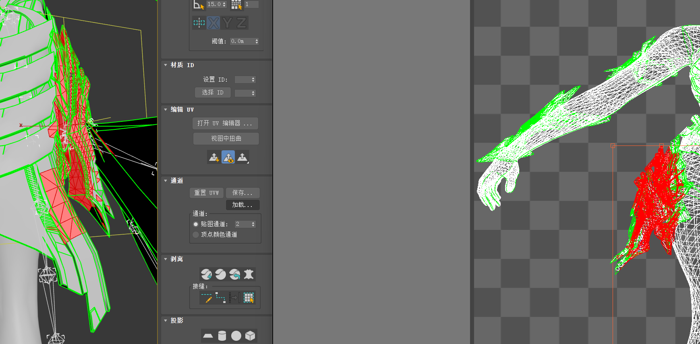

### 9.4 使用相对输入精确偏移一个 UV 单位

UE 材质采样中通常按 **U 对应 X、V 对应 Y** 理解纹理坐标：在常见的贴图显示约定下，U 从左向右由 0 到 1，V 从上向下由 0 到 1。这描述的是一张纹理的基础区间，**UV 本身可以小于 0 或大于 1**。3ds Max 的 UV 编辑器中，V 的显示方向与 UE 的上述贴图约定不同，不能直接把两者的屏幕方向混用。

如果希望精确平移一整格，可以使用 UV 编辑器左下角的数值输入：

1. 选中需要整体偏移的全部 UV。若要移动整个通道，可全选；若只移动主体或附属元素，则只选对应部分。截图中选中的是角色主体，下方飘带等部分未选中。
2. 将左下角 **Absolute/Relative Type Ins（绝对/相对输入）**切换到**相对输入**模式。
3. 保持 U、W 不变，在 **V 输入框中输入 `-1`** 并确认。
4. 所选 UV 会在当前 Max 视图中向下移动一个完整的 UV 单位，即一张基础 UV 方格的高度。

相对模式表示在当前坐标上增加偏移量。本次操作可写为 `V新 = V原 - 1`，并不是把所有选中 UV 的 V 坐标直接设为 `-1`。[3ds Max 绝对/相对输入说明](https://help.autodesk.com/cloudhelp/2022/ENU/3DSMax-Modifiers/files/GUID-C65A1B09-3670-4E7E-BCFC-13E10C831817.htm)

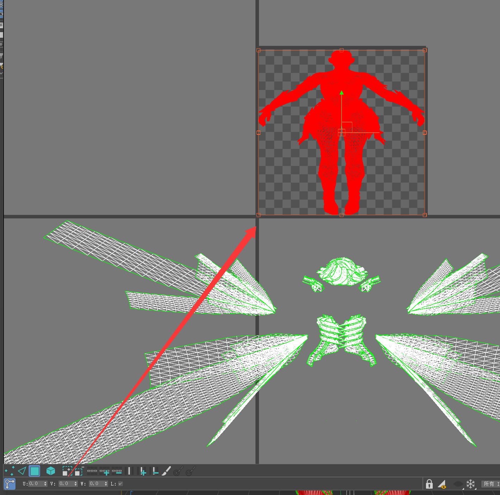

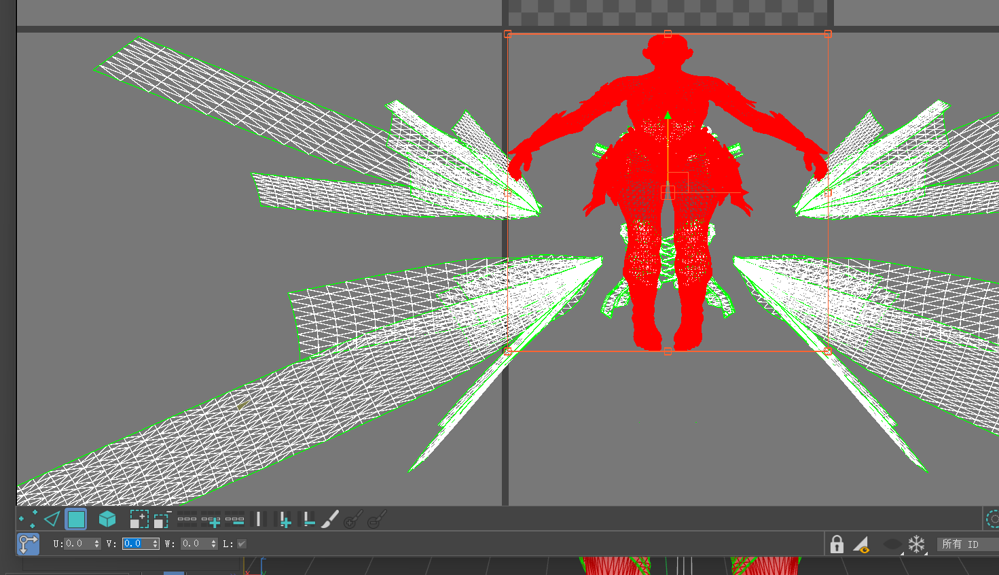

这一操作用于精确整理 UV 的位置。若纹理使用 Wrap 重复寻址，且材质直接使用未缩放的 UV 采样，整数格平移会采到相同的重复图案；它本身不会自动产生新的溶解顺序。最终噪声排布仍取决于整套 UV 的展开、缩放与材质中的采样设置。[UE 中超出 0～1 的 UV 与重复采样说明](https://dev.epicgames.com/documentation/en-us/unreal-engine/using-uv-channels-with-static-meshes-in-unreal-engine)

## 10. 使用 Muriel_GDC 演示第二套 UV：导出与导入准备

接下来使用项目中的 **Muriel_GDC** 模型，演示第二套 UV 的制作流程。本节先记录从 UE 导出 FBX、在 3ds Max 中设置单位及导入的准备工作。

### 10.1 从 UE 导出模型

在内容浏览器中找到 Muriel_GDC 的模型资源，通过右键菜单中的 **Asset Actions（资产操作）→ Export（导出）**，保存为 `Muriel_GDC.FBX`。

在 FBX 导出选项中，关闭以下两项，其余选项保持本次导出时的默认设置，然后点击“导出”：

| 选项 | 本次设置 | 用途 |
| --- | --- | --- |
| Level of Detail（细节层级 / LOD） | 关闭 | 本次先处理基础模型，不同时导出额外 LOD |
| Collision（碰撞） | 关闭 | 本次 UV 编辑不需要额外的碰撞几何体 |

截图中 FBX 导出兼容性为 `FBX 2013`，这里记录本次实际设置，不将其作为所有项目必须采用的版本。

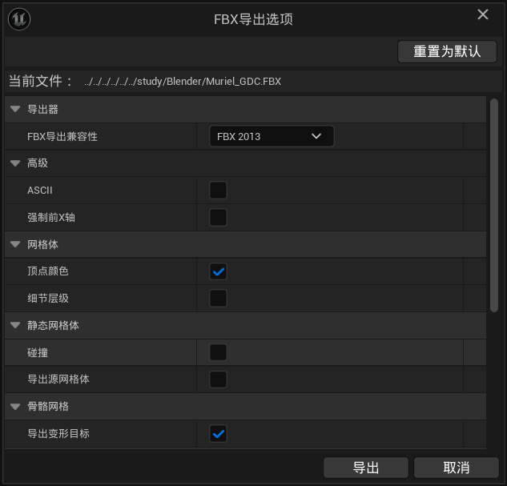

### 10.2 在导入前设置 3ds Max 单位

打开 3ds Max，先在空场景中进入 **自定义（Customize）→ 单位设置（Units Setup）**。

将“显示单位比例”设为 **公制 → 米**。

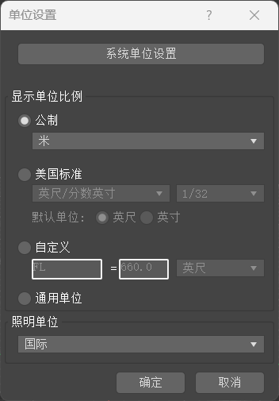

再点击“系统单位设置”，将系统单位比例设为 **1 单位 = 1.0 厘米**。

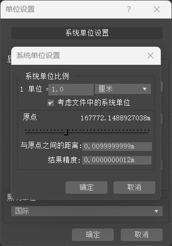

这里需要区分两种单位：**显示单位**决定界面里如何显示尺寸；**系统单位**决定场景内部的实际比例及文件交换时的单位基础。因此，“显示为米”和“系统单位为厘米”可以同时使用，并不冲突。本次使用厘米作为系统单位，与 UE 默认的长度单位保持一致。单位设置应在导入模型之前完成。[Autodesk 单位设置说明](https://help.autodesk.com/cloudhelp/2025/ENU/3DSMax-Customizing/files/GUID-69E92759-6CD9-4663-B993-635D081853D2.htm)

### 10.3 导入 FBX

完成单位设置后，通过 **文件（File）→ 导入（Import）→ 导入**，选择刚才保存的 `Muriel_GDC.FBX`。也可以按本次操作方式，使用 **Ctrl + 拖拽 FBX 文件到视口**来触发导入。

导入后先检查模型尺寸、朝向以及网格是否齐全，再开始编辑第二套 UV。若表面出现下图中的整体发黑现象，先按下一小节检查材质与视口显示。

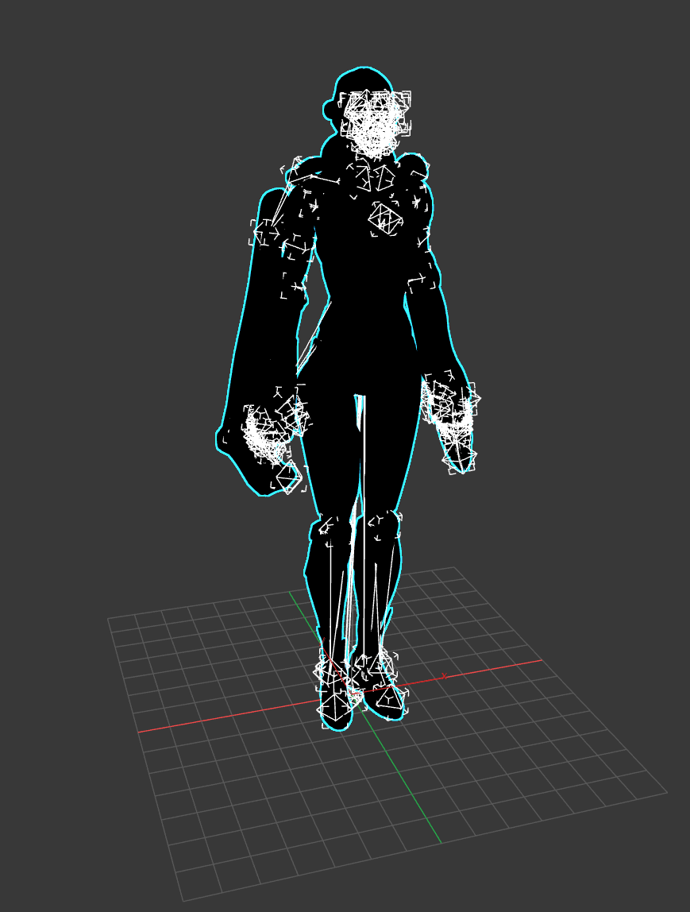

### 10.4 导入后模型发黑的排查方法

**后续文件检查已确认：导出的 FBX 中，10 个材质的漫反射颜色均为黑色，详见 10.5。** 这是模型发黑的直接材质原因，Max 中应用修复后的实际表现仍待视口验证。截图中模型轮廓仍可见，仅凭黑色表面无法判定网格或 UV 损坏。UE 中的完整材质节点效果也不能假定会通过 FBX 在 Max 中原样重建；导入后的基础颜色、贴图连接或子材质可能需要另行处理。

为了先看清表面并继续制作 UV，可以在用于 UV 编辑的场景副本中，给角色网格临时指定一个简单灰色材质：

1. 选中**角色网格对象**。如果角色由多个网格组成，应选择全部需要处理的网格；避免把周围的骨骼或辅助对象当作网格选中。
2. 按 **M** 打开材质编辑器，新建一个 **Physical Material（物理材质）**。
3. 将 **Base Color（基础颜色）设为中灰色**，金属度设为 `0`，粗糙度可设为 `0.5`；不连接贴图，保持不透明、不透射。
4. 选中这个材质，点击 **Assign Material to Selection（将材质指定给选定对象）**。
5. 如果模型恢复为正常的灰色明暗，说明原导入材质需要检查，可先用该临时材质继续观察和编辑 UV。[Autodesk 材质创建与指定示例](https://help.autodesk.com/cloudhelp/2021/ENU/3DSMax-Tutorial/files/GUID-88BFA730-0BD3-4543-ADA9-C745A9D95A6C.htm)

如果指定灰色材质后仍然全黑，再打开视口左上角的着色菜单，进入 **Lighting and Shadows（照明和阴影）**，选择 **Illuminate with Default Lights（使用默认灯光照明）**；也可在 **Active Viewport Settings（活动视口设置）**的照明选项中选择 **Default Lights**。不同 Max 版本的菜单位置可能略有差异。[Autodesk 视口照明设置](https://help.autodesk.com/cloudhelp/2026/ENU/3DSMax-Basics/files/GUID-E7FB1028-2566-4B32-801A-30079978ECDF.htm)

如果简单材质与默认灯光下仍有局部黑面、缺面，或从不同角度观察时表面消失，再检查面朝向与法线。当前截图不足以认定法线翻转，不宜直接对整个模型执行 Flip。

上面保留手动排查方法。下面记录实际完成的文件检查与副本处理，并提供用于当前 Max 场景的自动处理、截图脚本。

### 10.5 实际处理记录：修正 FBX 预览材质

本次直接读取了导出文件 `F:\study\Blender\Muriel_GDC.FBX`，而不是仅凭截图推测。解析结果如下：

- 文件为二进制 FBX，版本号 `7300`，对应本次导出界面的 FBX 2013。
- 10 个材质的 `DiffuseColor` 和兼容字段 `Diffuse` 全部为 `(0, 0, 0)`，即黑色。
- 其中 8 个主体材质同时存在 `Opacity = 1` 与 `TransparencyFactor = 1`。前者表示完全不透明，后者表示完全透明，存在不一致。
- 泪线 `MI_Muriel_TearLine` 和睫毛 `MI_Muriel_EyeLashes` 的 `Opacity = 0`，本次保留其原有透明设置。

`TransparencyFactor` 的含义已对照本机 Autodesk FBX SDK 2020.3.4 的 `fbxsurfacelambert.h` 核对：`0 = opaque`、`1 = transparent`。

**处理前的检查报告截图：** 下图是根据实际文件解析结果生成的报告，经浏览器打开后截取；它不是 Max 视口截图。导入后的原始黑色视口见 10.3。

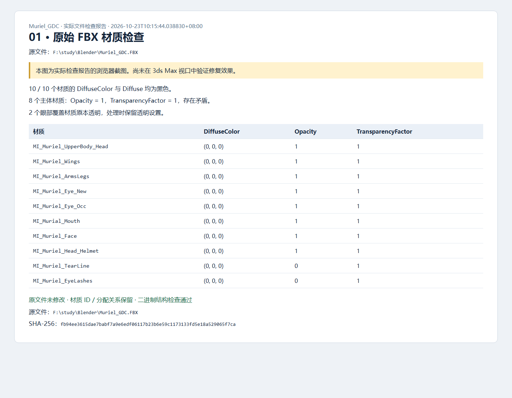

随后生成单独的灰色预览副本 [Muriel_GDC_GrayPreview.FBX](./Assets/Muriel_UV/Muriel_GDC_GrayPreview.FBX)，用于后续观察和制作 UV。处理范围如下：

| 项目 | 原始值 | 预览副本中的处理 |
| --- | --- | --- |
| 10 个材质的 `DiffuseColor` / `Diffuse` | `(0, 0, 0)` | 改为 `(0.5, 0.5, 0.5)` |
| 8 个主体材质的 `TransparencyFactor` | `1` | 改为 `0`，与 `Opacity = 1` 保持一致 |
| 泪线、睫毛的透明属性 | `Opacity = 0`，`TransparencyFactor = 1` | 保留 |
| 材质名称、ID 及分配关系 | 原始数据 | 保留 |

副本以原文件为基础，只覆盖已有材质属性中的双精度数值。没有重新导出模型，也没有修改顶点、三角面、UV、骨骼或蒙皮数据。它是灰色预览版本，不是恢复了 UE 原来的贴图与完整材质效果。

**处理后的检查报告截图：**

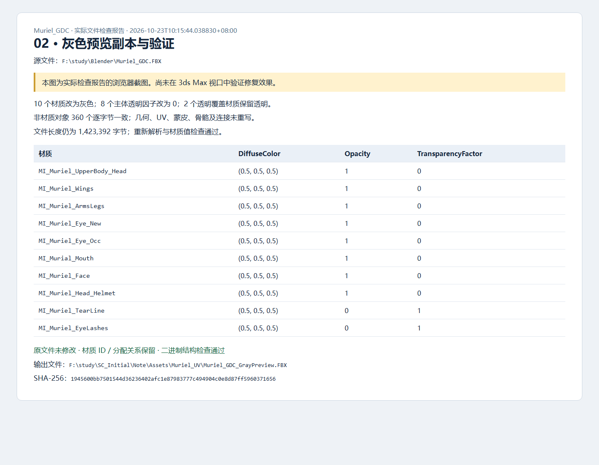

已完成的验证包括：

- 原始文件未修改；副本与原文件长度均为 `1,423,392` 字节，实际差异为 `136` 个字节，全部位于目标材质数值内。
- `Objects` 中的 360 个非材质对象逐字节一致，几何、UV、骨骼和蒙皮等数据保留。
- 对象连接、全局设置及各节点偏移保持一致。
- 重新解析副本，核对全部材质目标值及透明覆盖材质的保留值。

可复查文件：[完整数值与验证记录 JSON](./Assets/Muriel_UV/material_repair_report.json)、[原始材质检查报告](./Assets/Muriel_UV/inspection.html)、[副本验证报告](./Assets/Muriel_UV/verification.html)、[处理脚本](./Tools/Muriel/fix_muriel_materials.py)。

**验证边界：** 当前已完成文件层面的修正与检查；由于本次执行环境无法连接用户当前打开的 3ds Max 窗口，尚未执行 Max 导入验证，也没有声称已拍到 Max 中修复后的效果。可在新的 Max 场景中导入上面的灰色预览 FBX 检查显示。

### 10.6 当前 Max 场景的自动处理与真实视口截图

如果希望继续处理当前已经导入的模型，可使用 [fix_muriel_viewport.ms](./Tools/Muriel/fix_muriel_viewport.ms)。**后续用户已在 Max 中执行脚本，并确认角色成功显示灰色材质**；本次执行环境没有直接操控 Max。实际运行截图见 10.8。

使用方法：

1. 在 Max 中选中要处理的角色网格对象，保持当前视口能够看到角色。
2. 按 **F11** 打开 MAXScript Listener，输入下面的命令并回车；也可以通过“脚本 → 运行脚本”选择该 `.ms` 文件。

```maxscript
fileIn @"F:\study\SC_Initial\Note\Tools\Muriel\fix_muriel_viewport.ms"
```

脚本执行时会：

- 先保存当前活动视口的真实截图，再给选中的 Editable Mesh / Editable Poly 网格指定灰色 Standard 材质。保留多维子材质的层级和槽位，并按名称保留泪线、睫毛原有的不透明度；主体设为不透明。
- 重绘后再次截取活动视口，保存处理前、后的 PNG 及过程日志。文件写入 `Note/Images/BlinkEffects/Muriel_Max_Captures/`，以运行时间戳区分。
- 当定位到本文档时，在文末追加本次两张真实视口截图的引用，并注明仍需人工检查显示结果。

材质指定操作可通过 **Ctrl+Z** 撤销；脚本不会保存覆盖 Max 场景或导出 FBX。若处理后仍黑，继续按 10.4 切换默认视口灯光。这里的“处理后截图”表示已执行材质指定后的视口状态，不自动等同于视觉问题已经解决。

截图方式使用 Max 的 `gw.getViewportDib()` 获取实际活动视口，并保存位图。[Autodesk 位图与视口截取说明](https://help.autodesk.com/cloudhelp/2023/ENU/MAXScript-Help/files/MAXScript-Language-Reference/Values/Bitmap-Values/GUID-9F6ABEE1-0728-4B39-8903-D909634C1304.html)

### 10.7 为什么之前导出的 Nyx 没有整体发黑

用户确认之前导出的文件是 `Nyx_Skeletal_C.FBX`。对比该文件与原始 `Muriel_GDC.FBX` 的实际数据，可得到以下结果：

| 检查项 | Nyx_Skeletal_C.FBX | Muriel_GDC.FBX |
| --- | --- | --- |
| FBX 文件版本 | `7300`，即 FBX 2013 | `7300`，即 FBX 2013 |
| Creator 中的 SDK 版本 | `2020.2` | `2020.2` |
| 材质数量 | 17 | 10 |
| 黑色漫反射材质数量 | 10 | 10 |
| 非黑色漫反射材质数量 | 7 | 0 |
| 连接到 `DiffuseColor` 的贴图数量 | 5 | 0 |

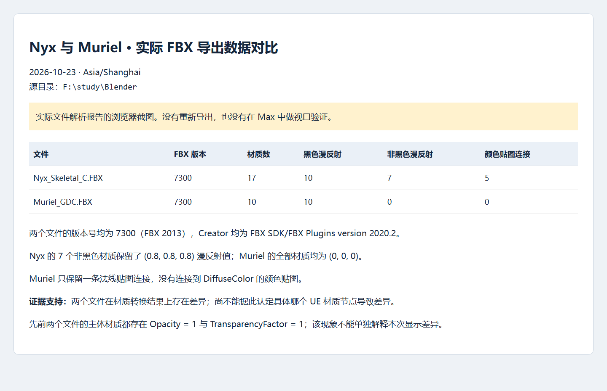

Nyx 的 7 个非黑色材质保留了 `(0.8, 0.8, 0.8)` 的漫反射值，而且部分材质保留了颜色贴图连接。Muriel 的所有材质都是黑色，唯一保留的贴图连接是面部的 `NormalMap`，不能提供基础颜色。这解释了为什么两者导入后的表面显示可能不同；Nyx 中仍有 10 个黑色漫反射材质，也不能把它看作完整恢复了 UE 原材质。

**当前证据更支持材质内容的转换差异，而不是关闭 LOD、碰撞导致发黑。** 两个文件采用相同 FBX 版本和 SDK，仅凭当前结果没有理由将问题归因于 FBX 2013。LOD 与碰撞选项用于控制额外几何的导出，不负责设置材质漫反射颜色。不同材质的节点组织、参数与贴图连接可能导致转换结果不同，但尚未定位到具体哪一个 UE 材质节点。

同时修正前面排查结论的权重：Nyx 的主体材质也存在 `Opacity = 1` 与 `TransparencyFactor = 1` 的组合，因此透明字段不一致并不是 Muriel 独有的现象，不能单独用于解释这次与之前的显示差异。

若当前目的是制作第二套 UV，可继续使用灰色预览材质，无需仅因模型发黑就反复修改 LOD、碰撞或 FBX 版本。原始对比数据保存在 [export_comparison.json](./Assets/Muriel_UV/export_comparison.json)，报告见 [export_comparison.html](./Assets/Muriel_UV/export_comparison.html)。


### 10.8 Max 实际运行：灰色预览材质

下面两张截图由 `fix_muriel_viewport.ms` 在 Max 中实际截取，运行编号为 `37568974`。用户随后确认，运行后模型已成功显示灰色材质。这验证的是当前 Max 场景的材质指定操作，不等同于重新导入灰色预览 FBX 的验证。

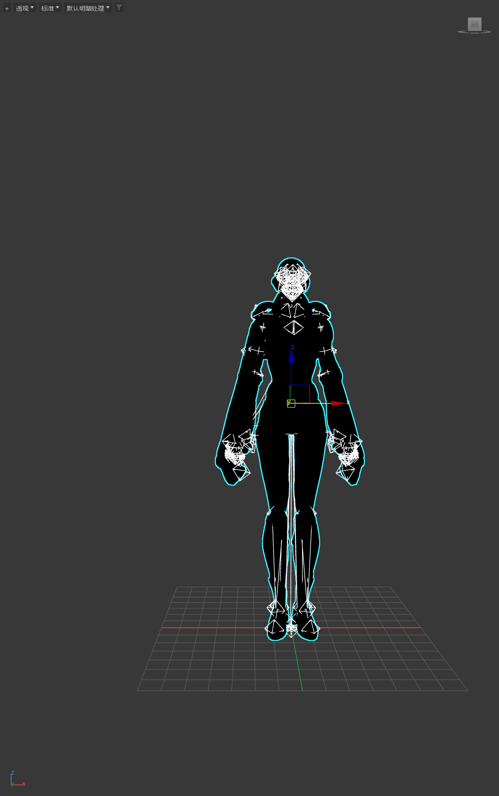

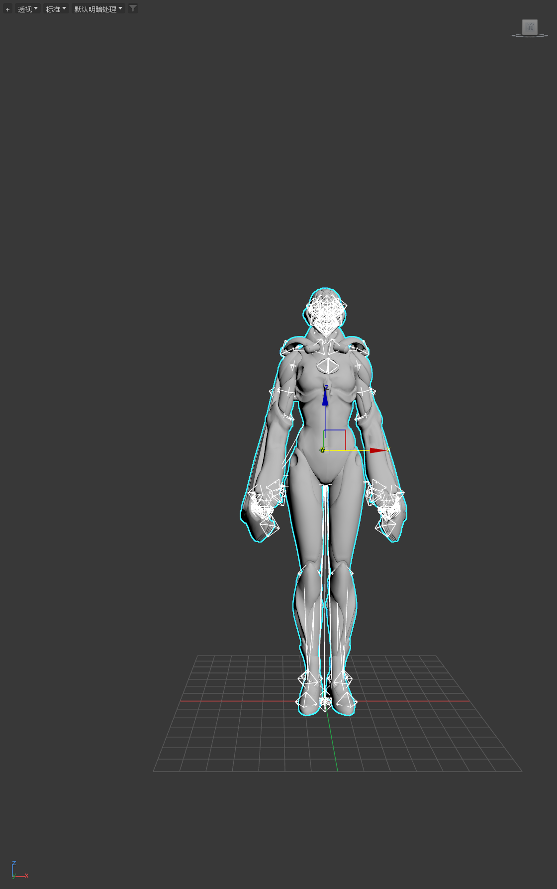

## 11. Muriel 第二套 UV：正面投影与区域整理

完成导入和灰色材质显示后，开始制作 Muriel 的第二套 UV。本次使用 **UVW 贴图（UVW Map）**生成正面平面投影，再用上方的 **UVW 展开（Unwrap UVW）**进行检查和局部整理，使主体 UV 按角色从头到脚的方向排列。

### 11.1 检查当前 UV 与第二套 UV 的方向

在 UVW 展开中打开 UV 编辑器，先查看当前模型的第一套 UV。可以看到 UV 岛按原贴图需求拆分并排列在纹理区域内。

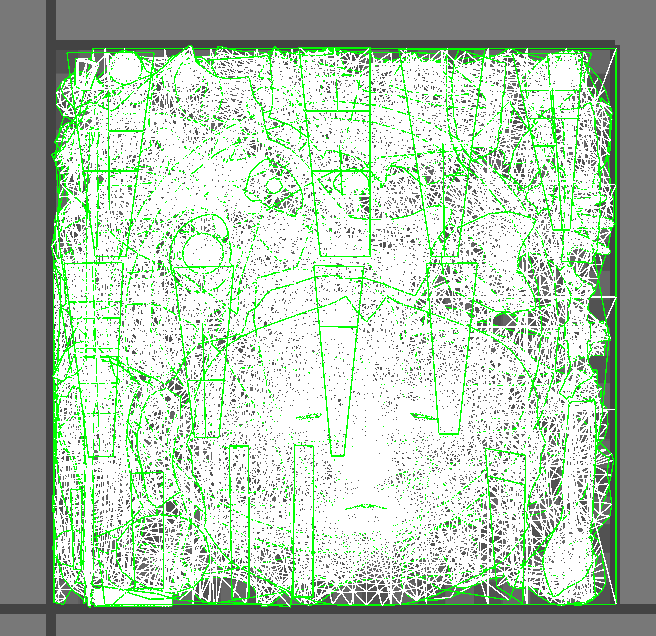

再切换到**贴图通道 2**查看第二套 UV。下图中的角色图案没有沿头顶到脚底的方向竖直排列，与本次需要的上下关系不符，因此重新设置该通道的投影方向。

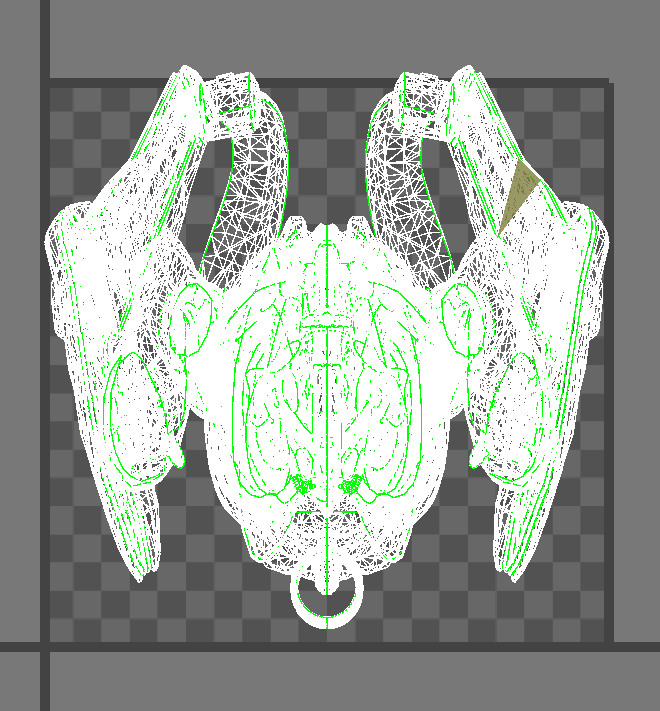

这里的“从上到下”描述 UV 排布与角色身体高度的对应关系；溶解的具体方向仍由后续材质计算决定。

### 11.2 添加 UVW 贴图，并确认修改器顺序

先关闭 UV 编辑器，再添加一个 **UVW 贴图（UVW Map）**修改器。**本流程中，UVW 贴图必须位于 UVW 展开之下**，让投影生成的坐标先进入展开编辑阶段。截图中的堆栈从上到下为：

```text
蒙皮（Skin）
UVW 展开（Unwrap UVW）  ← 检查和整理第二套 UV
UVW 贴图（UVW Map）    ← 生成第二通道的平面投影
可编辑网格
```

修改器按堆栈从下向上依次生效。添加时可以选中“可编辑网格”这一整行，再从修改器列表添加 UVW 贴图，使其插入 UVW 展开下方；若位置不对，则调整到截图中的顺序。

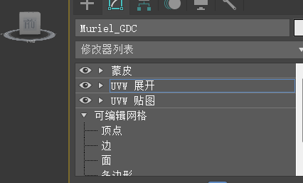

如果选择蒙皮下方的层级时弹出“依赖于拓扑的修改器”警告，在这里只添加映射、编辑 UV 的前提下，可以点击“是”继续。后续操作保持网格顶点和面不变，不进行增删、焊接或重新编号。

### 11.3 设置通道 2，并将 Gizmo 旋转 90°

选中 **UVW 贴图**，在参数面板中设置：

| 参数或层级 | 本次设置 |
| --- | --- |
| 贴图类型 | 平面（Planar） |
| 贴图通道（Map Channel） | `2` |
| 要操作的子对象 | 展开 UVW 贴图后，选中 `Gizmo` |

选择 Gizmo 后，3D 视口中可以看到黄色的投影框。接下来调整的是这个投影框，而不是旋转角色模型本身。[UVW Map 的通道与 Gizmo 说明](https://help.autodesk.com/cloudhelp/2021/ENU/3DSMax-Modifiers/files/GUID-78327298-4741-470C-848D-4C3618B18FCA.htm)

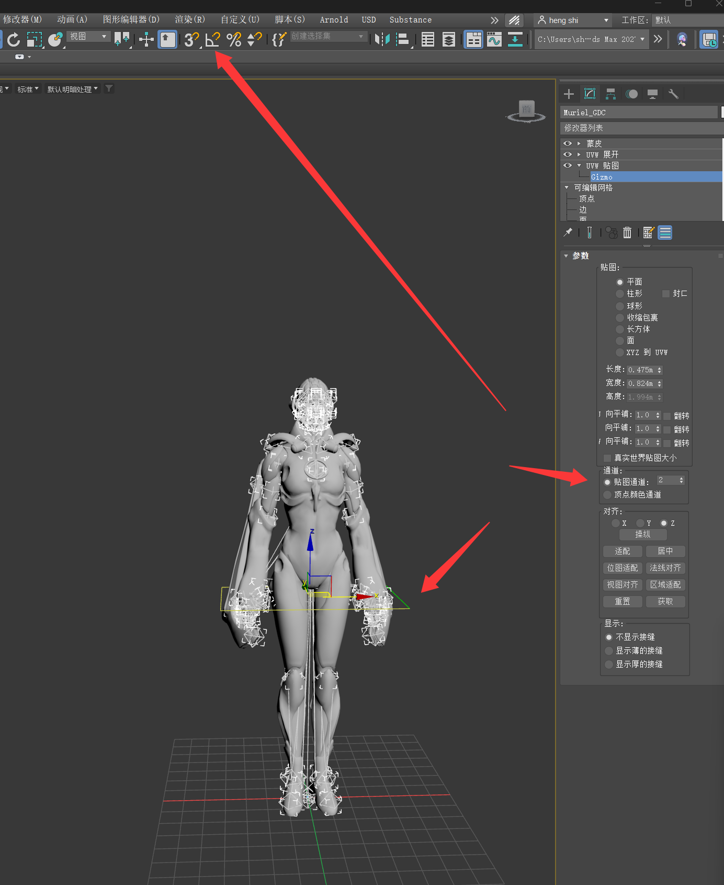

为了精确转动 90°，使用顶部工具栏的 **角度捕捉切换（Angle Snap Toggle）**。这里的作用是按指定角度增量旋转，并不是将旋转完全锁住。

1. 右键点击角度捕捉图标，打开“栅格和捕捉设置”。
2. 在“选项”页，将**角度设为 `90.0°`**。
3. 关闭设置窗口，左键点击同一个图标，使角度捕捉处于启用、高亮状态。
4. 使用旋转工具，在正确的旋转轴上将 Gizmo 转动 90°，使投影平面朝向角色正面，与正视图平面平行。本次初始框近似水平，需要将它转为竖直；旋转轴以当前 Gizmo 朝向为准。

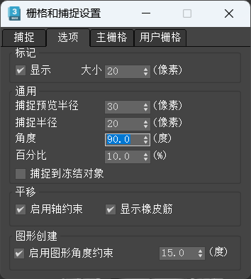

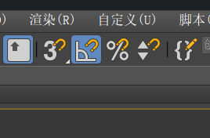

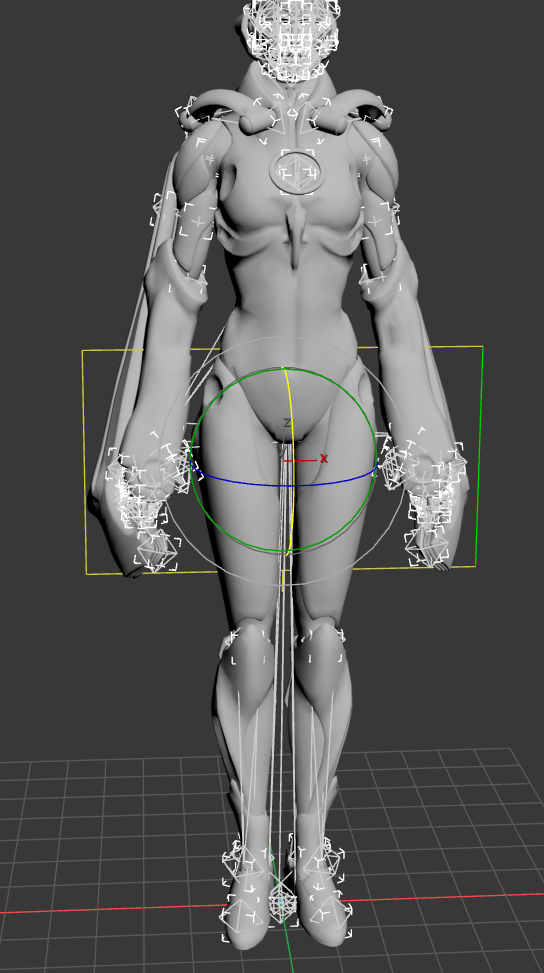

右键用于设置捕捉参数，左键用于开关捕捉；只有设置角度而没有启用图标，并不会约束旋转步长。[角度捕捉设置说明](https://help.autodesk.com/cloudhelp/2024/ENU/3DSMax-Basics/files/GUID-47E8B8FB-6A32-44DA-AFF1-6D959B1E45F9.htm)

### 11.4 在正视图中调整投影范围

切换到**正视图（Front）**，保持 Gizmo 子对象处于选中状态。通过缩放及必要的位置调整，使投影框覆盖角色从头顶到脚底的完整高度，以及两侧需要投影的模型范围。

调整时以角色完整轮廓为准，避免头部、手部或脚部超出框外。投影框确定后，角色各部位会按其在这个平面中的位置映射到 UV 区域。

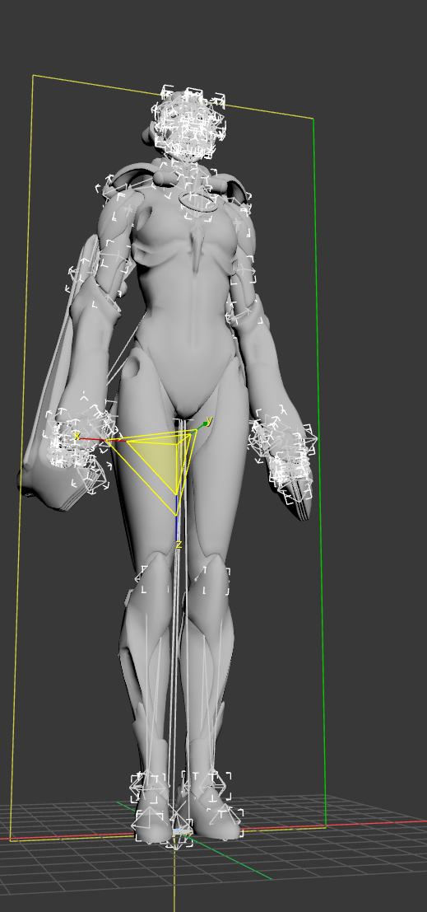

回到上方的 **UVW 展开**，确认该修改器同样使用**贴图通道 2**，再打开 UV 编辑器检查投影结果。如下图，角色主体已经按从头到脚的方向竖直排列，完成本阶段的第二套 UV 基础布局。

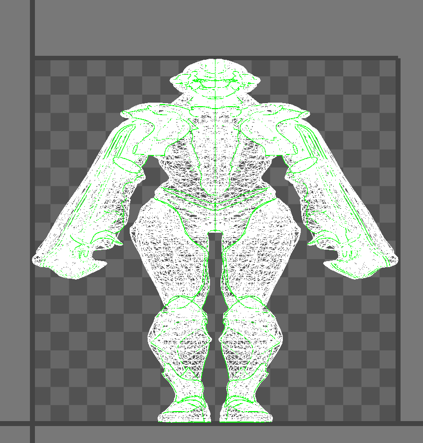

**如果返回后仍然显示旧 UV：** Unwrap UVW 会存储自身接收到的 UV，已经缓存的坐标可能覆盖下方 UVW Map 的新结果，单纯关闭再打开编辑器不一定会刷新。本流程应先完成下方投影，再让通道 2 的 UVW 展开读取它。如果尚未开始手工整理，可以移除并重新添加专用于通道 2 的 UVW 展开；重新选择通道 2 时读取该通道当前坐标，不把旧布局复制过去。已有手工编辑时先保存，避免重建丢失编辑结果。[Unwrap UVW 对已有坐标的处理](https://help.autodesk.com/cloudhelp/2022/ENU/3DSMax-Modifiers/files/GUID-EA10E59F-DE7F-497E-B399-6CF213A02C8D.htm)

这是用于特效的平面投影布局，前后表面可能重叠；本阶段关注角色高度关系与区域标记，不要求按基础颜色贴图的方式打包 UV 岛。

### 11.5 为粒子采样筛选整理特殊区域

后续角色溶解时，需要从角色三角面上采样并释放粒子。对于脸部、睫毛等本次不希望生成粒子的区域，先将对应的第二套 UV 移到主体区域下方，作为后续筛选的区域标记。

选面时可以按下面的方式整理：

1. 在 UVW 展开的**面／多边形子对象层级**进行选择，先框选头部相关区域。
2. 对框选时多选的部分，**按住 Alt 再点击或框选，从当前选择中减去**，只保留目标区域。可以配合 3D 视口与 UV 编辑器，核对高亮面是否对应需要处理的脸部、睫毛等元素。
3. 确认选择后，在 UV 编辑器中将这些面对应的 UV 整体移到主体下方。需要精确平移一格时，可使用第 9.4 节的相对输入方式。

这里只移动 UV 坐标，不移动或删除实际模型面，也不改变第一套 UV。

**区域标记还需要后续采样逻辑配合。** 单纯移动 UV，并不会让三角面自动退出采样；后续粒子逻辑需要读取第二套 UV（UE 中索引为 `1`），依据约定的有效区域过滤采样点或候选三角面。用于筛选的应是原始 UV 坐标，不能先通过 Wrap 重复采样把区外坐标折回 0～1。具体粒子模块与筛选规则留待后续实现。

### 11.6 将不发射粒子的区域下移一格

在 UV 编辑器中结合 3D 视口，继续选中本次不需要发射粒子的部位，例如脸部、睫毛、翅膀等。对于面数较多、但对本次粒子表现贡献较小的区域，也可以按效果需求归入这一组。

选择时核对两个窗口中的红色高亮，确认选中的是目标模型面及其对应 UV，而不是只根据 UV 中重叠的轮廓判断。截图中选中了脸部及两侧翅膀等区域。

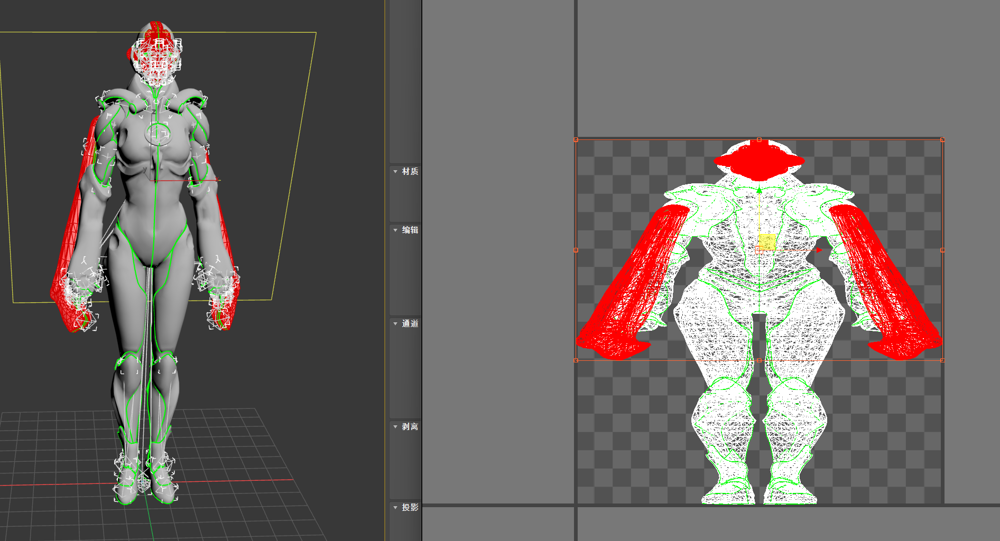

选面时沿用前面排查得到的设置：在 **UVW 展开的面／多边形层级**操作；需要框选后脑等背面时关闭“忽略背面”；需要整块选择或 Alt 取消时，可按几何连接情况使用“按元素选择”，并检查是否影响了相连的其他部位。

选好后，使用第 9.4 节的**相对输入模式**，输入 **V 偏移量 `-1`**，使这一组 UV 在 Max 的 UV 编辑器中整体下移一格：

```text
U新 = U原
V新 = V原 - 1
```

这里平移的是选中面的第二套 UV，模型面的位置、面数和蒙皮保持不变。它也不会减少模型本身的几何开销；后续粒子筛选逻辑读取该区域标记后，才会按规则排除相应的发射位置。

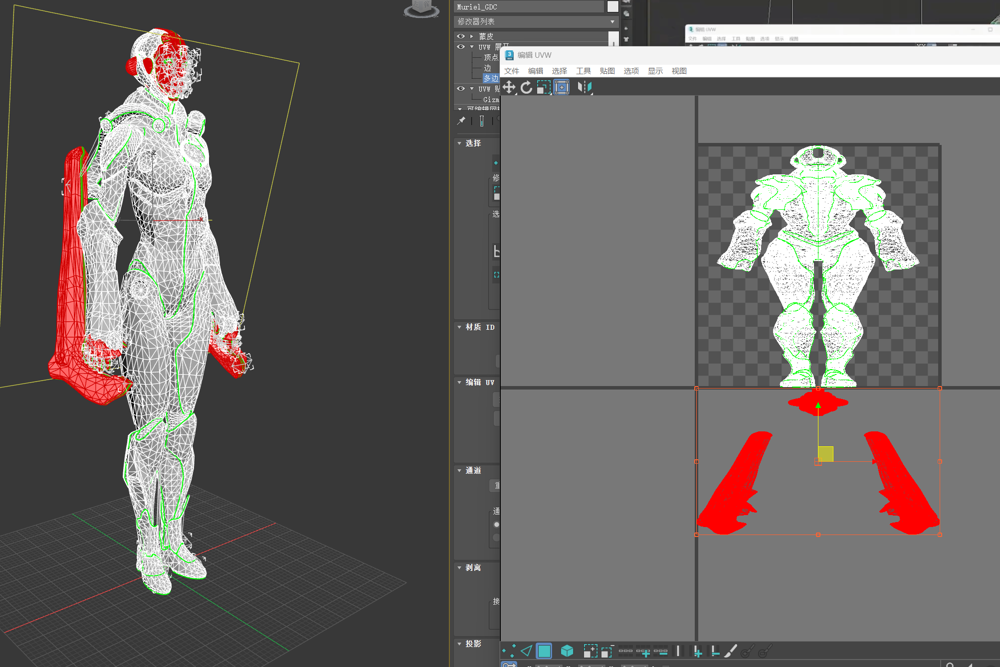

可以继续补选眼部等其他需要排除的细节，按同样方式移到下方。整理完成后，主体保持在上方基础 UV 区域内，排除区域分布在其下方，如下图所示。

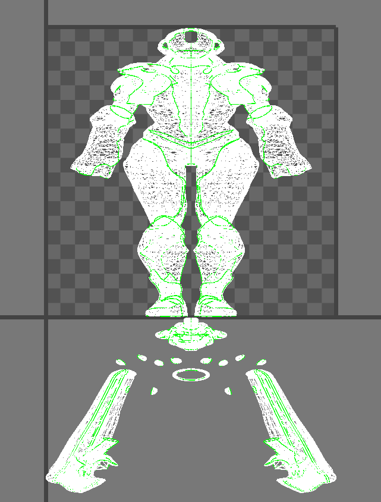

## 12. 固化 UV 编辑结果并导出 FBX

### 12.1 对 UVW 展开执行“塌陷到”，保留蒙皮

确认第二套 UV 排布后，关闭 UV 编辑器，退出子对象选择，回到修改器堆栈。此时堆栈从上到下仍应为：

```text
蒙皮（Skin）
UVW 展开（Unwrap UVW）  ← 选择这一项，右键执行“塌陷到”
UVW 贴图（UVW Map）
可编辑网格
```

右键点击 **UVW 展开**节点，在菜单中选择 **塌陷到（Collapse To）**。该操作会将所选层及其下方的计算结果合并到基础网格中，固化已经完成的 UV 编辑；所选层上方的修改器会保留。因此，本次将 Skin 放在 UVW 展开上方，并以 UVW 展开为塌陷截止位置。[Collapse To 官方说明](https://help.autodesk.com/cloudhelp/2022/ENU/3DSMax-Basics/files/GUID-3B752392-7B10-4D03-B624-51044BF94106.htm)

这里应使用“塌陷到”，并选对 UVW 展开这一层；如果选择 Skin 再塌陷，或使用“全部塌陷”，蒙皮修改器也会被合并。

完成后检查堆栈，应保留下面的结构，截图中的“封套”是 Skin 的子对象层级：

```text
蒙皮（Skin）
可编辑网格
```

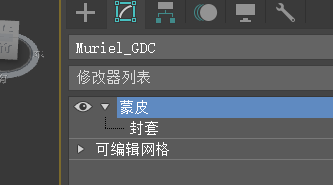

### 12.2 从 Max 导出带蒙皮的 FBX

完成塌陷后，将模型导出为 FBX。导出范围应包含角色网格及其需要的骨骼层级。本阶段是在第二套 UV 整理完成后保留角色的蒙皮和变形数据，不另外制作动画烘焙。

在 FBX 导出窗口中，按本次截图设置：

| 区域 | 选项 | 本次设置 | 作用 |
| --- | --- | --- | --- |
| 几何体（Geometry） | 平滑组（Smoothing Groups） | 勾选 | 将模型平滑组信息写入 FBX |
| 几何体（Geometry） | 仅动画／不导出几何体（Animation Only） | 不勾选 | 本次需要导出角色网格 |
| 动画（Animation） | 动画 | 勾选 | 启用动画相关导出设置，并使用下方变形选项 |
| 烘焙动画（Bake Animation） | 烘焙动画 | 不勾选 | 本次没有需要在此步骤重采样烘焙的动作或控制器 |
| 变形（Deformations） | 变形总开关 | 勾选 | 启用 Skin、Morph 的导出选项 |
| 变形（Deformations） | 蒙皮（Skins） | 勾选 | 导出模型使用的蒙皮变形数据 |
| 变形（Deformations） | 变形（Morphs） | 勾选 | 如模型存在 Morph／变形目标，将其一并导出 |

其余选项保持本次使用的默认配置，然后点击“确定”导出。截图标题中的 `2020.3.9` 是 FBX 插件版本，不能直接将其等同于导出文件的兼容格式版本。

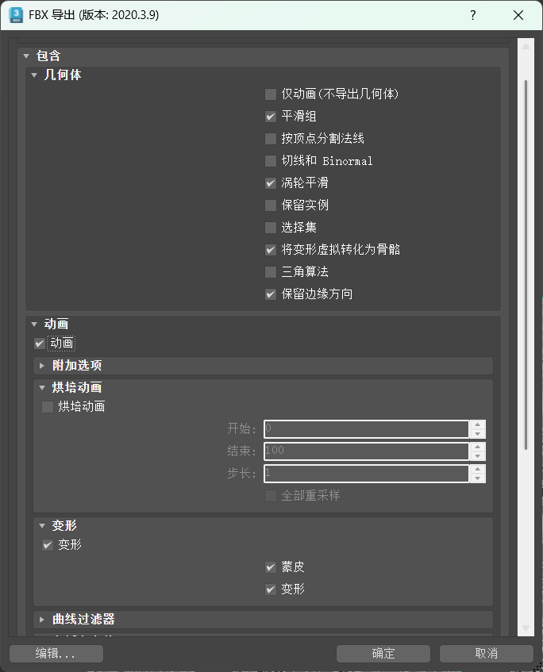

**动画、烘焙动画与变形是不同的设置。** Bake Animation 用于在导出时把相关约束或控制器等结果重采样为动画曲线；本次只整理 UV 并保留变形数据，因此关闭该项。Skin 与 Morph 的导出由 Deformations 下的对应选项控制，不能把“关闭烘焙动画”理解为“不导出蒙皮”。勾选 Morphs 也不会自动创建原模型中不存在的变形目标。[动画、烘焙与变形选项说明](https://help.autodesk.com/cloudhelp/2024/ENU/3DSMax-Interoperability/files/GUID-31EA2A4F-A126-498B-96E8-31811522738A.htm)

平滑组用于保留表面的平滑分组信息，与蒙皮及动画烘焙分别控制。[平滑组导出说明](https://help.autodesk.com/cloudhelp/2024/ENU/3DSMax-Interoperability/files/GUID-249100FE-67BE-43B8-AF12-D20703CDF8D1.htm)

导出后返回 UE 时，重点核对第二套 UV（索引 `1`）中的主体与下方排除区域是否保留，以及角色骨骼、蒙皮是否正常；原有基础贴图仍使用各自的第一套 UV。粒子筛选的具体接线留待后续记录。

## 13. 清理额外父级节点并重新导入 UE

### 13.1 对照 UE 原有的根骨骼层级

将模型从 UE 导出、经过 Max 编辑后再导回 UE，需要保持原有骨骼的名称与父子关系。本次 UE 模型的根骨骼在截图中名为 **`root`**，应保留其名称和大小写。

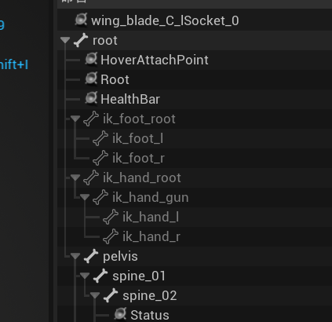

在本次 Max 导入结果中，真正的 `root` 上方还多出了一层名为 **`Muriel_GDC`** 的父节点。下方另一个同名 `Muriel_GDC` 则是角色网格，不能仅凭名称将两者混为一谈。

```text
Muriel_GDC             ← 本次需要清理的额外父级
├─ root                ← 真正的根骨骼，保留
│  └─ 原有骨骼层级
└─ Muriel_GDC          ← 角色网格，保留
```

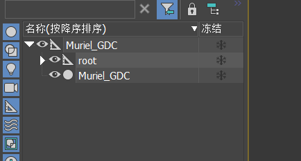

这里将其记录为**本次往返导入后出现的额外父级节点**，不将其一概称为 Max 必定新建的骨骼；场景中的父节点可能是辅助或变换节点，是否进入 UE 骨骼层级还与导出、导入解释有关。如果该节点被导出并作为新的根节点参与骨骼匹配，就可能造成原 Skeleton 的层级不一致。本次按下面的方法清理它，恢复原有的根层级。[UE 骨骼层级与 Skeleton 兼容说明](https://dev.epicgames.com/documentation/en-us/unreal-engine/skeletons-in-unreal-engine)

### 13.2 在 Max 中删除额外父级，再重新导出

在 Max 的场景资源管理器中按层级查看对象，确认顶部额外的 `Muriel_GDC`、真正的 `root` 以及同名角色网格各自的位置。

处理时只删除**最上层额外父级**，保留完整的骨骼链、角色网格与 Skin。需要手动解除链接时，可先对该父级的直接子对象（真正的 `root` 和角色网格）使用 **Unlink Selection（断开选择链接）**，使其脱离额外父级，并核对解除链接后的世界位置、朝向与比例，再删除空的父节点；不要将 root 下方的整条骨骼链全部解除链接。[Max 解除父子链接说明](https://help.autodesk.com/cloudhelp/2025/ENU/3DSMax-Animation/files/GUID-CFB26BBB-358C-4B22-A4FA-6F0E13BDE7C0.htm)

清理后，场景顶层应保留真正的根骨骼和角色网格，结构与下图一致：

```text
root                   ← 保留原有子骨骼
Muriel_GDC             ← 保留角色网格及 Skin
```

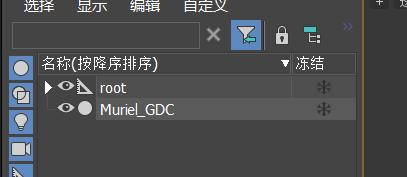

确认骨骼、网格、蒙皮及第二套 UV 均保留后，再按第 12.2 节的配置重新导出 FBX。本次处理针对额外父级导致的骨骼层级匹配问题；它与前面出现的骨骼绑定矩阵／Gimbal Lock 警告需要分别检查，不能只凭删除父节点就认定所有蒙皮问题已解决。

### 13.3 重新导入原骨骼网格体，更新第二套 UV

将整理好的模型导回 UE 时，更新的是**原有骨骼网格体（Skeletal Mesh）资源**：

1. 确认最新导出的 FBX 已写入原资源对应的源文件路径。
2. 在内容浏览器中找到原来的 Muriel 骨骼网格体。
3. 右键该资源，选择 **重新导入（Reimport）**，使用修改后的 FBX 更新模型。
4. 如果最新 FBX 另存到了不同路径，则使用“使用新文件重新导入／Reimport With New File”或更新源文件路径后再重新导入，避免仍然读取旧文件。

本次流程完成后，原骨骼网格体就包含了在 Max 中整理后的第二套 UV：主体按头到脚排列，需要排除粒子发射的区域移到了下方。导入完成后，在骨骼网格体编辑器中查看 **UV 通道 1（第二套 UV）**，确认布局与第 11.6 节一致；材质使用该通道时，对应 `TexCoord` 的 `Coordinate Index = 1`。

同时检查原有第一套 UV、材质槽、骨骼与蒙皮显示，确认本次更新后的资源可以继续用于溶解特效。粒子发射区域的筛选仍需后续逻辑读取第二套 UV 才会生效。

## 14. 重映射溶解参数，让蓝图曲线使用 0～1

### 14.1 溶解值为 0 时仍有碎边的原因

接下来优化溶解参数的端点行为，继续保持对外约定：**`Dissolve = 1` 为未溶解，`Dissolve = 0` 为溶解结束**。

前面的最终遮罩使用 `DissolveMin`，它为亮边保留了宽度为 `W` 的灰度区间。因此，原始参数直接降到 0 时，遮罩的比较阈值仍然是 `1-W`，噪声高值区域中的细碎亮边可能还没有完全消失。

此前可以让角色蓝图中的曲线继续降到负数，以推动这些区域消失，但这样会让蓝图端的“完全溶解值”依赖材质内部的亮边宽度。现在将这部分补偿放到材质中处理，使蓝图继续使用 0～1 的参数范围。

### 14.2 使用 RemapValueRange 调整材质内部的参数

截图使用 `MPC_Nyx` 中的 **Dissolve** 和 **Edge** 参数，将原始 Dissolve 接入 **RemapValueRange**，同时计算 `Dissolve - Edge`，接到目标下限。

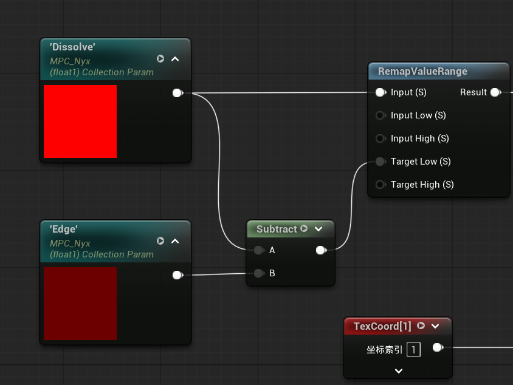

这里继续用 `D` 表示蓝图传入的原始 Dissolve，用 `W` 表示亮边宽度（本图参数名为 `Edge`），新增 `R` 表示重映射结果。按 0～1 的输入设计，连接和范围应确认为：

| RemapValueRange 引脚 | 设置或连接 |
| --- | --- |
| Input | 原始 `Dissolve`，即 `D` |
| Input Low | `0` |
| Input High | `1` |
| Target Low | `Subtract.A = D`、`Subtract.B = W` 的结果，即 `D-W` |
| Target High | `1` |
| Result | `R`，接入后续溶解计算 |

截图没有展开未连接引脚的内部默认值，复现时需要确认 Input Low、Input High、Target High 与表中一致。Target Low 随 `D` 一起变化，因此这套连接的整体响应并不是固定上下限的线性映射。

按上述范围，重映射结果为：

```text
R = (1-D) × (D-W) + D × 1

D = 1 → R = 1
D = 0 → R = -W
```

也就是说，蓝图端的参数仍然降到 **0**，材质内部已经将它转换到 **`-W`**，额外推进了一个边缘宽度。原先需要在曲线里手动输入的负值，现在由材质根据 Edge 自动补偿。

### 14.3 与溶解遮罩和亮边渐变保持一致

如果沿用前面的 OneMinus 与两次 Step，接入重映射后，实际阈值应统一改为：

```text
D = 蓝图传入的原始 Dissolve
R = RemapValueRange 的 Result
T = 1 - R

DissolveMin = Step 节点（X = N，Y = T-W）
DissolveMax = Step 节点（X = N，Y = T）
EdgeMask    = DissolveMin - DissolveMax
G           = T-N = (1-N)-R

Opacity Mask = DissolveMin
```

这里的渐变补偿使用 **`R`**。第 6 节尚未引入重映射时使用 `(1-N)-D`；引入重映射后，改为 `(1-N)-R`，才能与当前裁切阈值保持一致。蓝图和 MPC 仍然保存原始 `D`，材质后续分支使用 `R` 及其对应阈值。

当 `D=0` 时，`R=-W`，因此 `T-W=1`，原先因亮边宽度而提前保留的高值区间被推进到噪声上限。这就是本次清除尾部碎边的原理。由于 Step 在相等时仍输出 1，若噪声中恰好存在值为 1 的像素且仍有残留，可增加少量终点余量，或额外在 `D=0` 时关闭最终遮罩与亮边输出。

重映射后的 `R` 需要能够低于 0；在接入后续计算前将它 Clamp／Saturate 到 0～1，会截掉这部分补偿。

### 14.4 将角色蓝图的曲线终点改回 0

回到角色蓝图的 **Timeline_DodgeEffect**，调整其中的 Dissolve 浮点曲线：溶解阶段从 **1 降到 0**，在 0 保持一段时间，再从 **0 回到 1**，完成角色显现。具体时长按技能节奏设置。

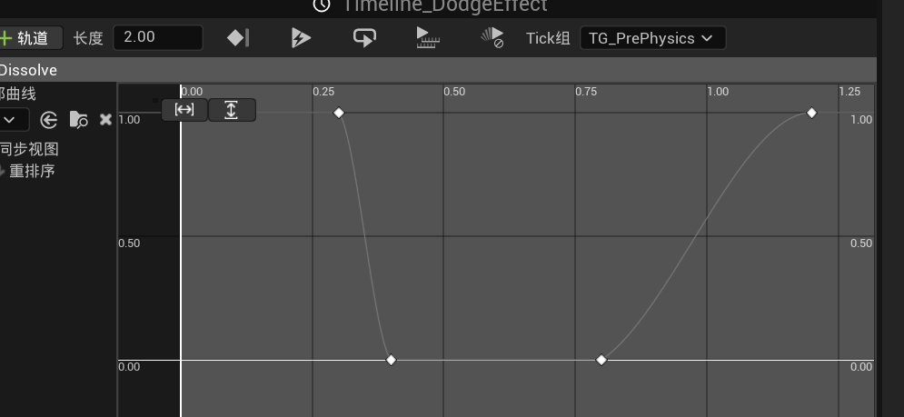

现在无需为了清除剩余亮边，把曲线最低点设为负数。蓝图只负责控制“未溶解 → 完全溶解 → 显现”的进度，边缘宽度对应的数值补偿由材质内部完成。调整后分别检查 `D=1` 的完整显示、`D=0` 的完全消失，以及中间阶段的亮边渐变是否正常。
