# Houdini Pyro：从发射源到体积模拟

本篇从圆环发射源入手，整理 `Torus → Pyro Source → Volume Rasterize Attributes` 的搭建过程，理解撒点、点属性和体积之间的关系。随后补充一个基础烟雾模拟，以及适合初学阶段的参数实验、排错和缓存思路。

**当前学习记录从热烟雾发射源出发，覆盖体积转换、源属性噪声、Fields 场管理、Shape 塑形，以及 Look 与 Pyro Bake Volume 的外观调整。** 同时记录火焰与速度源接入、参数引用和缓存等工程思路。不同 Houdini 版本的布局和预设可能不同，以节点完整名称和参数含义为准，不把截图数值当成所有版本的默认值。

## 1. 先认识 Pyro 的数据流程

Pyro 常用于烟、火、爆炸等气体效果。本例采用点属性准备发射源，再转换为体积交给求解器的流程：[Pyro 入门官方说明](https://www.sidefx.com/docs/houdini/pyro/intro.html)。

```text
Torus                         定义发射器形状
  ↓
Pyro Source                   准备发射点及其属性
  ↓
Volume Rasterize Attributes    将点属性采样为 VDB 体积
  ↓
Pyro Solver                   逐步计算烟雾运动
  ↓
File Cache                    保存结果
```

可以把前三步理解为“准备往空间中注入什么”，求解器负责“注入后怎样随时间变化”。更换圆环为角色表面、碎片或粒子轨迹时，这个分工仍然有用。

### 1.1 OBJ、SOP 和 DOP 是什么

| 层级／上下文 | 初学时的理解 | 本次用途 |
| --- | --- | --- |
| OBJ（对象层级） | 管理场景中的对象及其变换 | 创建 Geometry 对象 |
| SOP（几何节点上下文） | 在对象内部处理几何、点、属性和体积 | 搭建本文的节点链 |
| DOP（动力学上下文） | 组织随时间演化的模拟 | SOP 级 Pyro Solver 封装了内部动力学网络，初学时可先使用外层参数 |

这里的点用于准备发射源，**不表示烟雾最终由这些粒子逐个模拟**。Pyro 的状态保存在体积场中，速度场带动密度、温度等量运动。[Pyro 工作原理](https://www.sidefx.com/docs/houdini/pyro/background.html)

## 2. 创建 Geometry 与圆环发射源

1. 打开 Houdini，在 `/obj` 层级按 `Tab`，搜索并创建 **Geometry**，例如命名为 `geo_pyro`。
2. 选中 Geometry，按回车或双击进入，路径变为 `/obj/geo_pyro`。
3. 在内部按 `Tab` 搜索 **Torus**，创建圆环。
4. 再搜索 **Pyro Source**，连接 `torus1 → pyrosource1`。
5. 将显示旗标切到 `pyrosource1`，观察其输出。

这里“添加一个 Pyro 节点”具体指 **Pyro Source**，不是后续负责模拟的 **Pyro Solver**。截图菜单中的火焰图标节点也是 Pyro Source。

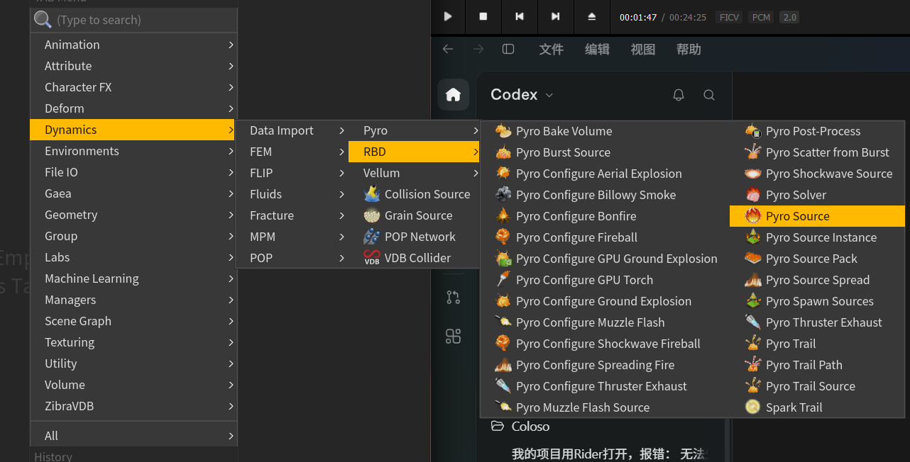

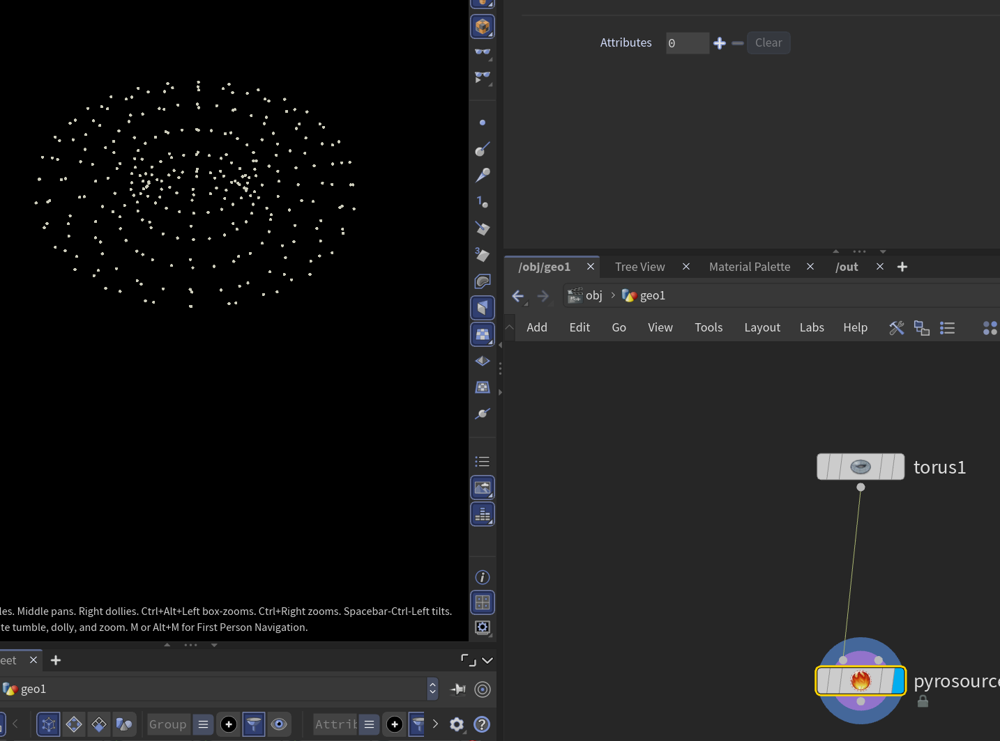

**先保持 Geometry 对象本身的变换简单，在 SOP 内确定圆环大小。** 后续检查点间距、点半径和体素尺寸时，都应基于同一空间尺度。对于其他对象中的模型，可以使用 Object Merge 导入，并确认变换方式。

圆环只是发射器形状。后续模拟生成的烟雾会离开发射区域，因此圆环尺寸不等于最终烟雾范围；作为发射器的模型也不会自动成为碰撞体。

## 3. Pyro Source：选择点从哪里来

右侧参数面板的 **Mode** 决定点的来源。截图显示三种选项：

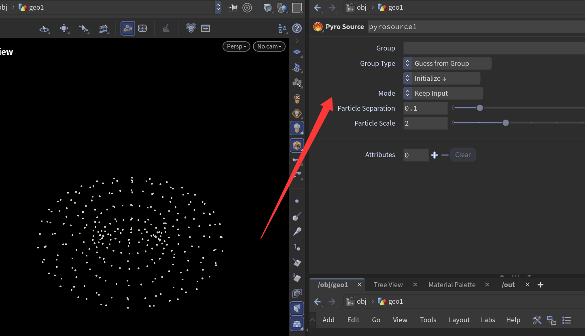

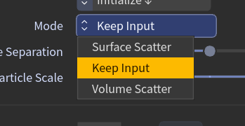

| Mode | 行为 | 选择思路 |
| --- | --- | --- |
| `Keep Input` | 沿用输入已有的点 | 已有点云、模型顶点或上游已经准备好采样点时使用 |
| `Surface Scatter` | 在输入表面重新撒点 | 适合学习从模型表面发射的流程 |
| `Volume Scatter` | 在输入封闭形状的内部撒点 | 希望整个内部空间都成为发射区域时使用 |

`Keep Input` 不等于自动均匀撒点。若输入直接来自模型，其点分布会受到模型拓扑影响。`Volume Scatter` 则需要能够判断内部的几何；模型有洞或表面异常时，应先检查几何。[Pyro Source 官方说明](https://www.sidefx.com/docs/houdini/nodes/sop/pyrosource.html)

本例可切为 **Surface Scatter**。它是当前练习的选择，不是所有 Pyro 效果都必须使用的模式。比如从实心区域填充烟雾，Volume Scatter 可能更直观。

## 4. Particle Separation：点间距及其连带影响

### 4.1 数值越大，撒点越稀

**Particle Separation** 可理解为撒点的目标间距尺度。在表面／内部撒点模式中，数值增大，点通常更少；数值减小，点通常更多。

截图中从 `0.1` 调到 `0.295`，点分布明显变稀：

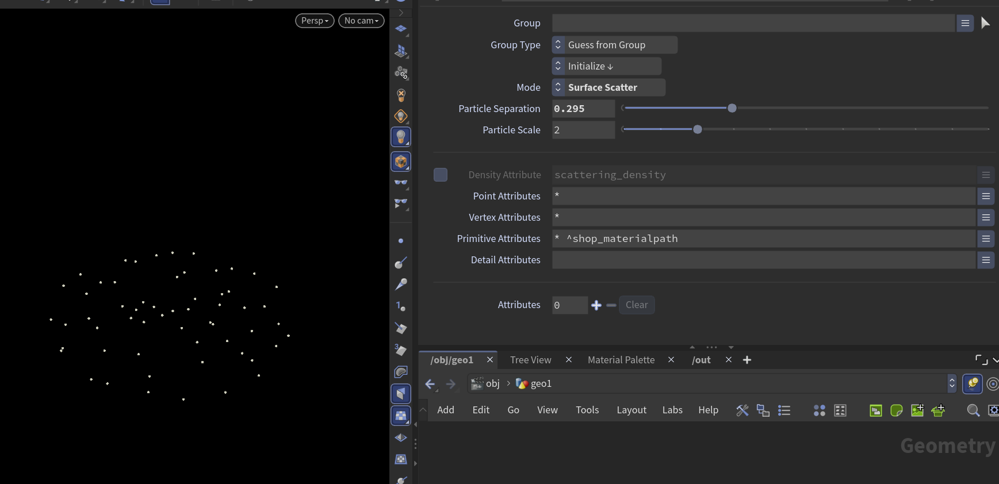

对固定形状作粗略估算：表面均匀采样时，间距减半，点数约变为 4 倍；内部均匀采样时约为 8 倍。这是基于面积／体积的量级估算，实际结果还会受到几何、分布和采样算法影响。

**这里控制的是采样点的疏密，不能直接等同于烟雾 `density` 的值。** 在 Keep Input 模式中，已有点数不会被这个参数重新分配，它主要参与下述点尺寸计算。[Particle Separation 的模式差异](https://www.sidefx.com/docs/houdini/nodes/sop/pyrosource.html)

### 4.2 为什么增大间距后，转换的体积可能变厚

Pyro Source 在输入没有既有 `pscale` 时，按以下关系设置点尺寸：

```text
pscale = Particle Separation × Particle Scale
```

例如，保持 Particle Scale 为 `2`：

| Particle Separation | 得到的 pscale |
| ---: | ---: |
| 0.1 | 0.2 |
| 0.295 | 0.59 |

因此，增大间距同时带来“点更少”和“每个点的覆盖范围更大”。后续转体积时，可能看到边缘变厚、局部形状变粗。**这不是最终流体体积必然增大的规律**，实际还取决于覆盖重叠、过滤和体素大小。[pscale 的生成规则](https://www.sidefx.com/docs/houdini/nodes/sop/pyrosource.html)

若上游已有 `pscale`，Pyro Source 会保留它。此时调整这两个参数却发现点半径没变化，应先检查 Geometry Spreadsheet 中已有的属性。

### 4.3 恢复默认参数

按住 `Ctrl`，用鼠标中键单击参数标签，可以恢复该参数默认值；也可以右键参数标签，选择 **Revert to Defaults**。这是“单击恢复”，普通中键拖动数值常用于打开数值阶梯。[参数编辑器官方说明](https://www.sidefx.com/docs/houdini/network/parms.html)

## 5. Particle Scale：影响转体积时的覆盖范围

**Particle Scale** 通过 `pscale` 控制源点的尺寸。普通视口中的小点标记不一定随它变化，因此只看点显示，很难判断真实覆盖范围；可查看 `pscale` 数值，并在转体积后比较轮廓。

如果将每个点想象为往体素网格上写入数值的一团软球，`pscale` 影响这团软球的作用范围。它不是模拟粒子的碰撞半径，也不是烟雾浓度。

下游 **Volume Rasterize Attributes** 也有一个同名 **Particle Scale**，会继续缩放输入 `pscale`。调试时可先保持下游这个乘数为 `1`，集中观察上游变化，避免两处同时调整。[栅格化节点的尺寸参数](https://www.sidefx.com/docs/houdini/nodes/sop/volumerasterizeattributes.html)

点的作用范围过小，转体积后容易出现分离的小团或孔洞；范围过大，轮廓会膨胀、相邻结构容易粘连。这里的判断对象是**源体积质量**，还未涉及求解器运动。

## 6. 添加两个点属性：density 与 temperature

前面未初始化时，Pyro Source 的 **Attributes 为 0**。接下来通过烟雾预设创建 `density` 与 `temperature`：前者描述可见烟雾的密度，后者描述热量。可以先理解为“density 提供烟，temperature 参与驱动浮力”；上升速度还受到浮力强度、冷却和速度场等因素影响，温度并不直接等于上升速度。temperature 通常使用归一化量级，不直接填写摄氏温度。[模拟场与浮力的含义](https://www.sidefx.com/docs/houdini/pyro/background.html)

### 6.1 在 Pyro Source 中操作

先选中带火焰图标的 **pyrosource1**，确认参数面板标题是 **Pyro Source**。可以通过 **Initialize → Source Smoke**（部分教程称 Smoke）快捷配置，然后确认下方已有 Density 与 Temperature 两项。教程截图展示的就是这个节点的属性创建列表：

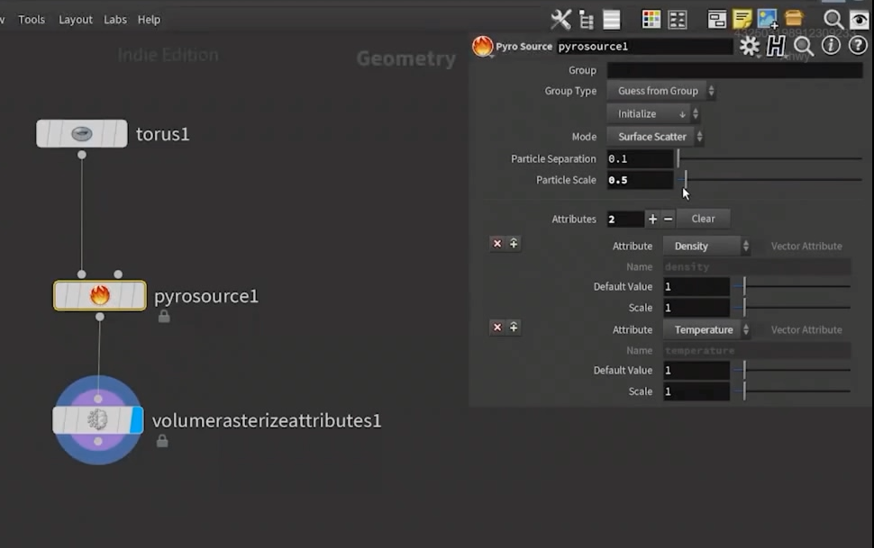

当前版本应用烟雾预设后的截图如下：Attributes 为 `2`，两项分别为 Density、Temperature，Default Value 与 Scale 均为 `1`。预设用于一次配置这组参数；后续仍可以逐项调整。

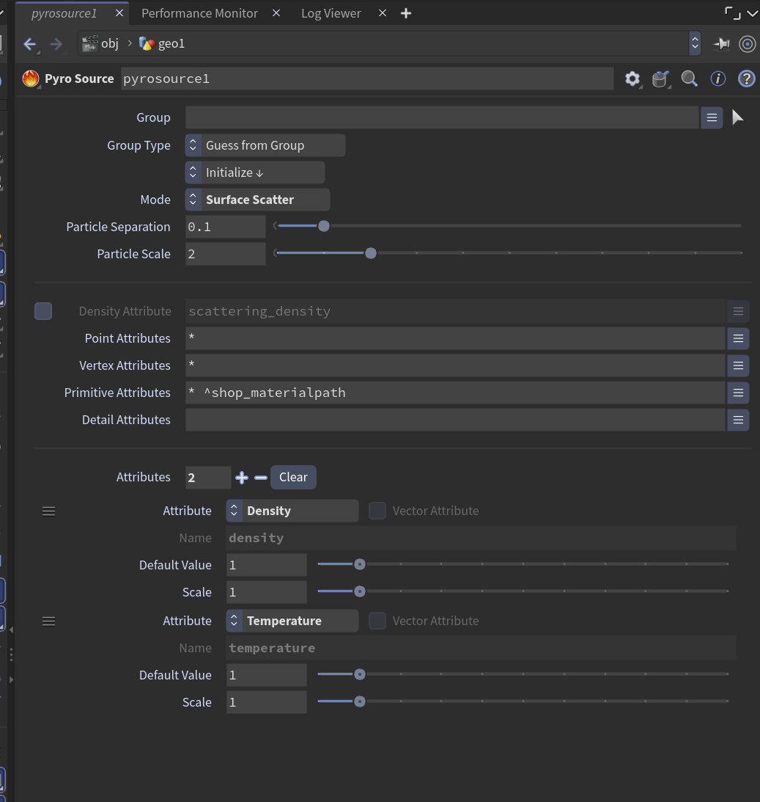

若手动配置，操作如下：

1. 找到 **Attributes 数量框**，点击 `+` 补足两项，或将数量设置为 `2`。
2. 第一项的 Attribute 选择 **Density**，对应名称 `density`。
3. 第二项选择 **Temperature**，对应名称 `temperature`。
4. 若版本界面需要使用 Custom Attribute，手动填写上述名称，并保持为标量浮点属性。
5. 为本次热烟雾实验，将两项的 **Default Value** 暂设为 `1`，**Scale** 暂设为 `1`。

```text
点属性：
density     = 1.0
temperature = 1.0
```

这些值是便于观察的练习起点，不是通用成品参数。可以使用 Initialize 菜单的 **Source Smoke** 预设作为起点，但要先应用预设，再检查模式和属性，避免预设覆盖手工设置。

Default Value 用于初始化新建属性；输入已经具有同名属性时，不会靠修改 Default Value 将已有值全部重写。Scale 则缩放输出值。[属性初始化与缩放规则](https://www.sidefx.com/docs/houdini/nodes/sop/pyrosource.html)

### 6.2 用 Geometry Spreadsheet 验证

选中 Pyro Source，打开 **Geometry Spreadsheet** 并查看 Points。应能找到 `P`、`pscale`、`density` 和 `temperature`。当前例子中后两项应有非零值。

属性名区分大小写，后续节点要按名称读取。仅仅在参数列表里添加了项目，还应确认它确实出现在输出数据上。

此时点云不会自动变成烟雾：这些数字只是附在点上的发射信息。把它们转换为空间中的连续体积，是下一步的工作。

## 7. Volume Rasterize Attributes：点属性转为 VDB

在 Pyro Source 下方添加 **Volume Rasterize Attributes** 并连接：

```text
torus1 → pyrosource1 → volumerasterizeattributes1
```

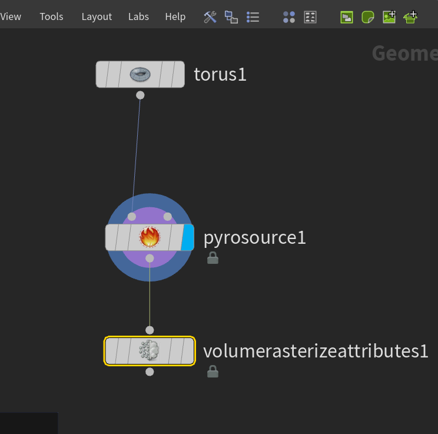

### 7.1 明确填写要转换的属性

在栅格化节点的 **Attributes** 中输入空格分隔的名称：

```text
density temperature
```

也可以点击输入框右侧的属性菜单，依次选择 `density`、`temperature`，最后检查输入框同时包含这两个名称。截图菜单还列出了 `P`、`pscale`，它们是可选的输入属性，不代表本例都要生成同名体积。

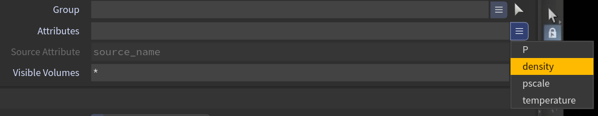

这里的选择是按名称指定要转换的属性，可理解为“选取上游数据”；它不是参数表达式引用，也不会替上游创建缺失属性。

这个节点把指定的浮点／向量点属性采样为对应名称的 VDB。它不会因为输入是 Pyro Source，就自动补出当前缺失的烟雾属性。[Volume Rasterize Attributes 官方说明](https://www.sidefx.com/docs/houdini/nodes/sop/volumerasterizeattributes.html)

将显示旗标切到这个节点，检查节点信息或 Geometry Spreadsheet 的 Primitives 页，应找到名称为 `density`、`temperature` 的 VDB。前面是“点上有属性”，现在是“空间网格中有场”。

**两个节点都有 Attributes，但用途不同。** 操作时先看参数面板标题：

| 所在节点 | Attributes 的界面 | 含义 |
| --- | --- | --- |
| Pyro Source | 数量框及 `+ / −`，下方是逐项属性设置 | 在点上创建／配置属性；本例设置为 2 项 |
| Volume Rasterize Attributes | 可以输入 `density temperature` 的文本框 | 选择输入中已有的属性，将它们转换成体积 |

在第二个节点中输入名字，不会回到上游创建缺失的点属性。若输出确实缺少 temperature，应回到 Pyro Source 查看 Points 页是否存在同名浮点属性。[点属性创建](https://www.sidefx.com/docs/houdini/nodes/sop/pyrosource.html)、[选择待栅格化属性](https://www.sidefx.com/docs/houdini/nodes/sop/volumerasterizeattributes.html)

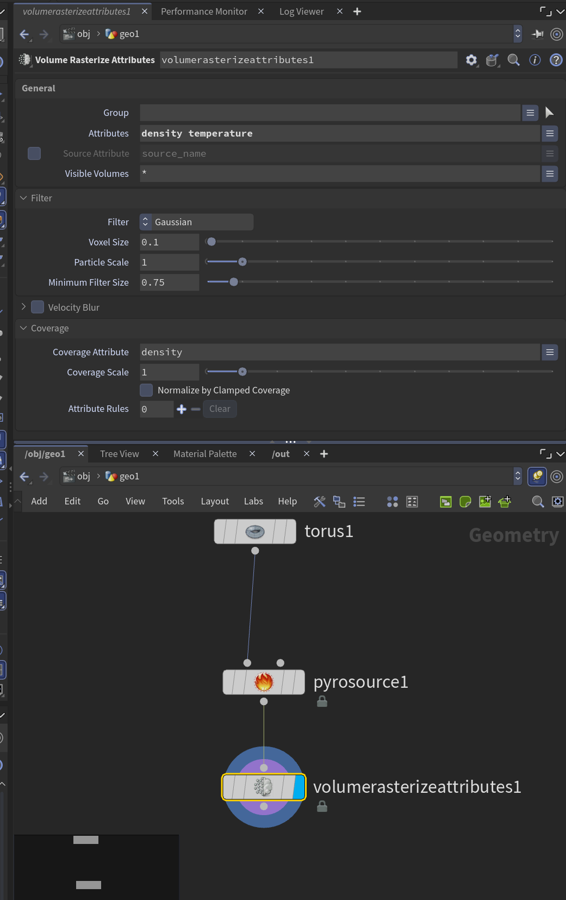

**截图下方 Coverage → Coverage Attribute 中的 `density`，不是输出属性列表。** 该参数指定哪个点属性提供各点的覆盖权重；截图使用 density。它只有一个属性名输入框，不会因为上方填写了两个属性，就在下方列出两项。保持这里为 density 即可，不要为了显示 temperature 将它改成 `density temperature`。[Coverage Attribute 官方说明](https://www.sidefx.com/docs/houdini/nodes/sop/volumerasterizeattributes.html)

确认是否成功的检查顺序：

1. 选中 **pyrosource1**，查看 Geometry Spreadsheet 的 **Points**，确认同时有 density、temperature 两列。
2. 选中 **volumerasterizeattributes1**，确认顶部 Attributes 为 `density temperature`，然后查看 **Primitives** 的 name 列或节点信息，确认有同名的两个 VDB。
3. 如果两个 VDB 都有，只是在视口里看起来只有一团烟，不能据此判断少了温度场：二者可占据相同空间。若要单独查看温度体积，可暂将 Visible Volumes 设为 `temperature`；这仍是雾状显示，不自动等于温度伪彩色。

若没有画面，先确认确实生成了非零的 `density`，再检查 **Visible Volumes** 是否包含 `density`。该参数控制哪些体积在视口中作为雾显示；不可见不一定代表数据没有生成。[Visible Volumes 参数说明](https://www.sidefx.com/docs/houdini/nodes/sop/volumerasterizeattributes.html)

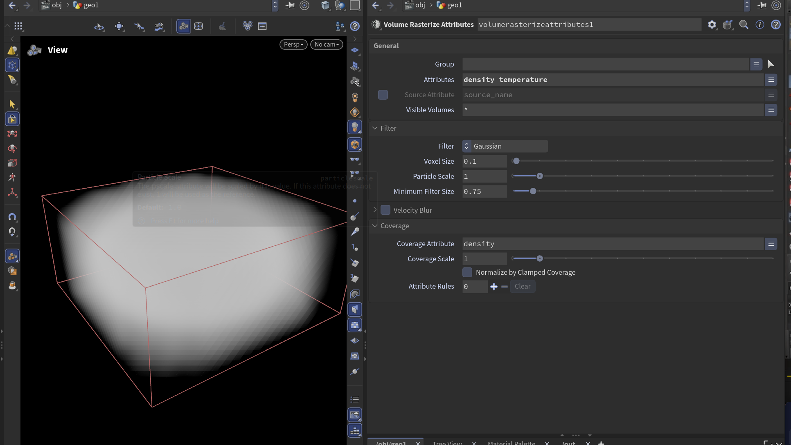

**这时看到的是栅格化后的源体积预览。** 当前节点链尚未接入 Pyro Solver，所以还没有上升、翻卷等随时间演化的流体运动。截图中的红色线框用于显示体积范围，不表示已经建好了模拟容器。

### 7.2 对照两个 Particle Scale

保持显示旗标在 Rasterize 上，再选中上游 Pyro Source 调节参数，就可以一边修改点属性，一边查看最终源体积。若参数面板或显示被固定，先确认当前选中的节点与显示旗标分别在哪里。

截图把 **Pyro Source → Particle Scale** 从前面的 `2` 缩小到 `0.22`，Particle Separation 保持 `0.1`；没有既有 pscale 时，点尺寸从 `0.2` 变为 `0.022`。这个操作改变覆盖半径，不直接减少点数。

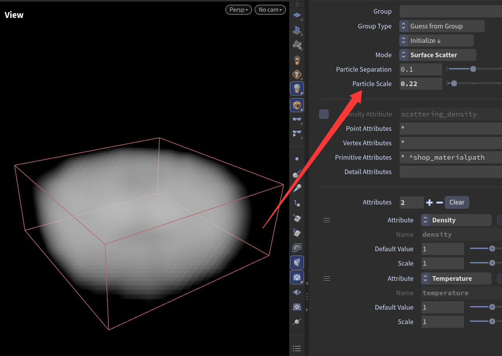

**Rasterize → Particle Scale** 则是对输入 pscale 的整体乘数。本例先保持为 `1`，便于将尺寸控制集中在上游；需要统一扩大或缩小源点覆盖时，也可以有意使用它，并非不能调整。

```text
Pyro Source：生成／保留点的 pscale
Rasterize：  用输入 pscale × 本节点 Particle Scale 参与栅格化
```

实际可见边缘还受 Filter、Minimum Filter Size 和 Voxel Size 影响，所以点很小时，继续缩小 pscale 也未必让可见体积按相同比例缩小。[点尺寸与最小过滤范围](https://www.sidefx.com/docs/houdini/nodes/sop/volumerasterizeparticles.html)

### 7.3 Voxel Size：体素尺寸

体素可理解为三维像素。**Voxel Size 越小，采样越细；越大，越容易丢失窄缝和小结构。** 它控制的是网格分辨率，不会给源点凭空增加新的属性变化。

作为练习起点：如果圆环整体宽度为几个 Houdini 单位，可以先试 `0.1`，再比较 `0.05`。如果模型本身只有 `0.01` 单位宽，这组数值就不适用，应先看模型尺度。

低分辨率栅格化还可能让点看起来变胖，因为过滤需要让小点对网格产生稳定贡献。因此，体积轮廓变厚不一定只来自 Particle Scale。[点栅格化与过滤的说明](https://www.sidefx.com/docs/houdini/nodes/sop/volumerasterizeparticles.html)

制作时可以先使用较大的体素快速调形状，再为最终输出提高精度。**这里的 Voxel Size 是源体积生成参数，并非只在最终渲染时生效。** 修改后会重新生成源体积；若它用于动态模拟，应让求解器读取新源并重新计算受影响的模拟，已有磁盘缓存也不会自动更新。

把源体素调得极细，而求解器仍使用很粗的网格，细节也可能无法保留。渲染器的体积采样精度是另一层设置，不能代替源体积和模拟本身的空间分辨率。

### 7.4 三组参数分别解决什么问题

| 参数 | 主要控制 | 不应混淆为 |
| --- | --- | --- |
| Pyro Source：Particle Separation | 源点间距，并参与生成 pscale | 烟雾浓度 |
| Pyro Source：Particle Scale／点 pscale | 每个点的空间覆盖范围 | 求解器分辨率 |
| Rasterize：Voxel Size | 源体积网格的采样精度 | 点的数量 |
| 点属性 density | 写入源体积的密度信息 | 点间距 |
| Pyro Solver：Voxel Size | 动态模拟网格的精度 | 上游撒点精度 |

这些设置需要配合：只增加点数但使用很粗的体素，小细节仍然无法表达；只减小体素但源点覆盖不连续，也不会自动得到均匀的源。

### 7.5 Coverage：点在空间中的贡献权重

展开 Rasterize 下方的 **Coverage**。本例 **Coverage Attribute** 为 `density`，**Coverage Scale** 为 `1`。前者指定贡献权重来自哪个点属性，后者是该权重的乘数；若指定属性不存在，节点按每点覆盖权重为 `1` 处理。[Coverage 参数说明](https://www.sidefx.com/docs/houdini/nodes/sop/volumerasterizeattributes.html)

可以用两个问题帮助理解：pscale 主要回答“这个点影响多大的空间”，Coverage 回答“这个点在覆盖处贡献多少权重”。因此，不要把 Coverage Scale 当作半径缩放，也不要把这里的 density 当成整个输出属性列表。

### 7.6 Normalize by Clamped Coverage：让覆盖边缘柔和衰减

截图勾选的完整名称为 **Normalize by Clamped Coverage**。在没有额外 Attribute Rules 覆盖默认行为时，它将普通属性的写入方式从 **Weighted Average（加权平均）** 改为 **Covered Average（带覆盖衰减的平均）**，使覆盖不足的边缘逐渐衰减。[Normalize 与写入方式的官方说明](https://www.sidefx.com/docs/houdini/nodes/sop/volumerasterizeattributes.html)

例如源点的 temperature 都为 `1`：未勾选时，只要有点参与取样，加权平均仍可能接近 `1`，在覆盖边缘突然降为零；勾选后，覆盖不足的地方会衰减，边缘看起来更柔和。这是在原有网格上改变写入值的过渡，**不增加体素数量，也不等于逐个体素做空间模糊**。

下面先记录本次较密集源的视口对照，保留截图中的显示设置：

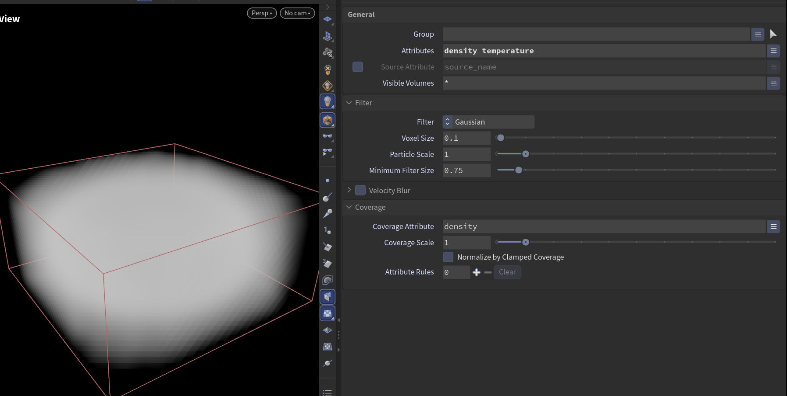

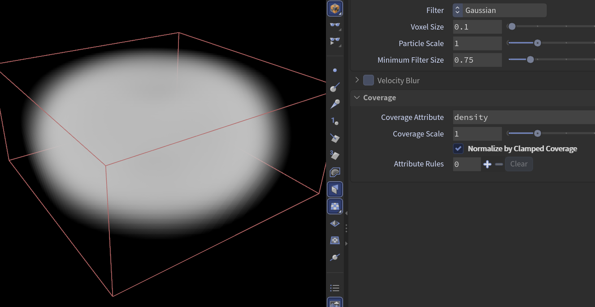

**这里还有一个需要单独检查的细节：被指定为 Coverage Attribute 的属性始终采用 Accumulated（累加）写入。** 当前指定的是 density，因此不应把上述变化直接解释为“Normalize 对 density 做了模糊”；默认平均方式的切换适用于 temperature 等其他输出属性。[覆盖属性的累加规则](https://www.sidefx.com/docs/houdini/nodes/sop/volumerasterizeparticles.html)

截图的 **Visible Volumes 为 `*`**，会允许多个体积作为雾显示。因此，依据截图与上述规则推断，temperature 的显示变化可能参与了这组视觉差异；仅凭画面无法确定每个场的数值变化。验证时分别将 Visible Volumes 设为 `density`、`temperature`，再切换 Normalize，对比单个体积。

### 7.7 减少源点，放大观察 Normalize 的区别

为了更容易看到各点生成的体积团，可以回到 Pyro Source，将 **Particle Separation 增大**，使源点数量减少。截图使用 `Separation=0.975`、`Particle Scale=0.05`，以便观察分离的体积团；这是对照设置，不是连续烟雾的推荐配置。

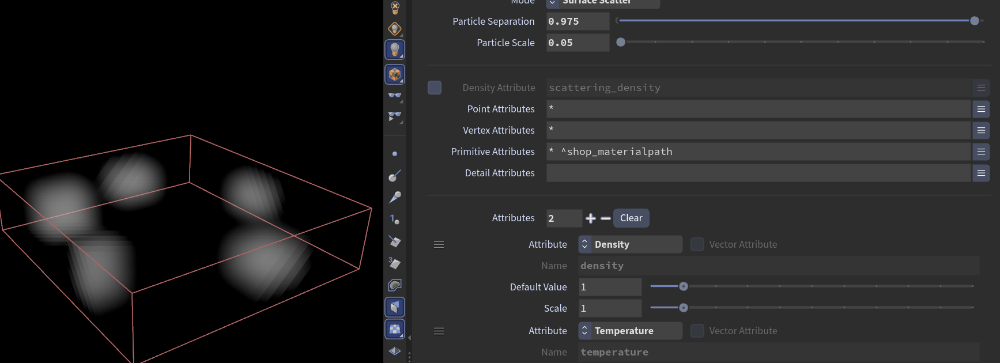

这里同时改变了两个参数，既改变点数，也改变 pscale。若只想研究点数的影响，可以参考第 16 节的等 pscale 实验，补偿 Particle Scale，避免同时改变覆盖半径。

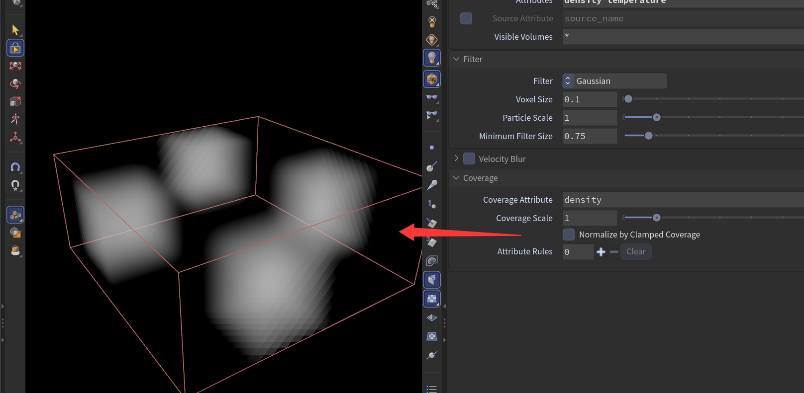

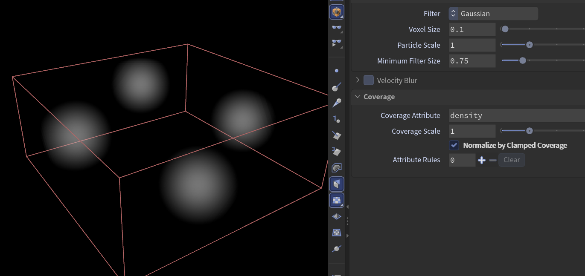

这组截图中，Rasterize 的 **Voxel Size 仍为 `0.1`**，Particle Scale 为 `1`，Minimum Filter Size 为 `0.75`。所以画面变柔和并不是网格变细，也不能把所有块状或层状显示都直接认定为单个体素的边界。

建议按以下顺序复现，区分三个参数各自的贡献：

1. 固定源点、视角、帧号和 Voxel Size，先单独显示 temperature，切换 Normalize；再单独显示 density 重复比较。
2. 固定 Normalize，仅改变 Voxel Size，观察网格分辨率对轮廓的影响。
3. 固定前两者，再调整 Minimum Filter Size，观察小点的最小过滤范围。它帮助小点在网格间移动时平稳过渡，也可能让边界变软、体积显得更厚。[Minimum Filter Size 官方说明](https://www.sidefx.com/docs/houdini/nodes/sop/volumerasterizeparticles.html)

实验结束后，将点间距和覆盖范围恢复到能形成连续源的配置，再进入动态模拟。Normalize 不能补齐实际缺失的发射点，也不能替代合理的采样密度。

## 8. Pyro Solver：解算烟雾、调整浮力与统一分辨率

到上一节为止，得到的是源体积。静态圆环接静态属性，即使拖动时间轴，源体积也不会自行上升。需要连接求解器，才开始模拟。

### 8.1 连接 SOP 级 Pyro Solver

1. 在同一 SOP 网络中创建 **Pyro Solver**。
2. 将栅格化输出接入其**第一输入（Volumes for Sourcing）**。
3. 将显示旗标切到 `pyrosolver1`，确认 **Start Frame 为 `1`**。
4. 检查 **Sourcing**；如果当前配置不能正确接收烟雾源，可以使用 **Quick Setups → Initialize Smoke** 初始化烟雾，必要时使用 **Initialize Sources** 生成映射，再逐项核对。预设应在后续手工调参之前应用。

本例要让 `density` 源写入 `density` 场、`temperature` 源写入 `temperature` 场。注意源体积名称与模拟目标场是两个独立设置。[Pyro Solver 输入和 Quick Setups](https://www.sidefx.com/docs/houdini/nodes/sop/pyrosolver.html)

```text
Torus → Pyro Source → Volume Rasterize Attributes → Pyro Solver
          点属性          命名源体积                 模拟结果
```

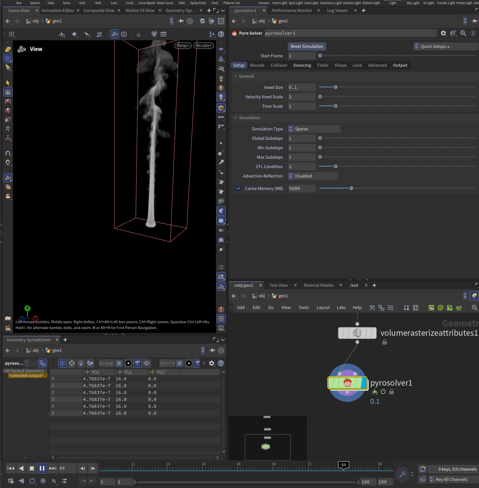

现在视口显示的是求解结果。圆环负责提供源，求解器将注入的密度和温度随流场输运，产生上升和翻卷。初始帧烟雾很少、甚至尚无明显形状时，先从起始帧顺序播放几帧再观察。

### 8.2 将测试范围缩短到 1～100 帧

初学调参时，可以先把原来的 `1～240` 帧缩短为 **`1～100` 帧**。截图箭头指向时间轴下方的结束帧输入框：

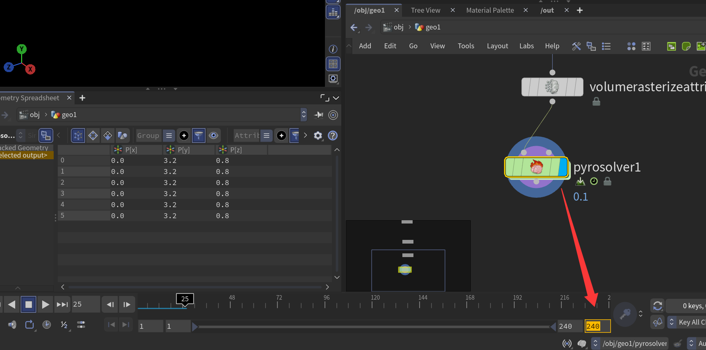

Houdini 有**全局帧范围**和**当前播放范围**：时间轴范围滑条外侧的输入框控制全局起止，紧贴滑条内侧的输入框控制播放起止。本次可以让两者都为 `1～100`，并确认求解器的 Start Frame 仍为 `1`。也可以通过 **Global Animation Options** 设置全局范围，再检查播放范围。[时间轴与两种帧范围](https://www.sidefx.com/docs/houdini/anim/playbar.html)

缩短范围可以减少一轮预览需要推进的总帧数，也减少误跳到很远帧时的等待；**它不会直接降低同一帧的体素数量或计算难度**。如果前几十帧已经很慢，还应检查分辨率、活跃区域和子步，而不是只缩短结束帧。

`100` 是测试长度，不是帧率；改变结束帧不会改变模拟的 FPS。缓存节点若单独指定了帧范围，也需要另外检查。

### 8.3 Shape → Buoyancy：将浮力强度改为 0.2

切到求解器的 **Shape** 页，保持 **Buoyancy** 启用，将截图中的强度从 `1` 调到 **`0.2`**。

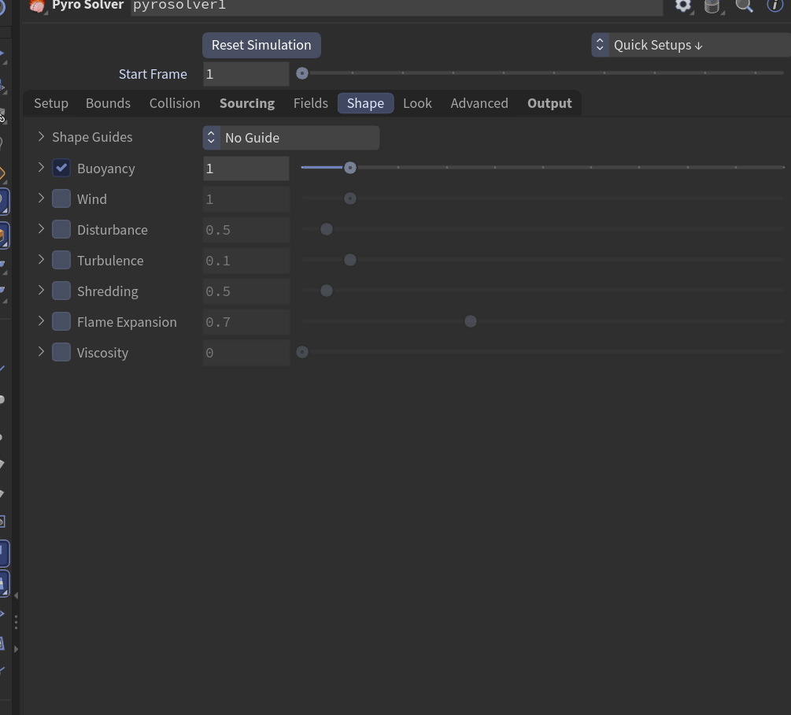

这个数值是浮力强度的乘数；浮力还依赖温度及环境、重力设置。保持其他输入不变时，减小它通常会减弱向上的加速，让烟雾上升得更缓。[Buoyancy Scale 官方说明](https://www.sidefx.com/docs/houdini/nodes/sop/pyrosolver.html)

`0.2` 不是“温度变为 0.2”，也不能直接理解为“烟雾速度只剩 20%”。速度会随着时间累积，并受到输入速度、冷却和其他运动因素共同影响。这里先使用浮力乘数调整运动，便于保持源属性不变。

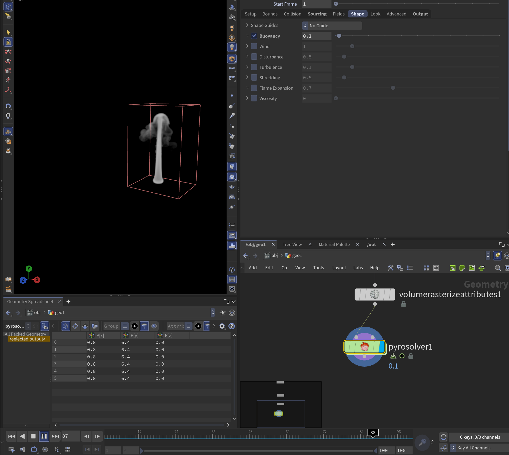

本组截图的取景和帧号并不完全一致，适合记录操作与大致形态，不宜直接用画面高度衡量浮力变化。做严格对比时应固定镜头、源、FPS 和观察帧，例如都比较第 48 帧。

### 8.4 从头重算：分清回到首帧、重置和跳到末帧

模拟具有时间依赖，后面的结果需要由前面的状态推演出来。修改浮力后，可以按以下顺序重新观察：

1. 停止播放。
2. 点击求解器顶部的 **Reset Simulation** 清理模拟缓存；**Ctrl + 单击**该按钮可同时跳到 Start Frame。
3. 确认当前帧回到 `1`，再向前播放，或逐步推进到要比较的帧。[Reset Simulation 官方说明](https://www.sidefx.com/docs/houdini/nodes/sop/pyrosolver.html)

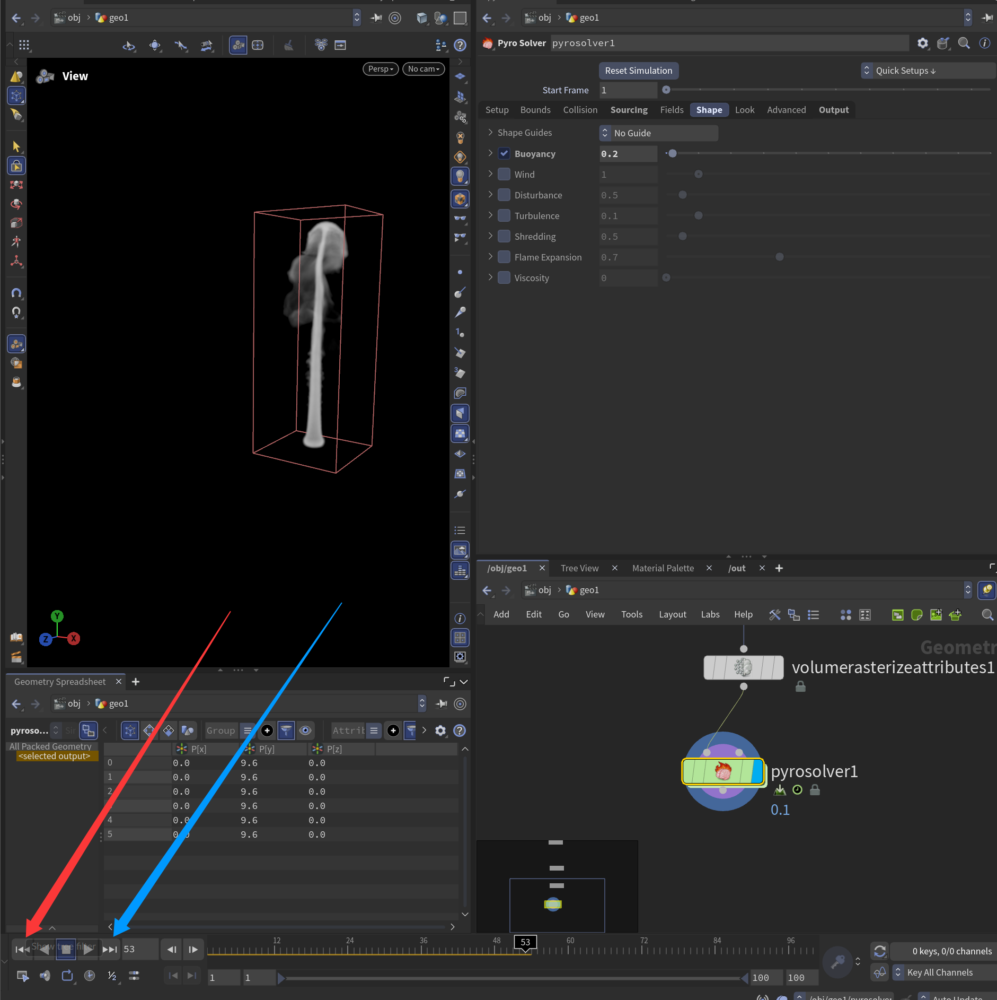

截图中的**红色标注箭头**指向左侧 **First Frame（回到首帧）**，**蓝色标注箭头**指向 **Last Frame（跳到末帧）**；箭头颜色是图片标注，不是按钮本身固定的颜色。可将鼠标悬停在按钮上确认名称。[播放控制按钮说明](https://www.sidefx.com/docs/houdini/anim/playbar.html)

回到首帧只改变当前时间位置，和显式清空求解器缓存是两件事。为确保对比使用新参数，采用“Reset Simulation → 回到起始帧 → 向前播放”的流程更清楚。

跳到末帧会请求该帧的结果；如果中间状态没有可用缓存，求解器可能需要顺序补算。即使界面直接切到第 100 帧，也不代表只算这一帧。这就是测试时先缩短范围、避免误点末帧按钮的原因；已有可用缓存时，跳转则可能很快。

### 8.5 用求解器的 Voxel Size 驱动源体积精度

回到 **Setup → General → Voxel Size**。它控制**模拟网格**，前面 Rasterize 的同名参数控制**源体积网格**。

本次练习让两者使用相同尺寸，便于从一个位置统一调整精度。**数值一致是当前采用的组织方式，不是两个节点能够工作的强制条件。** 实际工程也可以让源稍细或采用固定尺寸，再由模拟网格采样，但要检查细小源结构能否保留。

按下面的方向建立参数引用：

1. 在 **pyrosolver1 → Setup → Voxel Size** 上右键，选择 **Copy Parameter**。
2. 选中 **volumerasterizeattributes1**。
3. 在它的 **Voxel Size** 上右键，选择 **Paste Relative References（粘贴相对引用）**，不要选只复制当前数值的 Paste Values。[参数引用官方说明](https://www.sidefx.com/docs/houdini/network/copying.html)

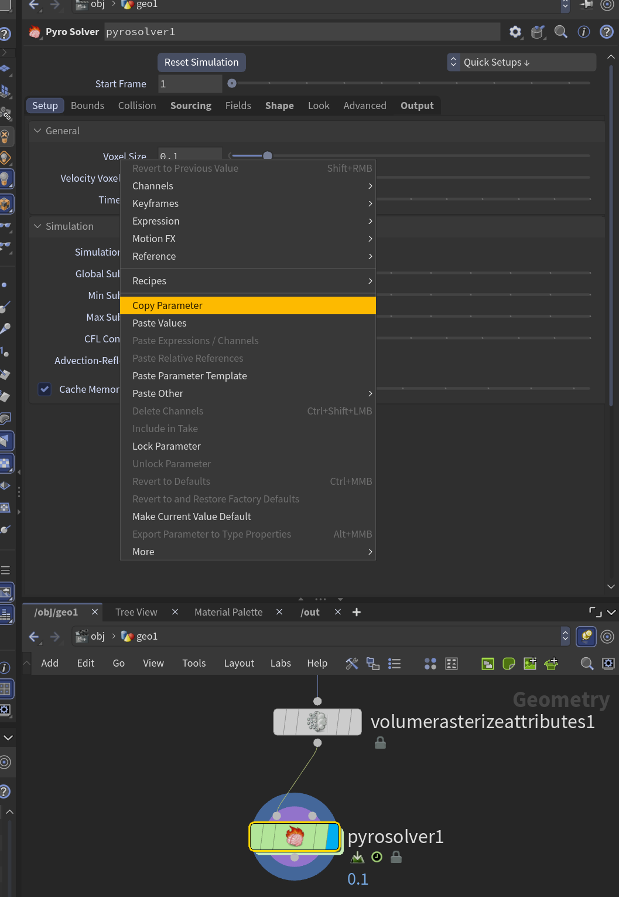

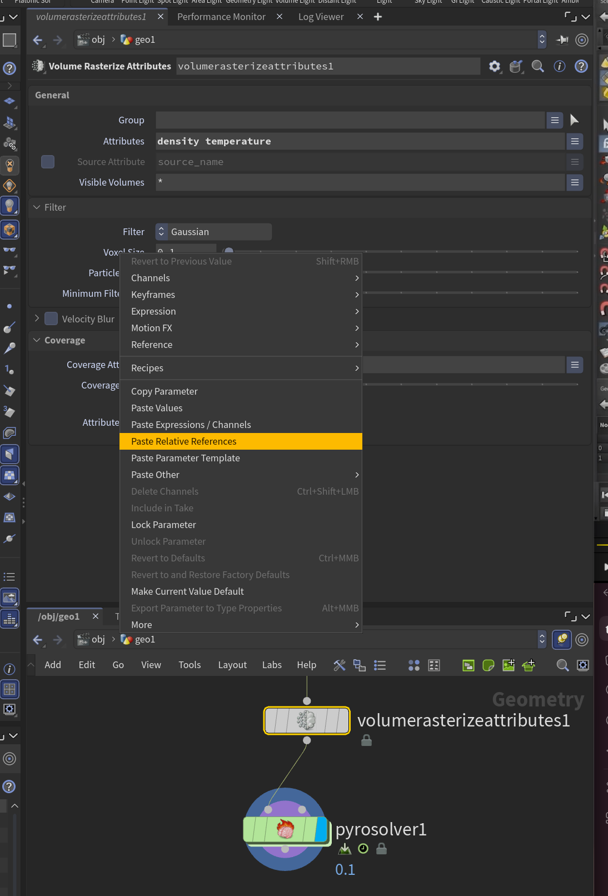

截图生成的表达式为：

```hscript
ch("../pyrosolver1/divsize")
```

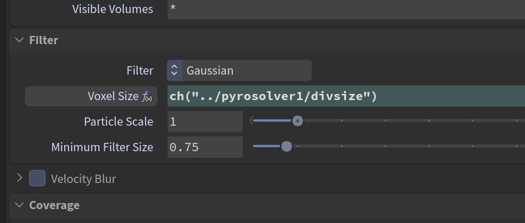

其中 `ch()` 读取一个数值参数，`..` 表示从当前节点向上一级，再找到同级的 `pyrosolver1`；`divsize` 是截图版本中求解器 Voxel Size 的内部参数名。节点名称不同时，表达式中的路径也会不同，让菜单自动生成即可。[节点与参数的相对路径](https://www.sidefx.com/docs/houdini/network/paths.html)

```text
参数控制方向：Pyro Solver.Voxel Size → Rasterize.Voxel Size
几何数据方向：Rasterize 输出源体积   → Pyro Solver 第一输入
```

这是单向的参数依赖。它读取的是求解器的设置值，并不要求先获得求解器的模拟输出；不要反过来让求解器的同一参数再引用 Rasterize 的这个值，形成循环引用。

### 8.6 验证引用，并从粗分辨率恢复到测试设置

为检查联动，可以将 **Pyro Solver → Voxel Size** 从 `0.1` 暂改为 `0.5`，再切到 Rasterize，确认其数值也变为 `0.5`。

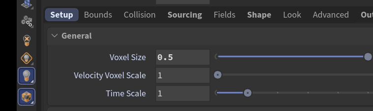

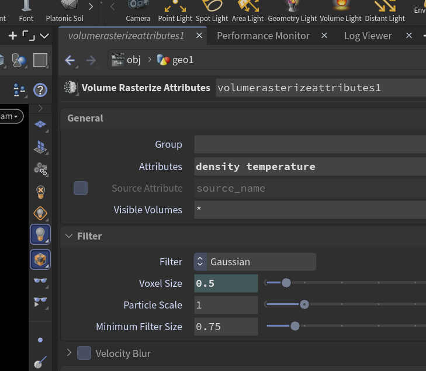

输入框可能显示表达式，也可能显示计算后的数值；显示 `0.5` 本身不能证明引用已消失，可以查看表达式核对。后续统一在求解器这一端改值；确需独立控制时，可先在目标参数上使用 **Delete Channels** 解除引用，再输入独立值。[查看表达式](https://www.sidefx.com/docs/houdini/network/parms.html)、[解除参数引用](https://www.sidefx.com/docs/houdini/network/copying.html)

`0.5` 主要用来验证联动，相对于 `0.1` 是更粗的网格，小圆环的孔洞和细节可能丢失。验证后可恢复本例的 `0.1`，重置模拟，再从首帧播放。提高精度应逐步进行；固定区域内，体素边长减半，体素数量约增至 8 倍，实际模拟成本还受活跃区域和子步影响。

参数联动会让两处设置随之更新，**不意味着已有模拟结果或磁盘缓存自动成为新精度**。源体积需要重新生成，受影响的模拟需要重算，File Cache 也应重新保存相应版本。

### 8.7 Setup 参数全览与初学阶段的调整建议

当前练习中，**优先通过 Voxel Size 控制精度与计算量；Cache Memory 根据回看需求和可用内存调整，其余先保持截图设置。** 这是方便学习的操作范围，不表示其他参数都只用于优化：Time Scale 会改变运动节奏，子步和算法也会影响模拟结果。

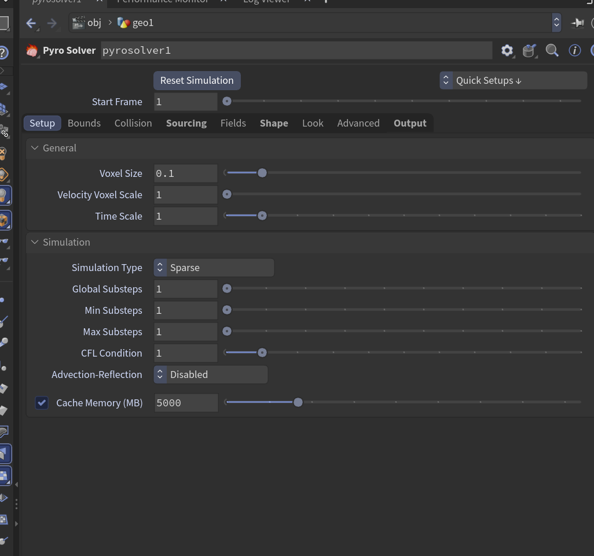

下表的数值来自本次截图，不代表所有版本或预设的固定默认值。页面顶部的 Reset Simulation、Start Frame 和 Quick Setups 分别用于重置、设置起始帧和应用快捷配置，操作见前面各节。

#### General：分辨率与模拟时间

| 参数 | 截图值 | 作用 | 当前建议 |
| --- | --- | --- | --- |
| **Voxel Size** | `0.1` | 模拟网格的体素边长；越小通常越精细，内存和计算成本也越高 | 主要调整项；先粗后细，并留意第 8.5 节与源体积的联动 |
| **Velocity Voxel Scale** | `1` | 速度网格体素尺寸相对于 Voxel Size 的乘数；增大可降低速度场分辨率，可能损失运动细节 | 先保持 `1`；需要明确的性能取舍时再测试 |
| **Time Scale** | `1` | 求解器内部时间倍率；小于 1 放慢模拟演化，大于 1 加快 | 正常速度保持 `1`；需要改变节奏时才调整 |

Velocity Voxel Scale 为 `2` 时，速度网格的体素边长为基础尺寸的两倍，并不等于烟雾移动速度翻倍。Time Scale 改变的是模拟内部时间推进，不是场景 FPS，也不是让计算机更快完成解算。[General 参数官方说明](https://www.sidefx.com/docs/houdini/nodes/sop/pyrosolver.html)

#### Simulation：求解方式、时间子步与缓存

| 参数 | 截图值 | 作用 | 当前建议 |
| --- | --- | --- | --- |
| **Simulation Type** | `Sparse` | 选择模拟方式；Sparse 集中计算活跃区域，Dense 计算整个容器；Minimal OpenCL 为功能受限的快速原型模式 | 保持 Sparse；切换模式需要同时检查功能和容器设置 |
| **Global Substeps** | `1` | 整个动力学网络层面的时间细分，与 Pyro 内部子步不同；增加也可能增加子帧缓存开销 | 保持 `1`；需要全局子帧计算或输出时再研究 |
| **Min Substeps** | `1` | Pyro 内部每次推进至少采用的子步数 | 当前保持 `1`；有明确稳定性需求时再提高 |
| **Max Substeps** | `1` | Pyro 内部子步数量上限，为自适应细分设置预算 | 当前保持 `1`；高速运动或碰撞问题需要更多子步时再提高 |
| **CFL Condition** | `1` | 自适应子步的运动尺度目标，以单步跨越的体素数量衡量；越小通常要求更细的时间步 | 当前保持 `1`，并结合 Min／Max Substeps 理解 |
| **Advection-Reflection** | `Disabled` | 尝试补回压力投影损失的运动能量，帮助保留涡旋；可能增加计算和稳定性要求 | 保持 Disabled；它会改变运动，不是普通的性能开关 |
| **Cache Memory (MB)** 及其启用复选框 | 勾选，`5000` | 是否使用模拟内存缓存，以及缓存容量上限 | 保持启用；只有缓存回看受限且 RAM 有余量时，才考虑增加 |

Simulation Type、Global Substeps 和 Advection-Reflection 的具体行为见 [Pyro Solver 官方说明](https://www.sidefx.com/docs/houdini/nodes/sop/pyrosolver.html)。Minimal OpenCL 有缓存、容器调整等限制，不能仅凭“OpenCL”就认定可以直接替换当前流程。

**子步是把一段时间拆成更小的计算步，不是增加空间分辨率。** 可以先把 Global Substeps 理解为外层时间细分、Min／Max 理解为内部细分范围，不要为了“更精细”同时将它们全部调高。

例如 CFL 为 `1`，表示根据速度场估算，目标是让最快运动在一个子步内不超过约一个体素；实际细分还受子步上下限约束。截图中 Min 和 Max 都是 `1`，内部细分数量被固定，单独降低 CFL 并不能越过 Max 上限。需要更多细分时才应有针对性地调整范围，并比较穿透、运动表现和耗时。[子步与 CFL 的工作方式](https://www.sidefx.com/docs/houdini/nodes/dop/gassubstep.html)

#### Cache Memory：缓存历史帧，不是渲染内存预算

截图的 `5000` 表示最多允许约 `5000 MB` 用于模拟内存缓存。它用于保留已算出的历史状态，便于回看与拖动时间轴；**这个上限不代表整个 Houdini 进程只能用这么多内存**，当前求解、几何、视口及其他程序仍会占用内存。[模拟缓存与 Cache Memory](https://www.sidefx.com/docs/houdini/nodes/obj/dopnet.html)

缓存达到上限后，旧状态可能被丢弃，或按内部缓存设置写入磁盘；这时回看可能需要读盘或重算。若物理内存仍有足够余量，适当增加 Cache Memory，可以保留更多状态、改善这类交互；超出实际 RAM 能力则可能造成换页，让操作更慢。[模拟缓存的容量与磁盘缓存](https://www.sidefx.com/docs/houdini/dyno/cache.html)

因此，“算不动／渲染不动”应先分清具体表现：

| 表现 | 优先处理方向 |
| --- | --- |
| 向前已算过，回拖却经常等待；内存仍充裕 | 检查缓存是否启用、历史状态是否仍在；可适当增加 Cache Memory |
| 第一次向前计算每帧就很慢 | 检查 Voxel Size、活跃区域、子步和源复杂度；增大缓存不会直接加快求解 |
| 系统内存接近耗尽，磁盘持续忙碌 | 降低模拟或缓存需求，并考虑磁盘 File Cache；继续增大缓存可能更慢 |
| 已有模拟结果，最终渲染仍很慢或报内存错误 | 检查渲染器、体积数据量、采样及对应的 RAM／显存占用；Cache Memory 不控制渲染器预算 |

正式保存结果仍应使用 **File Cache**。内存缓存主要服务当前会话的交互，不能代替明确的磁盘输出与版本记录。

#### 当前练习可以沿用的参数组合

保持 `Velocity Voxel Scale=1`、`Time Scale=1`、`Simulation Type=Sparse`、三项 Substeps 均为 `1`、`CFL=1`、`Advection-Reflection=Disabled`。以 Voxel Size 调整精度，Cache Memory 按实际需求管理；出现高速碰撞、特殊时间节奏等明确需求时，再单独研究相关项。

修改分辨率、时间或求解算法后，应重置并重算再比较；**仅增加缓存容量并不会提高已有结果的精度**。

### 8.8 持续发射与一次喷发

静态源不等于只发射一次：求解器可以在每个时间步重复使用同一份源。烟囱需要持续注入；短促喷发则应只在开头若干帧启用发射。

Sourcing 的操作也会改变结果：`Add` 将源值加入已有场，`Maximum` 在二者之间取较大值，`Copy` 则覆盖相应目标值。不要把这些操作当作同一种“开启发射”。[Sourcing 操作说明](https://www.sidefx.com/docs/houdini/nodes/sop/pyrosolver.html)

第一次练习可以先保持预设的烟雾发射方式。做单次喷发时，可为相关条目的 Activation 设置关键帧，让密度和温度在指定帧段之后同时停止注入；源停止后，已有烟雾仍会继续运动和消散。

### 8.9 Bounds：自动调整计算范围

**Bounds** 管理模拟容器的范围和扩展方式。在当前 Sparse 烟雾练习中，可以先保持自动调整，不必手动固定包围盒。

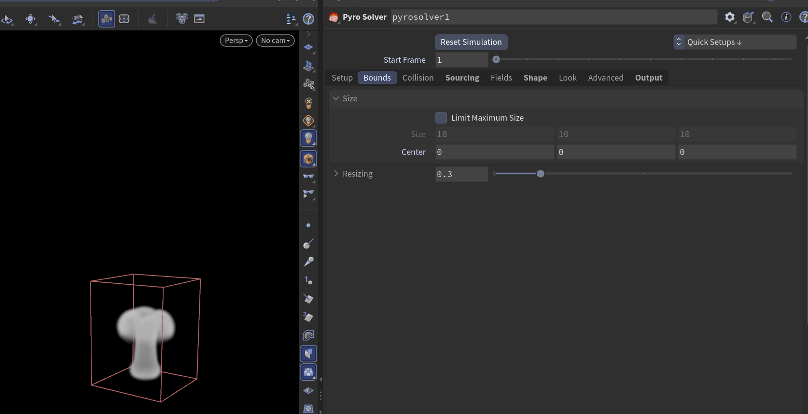

求解器根据参考场识别需要覆盖的区域，再预留运动缓冲；烟雾扩散时，范围也会变化。初学时先认识以下设置：

| 设置 | 作用与当前处理 |
| --- | --- |
| **Limit Maximum Size** | 限制容器可扩展的最大范围；截图未勾选，当前保持即可 |
| **Size / Center** | 定义最大范围的尺寸与中心；Size 在未启用限制时呈灰色，不要将显示的数值误认为已生效的固定容器 |
| **Resizing** | 管理自动调整，包括跟踪哪些 Reference Fields，以及在其周围预留的 Padding 等；当前先沿用设置 |

包围盒用于管理计算范围，**边界不自动等于固体墙面**。若烟在固定平面被截断，或高速喷射离开活跃区域，应回头检查最大范围与扩展缓冲；若内存持续增长，也要查看容器和活跃区，而不是永远忽略 Bounds。[范围与自动扩展原理](https://www.sidefx.com/docs/houdini/pyro/sparsity.html)

### 8.10 Collision：当前没有碰撞体时先保持设置

**Collision** 管理障碍物和地面等碰撞边界。当前只是自由空间中的发射练习，没有额外碰撞需求，可以先保持此页设置。

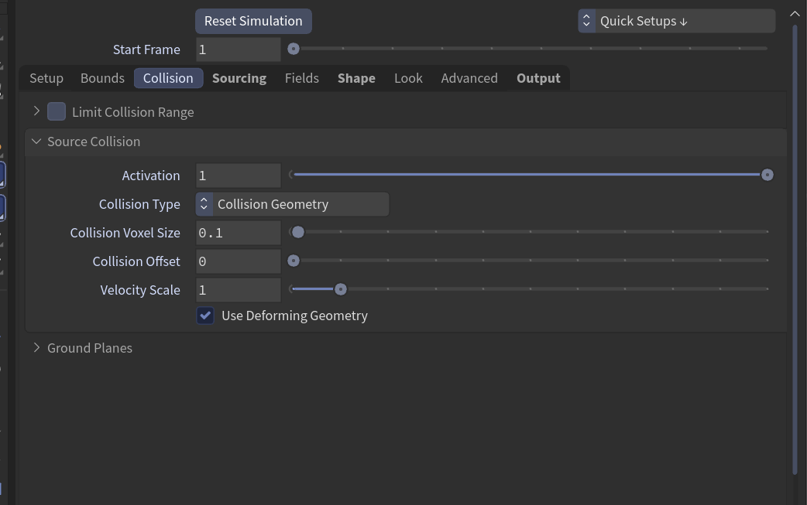

需要烟雾绕开物体时，再按求解器支持的碰撞类型将数据接到**第二输入**。圆环接在发射源链路中，不会因此自动成为障碍物；Ground Planes 则可单独提供轴向平面边界。[碰撞输入与边界设置](https://www.sidefx.com/docs/houdini/nodes/sop/pyrosolver.html)

截图中的 Collision Voxel Size 用于碰撞表示的精度，Collision Offset 调整碰撞表面偏移，Velocity Scale 缩放碰撞体带来的运动影响，Use Deforming Geometry 决定是否逐帧重建碰撞几何。它们应在实际加入静态或运动碰撞体后再针对问题调整；这里的 Velocity Scale 也不是后文发射源 v 的强度控制。

### 8.11 Sourcing：将命名源体积写入模拟场

**Sourcing** 把第一输入中的源体积合入模拟。这里更准确的理解是“按名称匹配、缩放和合并”，而不是把点属性直接变成求解属性：点属性转体积已经在 Rasterize 中完成。

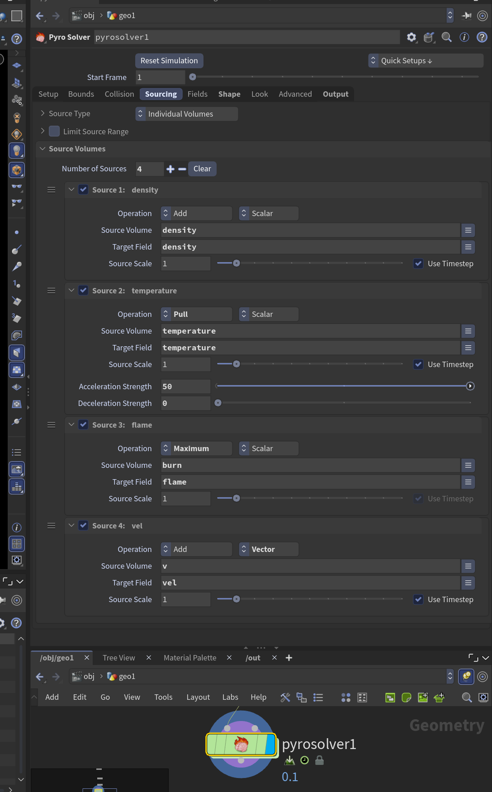

截图采用 **Source Type = Individual Volumes**，Source Volumes 中有四项。这是当前配置的映射，不表示输入一定已经具备四个源。

| Source Volume：输入体积名 | Target Field：模拟场名 | 类型 | 截图 Operation | 作用 |
| --- | --- | --- | --- | --- |
| `density` | `density` | Scalar | Add | 向已有烟雾密度追加源贡献 |
| `temperature` | `temperature` | Scalar | Pull | 将模拟温度向源温度推近，推近方式由下面的强度控制 |
| `burn` | `flame` | Scalar | Maximum | 刷新反应物寿命相关的场，避免简单持续累加 |
| `v` | `vel` | Vector | Add | 将源速度贡献加入模拟速度场 |

**Number of Sources 是合并操作的数量。** 存在 `burn → flame` 条目，不会自动在上游创建 burn；存在 `v → vel` 也不会自动产生非零速度。[Sourcing 与源／目标名称](https://www.sidefx.com/docs/houdini/nodes/sop/pyrosolver.html)

每项前面的启用状态可用于独立检查某个源；Source Scale 用于缩放输入贡献。Use Timestep 对支持它的操作进行时间步归一化，先保留当前配置，不要靠随意切换它解决速度问题。截图 temperature 的 Pull 使用 Acceleration Strength `50`、Deceleration Strength `0`，不是与 Add 相同的持续相加，也不能只看 Source Scale 就判断其效果。[合并操作与时间步设置](https://www.sidefx.com/docs/houdini/nodes/sop/pyrosolver.html)

后续添加新属性，都按同一条路径检查：

```text
点上有非零属性 → Rasterize 输出同名体积 → Sourcing 对应正确目标场
             → 求解器启用所需场与行为 → 重置、重算并检查显示
```

### 8.12 添加 burn：从热烟雾扩展到火焰源

当前点上只有 density、temperature，因此预先存在的 `burn → flame` 映射还没有对应的源数据。

回到 **Pyro Source**，可以查看 **Initialize → Source Burn** 一类快捷配置，但 Initialize 是预设配置入口，不能把它当作只追加一项属性的按钮；应用后应复查原有密度、温度和撒点设置。要明确保留当前两项并增加 burn，可直接按截图手动配置：

1. 将 Attributes 数量补到 `3`。
2. 保留 Density、Temperature，第三项选择 **Burn**，名称为小写 `burn`。
3. 保持为标量，练习起点使用 Default Value `1`、Scale `1`。

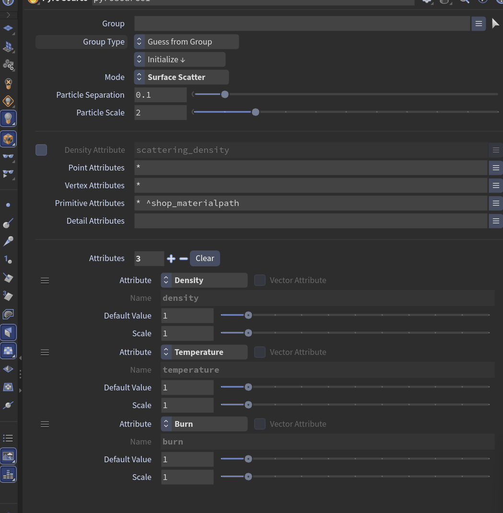

再回到 **Volume Rasterize Attributes**，在 Attributes 中补上 burn：

```text
density temperature burn
```

检查输出出现非零 burn 体积，再确认求解器 **Source Volume = burn、Target Field = flame、Operation = Maximum**。`flame` 用来记录随流运动的反应物剩余寿命，并可驱动烟、温度、膨胀和火焰显示；它不是旧版燃烧模型中所有字段的简单改名。[Flame 场与 Maximum 发射方式](https://www.sidefx.com/docs/houdini/pyro/flames.html)

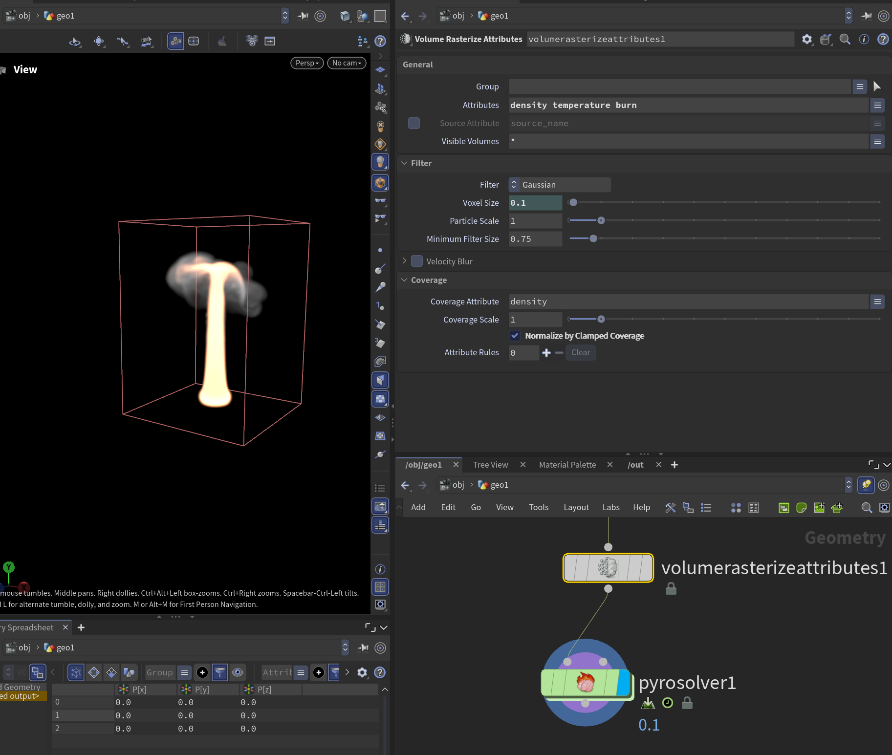

截图中，保留显示在 Pyro Solver，只选中 Rasterize 编辑参数，因此左侧可以同时观察动态火焰结果。**Rasterize 本身仍只负责生成源体积**。

这组配置已具备火焰相关设置，所以补齐 burn 的传递后能看到火焰。若自己先前使用的烟雾预设关闭了相关功能，仅把 burn 写入列表仍不保证出现火焰：应检查 **Fields → Flame → Create Flame Field** 是否启用，以及 Look／材质是否使用合适的发光场。需要火焰继续产生热量、烟或膨胀时，再检查 Emit Temperature from Flame、Emit Density from Flame 和 Flame Expansion 等行为。[Flame 场及其输出设置](https://www.sidefx.com/docs/houdini/nodes/sop/pyrosolver.html)

完成后 Reset Simulation，从首帧重算。不要在已经手工配置好的网络上反复应用整套 Initialize Fire 预设而不检查变化。

### 8.13 Attribute Adjust Vector：创建 v 并向 +X 方向喷射

速度需要同时表达方向和大小，因此使用三分量向量。本例的属性名是**小写 `v`**，求解器目标场为**小写 `vel`**；不要输入成大写 `V`。

在 Pyro Source 与 Rasterize 之间插入 **Attribute Adjust Vector**：

```text
Torus
  → Pyro Source                         density、temperature、burn、pscale
  → Attribute Adjust Vector             创建／调整点向量 v
  → Volume Rasterize Attributes          输出 density、temperature、burn、v
  → Pyro Solver                          将 v 合入 vel，并计算运动
```

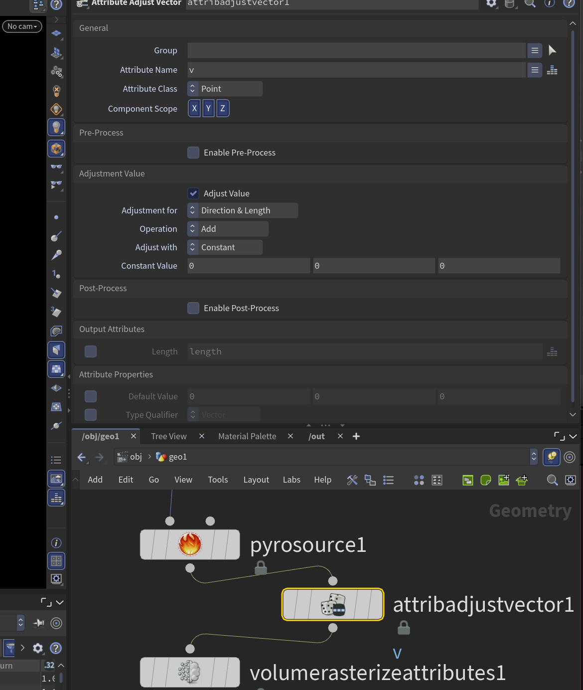

按截图检查参数，而不是只依赖新建节点的默认值：

| 参数 | 本次配置 |
| --- | --- |
| Attribute Name | `v` |
| Attribute Class | `Point` |
| Component Scope | X、Y、Z 均启用 |
| Adjust Value | 启用 |
| Adjustment for | `Direction & Length` |
| Operation | 截图为 `Add` |
| Adjust with | `Constant` |
| Constant Value | `(5, 0, 0)` |

**Add 表示在输入向量上增加 `(5,0,0)`。** 本例没有既有速度，以零向量为起点时得到所需值；上游已有 v 时，结果为 `v输入 + (5,0,0)`。若目标是无论输入如何都将速度设为这个常量，改用覆盖赋值的 **Set／Set Always**，再检查输出。[Attribute Adjust Vector 的创建与操作模式](https://www.sidefx.com/docs/houdini/nodes/sop/attribadjustvector.html)

在 Geometry Spreadsheet 的 Points 页核对 `v.x`、`v.y`、`v.z`。只有长度或方向调整的模式不适合从零向量直接生成本例速度，因此这里使用 Direction & Length。

然后将 Rasterize 的 Attributes 补全为：

```text
density temperature burn v
```

若只做烟雾速度实验而没有 burn，则填写 `density temperature v` 即可。确认 v 被输出为向量体积，并由 Sourcing 的 **Vector、v → vel** 条目接收。

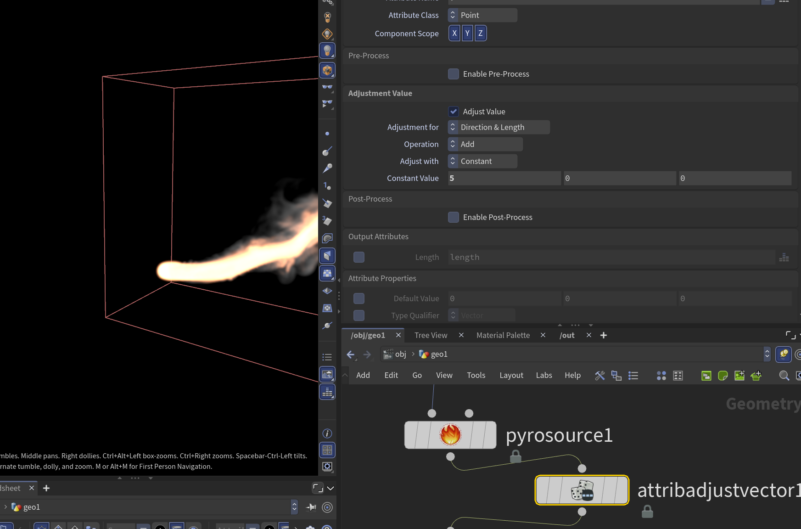

在本例未额外变换的坐标空间中，`(5,0,0)` 表示沿 **+X** 方向提供速度，单位可按 Houdini 单位／秒理解。它不是沿当前屏幕向右，也不是把发射器位置平移 5 个单位；视觉方向需结合坐标轴和视角判断。

还要区分两次 Add：Attribute Adjust Vector 在点数据上相加，Sourcing 在模拟场中合并源。截图的速度发射操作也是 Add，因此在持续发射区域，已有流体可能持续收到速度贡献，**最终 vel 不保证处处等于 `(5,0,0)`**。若想让速度趋近一个目标值，应另行比较 Pull 等操作，并控制强度；当前先保持截图配置来理解流程。

修改后重置并从首帧播放。若方向没有变化，先检查属性名、点上的值、Rasterize 输出与 Sourcing 启用状态，再调整数值；无需先用很大的速度“试出效果”。

### 8.14 扩展实验：Random 速度与 Constant 速度的区别

最后一张截图将 Attribute Adjust Vector 的 **Adjust with 改为 Random**，Range Values 为 **Zero Centered**，Amplitude 为 `500`，Randomization By 为 **Element Number**，Seed 为 `22`。

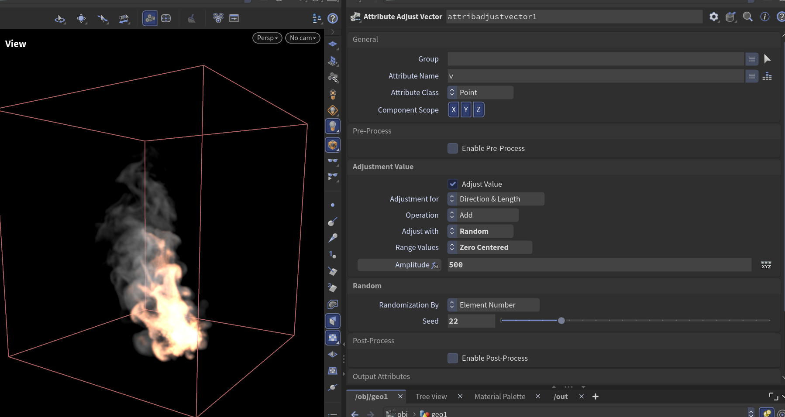

这表示不同点获得不同的随机速度增量，区别于 Constant 给每个点相同的增量。当前 Zero Centered 模式下，各分量的范围为负半幅到正半幅；Amplitude 为 `500` 时，各分量范围为 `-250～250`，并非每点速度长度固定为 500。[随机向量范围](https://www.sidefx.com/docs/houdini/nodes/sop/attribadjustvector.html)

`500` 是这张截图的实验值，不是本例推荐起点。随机方向在转体积时会发生局部混合，可能部分抵消，所以不能只按数值大小推断最终火焰速度或形状。应先使用较小幅度、固定观察帧逐步比较，再观察活跃区、计算成本和子步需求。

Element Number 按点编号生成随机值，固定 Seed 不等于每帧都会重抽一次；如果重新撒点导致编号对应关系变化，随机分布也可能变化。想稳定跟随同一批点时，需要稳定的编号／标识；想得到空间连续的变化，可再学习 Noise 模式。[随机种子与元素编号](https://www.sidefx.com/docs/houdini/nodes/sop/attribadjustvector.html)

这里改变的是**发射源速度**，并不等于开启求解器 Shape 页的 Turbulence。先单独比较一种改动，避免同时改变两者而难以判断原因。

## 9. Attribute Noise：打散烟雾源的密度与温度

当前烟雾的源属性比较均匀，形态也偏平滑。这一步先给 density 和 temperature 增加空间变化，让不同位置发射的烟雾量、热量有所区别。

**这是发射源层面的细节设计。** 平滑程度还受体素尺寸、输运、冷却和求解器扰动等因素影响，不能全部归因于“还没有调求解器”。先控制源，再研究 Shape 中的扰动，更容易判断各自的作用。

### 9.1 暂停燃烧与外加速度，回到纯烟雾对照

保留前一阶段节点作为实验记录，将本轮生效链路恢复为热烟雾：

1. 绕过前面创建速度的 Attribute Adjust Vector。
2. Rasterize 的 Attributes 恢复为 **`density temperature`**，暂不输出 burn、v。
3. 求解器 Sourcing 暂停 `burn → flame`、`v → vel`，保留密度、温度发射。
4. Reset Simulation 后回到首帧重算，避免已有 flame、外加速度继续影响观察。

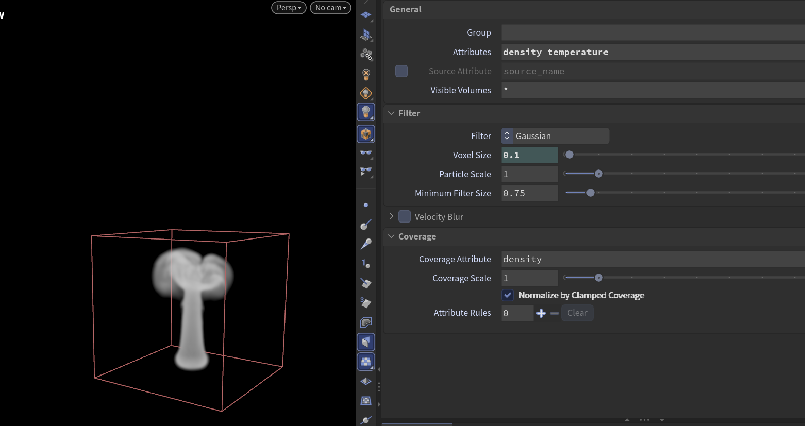

“去掉燃烧和速度”在这里指停用这两条发射来源，不要求删除所有旧节点或点属性。后续截图的表格里仍有 burn 列，只要它没有被转成源体积并注入，就不参与当前燃烧发射。**也不要删除求解器内部的 vel 场**，烟雾本身的运动仍然需要速度场。

### 9.2 在 Pyro Source 后添加 Attribute Noise Float

按 `Tab` 搜索 **Attribute Noise Float**，插到 Pyro Source 与 Rasterize 之间。某些版本显示为 **Attribute Noise**，将 Attribute Type 设为 **Float** 即可；截图节点名为 `attribnoisefloat1`。

```text
Torus → Pyro Source → Attribute Noise Float（density）
      → Attribute Noise Float（temperature）
      → Volume Rasterize Attributes → Pyro Solver
```

先只配置第一个噪声节点：

| 参数 | 本轮设置与用途 |
| --- | --- |
| Attribute Type | `Float`，密度是标量 |
| Attribute Names | 只填 `density` |
| Attribute Class | `Point`，在源点上处理 |
| Operation | `Multiply`，对输入密度乘噪声系数 |
| Location Attribute | `P`，按点位置采样空间噪声 |
| Noise Type | 截图为 `Simplex`，先沿用 |

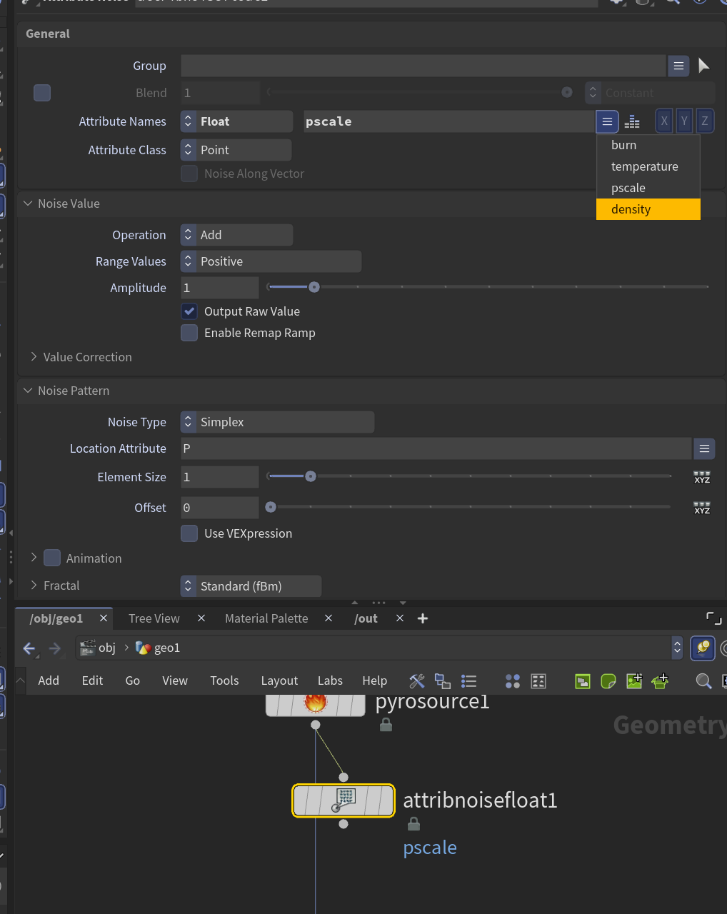

截图初始目标是 `pscale`。这里将它**从 Attribute Names 文本中移除**，换为 density；不是删除几何上已有的 pscale 属性。pscale 继续负责点的覆盖大小，本次先不随机它，便于把“密度变化”与“发射范围变化”分开观察。

属性噪声是在空间噪声场上按位置采样，相邻点的值通常有连续关联，不等于每个点完全独立抽一次随机数。[Attribute Noise 的属性类型与采样位置](https://www.sidefx.com/docs/houdini/nodes/sop/attribnoise.html)

### 9.3 Multiply、Zero Centered 与 Remap Ramp

以 Blend 未额外削弱效果为前提，可以把 Multiply 理解为：

```text
density输出 = density输入 × 噪声系数
```

已有密度为 `1` 时，系数为 `0.3` 的位置变为 `0.3`，系数为 `0.8` 的位置变为 `0.8`。输入若本来为零，乘噪声仍为零。因此先在 Pyro Source 创建有值的属性，再进入这一步；噪声节点里只填写名称不能代替对输入的检查。

操作上先按本组截图设置：Range Values 选择 **Zero Centered（以零为中心）**，Operation 选择 **Multiply**，勾选 **Enable Remap Ramp**，然后抬高 Ramp 左端点的纵向 Value，减少低值区域过弱的问题。

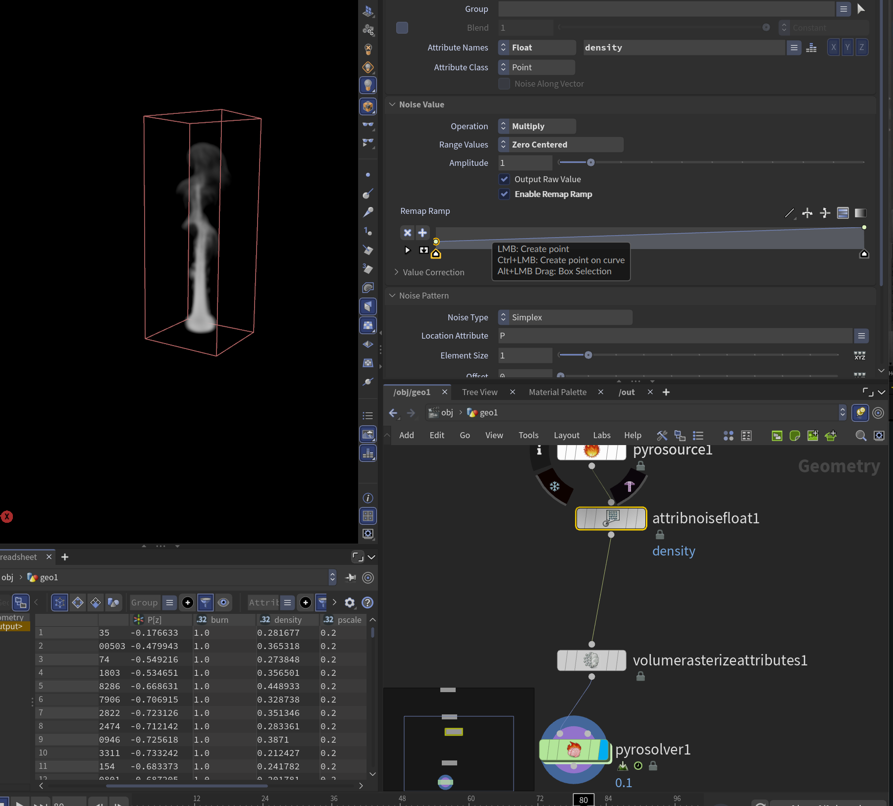

**抬高左端点是提高低端输出，不是把该点沿横轴向右移动。** 横向 Position 表示噪声输入落在哪一段，纵向 Value 控制对应输出。用曲线压低或抬高某个区间，可以改变强弱分布；截图未显示端点精确值，因此不将其写成固定配方。

Output Raw Value 在截图中保持勾选，它影响噪声值的分布，不表示保留原密度，也不是负值保护开关。[输出分布与 Ramp 参数](https://www.sidefx.com/docs/houdini/nodes/sop/attribnoise.html)

#### 为什么要额外检查负密度

**Attribute Noise 的 Zero Centered 原始范围为 `-Amplitude～+Amplitude`**。这与前面 Attribute Adjust Vector 的 Zero Centered 半幅规则不同，不能按相同名称直接套用数值。

对非负密度使用乘法时，负的噪声系数会使结果变负。最后一张截图的 Geometry Spreadsheet 中，density 第一行约为 **`-0.078`**，说明这组实验设置确实出现了负密度；单看 Ramp 曲线被抬高，不能认定最终值已经全部非负。

普通发烟练习需要非负密度。为了更容易控制，可以采用下面的替代起点；它是补充的练习配置，不是截图的原参数：

- Range Values 改为 **Min/Max**，先设 Min Value `0.2`、Max Value `1`，得到可控的正值系数。
- 先关闭 Remap Ramp 看范围，之后需要塑形再打开，并重新检查输出。
- 也可以使用 Post-Process 的 **Enable Minimum / Minimum = 0**，对最终输出设置下限；这是截断负值，会改变分布，不等同于保持所有原噪声细节。[范围与输出下限](https://www.sidefx.com/docs/houdini/nodes/sop/attribnoise.html)

上游密度不是 `1` 时，`0.2～1` 是乘数范围，不是最终密度范围。乘法也会改变平均发射量，因此比较时既要看局部变化，也要看整团烟是否整体变淡。

### 9.4 Element Size：控制噪声图案的空间尺度

**Element Size** 控制噪声特征的大小：数值减小，同一范围内变化更密、更细碎；数值增大，变化更宽、更成块。它不是点数、体素尺寸或噪声幅度。

本例可以先对比 `1` 与 `0.5`，固定 Amplitude 和其他参数，查看源属性分布与指定帧的模拟变化。这组数值需要结合模型实际尺度，不是通用推荐值。

Element Size 不能无限减小来换细节。图案比点间距还小，源点可能采样不到完整变化；比源／模拟体素可表达的尺度还小，则容易在转换和输运时被平均掉。需要同时检查撒点、pscale 覆盖、Rasterize Voxel Size 与 Solver Voxel Size。

若只调小 Element Size，却始终看不见细节，应先沿数据流检查，而不是继续把噪声频率拉高。[Element Size 与空间采样](https://www.sidefx.com/docs/houdini/nodes/sop/attribnoise.html)

### 9.5 复制节点，为 temperature 设置另一组噪声

复制 density 噪声节点，串接在后面，将第二个节点的 **Attribute Names 改为 `temperature`**，并确认不再包含 density、pscale。Operation 仍使用 Multiply，再独立调整强度、尺度与图案位置。

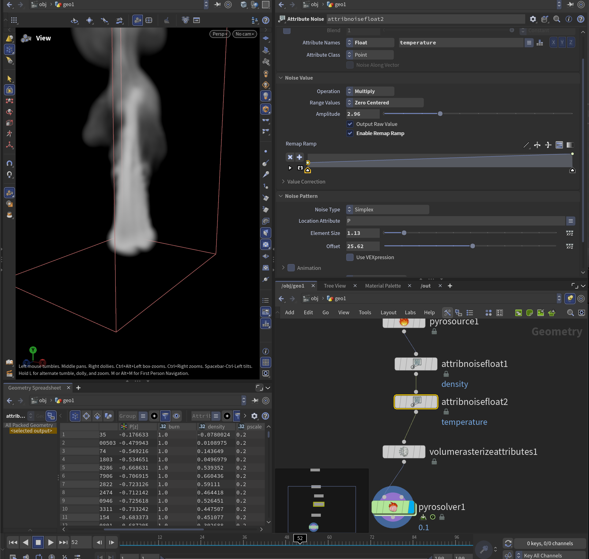

截图第二个节点显示：Amplitude `2.96`、Element Size `1.13`、Offset `25.62`，Range Values 仍为 Zero Centered，Remap Ramp 开启。这些是当时的实验值；Amplitude 不是“将每点温度都设为 2.96”，Offset 也不是把模型移动 25.62 个单位。

密度噪声主要改变哪里发射得浓、哪里发射得淡；温度噪声让源的热量不均匀，随后通过浮力等机制影响运动。对于当前只模拟热烟雾的练习，温度乘数也可先使用明确的正值范围，再逐渐扩大变化。

复制节点后，如果噪声类型、坐标、尺度和 Offset 都不变，两个属性的变化可能高度相关。改变第二个节点的 Offset，可以采样到另一处图案；不必为了“随机”而将每项参数同时改动。

截图中 Animation 未启用。对于静态点、固定 P 与固定噪声设置，噪声本身不会每帧自动重抽；模拟仍会随时间演化。需要变化的发射源时，再启用噪声 Animation，或有意动画 Offset；Offset 动画表现为图案在噪声空间中移动。[Offset 与噪声动画](https://www.sidefx.com/docs/houdini/nodes/sop/attribnoise.html)

### 9.6 从点属性到模拟结果逐级验证

1. **查看点数据。** 第一个节点应只改变 density，第二个只改变 temperature；检查各自是否有变化、是否出现不希望的负值，pscale 是否仍按原来的规则保留。
2. **查看源体积。** Rasterize 继续输出 `density temperature`；先单独显示 density，再看 temperature，避免 `Visible Volumes=*` 的叠加干扰。
3. **检查模拟映射。** 保留 density、temperature 的 Sourcing，停用本轮不需要的 burn、v 来源。
4. **重算再比较。** Reset Simulation，固定镜头、帧率与观察帧，分别比较“无噪声”“只有密度噪声”“两种噪声均开启”。

单独检查 temperature 时还要记得：Rasterize 当前把 density 用作 Coverage Attribute，密度的变化也可能参与温度体积的加权与边缘过渡。因此，点上的原始噪声与最终体积不是完全相同的数值表示。

常量源、源属性噪声、求解器 Shape 扰动解决不同层次的问题。本轮先把密度和热量分布打散；后续再比较 Turbulence、Disturbance 等如何改变已经进入模拟的流场，不把源噪声直接当作湍流开关。

## 10. Fields：查看场数据，控制烟雾消散与温度

前面在 Sourcing 中决定“往模拟里注入什么”，**Fields** 则提供场的查看方式，以及密度、温度、火焰随时间变化的控制。本轮继续保持纯烟雾输入；两个 Emit From Flame 暂不启用。

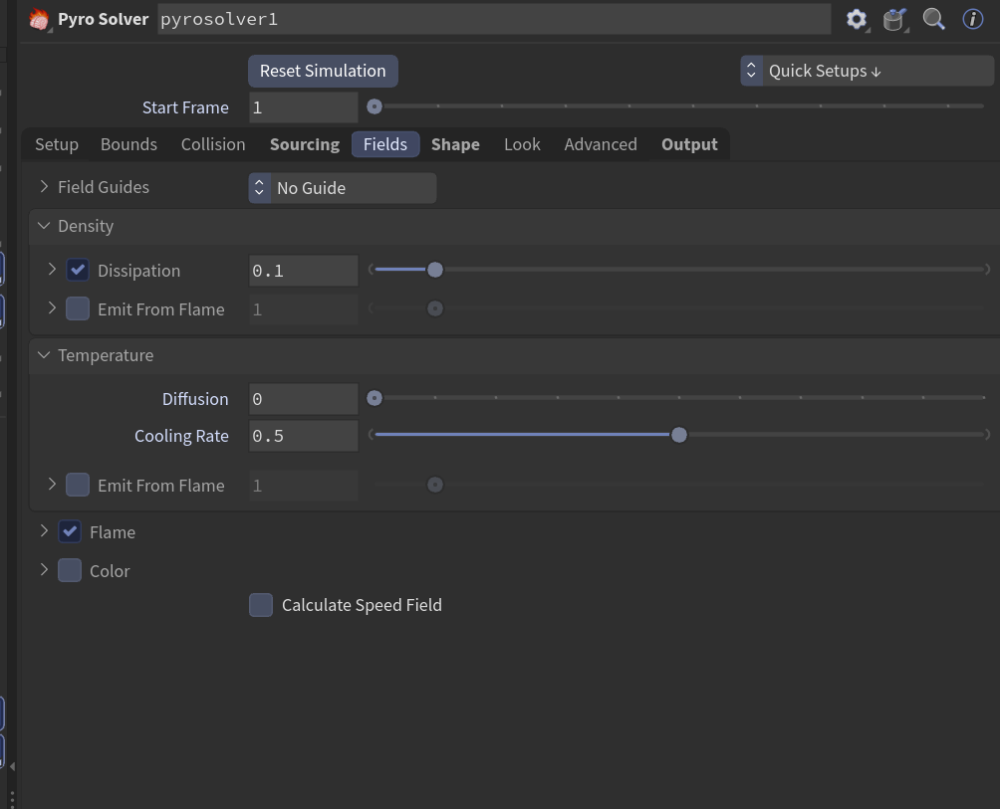

### 10.1 Field Guides：用伪彩色查看密度

在 **Field Guides** 下拉菜单选择 **Density**，视口会在模拟旁显示密度场的辅助可视化。截图左边是烟雾外观，右边是相同模拟数据的密度指引，不是新建了第二个发射器。[Field Guides 官方说明](https://www.sidefx.com/docs/houdini/nodes/sop/pyrosolver.html)

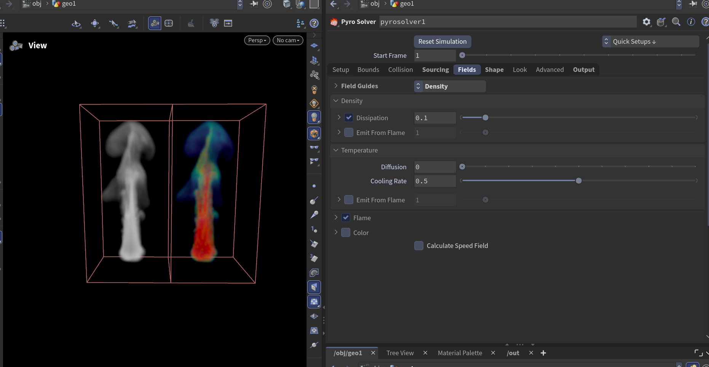

展开 Field Guides，可以看到 **Guide Range**、**Color Mapping** 和显示类型。截图使用 `3D`、Guide Range 为 **`0～1`**，颜色由左侧紫色，经过蓝／青、绿、黄，到右侧橙红色。

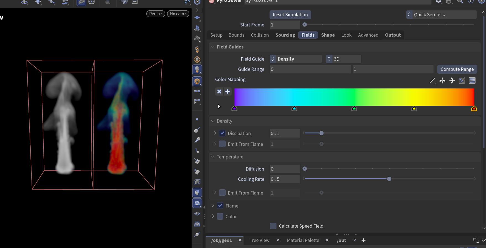

在这组映射中，靠近 0 的密度使用低端颜色，靠近 1 的密度使用高端颜色。**红色表示接近或超过当前显示上限，不保证它就是模拟中的绝对最大值；密度也不被限制为 0～1。** 颜色用于诊断，不能当作烟雾材质的最终颜色。

**Compute Range** 读取当前帧所选场的最小／最大值，便于选择显示范围；Guide Range 的低端还会剔除低于该值的指引显示，这不会清除实际模拟数据。比较不同参数或不同帧时，应使用一致的范围和色带；每次重新计算范围可能让不同数值看起来同样鲜红。[Guide Range 与 Compute Range](https://www.sidefx.com/docs/houdini/nodes/sop/pyrosolver.html)

切换 Field Guide、颜色和显示范围属于观察操作，不需要重算模拟。要返回普通外观查看，可选择 **No Guide**。需要检查内部某个截面时，也可研究 Plane 显示，先不改变本次 3D 对照。

### 10.2 Density → Dissipation：控制烟雾逐渐变淡

**Dissipation（消散）** 随时间减少 density，使烟雾变淡。当前截图开启它、数值为 `0.1`；将其改为 **`0.3`**，Reset Simulation 后从首帧播放，可以观察更快的消散。

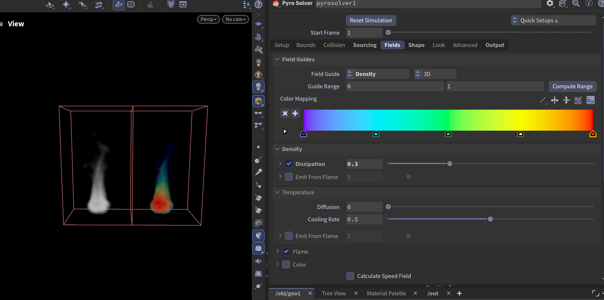

对照时保持源密度、发射时长、FPS、观察帧和 Guide Range 一致。持续发射区域仍会不断补充密度，因此提高消散不表示新注入的烟会在同一时刻全部消失。

不要将 `0.1` 机械理解成“每秒消散 10%”。当前官方说明以每 `1/24` 秒约去掉 10% 密度来解释该值；比较版本、帧率和时间设置时，仍应在固定条件下观察结果。[Dissipation 参数定义](https://www.sidefx.com/docs/houdini/nodes/sop/pyrosolver.html)

### 10.3 Clamp Below：将足够小的密度清零

展开 Dissipation，能看到 **Clamp Below**。截图中该项启用，阈值为 **`0.005`**：密度低于这个阈值时，会被置为 `0`。

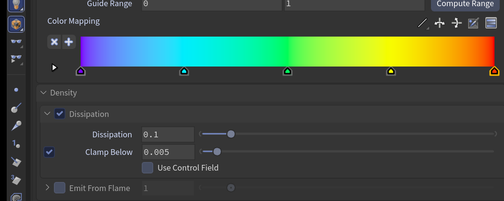

Dissipation 负责逐渐降低数值，Clamp Below 负责清理已经很小的尾部。它不是“将密度至少保持为 0.005”，也不是只把低密度的视口显示隐藏。

在 Sparse 模拟中，微小但非零的密度可能继续占用活跃区域，清零有助于避免无用计算；实际活跃区也取决于其他参考场。阈值过高则容易直接裁掉薄烟和柔软边缘，应结合源密度范围调整。[Clamp Below 与 Sparse 活跃区](https://www.sidefx.com/docs/houdini/nodes/sop/pyrosolver.html)

截图另有 **Use Control Field**，用于让某个场控制局部消散强度。本轮保持关闭，先研究统一消散，不同时引入新的控制关系。

### 10.4 Temperature → Cooling Rate：控制热量向环境值回落

先将 **Field Guide 切为 Temperature**，保持相同的显示范围，就可以把烟雾外观与热量分布分开观察。

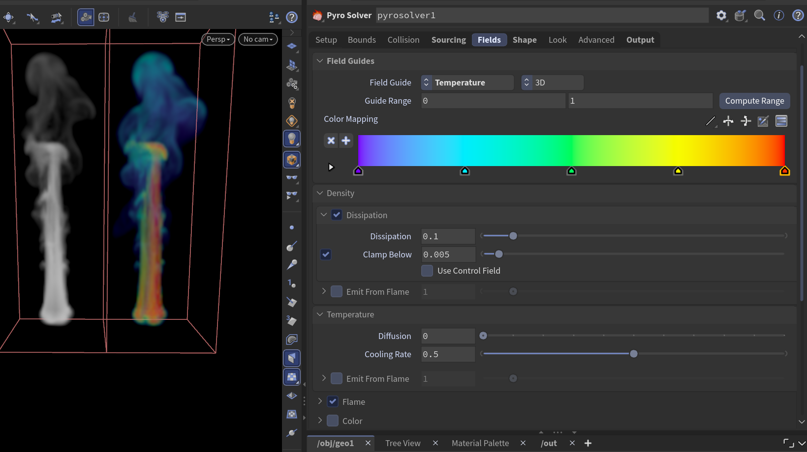

**Cooling Rate（冷却速率）** 控制 temperature 向 `0` 冷却的速度。这里的 `0` 对应环境温度，不是绝对零度，也不是 0 摄氏度。[温度场的数值含义](https://www.sidefx.com/docs/houdini/pyro/background.html)

截图原值为 `0.5`，对照图提高到 **`1`**：热量保留区域变小，烟雾离开发射区域后更快冷却，通常也会减少后续浮力驱动。

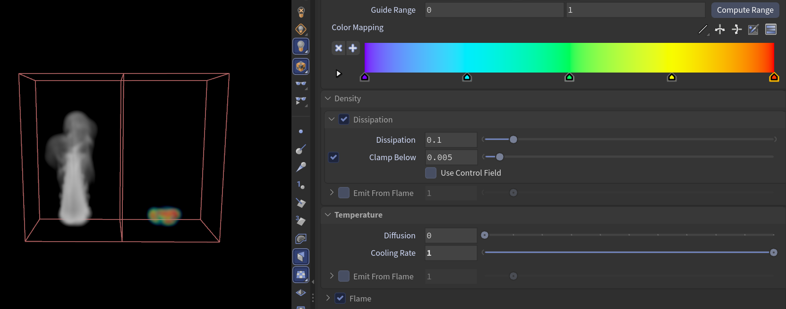

**Cooling Rate 为 `0`，表示关闭这一项主动冷却，并不保证每个位置的温度永远不变。** 温度仍会随流输运，可能通过扩散重新分布，也可能被源或火焰输出修改；不能据此认定烟雾会永远保持同样的温度和运动。

冷却削弱的是热量及其后续驱动，不会直接删除已经存在的 density 或将速度瞬间归零。截图也能看到：温度指引的热区缩小后，左侧仍有可见烟雾。想让烟本身消失，要回头看密度消散，而不是只增加 Cooling Rate。[热量、浮力与烟雾运动的关系](https://www.sidefx.com/docs/houdini/pyro/background.html)

### 10.5 Temperature → Diffusion：将热量向周围摊开

**Diffusion（温度扩散）** 将温度分布向邻近区域扩散，让热处与冷处之间的变化更平滑。它可以削弱局部尖锐的温度差，但不能简单等同于“求解更稳定”。

截图从 `0` 增大到 **`7.7`** 后，温度指引呈现更宽、更柔和的低值区域；这是为了展示扩散而使用的对照值，不是推荐默认值。

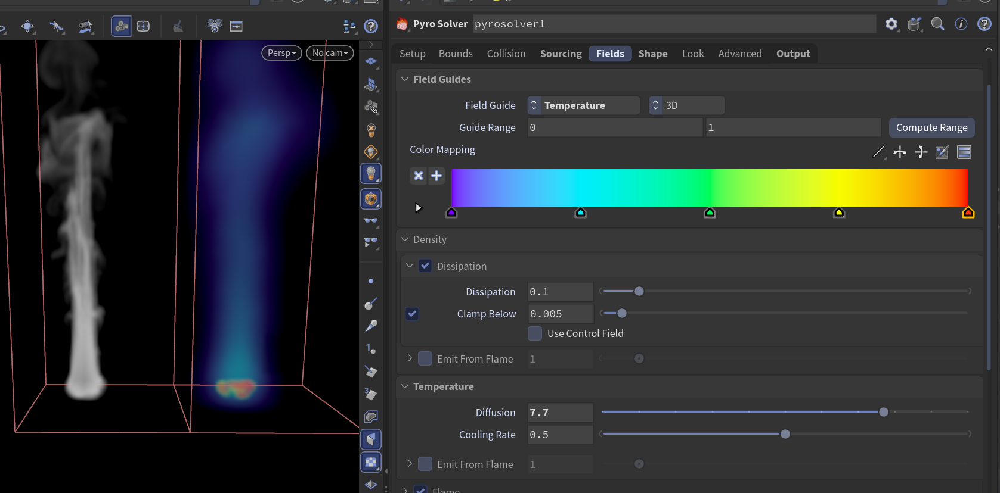

扩散与冷却的区别是：前者主要将热量在空间中重新分布，后者使温度向环境值回落。局部热峰可能因扩散降低，邻近区域则可能升温，所以不能用“整个烟雾一定更热／更冷”概括。

Diffusion 直接处理的是 **temperature**，并非给 density 做模糊；但热量分布改变后，会通过浮力影响烟雾形态。前一节刚加入的温度噪声，也可能因较强扩散失去小尺度差异。[温度扩散与冷却原理](https://www.sidefx.com/docs/houdini/pyro/background.html)

### 10.6 两个 Emit From Flame：分别生成烟与热量

Density 和 Temperature 区域中各有一个 **Emit From Flame**，所在位置决定它修改哪个场：

| 所在区域 | 功能 | 本轮处理 |
| --- | --- | --- |
| Density → Emit From Flame | 由 flame 的反应输出补充 density，即从火焰产生烟 | 先保持关闭 |
| Temperature → Emit From Flame | 由 flame 的反应输出补充热量 | 先保持关闭 |

这两项需要已有的非零 flame 才有相应反应输出，不会单靠勾选就在源中自动创建 burn。它们也不同于 Sourcing 直接注入 density、temperature；两种来源同时启用时，应分别检查贡献，避免混淆。[火焰产生的烟与温度](https://www.sidefx.com/docs/houdini/pyro/flames.html)

本轮沿用第 9 节的纯烟雾对照，先认识用途，具体输出范围和曲线等到重新制作火焰时再展开。

### 10.7 Flame → Flame Lifespan：反应物的消耗时间尺度

展开 **Flame**，截图中的 **Flame Lifespan 为 `2`**。它控制 flame 场所代表的反应物被用完的时间尺度，不是整团烟雾的寿命。

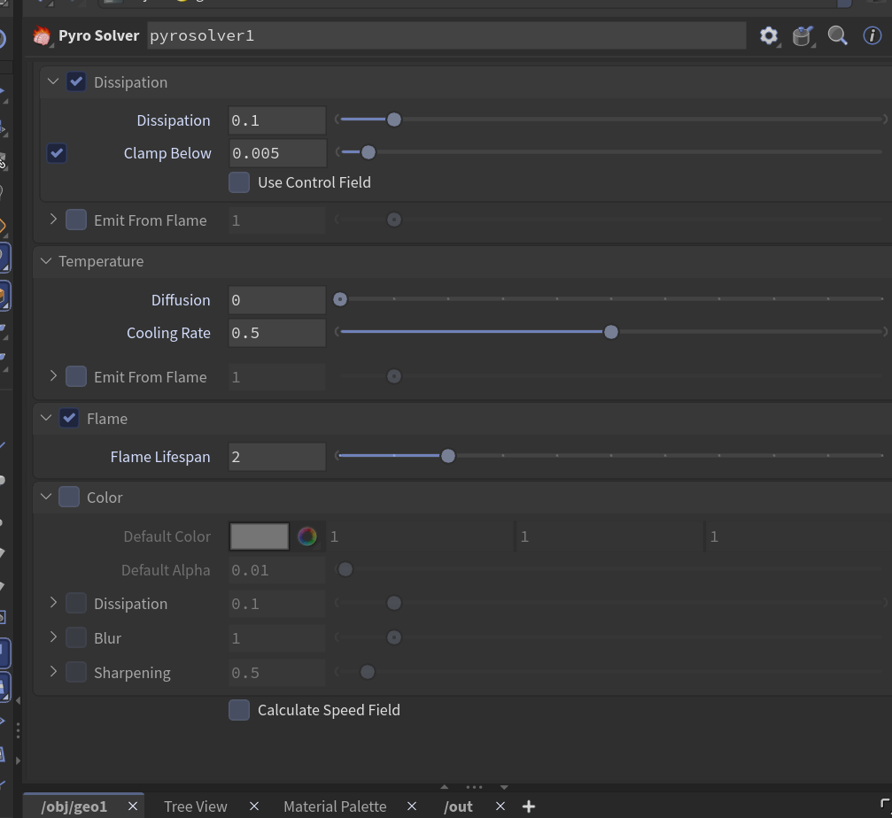

以模拟时间计，在没有继续补充的情况下，初始 `flame=1`、Lifespan 为 `2`，约需 **2 秒**消耗完；初始 flame 不同，消耗时间也相应不同。官方给出的关系为：

```text
消耗时间 = Flame Lifespan × 初始 flame 值
```

增大 Lifespan 会让反应物更慢消耗，通常能保留更长的反应／发光区域；最终可见火焰还取决于流动、持续发射与显示范围。源持续刷新 flame 时，不能从点火那一帧简单倒数 2 秒，认定整团火焰会结束。[Flame 寿命定义](https://www.sidefx.com/docs/houdini/pyro/flames.html)

当前没有注入 burn，所以即使 Flame 场保持启用，调整寿命也不一定能看到效果。后续恢复第 8.12 节的 `burn → flame` 后再实验；字段启用与源中存在数据是两件事。

截图下方的 Color 和 Calculate Speed Field 先保持当前状态，本轮不额外引入颜色场和派生速度标量。

### 10.8 分开调节“看起来淡、冷却、扩散和消失”

| 想检查的内容 | 主要参数或工具 | 要避免的混淆 |
| --- | --- | --- |
| 数值在哪里高、哪里低 | Field Guide、Guide Range、Color Mapping | 伪彩色改变不代表模拟数值改变 |
| 烟雾随时间变淡 | Density Dissipation | 与温度冷却分开 |
| 极薄烟雾直接被清零 | Clamp Below | 这是数值清理，不是显示阈值 |
| 热量保留多久 | Cooling Rate | 设为 0 也不会冻结整个温度场 |
| 热量在空间中有多平滑 | Temperature Diffusion | 不直接等同于密度模糊或求解稳定性 |
| flame 多快耗尽 | Flame Lifespan | 不控制整团烟雾的寿命 |

建议先固定 Guide Range、源和观察帧，仅比较 Dissipation `0.1 / 0.3`；恢复后比较 Cooling Rate `0.5 / 1`；最后再单独比较 Diffusion。每次修改求解参数后重置并重算，只有指引显示设置改变时可以直接观察。

## 11. Shape：浮力、风与 Turbulence 湍流塑形

Fields 控制密度、温度等场如何变化，**Shape** 则提供影响运动与形状的算子。本节依次单独观察各项作用：先保留 Buoyancy、开启 Turbulence，再分别测试 Disturbance、Shredding、Flame Expansion 与 Viscosity，便于判断每项的贡献。

### 11.1 Buoyancy：温度、重力与浮力方向

展开 Buoyancy，截图中的 Buoyancy Scale 为 `0.2`，Ambient Temp 为 `300 K`，Reference Temp 为 `3000 K`，Gravity Acceleration 为 `9.8`，Gravity Direction 为 `(0,-1,0)`。

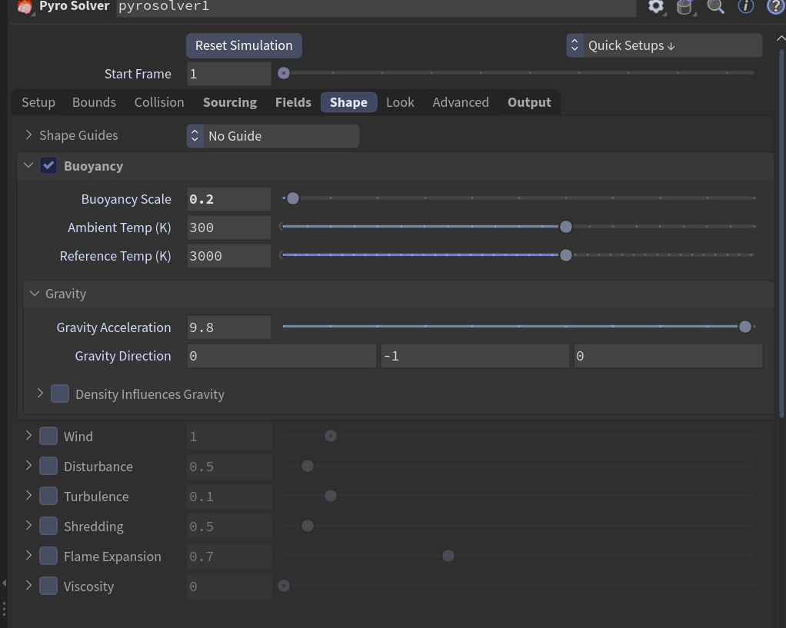

| 参数 | 含义与当前处理 |
| --- | --- |
| Buoyancy Scale | 浮力强度的乘数，当前以它微调上升趋势 |
| Ambient Temp (K) | temperature 为 0 时对应的物理温度，即环境温度 |
| Reference Temp (K) | temperature 为 1 时对应的物理温度 |
| Gravity Acceleration / Direction | 定义重力大小与方向，并参与浮力计算；热气体通常趋向重力反方向运动 |
| Density Influences Gravity | 额外按密度等场施加重力影响；截图关闭，本轮先不启用 |

这组参照下，temperature 的 `0～1` 映射到 `300～3000 K`；温度场数值本身不是开尔文温度。为保持前面调好的尺度关系，先不同时修改这些物理参照。[浮力与温度参照](https://www.sidefx.com/docs/houdini/nodes/sop/pyrosolver.html)

如果想做向下运动的艺术效果，可以尝试把 Buoyancy Scale 从 `0.2` 改为 **`-0.2`**：在本例热源与重力方向下，这会反转该浮力贡献。它不是直接增加“向下扩散”，也不等于给所有烟雾指定向下速度；已有流动、风和源速度仍会影响结果。测试后重置模拟，从首帧比较，再恢复本轮配置。

### 11.2 Wind：提供有方向的风

展开 **Wind**，可以看到 **Wind Speed** 与 **Wind Direction**。截图没有启用，因此参数呈灰色；仅展开或修改数值不等于该作用已经开启。


需要整体朝某个方向偏移时，再勾选 Wind。其风速向量由方向与 Wind Speed 相乘得到，初学时可用单位方向如 `(1,0,0)` 表达 +X，并用速度参数调大小。它与上游点属性 `v` 的注入位置不同，当前先不要两者同时增加，以免难以判断变化来自哪里。[Wind 参数](https://www.sidefx.com/docs/houdini/nodes/sop/pyrosolver.html)

### 11.3 三个形状算子的分工

| 算子 | 可以先建立的直觉 | 本轮做法 |
| --- | --- | --- |
| Turbulence | 在速度场中加入连续的翻卷运动，常用于大尺度形态 | 单独开启，先调整尺度与强度 |
| Disturbance | 加入局部随机加速，打散过于光滑的结构 | 留到后续独立对照 |
| Shredding | 通过转动速度方向打散运动，适合增加细碎变化 | 留到后续独立对照 |

这只是作用层次的划分，不表示任意参数下都只影响某个固定尺度。尤其 Shredding 的直接操作偏向改变方向，不能因此认定整个求解过程中速度大小都不会变化。[Shape 算子说明](https://www.sidefx.com/docs/houdini/nodes/sop/pyrosolver.html)

### 11.4 开启 Turbulence，并查看 Shape Guides

勾选 **Turbulence**，展开参数，再将 **Shape Guides 选择为 Turbulence**。截图中旁边的彩色线条用于查看湍流作用，不是另一团烟，也不是 density 的伪彩色显示。


可以借用 UE Niagara **Curl Noise Force** 的直觉：从空间噪声场取到不同方向的作用，产生翻卷运动。Niagara 的模块将 Curl Noise 作用加入粒子力，Pyro 这里则影响体积流场；这是帮助理解的类比，不表示参数或算法完全对应。[Niagara Curl Noise Force](https://dev.epicgames.com/documentation/unreal-engine/particle-update-group-reference-for-niagara-effects-in-unreal-engine?lang=en-US)

字段指引用于查看 density、temperature 等状态，Shape Guides 用于观察塑形作用。只改指引显示不需要重算；改湍流参数后应重置并重新演算，再看同一帧的形态。[Shape Guides 官方说明](https://www.sidefx.com/docs/houdini/nodes/sop/pyrosolver.html)

### 11.5 湍流强度、尺度、层次与时间

截图基准配置为 Noise Type `Analytic Fast Simplex Noise`、Turbulence `0.5`、Swirl Size `1`、Roughness `0.5`、Pulse Length `0.5`、Max Octaves `2`、Seed `0`。以下是参数分工：

| 参数 | 作用 | 调节时的观察方向 |
| --- | --- | --- |
| **Turbulence** | 整体作用强度 | 先固定其他项，确认翻卷是否过强或过弱 |
| **Swirl Size** | 基础涡旋的空间尺寸 | 大值产生宽广、连贯的推动，小值产生更局部的涡旋 |
| **Roughness** | 后续高频噪声层相对前一层的幅度比例 | 增大后，小涡旋相对更明显；为 0 时仍保留基础层，并非关闭湍流 |
| **Pulse Length** | 噪声演化的时间尺度 | 大值变化慢，小值变化快；不是涡旋的空间尺寸 |
| **Max Octaves** | 最多叠加多少层噪声 | 是多尺度层数，不是求解子步或物理迭代精度 |
| **Seed** | 改变噪声场的偏移／具体分布 | 固定其他条件后，用于选择不同的运动形态 |

后续噪声层的涡旋尺度逐层缩小，Roughness 控制这些层的相对幅度。增加层数可能增加成本；网格不能表达的微小层次，也未必能保留到烟雾结果中。[湍流参数定义](https://www.sidefx.com/docs/houdini/nodes/sop/pyrosolver.html)

**Swirl Size 是空间尺寸，和空间频率的调节方向相反**，可粗略理解为 `尺寸 ∝ 1 / 频率`，不能直接套用 Niagara Frequency 的数值。把噪声想成分布在空间中的图案：尺寸越大，同一区域里图案变化越疏；尺寸越小，变化越密。这是尺度类比，不要求噪声实际使用一张平铺纹理。[Swirl Size 与频率关系](https://www.sidefx.com/docs/houdini/nodes/dop/gasturbulence.html)

本组对照将 Swirl Size 从 `1` 增大为 **`8.33`**，指引中可以看到更大范围的连贯作用，烟雾整体弯曲方式也改变。它不一定只是让烟“细节更少”，也可能主要改变整体轮廓。


### 11.6 Seed：在确定尺度后挑选形态

恢复本轮 Swirl Size 等基准值，再只将 Seed 从 `0` 改到 **`31`**，可以得到另一组湍流分布。制作烟雾时，可在固定设置下比较多个 Seed，选出符合镜头构图的形态。


Seed 不控制强度，也不是每帧重新抽样的开关；变化快慢主要看 Pulse Length 等时间设置。先定大轮廓、尺度和消散，再选 Seed，并记录对应场景与缓存版本；单独修改 Seed 也需要重新模拟。[Seed 与 Pulse Length](https://www.sidefx.com/docs/houdini/nodes/dop/gasturbulence.html)

### 11.7 Threshold Field：先判断哪些区域允许湍流作用

这组截图的设置为：

```text
Threshold Field = temperature
Threshold Range = 0.01, 0
Use as Range    = 未勾选
```

**Use as Range 未勾选时，使用第一个值作为阈值，第二个值被忽略。** 因此当前条件是 **`temperature > 0.01`**，并不是“只有温度在 0 到 0.01 之间才受到影响”。热区较多时，很多位置都能通过，但已经冷却的区域可能不再通过。

勾选 **Use as Range** 后，两端点才用于将场值映射成 `0～1` 的强度权重。端点顺序有意义：若仍保持 `0.01 → 0`，就是热端较弱、冷端较强的反向映射；若想在 `0 → 0.01` 之间逐渐启用，则应使用升序端点。它也不是“区间外都不作用”的带通选择器。[阈值模式与范围模式](https://www.sidefx.com/docs/houdini/nodes/sop/pyrosolver.html)

后续 Cooling Rate、Diffusion 或源温度改变后，通过这一条件的区域也会变。所以湍流范围不是静止不变的几何遮罩。

### 11.8 Use Control Field：按密度缩放湍流强度

截图开启 **Use Control Field**，Control Field 为 **density**，Control Range 为 **`0 → 1`**，Remap Control Field 未开启。它把密度映射为作用权重，而不是让整个区间里的强度完全相同。

在此配置下，可以用下面的比例理解控制效果：

| density | 密度控制权重 | 通过温度阈值后，Turbulence 为 0.5 时的强度量级 |
| ---: | ---: | ---: |
| 0 | 0 | 0 |
| 0.25 | 0.25 | 0.125 |
| 0.5 | 0.5 | 0.25 |
| 1 | 1 | 0.5 |
| 大于 1 | 1 | 0.5 |

表中是控制乘数的示意，不是最终流体速度。前一层温度阈值与这一层密度控制要一起满足，实际还有空间噪声方向和后续求解影响。[Control Range 的归一化与缩放](https://www.sidefx.com/docs/houdini/nodes/dop/gasturbulence.html)

```text
湍流作用 ≈ 基础噪声作用 × Turbulence 强度
          × 温度阈值／范围权重 × 密度控制权重
```

**不建议用 `1 → 1` 表达“只选择密度恰好为 1”。** 两端相等会让渐变区间退化，不能当成等值筛选，更不能直接理解为“只影响最底部”。密度也可能超过 1，高密度区域在哪里取决于模拟状态。

若希望稀薄烟不受影响、浓烟受较强影响，可先试 **`0.8 → 1`**：密度不高于 0.8 时权重为 0，0.8～1 逐渐增强，达到或超过 1 时权重为 1。`0.8` 和 `1` 只是按当前数值尺度设计的示例，应先用 Fields 的 Density 指引或 Compute Range 查看实际分布。

需要更复杂的强弱关系时，再开启 **Remap Control Field** 调曲线。它修改的是湍流权重，和 Field Guides 中仅用于显示的 Color Mapping 是不同用途。

### 11.9 湍流对照顺序

先记录并固定源噪声、Voxel Size、Buoyancy、Dissipation、Cooling Rate 和 Diffusion；若前一节曾将 Diffusion 调到 `7.7`，不要在不知情的情况下把这个实验值继续带入本轮。

1. 仅开启 Buoyancy 与 Turbulence，先保留截图中的阈值和密度控制。
2. 固定 Seed，比较 Swirl Size `1 / 8.33`，建立空间尺度直觉。
3. 分别比较 Roughness、Pulse Length、Max Octaves，每次只改一项。
4. 恢复基准，再比较 Seed `0 / 31`，选择形态。
5. 最后改变 Threshold／Control 条件，观察哪些区域的湍流被削弱，而不只是比较烟雾总轮廓。

每次改变求解设置后重置重算，用相同帧号和镜头比较。Disturbance 在下面单独测试，Shredding 留到后续独立对照，避免同时加满后难以确定哪个参数起作用。

### 11.10 Disturbance：用局部随机作用打散光滑结构

关闭上一轮 Turbulence，保持 Buoyancy `0.2`，单独开启 **Disturbance（干扰／扰动）**，再将 **Shape Guides 切为 Disturbance**。Wind、Shredding 等继续关闭。


它和湍流都会影响速度场，但这组 Disturbance 的作用更局部、碎散，适合打破过于光滑的烟帽与边缘。指引中不再呈现上一节那种大范围连贯的涡旋；**不能因此把所有 Disturbance 模式概括为“完全没有连续性”**。

这里需要区分两种生成方式：

| Mode | 生成方式 | 理解要点 |
| --- | --- | --- |
| **Block-Based** | 在立方块内保持一致的噪声，叠加多个尺寸层次 | 截图采用此模式；块之间可不连续，但块内有共同作用，也可在一段时间内保持图案 |
| **Continuous** | 各体素独立生成随机向量 | 名称不表示空间噪声很平滑；扰动作用在体素尺度，图案逐帧变化 |

因此，观察连续性时应分别问“相邻空间位置是否相关”和“图案随时间怎样变化”。本例是 Block-Based，不应将逐体素、逐帧随机的描述直接套在这组参数上。[Gas Disturb 的两种模式](https://www.sidefx.com/docs/houdini/nodes/dop/gasdisturb.html)

### 11.11 Block-Based 参数：强度与块尺度分别控制

| 参数 | 截图值 | 作用 |
| --- | --- | --- |
| **Disturbance** | 先 `0.5`，后改为 `5` | 局部随机作用的强度；不是增加网格分辨率 |
| **Base Block Size** | `0.2` | 最大一层噪声块的空间尺寸 |
| **Roughness** | `0.5` | 后续层相对前一层的幅度比例 |
| **Pulse Length** | `0.2` | Block-Based 图案保持的时间长度；越短，重新变化越频繁 |
| **Max Octaves** | `3` | 最多叠加三层块状噪声，不是求解子步数 |
| **Lacunarity** | `2.1` | 相邻层的块尺寸比例，后续层逐渐缩小 |
| **Threshold Field / Range** | `density`、`0.05 → 0` | 按密度削弱浓烟内部的作用，详见第 11.13 节 |
| **Use Control Field** | 未勾选 | 本轮不再叠加另一层场控制 |

这些是截图的实验设置。先保持块尺度、层数不变，把强度从 `0.5` 提到 **`5`**，查看指引和同一观察帧的烟雾：指引可能明显增强，但烟雾边缘还没有同等明显的细节。


“提高强度却不明显”不只有精度这一种原因，还应确认阈值是否让作用避开了主体、是否已重算，以及细碎运动是否被后续输运或消散弱化。指引变红也只是当前显示范围下的高值，不直接等于烟雾位移或最终细节量。[Disturbance 参数与场控制](https://www.sidefx.com/docs/houdini/nodes/sop/pyrosolver.html)

### 11.12 减小 Voxel Size，让小尺度作用有表达空间

接着在 **Setup → Voxel Size** 中，从前面的 `0.1` 减小为 **`0.03`**，保持本轮其他参数不变，Reset Simulation 后从首帧重算。


Base Block Size 为 `0.2` 时，最大噪声块在 `0.1` 网格上只跨约 2 个体素，在 `0.03` 网格上则跨约 6.7 个体素。按 Lacunarity `2.1` 估算，本例三层块尺度依次约为：

```text
0.2 → 0.095 → 0.045
```

较粗网格无法表达比单个体素还小的块；更细网格才有机会保留后续层次。Max Octaves 是上限，实际可用层数与网格尺度有关，算法也会补偿层数截断，所以不是每增加一层都会无条件新增可见细节。[块尺度、分辨率与层数截断](https://www.sidefx.com/docs/houdini/nodes/dop/gasdisturb.html)

**`0.03` 是这次对照的精度，不是 Disturbance 的固定要求。** 对相同三维区域，从 `0.1` 改到 `0.03`，体素数量的几何估算约增至 `(0.1 / 0.03)^3 ≈ 37` 倍；实际耗时和内存还受 Sparse 活跃区、启用场与子步影响。可以先用 `0.05` 做中间检查，再决定是否需要 `0.03`。

若已按第 8.5 节建立参数引用，修改求解器 Voxel Size 也会同步改变 Rasterize 的源体积精度。因此这组结果是两处精度联动后的对照；若想单独研究求解网格，应先记录并临时解除引用、固定源，再进行独立实验。

### 11.13 Threshold Range：为什么主要影响烟雾边缘

截图的 Threshold Field 为 **density**，Threshold Range 是按顺序填写的 **`0.05 → 0`**。这里是反向强度映射，不只是检查密度是否落在 0～0.05 内：

| density | 扰动阈值权重 |
| ---: | ---: |
| 0 | 1 |
| 0.025 | 约 0.5 |
| 0.05 及更高 | 0 |

也就是越稀薄，权重越高；浓度达到 `0.05` 后，这项扰动被关掉。它与上一节 Turbulence 在 **Use as Range 未勾选**时的单阈值规则不同，不要只看都有两个输入框就按同一种方式解释。[Disturbance 阈值映射](https://www.sidefx.com/docs/houdini/nodes/sop/pyrosolver.html)

烟雾主体较浓、外缘较淡时，这种设置自然把细节集中在边缘，所以指引中间形成相对空的区域。**它选择的是密度数值，不是真正的几何边缘或到边界的距离**；如果内部也有低密度孔洞，内部同样可能受到作用。


在 density 接近 0 的位置，权重也可以很高，因此指引可能显示烟雾周围的作用；它不代表那里新生成了 density。实际计算范围仍受活跃区域限制，指引的采样和显示阈值也会影响哪些线条可见。

“主体没受影响”应理解为：**主体高密度区没有直接获得这项扰动加速**。周围速度仍会通过后续流体求解与主体相互影响，不能保证核心形态绝对不变。改变密度发射量、消散或阈值，也会改变这一保护范围。

### 11.14 Disturbance 的使用与比较顺序

可以先用 Turbulence 确定大范围翻卷，再用受密度阈值限制的 Disturbance 丰富边缘；但学习阶段先单独测试，确认每一项的影响。

1. 固定源、镜头和观察帧，仅开启 Buoyancy 与 Disturbance。
2. 保持 Voxel Size 不变，比较强度 `0.5 / 5`，分别看指引与烟雾结果。
3. 固定强度与块参数，再比较网格精度，并记录源体积是否随引用一起改变。
4. 用 Density 指引检查 `0.05` 在当前模拟中对应哪里，确认稀薄区是否真的是想要的边缘。
5. 最后关闭 Shape Guide 查看普通烟雾，检查边缘是否太碎、是否丢失薄烟，以及主体轮廓是否符合预期。

强度、噪声块尺寸、网格分辨率、作用区域是四个不同控制。仅提高强度不能代替其他条件；后续再与 Turbulence 叠加时，也应分别保留开关对照。

### 11.15 Shredding：恢复火焰源，观察分叉与撕裂感

本轮先恢复火焰，关闭 Disturbance、Turbulence、Wind 与 Flame Expansion，只保留 Buoyancy 和 **Shredding（撕裂）**，将 Shape Guides 切到 **Shredding**。

按第 8.12 节检查完整火焰来源：Pyro Source 有非零 burn；Rasterize 的 Attributes 恢复为 **`density temperature burn`**；Sourcing 启用 **`burn → flame`**；Fields 中 Flame 场已启用，火焰发光显示也已配置。外加速度 v 本轮仍不启用。已有 burn 点属性可以直接复用，不必重新应用整套初始化预设。


Shredding 通过将速度向量转向随机方向，引入细碎、分叉的运动；该操作本身不直接改变向量长度。它常用于打破过于笔直的火舌，让火焰出现分叉、摆动和撕裂感，但不是对火焰几何执行切割。[Shredding 作用方式](https://www.sidefx.com/docs/houdini/nodes/sop/pyrosolver.html)

它也不是只能作用于火焰；**当前配置使用 flame 作为阈值场**，所以这里需要恢复燃烧源。截图参数为：

| 参数 | 截图值 | 当前理解 |
| --- | --- | --- |
| Shredding | `5` | 撕裂作用强度，是本轮对照值 |
| Base Block Size | `0.2` | 基础随机块尺寸 |
| Roughness / Pulse Length | `0.5 / 0.2` | 控制后续噪声层幅度与图案变化时间 |
| Max Octaves / Lacunarity | `1 / 2.1` | 层数上限与相邻层尺度比；只有一层时，后续层参数没有展开更多层次的空间 |
| Threshold Field | `flame` | 按反应物场分布控制作用位置 |
| Threshold Range | `0.1 → 1` | flame 不高于 0.1 时权重为 0，到 1 时达到完整权重 |
| Use Control Field | 未勾选 | 本轮不再附加其他场的缩放 |

这解释了为什么纯烟雾时，直接开启当前 Shredding 可能几乎看不到效果：不是一定缺少精度，也可能根本没有足够的 flame 通过阈值。

确认场数据和阈值之后，再按前一节的方法逐步减小 Voxel Size，提高分辨率，并重置重算。截图未展示这一轮具体的体素数值，因此不将其写成固定配方；若沿用 `0.03`，也要检查源体积联动与内存成本。


比较时保持源、火焰寿命、镜头和帧号一致。看不清分叉时，除了网格，也要检查火焰显示是否过亮、阈值覆盖是否太少、流动本身是否足够明显，不要仅靠持续增加强度解决问题。

### 11.16 Flame Expansion：由 flame 驱动向外膨胀

接下来关闭 Shredding，保留火焰源，单独开启 **Flame Expansion（火焰膨胀）**。截图中 Expansion Rate 为 **`2`**，Flame Range 为 **`0 → 1`**，Remap Flame Range 与 Use Control Field 均未开启。


这一项依据 flame 向模拟添加目标散度，可以先理解为让局部气体产生向外扩张的流动；它不是把最终火焰图像或源模型统一放大。正的 Expansion Rate 越高，通常膨胀越强，但 `2` 不等于火焰半径或体积翻倍。[火焰的膨胀输出](https://www.sidefx.com/docs/houdini/pyro/flames.html)

Flame Range 先把 flame 映射成 `0～1` 的权重，再乘 Expansion Rate；因此不是所有区域都按相同程度膨胀。Remap Flame Range 可进一步改变权重曲线，本轮先不开启。负的 Expansion Rate 则可产生向内吸入的趋势，属于另一种效果方向。[Expansion Rate 与 Flame Range](https://www.sidefx.com/docs/houdini/nodes/sop/pyrosolver.html)

要区分三个“火焰相关”控制：Shredding 改变流动方向，Flame Lifespan 控制反应物消耗时间，Flame Expansion 提供膨胀趋势。增加膨胀也会让模拟占据更大范围，需要同时留意 Bounds 和活跃区域，不能靠增大容器来替代实际的膨胀作用。

### 11.17 切回纯烟雾，再做 Viscosity 对照

研究黏度时先移除火焰输出的干扰。可以在求解器 Fields 中关闭 Flame，但应同时检查 Sourcing，避免仍向已关闭的场注入 burn。更清楚的本轮配置是：

1. Rasterize 恢复 **`density temperature`**，Sourcing 停用 `burn → flame`，外加 v 仍保持停用。
2. 关闭 Shredding、Flame Expansion，以及 Density／Temperature 中的 Emit From Flame。
3. 确认纯烟雾设置后，按需关闭 Fields → Flame；不要误关提供浮力的 temperature。
4. 保留 Buoyancy `0.2`，开启 Turbulence，并将强度提高到截图中的 **`5`**；Wind、Disturbance 先关闭。
5. Shape Guides 选择 No Guide，开启 Viscosity，先设为 **`0`**，重置后从首帧演算。

**只在 Look 中关闭 Enable Emission，会隐藏火焰发光，不会自动停掉 flame 参与的反应与膨胀。** 做纯烟雾对照应处理源和求解行为，而不只是显示。[火焰场输出](https://www.sidefx.com/docs/houdini/pyro/flames.html)、[发光显示开关](https://www.sidefx.com/docs/houdini/nodes/sop/pyrosolver.html)


### 11.18 Viscosity：让邻近区域的速度更接近

**Viscosity 更准确的称呼是黏度，不是几何粘合度。** 这里主要平滑速度场中的局部差异，使相邻区域更倾向于一起运动，从而减少相互拉散的趋势；它不会把分离的烟雾团自动吸回去，也不直接把 density 增浓。[速度场中的黏度作用](https://www.sidefx.com/docs/houdini/nodes/dop/gasviscosity.html)

保持 Turbulence `5` 和其他条件不变，将 Viscosity 从 `0` 增大到截图中的 **`3.63`**，重置并重新演算，观察烟团是否更连贯、细碎运动是否减弱。


`3.63` 是这次实验值，不是通用的真实烟雾参数。黏度为 0 时只代表这项平滑没有贡献，烟雾仍受到其余求解步骤影响；增大黏度也不保证烟雾永远不散或不消失，风、膨胀、输运、持续注入与密度消散仍然存在。[Pyro Viscosity 参数](https://www.sidefx.com/docs/houdini/nodes/sop/pyrosolver.html)

本组图片的取景和可见包围盒有所差别，适合记录形态变化，不宜直接把屏幕面积差解释为黏度造成的收缩。做严格对照时固定镜头、观察帧和源设置，并记录 Turbulence 的尺度、场控制及体素精度。

还要分开三种“变平滑”：Temperature Diffusion 平滑热量分布，Viscosity 平滑局部运动，密度显示／着色则可能只让外观看起来柔和。提高黏度可能压掉先前加入的小尺度运动，不适合把它当作所有噪点或细节问题的统一修复开关。

### 11.19 本轮三个效果的独立对照

| 实验 | 使用的源 | 主要开关 | 重点观察 |
| --- | --- | --- | --- |
| 火舌分叉 | density、temperature、burn | Buoyancy + Shredding | flame 阈值覆盖、速度转向与分叉细节 |
| 火焰膨胀 | density、temperature、burn | Buoyancy + Flame Expansion | 向外扩张及活跃区变化 |
| 黏度对照 | density、temperature | Buoyancy + Turbulence，比较 Viscosity 0／3.63 | 局部运动是否更连贯、是否损失需要的细节 |

先完成这三组，再根据成品需要组合算子。每次切换都检查实际启用项，不要把灰色框中保留的数值误认为正在生效；求解设置改变后重置重算，才能比较同一帧的新结果。

## 12. Look 与 Pyro Bake Volume：在求解后调整外观

模拟形状和运动合适之后，再调整“烟有多浓、是什么颜色、火焰有多亮”。本次采用在求解器下游放置 **Pyro Bake Volume** 的方式，将外观调整集中到单独节点；求解器自带的 Look 仍可用于快速预览。

### 12.1 Pyro Solver → Look：先认识外观参数

Look 中可以调整 Smoke 和 Fire 的外观。截图在求解器上将 Density Scale 调到 `6.3`、Shadow Density 调到 `1.66`，并使用火焰颜色渐变和较高的发光强度，得到蓝青色与亮白色的火焰。


这些数值记录当前截图，不是推荐的通用设置。这里的火焰颜色是外观映射，与 Fields 页中用来查看数值的伪彩色指引不同；调整颜色也不表示实际 temperature 随之改变。[求解器 Look 参数](https://www.sidefx.com/docs/houdini/nodes/sop/pyrosolver.html)

### 12.2 在求解器下方创建 Pyro Bake Volume

1. 在同一 SOP 网络中，按 `Tab` 搜索 **Pyro Bake Volume** 并创建。
2. 将 `pyrosolver1` 的体积输出连接到它的输入。
3. 将显示旗标切到 `pyrobakevolume1`，确认参数面板也在编辑这个节点。
4. 先在 **Smoke** 页调整烟雾，火焰外观则在 **Fire** 页调整。

```text
Pyro Source → 属性处理 → Volume Rasterize Attributes → Pyro Solver
                                                       ↓
                                                Pyro Bake Volume
                                                烟雾与火焰外观
```


显示在 Bake 节点时，下游的可视化设置可以接管这一路体积的外观，所以可以直观地说它“覆盖上面的 Look”。**它不会回头改写 Solver 的 Look 参数，也不会自动把那里的设置全部复制过来**。截图中 Bake 的 Density Scale 为 `1`，而前一张 Solver Look 为 `6.3`；接入后外观变化时，应先对照两处设置。

它属于模拟之后的体积外观处理，可以借用“后期调整”的直觉，但并非对已经渲染好的二维图片做滤镜。节点还可以分配材质，并在启用相关功能时生成 scatter 等派生体积；名称中的 Bake 不表示已经自动保存模拟缓存或导出序列帧。[Pyro Bake Volume 官方说明](https://www.sidefx.com/docs/houdini/nodes/sop/pyrobakevolume.html)

### 12.3 Smoke 页：密度外观、颜色与阴影

| 参数 | 截图值 | 调整目的 |
| --- | --- | --- |
| **Smoke** 启用项 | 勾选 | 显示烟雾这一部分；不等同于停止 density 模拟 |
| **Density Scale** | `1` | 缩放显示／着色时的烟雾浓厚程度；增大通常更不透明 |
| **Smoke Color** | 白色，`Constant` | 烟雾颜色；需要随密度变化时可再使用颜色 Ramp |
| **Shadow Color** | 白色 | 控制阴影的色彩表现，先保持当前设置 |
| **Shadow Density** | `1` | 控制光穿过体积时的阴影衰减，不能与 Density Scale 当作同一个参数 |
| **Ambient Shadow Scale** | `0.5` | 环境光照下的自阴影强度，需结合视口光照判断 |

可以先固定光照，把 Density Scale 小幅增大，确认烟雾是否更浓，再改 Smoke Color，最后调阴影。不要同时改变所有项，否则烟变暗时很难判断是浓度、颜色还是自阴影造成的。

这里的 Density Scale 用于外观；Pyro Source 的 density 控制注入数据，Fields 的 Dissipation 控制它随时间消散。想让烟“看起来更浓”和想让它“活得更久”，应分别调整对应环节。[烟雾外观与体积字段的分工](https://www.sidefx.com/docs/houdini/pyro/lookdev.html)

### 12.4 Assign Material 与 Bindings：确认外观使用了正确数据

截图勾选 **Assign Material**，路径为 `matnet/Pyro_Shader`。节点内置的 Pyro Shader 可以引用这些外观参数，并通过材质分配用于渲染；实际结果仍取决于目标渲染器、材质绑定与光照，不能把视口效果当作最终渲染的完全保证。

在 **Bindings** 中，Smoke Volume 通常使用 `density`；火焰强度和颜色也需要绑定到实际存在的体积，常见流程分别使用 `flame` 与 `temperature`。若上游只保留纯烟雾数据，单独开启 Fire 显示不会凭空补出燃烧场。

顶部 **Max Vis Resolution** 用于限制视口预览分辨率，帮助预览较重的体积；它与求解器的 Voxel Size 不同，不会提高模拟精度。截图未开启这项限制，不要把灰色的 `128` 当作当前模拟的体素数量。

本轮先沿用默认绑定，Scatter、Secondary Fire 等留到需要时再展开。部分选项会生成额外体积，甚至可按设置向烟雾密度合入发光区域，因此不能将节点所有功能都理解为“只改颜色”。[材质分配、字段绑定及烘焙功能](https://www.sidefx.com/docs/houdini/nodes/sop/pyrobakevolume.html)

### 12.5 缓存后调外观，减少重复模拟

仅改变常规的烟雾颜色、Density Scale、火焰颜色或亮度时，通常不需要 Reset Simulation；下游可能重新计算显示或派生体积，但没有改变上游的运动规则。想改变上升、分叉或膨胀，仍应回到源、Fields 或 Shape。

为了反复试外观，可以在求解器之后先缓存原始模拟场，再接 Bake：

```text
Pyro Solver → File Cache（原始模拟场）→ Pyro Bake Volume → 输出／渲染
```

缓存时保留当前外观需要的 density、temperature、flame 等字段。读取同一份缓存后，可以分支创建多个 Bake 节点尝试不同风格；先集中在一个 Bake 节点调外观，避免 Solver Look 与下游来回改动而难以判断当前生效位置。

若修改 Bake 参数没有变化，先检查显示旗标、当前编辑节点、Smoke／Fire 启用状态和 Bindings；若视口变化而渲染不变，再检查渲染的对象／路径是否使用该输出和材质。不要因为外观问题先重算整段模拟。

## 13. 初学调参顺序：先形状和运动，再做细节

建议先确认源体积连续、圆环孔洞仍然存在，再调整整体运动，最后加入噪声和提高分辨率。下面是判断方向，具体数值需要结合场景尺度测试。

| 想改变的表现 | 优先检查 | 思路 |
| --- | --- | --- |
| 源太粗，圆环孔洞消失 | pscale、Rasterize Voxel Size、圆环粗细 | 先看源轮廓，不急着改模拟湍流 |
| 烟雾不上升或升得慢 | temperature 是否成功注入、Buoyancy Scale、Cooling Rate | 检查热量和浮力链路 |
| 上升过快 | 源温度、Buoyancy Scale、输入速度 | 一次只调整其中一项 |
| 烟雾保留太久／消失太快 | Density Dissipation | 影响密度随时间的消散 |
| 希望大范围翻卷 | Turbulence 及其空间尺度 | 先形成大轮廓，再观察小扰动 |
| 希望增加局部破碎细节 | Disturbance、求解器分辨率 | 小于网格可表达尺度的细节难以保留 |
| 希望火舌出现分叉、撕裂感 | Shredding、flame 阈值、分辨率 | 先确认 burn 已进入 flame，再比较局部运动 |
| 希望火焰向外鼓胀 | Flame Expansion | 改变局部膨胀趋势，同时观察计算范围 |
| 希望烟团不那么容易被拉散 | Viscosity | 平滑局部速度差异，并检查是否压掉了需要的翻卷细节 |

浮力、冷却、消散与形状控制共同决定效果，不存在一个参数独立控制“真实感”。先确定源尺寸和输入值范围，再调运动，是更容易比较的顺序。[Pyro 工作流与外观调整](https://www.sidefx.com/docs/houdini/pyro/lookdev.html)

视口中的烟雾深浅还受显示与着色影响。若只是想让成片中的烟更浓，应先判断是模拟密度不足，还是显示／材质的密度映射偏弱；不要直接通过增加源点数解决所有问题。

## 14. 工程思路：把源、模拟和显示分开检查

### 14.1 为什么先编辑点，再转换体积

点和点属性便于检查，也便于接入 Houdini 的属性处理工具。可以先在点上改变局部密度、温度和速度，再统一转为体积；同一套点也能携带多种发射信息。这是点属性发射源流程的主要便利。[点属性发射源工作流](https://www.sidefx.com/docs/houdini/pyro/pyro.html#point-based-sourcing)

第 9 节记录了在 Pyro Source 与 Rasterize 之间加入 Attribute Noise 的操作。先保证常量源能稳定发射，再增加属性变化，就能分别检查源的强度分布、覆盖范围与求解器运动。

### 14.2 速度属性 v 与速度场 vel

第 8.13 节已记录创建与接入速度的完整操作。工程检查时记住：**输入属性名、生成体积名与目标场名需要逐段核对**，不能仅凭属性存在就认为求解器已使用它。点向量 `v` 先转换为源体积 `v`，再映射到模拟速度场 `vel`。[速度场含义](https://www.sidefx.com/docs/houdini/pyro/background.html)

纯烟雾加外部速度时输出 `density temperature v`；第 8 节的火焰与速度实验输出 `density temperature burn v`；第 9 节停用二者后恢复 `density temperature`。列表应与当前实验的发射需求对应，切换时同时检查 Sourcing 和模拟缓存。

### 14.3 从低分辨率开始，并管理计算范围

对于固定三维区域，体素边长减半，体素数量约增至 8 倍；实际耗时还受子步、活跃区域和启用场数量等影响。源体积与模拟体积都有自己的分辨率，不能只看一个 Voxel Size。[求解器分辨率的成本](https://www.sidefx.com/docs/houdini/nodes/sop/pyrosolver.html)

Sparse 模拟会将计算集中在活跃区域，但烟雾持续扩散后仍可能消耗很多内存。查看模拟包围盒与活跃区，确认范围符合预期；若烟在某个平面突然被切掉，应检查边界限制。[Sparse 与 Dense 模拟](https://www.sidefx.com/docs/houdini/pyro/sparsity.html)

### 14.4 节点命名与缓存

网络稍复杂后，可在源体积与模拟结果末端各放一个 Null，命名为 `OUT_SOURCE`、`OUT_SIM`，并用 Network Box 标注“发射源”“模拟”“显示”。这样可以快速切换显示旗标检查数据。

模拟满意后，在求解器后添加 **File Cache** 保存结果，再开启 **Load from Disk**。动态模拟需要按时间顺序计算；缓存动画时检查帧范围、Time Dependent Cache 和 Simulation 设置。[File Cache 官方说明](https://www.sidefx.com/docs/houdini/nodes/sop/filecache.html)

例如显式文件路径可以组织为：

```text
$HIP/cache/pyro_smoke/v001/pyro_smoke.$F4.bgeo.sc
```

`$HIP` 对应场景文件所在目录，`$F4` 为四位帧号。先保存 `.hip` 场景，再确定缓存位置。确认只输出 VDB 时也可保存 `.vdb`；不确定是否还有其他几何时，使用 `.bgeo.sc` 更方便保留数据。

改过上游却一直看到旧效果，应检查 Load from Disk 是否仍开启。缓存版本最好与 `.hip` 场景版本配套保存，并简单记录本次改变了什么。[缓存读取、格式与版本管理](https://www.sidefx.com/docs/houdini/nodes/sop/filecache.html)

## 15. 常见问题排查

按数据流从上游到下游检查，比同时改多个参数更容易定位问题。

| 现象 | 优先检查 |
| --- | --- |
| 切换 Keep Input 后点数没有随间距变化 | 此模式沿用输入点；改 Surface Scatter，或在上游重新分布点 |
| 调 Particle Scale，看不出变化 | 查看 pscale，再看 Rasterize 后的体积；检查是否已有上游 pscale |
| Rasterize 没有输出预期体积 | Pyro Source 是否有非零属性；Attributes 是否填写 `density temperature`；名称和类型是否正确 |
| 已有 VDB，视口仍看不到烟 | 显示旗标、density 是否非零、Visible Volumes、视图取景和显示设置 |
| 体积像分离的球团，或有孔洞 | 点间距与覆盖范围是否匹配；不要只减小 Voxel Size |
| 圆环中间的洞被填平 | 点覆盖范围是否过大，体素是否太粗，原始圆环是否太厚 |
| 播放后体积仍静止 | 是否还在显示源节点；是否接入 Pyro Solver，并从起始帧顺序播放 |
| 有烟，但不向上升 | temperature 是否成功映射；再看浮力、冷却及输入速度 |
| 改参数后没有变化 | File Cache 是否读旧缓存；求解器是否已经重置并重算 |
| 误点末帧后长时间等待 | 请求帧之前是否缺少模拟缓存；先缩短预览范围，再从首帧逐步播放 |
| 两处 Voxel Size 没有联动 | 是否用了 Paste Values；检查 Rasterize 中的相对引用、节点路径和求解器参数 |
| 添加 burn 后仍只有烟 | 点上是否有非零 burn、Rasterize 是否包含它、burn → flame 是否启用，以及 Flame 场和发光显示是否已配置 |
| Constant Value 为 5、0、0，却没有横向喷射 | 是否为小写点向量 v，Rasterize 是否输出 v，Sourcing 是否以 Vector 接入 vel；重置后重新比较 |
| 源速度设置很大，但运动方向仍难以判断 | 检查随机向量的局部混合、Sourcing 合并操作、坐标空间与当前视角，先用小幅常量速度隔离问题 |
| 加噪声后密度出现负数，或烟雾异常变淡 | 检查 Zero Centered 与 Multiply 的组合、实际输出范围、Ramp 和输出下限；不要只凭曲线外观判断 |
| 调了密度噪声，体积范围也明显变化 | Attribute Names 是否还包含 pscale；本轮应只修改 density |
| Element Size 很小，模拟仍没有细节 | 检查点间距、覆盖大小与源／模拟分辨率能否表达该尺度；先看点属性，再看源体积 |
| 复制温度噪声后，密度又被处理一遍 | 第二个节点是否仍以 density 为目标；应只填 temperature |
| 场指引一片红，无法比较高值 | Guide Range 上限是否太低；用 Compute Range 了解当前帧，再固定统一范围比较 |
| 调高冷却后烟仍存在 | Cooling Rate 处理温度，密度消失需查看 Dissipation 与持续发射 |
| 薄烟突然消失或边缘被切掉 | Clamp Below 是否过高；也检查容器边界及显示阈值，区分实际清零与不可见 |
| 调了 Flame Lifespan，纯烟雾没有变化 | 是否真的有 burn 注入 flame；仅开启 Flame 场不代表已有反应物 |
| 开启湍流却很弱或局部不起作用 | 检查 temperature 是否通过阈值、Use as Range 的状态，以及 density 控制权重是否接近 0 |
| 改 Threshold Range 的第二项没有变化 | Use as Range 未勾选时，第二个值被忽略 |
| 高密度控制没有只选中底部 | Control Range 按场数值控制，不按高度；不要把 1→1 当作等值或空间选择 |
| Swirl Size 变小仍看不到小涡旋 | 检查网格分辨率、湍流强度与场控制是否允许该尺度的作用 |
| Disturbance 指引很强，烟雾细节却不明显 | 检查块尺寸相对体素是否过小、阈值是否屏蔽主体，以及是否已重算；不要只继续加大强度 |
| Disturbance 指引中间是空的 | density 的 0.05→0 映射会屏蔽高密度核心；结合密度指引确认，不能只凭空心外观判断算法 |
| Shredding 已开启，却几乎没有分叉 | 检查 burn→flame、flame 是否通过 0.1→1 的阈值、显示亮度与实际网格精度 |
| 关闭发光后，烟雾仍像火球一样膨胀 | Look 的显示开关不会停掉模拟；检查 flame 来源、Flame Expansion 与其他火焰输出 |
| 提高 Viscosity 后细节变少 | 它在减小局部速度差异；检查黏度是否过强，并与湍流等参数分开比较 |
| 接入 Pyro Bake Volume 后，原来的浓淡或颜色变了 | 对照 Bake 与 Solver Look；下游不一定自动沿用上游外观值 |
| 改 Bake 参数没有视口变化 | 当前是否显示 Bake 输出、是否编辑正确节点、对应组件是否启用、字段绑定是否正确 |
| 视口外观已改变，渲染却仍用旧效果 | 检查输出路径、Assign Material 和实际渲染材质绑定；不要先重算模拟 |
| 模拟越来越慢 | 活跃区域是否持续增长；Voxel Size 是否过小；发射是否本该停止 |

## 16. 三个帮助理解参数的对照实验

每组只改一个变量，记录点数、pscale、源轮廓和模拟指定帧的截图。以下均是学习实验，不是成品推荐配置。

**实验 A：观察点间距与点半径的耦合。** 固定 Particle Scale 为 `2`，对比 Particle Separation 为 `0.1` 和 `0.2`。观察点数减少的同时，pscale 是否从 `0.2` 变成 `0.4`，以及转体积后的边缘变化。

**实验 B：分离点数和半径的影响。** 对比 `Separation=0.1、Scale=2` 与 `Separation=0.2、Scale=1`，两者 pscale 都为 `0.2`。固定 Rasterize Voxel Size，观察减少点数后是否出现覆盖不足。该关系以输入没有预先存在的 pscale 为前提。

**实验 C：分离源覆盖和网格分辨率。** 固定点和属性，只对比 Rasterize Voxel Size 为 `0.1`、`0.05`；先观察静态源，不接着改求解器。之后再固定源，仅改变求解器 Voxel Size，观察动态结果与计算成本。若已按第 8 节建立两处参数联动，应先记录并临时解除 Rasterize 的引用，才能独立比较；实验结束后按需恢复引用。

## 17. 火焰工作流的版本与字段提示

本篇前半部分的 `density + temperature` 是热烟雾起点，第 8.12 节再加入 `burn → flame`，扩展到火焰。完整效果还取决于反应设置与发光显示，不能仅凭一个属性名称判断燃烧已经配置完成。

旧教程可能使用 `fuel`、`burn`、`heat` 等名称；较新的 Sparse Pyro 流程常围绕 `flame` 场组织反应物剩余寿命，并生成烟、热量和膨胀。它们不能只按字面名称互换。[Flames 官方说明](https://www.sidefx.com/docs/houdini/pyro/flames.html)

接着学习时，先确认教程版本、求解器类型及实际的 Source Volume → Target Field 映射，再沿用参数。以当前“模型 → 点与属性 → 源体积 → 模拟”的数据流为基础，后续再加入碰撞物体和更复杂的爆炸源。
