# Houdini爆炸贴图

这篇笔记按实际制作顺序记录：先搭出烟火，再回头调整发射源，接着对比噪声和源操作，逐步确定这一版爆炸的效果。正文保留制作时的观察和调整思路，必要的参数纠错放在相应步骤旁边；截图中的中间尝试也保留，方便回看为什么这样改。

## 一、先明确要做什么，再搭出基础烟火

首先，我们需要使用 Houdini 创建一层爆炸烟雾的序列，以及一层灰烬飞散的烟雾序列。这里先从爆炸主体的烟火做起，灰烬飞散这一层后面再继续制作。

首先在 Houdini 中创建一个 **Geometry** 节点，进入它的内部，然后创建 Pyro 流程。首先需要一个发射源，这里依旧使用 **Pyro Burst Source**（`pyroburstsource`）；然后把它转为体积，使用 **Volume Rasterize Attributes**（`volumerasterizeattributes`）；接着连接负责解算的 **Pyro Solver**（`pyrosolver`）。

```text
/obj/geo1
  pyroburstsource1               爆炸发射源
    ↓
  volumerasterizeattributes1     将点属性转为体积
    ↓
  pyrosolver1                   烟火解算
```

接下来回到体积转换这里，将所需的属性添加进 **Attributes**：

```text
density temperature burn
```

也就是密度、温度、燃烧这三个属性。将显示旗标切到求解器，从起始帧向后播放，现在基本的烟雾流程就已经形成了。先把这条链路打通，再考虑它的轮廓、细节和爆炸感。

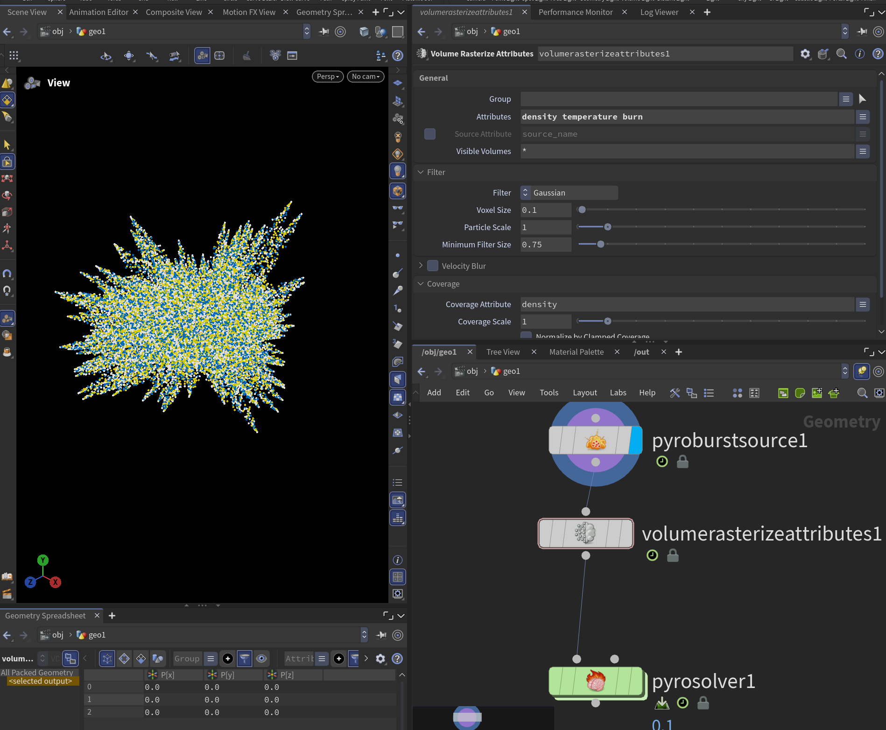

图 1：发射源、体积转换和解算器的连接。左侧当前看到的仍是源点；把显示切到求解器后观察模拟。截图中转体积的 Voxel Size 为 `0.1`，Particle Scale 为 `1`，Minimum Filter Size 为 `0.75`。

现在，如果我们需要进一步看到温度和燃烧相关的火焰表现，就回到体积转换这里，把 **Coverage → Coverage Attribute** 里的 `density` 删除。这样，在当前这套设置下就能看到火焰。

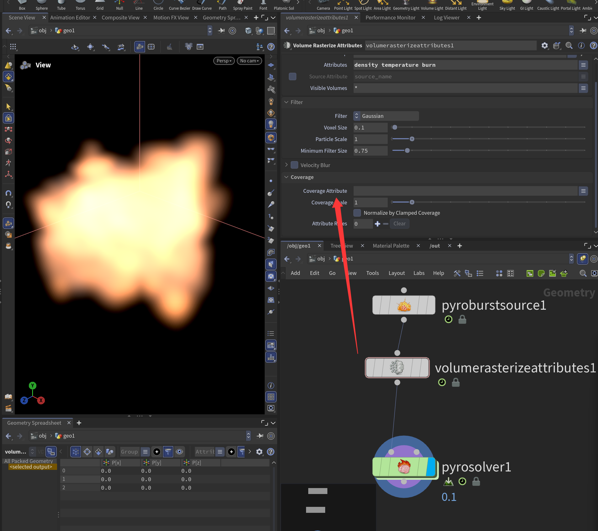

图 2：红色箭头指向要清空的位置。上方 Attributes 中的 `density temperature burn` 仍然保留。

> **操作补充：**这里清空的是“覆盖属性”，不是删除烟雾密度。它让温度、燃烧源不再以 `density` 作为覆盖权重；温度本身仍由上游提供，并非清空后才生成。若仍看不到火焰，再检查上游属性、求解器的源映射及火焰显示设置。[体积转换官方说明](https://www.sidefx.com/docs/houdini/nodes/sop/volumerasterizeattributes.html)

发射源的基础形状参数也可以对照前面的[《特效贴图制作》](4_2特效贴图制作.md)。这一段的“体积转换”始终指求解器上游的节点。

## 二、回到最上游：我希望它更大，而且是全向爆炸

我们回到最上游，调整它的发射源。这个爆炸类型使用 **Explosion**。其次是它的大小，我希望它大一点，所以把 **Initial Size** 调整为 `1.5`。

然后是角度。它现在爆炸的角度是朝上的，我希望这个爆炸是全向的，所以将 **Spread Angle** 调整为 `180`，Direction 仍保持 `(0, 1, 0)`。

接着，拖尾数量可以给少一点，这里 **Number of Trailings** 给 `59`。然后看 **Trailing Separation**（拖尾点间距）：现在这些点太密集了，这样产生的细节也会很多，这里改为 `0.2`，让它的点稀疏一点。

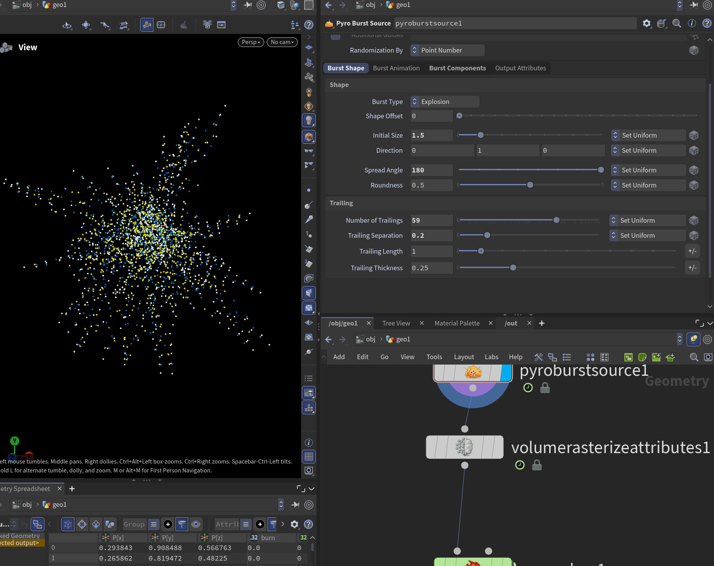

图 3：这一轮先调整整体形状和采样：尺寸 `1.5`、角度 `180`、拖尾数量 `59`、点间距 `0.2`。其余截图值为 Shape Offset `0`、Roundness `0.5`、Trailing Length `1`、Trailing Thickness `0.25`。

这里的调整思路是：先决定爆炸有多大、朝哪些方向展开，再把过密的点减下来。拖尾数量决定有多少条拖尾，点间距决定每条拖尾采样得多密。

> **补充：**点变稀疏后，转体积的局部细节也可能变粗；最终细节还要结合体素尺寸和求解器设置判断，不能只看源点数量。

## 三、接着调发射源动画：持续到第 6 帧，向外放大到 2.5

接着是它的发射源动画，打开 **Burst Animation**。当前这一步原先是从第 1 帧到第 5 帧，这里我们调整到第 6 帧：**Start Frame** 保持 `1`，**Frame Duration** 改为 `6`。

然后最大放大倍数给到 `2.5`，对应这里的 **Outward Expansion**。**Directional Expansion** 继续保持 `0`。

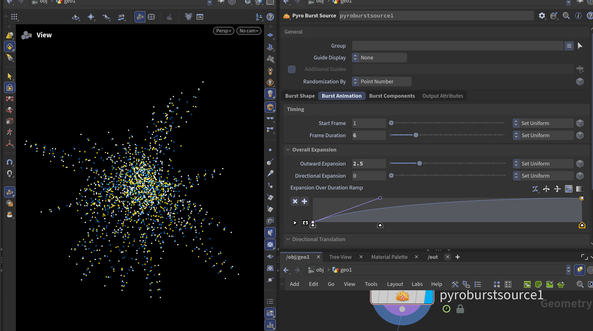

图 4：发射源持续时间为 `6` 帧，向外膨胀倍数为 `2.5`。下面的 Expansion Over Duration Ramp 记录这段时间内的展开节奏，截图中是开始展开得快一些，后面逐渐放缓。

这一段先把发射源“在多长时间里展开、展开到多大”定下来。后面还要继续控制这段时间里发射多少密度、温度和燃烧属性。

> **补充：**这里的放大倍数作用于发射源，相对于 Initial Size。它不是最终烟团尺寸的上限；发射源动画结束后，已有烟火还会继续被求解器模拟。

## 四、保留三个属性，再让发射强度有时间和空间上的过渡

然后是传递的属性。打开 **Burst Components**，密度 **Density**、温度 **Temperature**、燃烧 **Burn** 这三个都保持创建，也就是三个组件的 **Create Source** 都勾选。

这里它有一个 **Scale Over Duration**，这是之前没讲到的，把它点开。我们可以在这里设置这个发射器从第 1 帧到第 6 帧的发射密度变化：比如开始强一些，后面逐渐弱下来，而不是整段时间都以同样的强度发射。

然后下面的 **Scale Along Trailing** 也保持勾选，它会让每一条拖尾从中心到最顶端有一个过渡。通过下面的曲线，我们可以让爆炸内部的属性强一些，越接近拖尾尖端越弱。

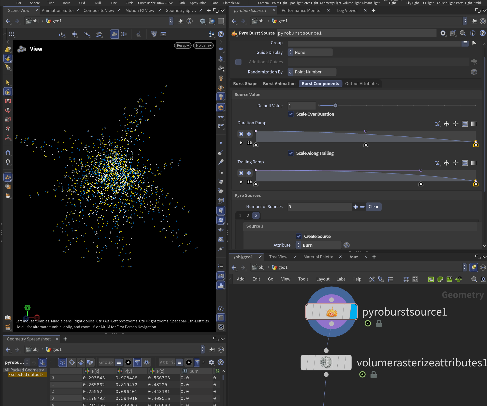

图 5：上面是 Duration Ramp，下面是 Trailing Ramp，两个选项都保持勾选。Default Value 为 `1`，Number of Sources 为 `3`。

这两步分别控制“发射过程中怎样变化”和“每条拖尾上怎样分布”。先把这两种过渡保留下来，再加噪声打破过于均匀的属性分布。

> **补充：**Duration Ramp 左端是发射开始，右端是结束；Trailing Ramp 左端是爆炸内部，右端是拖尾尖端。这里位于组件上方的公共缩放也会影响温度、燃烧等源属性，不只影响密度。它控制的是源强度，不是已经生成的烟雾的消散。

## 五、给烟雾密度加随机：先看 Add，再决定用 Multiply

然后我们调整一个烟雾密度的随机。进入 **Source 1 → Density**，把 **Enable Noise** 勾选启用。

它下面有两种方式，**Add** 和 **Multiply**。我们先选择 Add，看看它是怎么影响原来的值的。

### 1. Add：在原来的值上相加

当我们选择 **Add** 的时候，下面 **Amplitude** 振幅是 `1`，那么这个 Noise 噪声提供的值就是 `-1～1`。它会把这个值和原来的值进行相加，也就是当基础值是 `1` 时，最终得到的范围是 `0～2`。

```text
基础值 1 + 噪声（-1～1） → 0～2
```

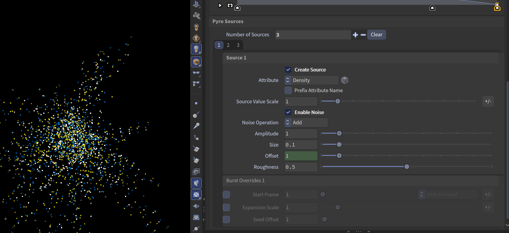

图 6：这是对比 Add 的阶段，振幅为 `1`，Size 仍为 `0.1`，不是最后采用的设置。

> **补充：**这里为了理解运算，先不计时间曲线、拖尾曲线和其他缩放；实际完整属性值还会受到它们影响，源点也不一定刚好采样到范围的两个端点。

### 2. 换一个随机图案：Offset、解除绑定与 Seed Offset

然后下面这个 **Offset**，在制作时可以先把它理解为类似 Seed 种子的控制：改变它，就能换一个噪声图案。

本次操作中提到用 **Ctrl + Shift + 鼠标左键** 取消绑定，然后选择想要的随机结果。操作后要检查对应参数的表达式或引用是否已经移除；也可以从参数右键菜单检查、删除不需要的通道。

原先的操作思路是“取消绑定后，在下面的 Seed Offset 里直接调整选择种子”。这里需要把两个位置区分清楚，避免回看时调错参数：

> **纠正：**Noise 的 **Offset** 是噪声采样偏移，用来换噪声图案；下面 **Burst Overrides → Seed Offset** 则在启用后偏移组件使用的 Shape Offset，用来换组件形状。如果已经解除了 Noise Offset 的引用，直接调整 Noise Offset；需要调整组件形状时，再启用 Seed Offset。截图里的 Seed Offset 覆盖开关未勾选，不能仅凭两个字段显示值相同，就认为它们在互相驱动。

### 3. 顺便看 Start Frame：让燃烧比烟雾晚一点开始

然后这个 **Start Frame**，我们也可以用它调整某个组件的开始时间。比如想让 Burn 晚一点出现，就单独调整 Burn，而不用把烟雾的开始时间一起改掉。

原先这里的例子是：“Burn 如果设置一个 `4`，那么模拟就会发现，火焰只从第 4 帧开始生成。”这个例子要结合右侧的模式看：

> **纠正：**截图中的组件 Start Frame 使用 **Shift Forward**，输入的是相对全局开始时间的延后量。全局从第 `1` 帧开始时，填 `4` 会延后到第 `5` 帧；希望从第 `4` 帧开始，应填 `3`，并启用该组件的覆盖开关。这里首先改变的是 Burn 源的时间，火焰显示还要结合求解器设置判断。这是时间控制的演示，最终截图没有展示启用后的结果。

### 4. Multiply：本次选用相乘，让三个属性都产生变化

然后我们再看另外一种噪声方式，**Multiply**。当振幅为 `1` 时，它会把原来的值和 `0～1` 的噪声进行相乘。如果原来的值是 `1`，结果就是 `0～1` 之间的值。

```text
基础值 1 × 噪声（0～1） → 0～1
```

这里我们使用相乘的方式，振幅保持 `1`，**Size** 大小改为 `0.2`。

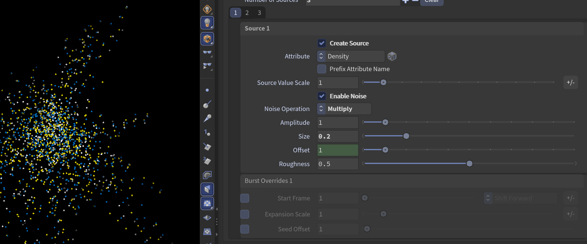

图 7：Density 的最终选择是 Multiply，Amplitude `1`，Size `0.2`。

然后温度也给个随机，也是相乘，大小同样是 `0.2`。

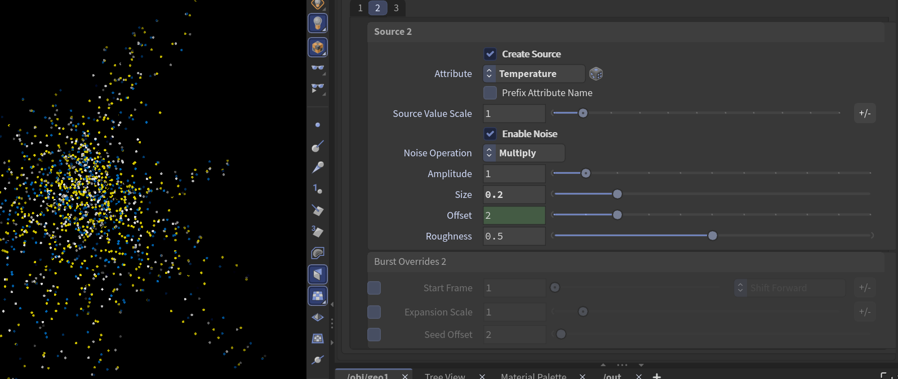

图 8：Temperature 同样启用噪声，Multiply，Amplitude `1`，Size `0.2`。

火焰这边的燃烧源 **Burn** 也使用相乘，大小也是 `0.2`。这样，密度、温度和燃烧三个属性都有了随机变化。

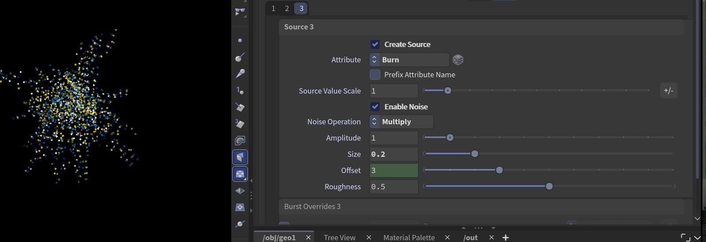

图 9：Burn 同样采用 Multiply，Amplitude `1`，Size `0.2`。

这三张图里，各组件 Source Value Scale 都是 `1`，Roughness 都是 `0.5`，Prefix Attribute Name 未勾选；Offset 的显示值分别为 `1、2、3`。这些字段显示为绿色，具体引用关系需要查看表达式确认。

比较下来，Add 会在基础值上加减，Multiply 则在本次振幅设置下把原有值调弱到不同程度。本次保留相乘方式，再继续往下处理运动与爆炸膨胀。[相关参数官方说明](https://www.sidefx.com/docs/houdini/nodes/sop/pyroburstsource.html)

## 六、记得把体素大小关联起来，并把速度传下去

然后记得把解算器里的 **Voxel Size** 关联到体积转换节点里。这样以后想调整这一套模拟的分辨率，就可以从解算器这里统一改，减少来回修改。

具体做法是：在 **Pyro Solver** 的 Voxel Size 上右键 **Copy Parameter**，再到 **Volume Rasterize Attributes → Filter → Voxel Size** 上右键 **Paste Relative References**。以求解器为控制端，让转体积节点单向引用它。

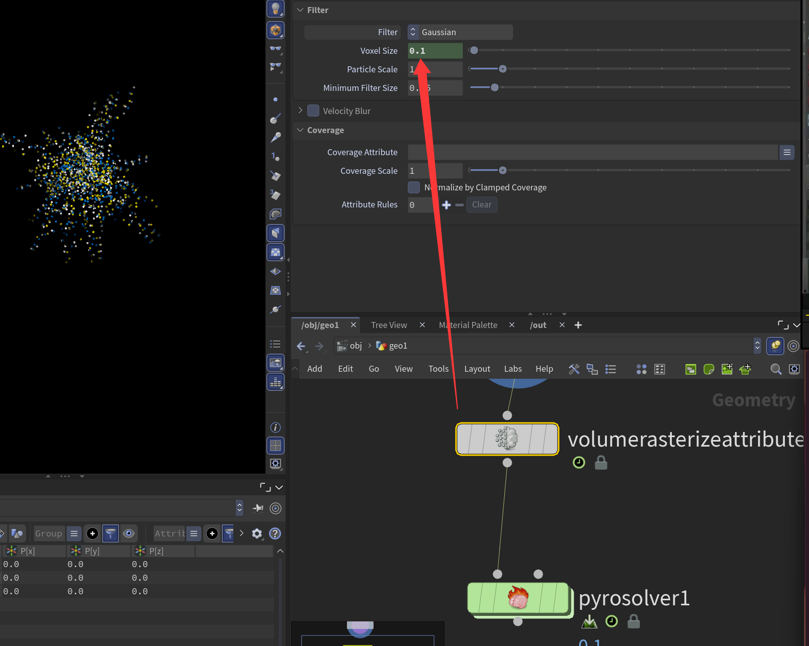

图 10：这里显示为 `0.1`。粘贴后可以改一下求解器的值，检查转体积节点是否跟着更新。

然后把速度属性也添加进来。在体积转换的 **Attributes** 后面追加 `v`，现在完整列表是：

```text
density temperature burn v
```

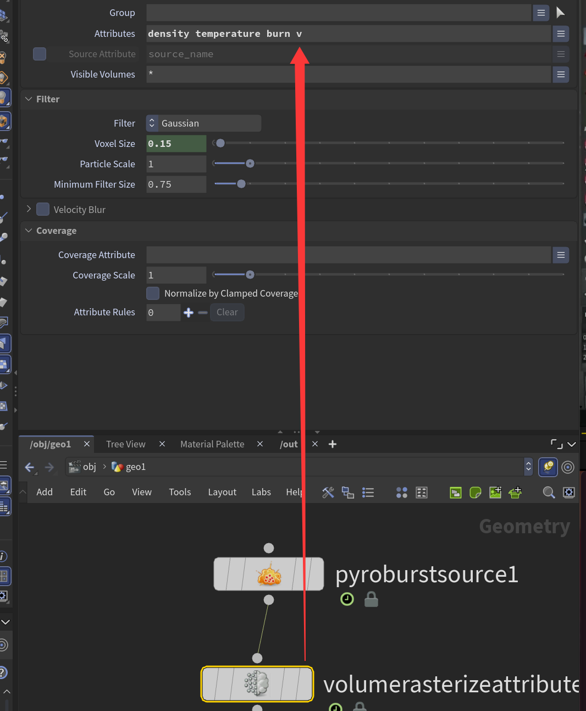

图 11：此时已有密度、温度、燃烧和速度四种输入。Coverage Attribute 继续留空。这张图的 Voxel Size 已改为 `0.15`，是后续阶段的值。

> **操作补充：**同时确认发射源 Output Attributes 中的 Velocity 已启用，求解器 Sourcing 中存在 `v → vel` 映射。仅添加属性名字，还需要上游实际输出速度、下游正确接收。

## 七、再调整一下速度：先启用速度噪声，其他参数保持原样

调整一下这个速度。在发射源 **Output Attributes** 这里，启用 **Add Velocity Noise**，参数先保持当前默认状态，不急着继续改。

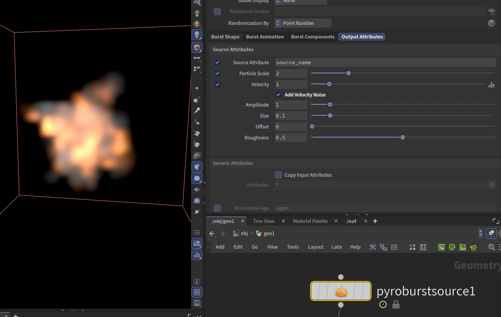

图 12：当前 Velocity 倍率为 `1`，速度噪声 Amplitude `1`、Size `0.1`、Offset `0`、Roughness `0.5`；Particle Scale 为 `2`。这是本次截图记录值。

这一步给发射运动增加一些变化。前面主要是在改密度、温度和燃烧“发射多少、分布在哪里”，现在继续处理“它们怎样被带着运动”。

## 八、做爆炸还需要膨胀：通过快速设置添加 divergence

然后，我们在做爆炸的时候，还需要添加一个重要的属性。在流体解算节点这里，目前输入的是 `density temperature burn v` 这四个属性。

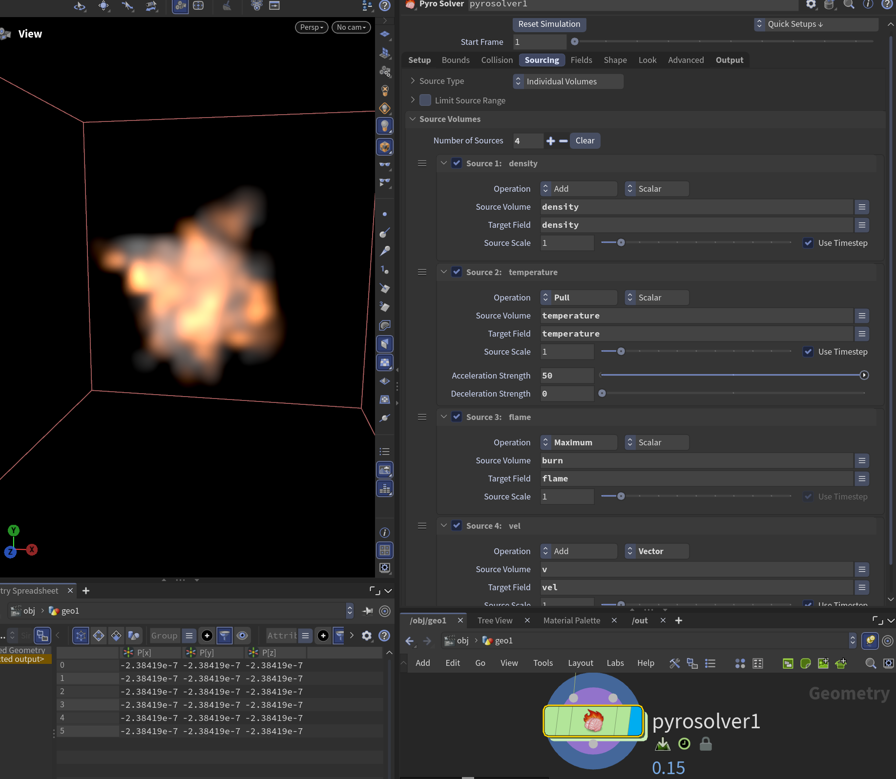

图 13：当前 Sourcing 中有四条映射：`density → density`、`temperature → temperature`、`burn → flame`、`v → vel`。温度此时还使用 Pull，后面会改为 Maximum。

我们点击右上角的快速设置 **Quick Setups**，找到爆炸 **Initialize Explosion**，点击它。本例中，它会自动添加一条 `divergence` 的源映射，将 **burn** 送入 **divergence**。

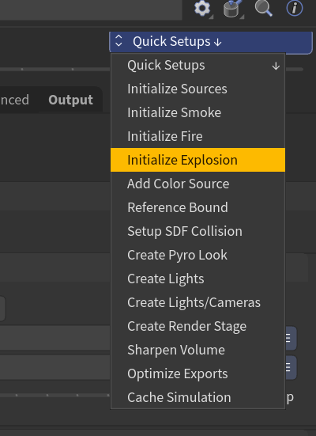

图 14：菜单中的完整名称是 Initialize Explosion。

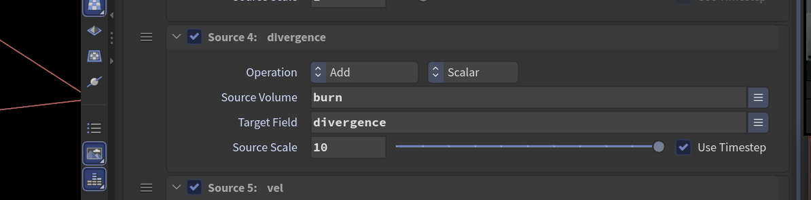

图 15：新增条目的 Source Volume 是 `burn`，Target Field 是 `divergence`。这时使用 Add，Source Scale 是 `10`，后面还要继续调整。

> **补充：**这里增加的是求解器内的源映射。原来的 `burn → flame` 仍保留，上游转体积也继续使用 `density temperature burn v`，本例不必额外创建一个 divergence 输入体积。快速设置会配置爆炸相关参数，执行后再检查已有设置。

那这个属性是什么意思？我们先打开它的指引看看。到 **Fields → Field Guides** 选择 **Divergence**，然后把预览帧调到发射还在进行的时候，比如第 `4` 帧。

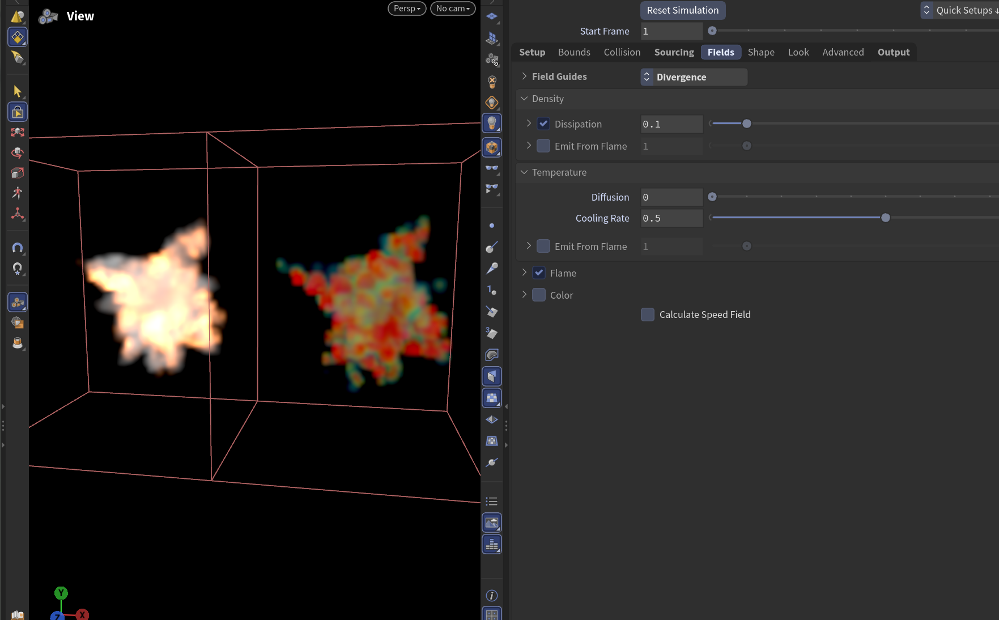

图 16：效果旁边显示出 Divergence 场的指引。需要时可调整 Guide Range 或使用 Compute Range 查看当前帧范围。

我们可以把 divergence 理解为局部气体向外膨胀或向内收缩的程度。这里把 Burn 用作正的膨胀来源，让爆炸刚发射出来时有向外撑开的趋势。

制作时说“这个属性只在发射粒子的时候产生”，这里主要是在观察**直接由 Burn 源注入的这部分膨胀**，所以把时间退回早期帧更容易看清。接下来还要看另一部分：火焰持续存在时的膨胀。

## 九、继续看 Flame Expansion：初始爆发和后续火焰膨胀分开调

然后看 **Shape → Flame Expansion**，也就是火焰膨胀。它与前面看的 divergence 有关，这里的火焰膨胀会随着模拟中有效的火焰场继续产生作用。

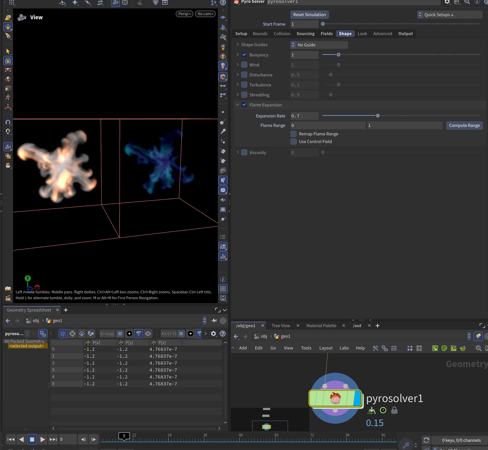

图 17：Flame Expansion 已启用，Expansion Rate 为 `0.7`，Flame Range 为 `0～1`。截图停在第 `9` 帧，已经超过前面第 1～6 帧的发射源动画阶段。

这里保留两个制作思路：刚开始爆炸时，我们可以把膨胀转换的比例调高，让初始爆发更明显；后面火焰还在延续时，再用 Flame Expansion 调整它继续膨胀的程度。

> **关系纠正：**准确说，是 **Flame Expansion 根据模拟中的 flame 场生成 divergence**。前面的 `burn → divergence` 是直接源注入，依赖发射源；这里则依赖模拟中的 flame，只要还满足范围设置，就可能在源停止后继续贡献膨胀。因此不能把所有 divergence 都理解为只在发射期间存在。[Flame Expansion 官方说明](https://www.sidefx.com/docs/houdini/nodes/sop/pyrosolver.html)

## 十、想把初始膨胀加强：先比较 Add、Maximum 和 Pull

我们可以把刚开始膨胀转换的比例调高。这里做烟火时常用的转换方式有 **Add、Maximum、Pull**，那这三个有什么区别？先把区别弄清楚，再决定密度、温度和膨胀分别用哪个。

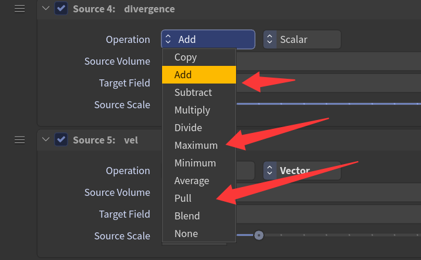

图 18：这里是求解器 Sourcing 的 Operation，负责把源体积合并到模拟目标场；与前面 Noise Operation 中的 Add、Multiply 是不同位置的操作。

### 1. Add：往已有结果里继续加

**Add** 就是把源值加到目标场的已有值上。比如当前值是 `2`，这次源值是 `3`，相加后就是 `5`；后面继续发射，还会继续补入。

所以烟雾密度这里，我们通常会使用 **Add**，持续往模拟中添加烟雾。本次也按这个思路设置。

### 2. Maximum：补到源值，但保留已经更大的值

**Maximum** 是取两者中的最大值。比如当前值是 `2`，源值是 `3`，结果就是 `3`；如果当前已经是 `5`，就保留 `5`。它不会像 Add 那样每次都继续相加。

温度这里使用最大值，可以理解为：把较冷的地方补热，同时保留已经更热的地方。本次温度后面就改为 **Maximum**。

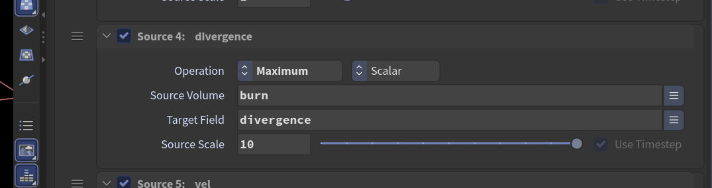

图 19：这里先在 divergence 上对比 Maximum，Source Scale 仍是 `10`。这是中间尝试，不是最后的选择。

### 3. Pull：向源值靠近，并控制靠近的力度

**Pull** 会把目标场的已有值往源值拉近。与直接相加或直接取最大值相比，它还能通过 **Acceleration Strength** 和 **Deceleration Strength**，分别控制往较大值和较小值靠近的力度。

比如当前值是 `2`，源值是 `3`，它会向 `3` 靠近，具体改多少还与强度、时间步有关。如果源值反过来比当前值小，则由 Deceleration Strength 控制往下拉的力度。

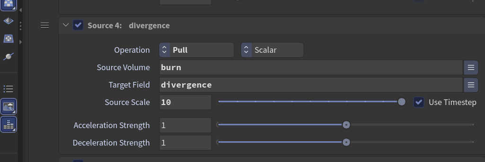

图 20：刚切为 Pull 时，Source Scale 为 `10`，加速、减弱强度都为 `1`。下面再把它调整为本次需要的值。

以上例子先不计时间步归一化和其他求解过程，比较的是三种合并方式本身；它们只在对应源操作的作用范围内生效。[Add、Maximum、Pull 官方说明](https://www.sidefx.com/docs/houdini/nodes/dop/volumesource.html)

## 十一、确定这一版：密度加厚、温度抬高，膨胀用 Pull 加强

然后烟雾密度我们使用 **Add**，缩放 **Source Scale** 给个 `3`。

温度的话使用最大值 **Maximum**，缩放也给 `3`。

**divergence** 我们用 **Pull**，缩放给 `25`，加速度强度 **Acceleration Strength** 给 `50`，减速 **Deceleration Strength** 给 `0`，这里不要它往下拉的效果。

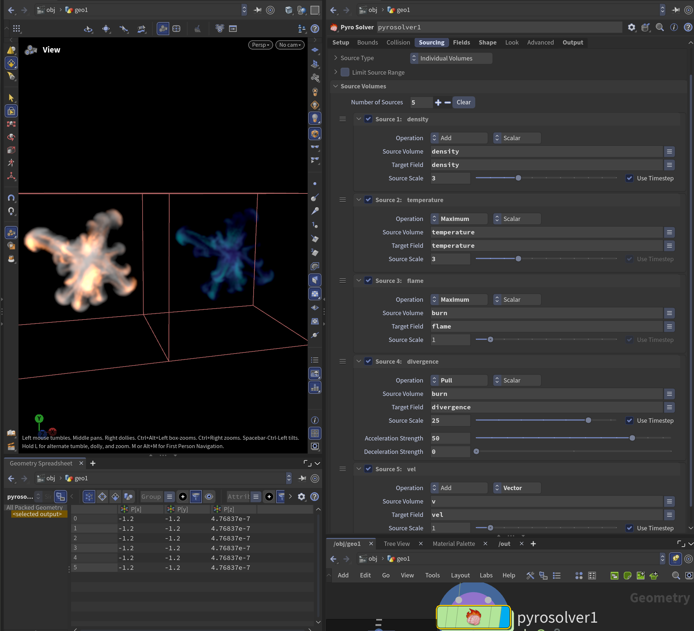

图 21：这是本阶段最后采用的设置，前面 Source Scale `10`、Maximum 等截图保留为对比过程。

> **“不要减速”的含义：**这里作用的目标是 divergence 标量场。Deceleration Strength 设为 `0`，是关闭这一条 Pull 操作向较小源值拉回的作用，不代表关闭整个模拟的速度衰减。Acceleration Strength `50` 则加强向较大源值靠近的作用。[Pull 强度参数说明](https://www.sidefx.com/docs/houdini/nodes/dop/volumesource.html)

做到这里，保留一张参数表方便下次复现，具体为什么这样改，仍按前面的制作过程回看：

| 输入源 → 目标场 | 本次操作 | Source Scale | 其他设置 |
| --- | --- | --- | --- |
| `density → density` | Add | `3` | Scalar，Use Timestep 勾选。 |
| `temperature → temperature` | Maximum | `3` | Scalar，截图中 Use Timestep 灰显。 |
| `burn → flame` | Maximum | `1` | Scalar，继续保留火焰来源。 |
| `burn → divergence` | Pull | `25` | Scalar，Acceleration `50`，Deceleration `0`，Use Timestep 勾选。 |
| `v → vel` | Add | `1` | Vector，Use Timestep 勾选。 |

Source Scale 是输入源的倍率，最终场值还要经过源操作和模拟计算。调整完以后，重置模拟，从第 1 帧重新播放：先在第 `4` 帧附近看刚开始的爆发，再到第 `9` 帧及后面看火焰延续时的膨胀和烟雾运动。观察完可以把 Field Guides 切回 No Guide。

这一版源设置先保留下来，接下来继续调形状，并检查体积转换是否影响了火焰和运动。

## 十二、接下来调整形状：先把湍流加强，变化速度放缓

接下来调整形状，先调整湍流。在 **Pyro Solver → Shape** 里启用 **Turbulence**，湍流强度给高一点，给到 `10`。

噪声的演变速度 **Pulse Length** 可以给缓一点，这里给到 `1`。我们先加强它的翻卷变化，但不希望噪声图案变化得太急。

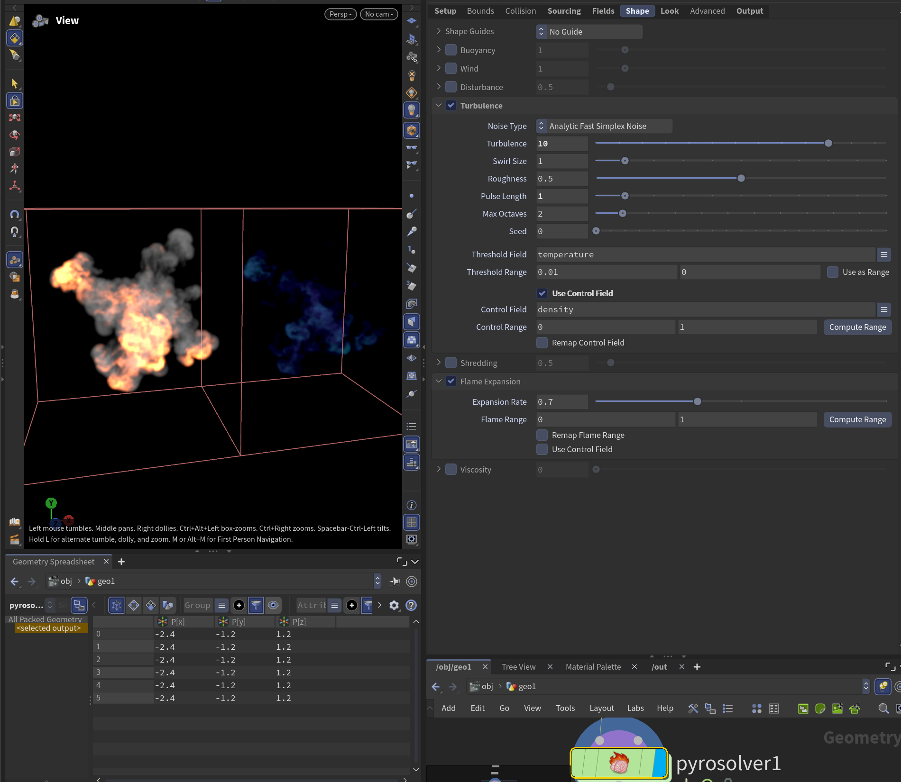

图 22：Turbulence 为 `10`，Pulse Length 为 `1`；Swirl Size 保持 `1`，Roughness 为 `0.5`，Max Octaves 为 `2`，Seed 为 `0`。截图中还启用了 density 控制场，范围为 `0～1`；Buoyancy 此时未勾选，与前面阶段不同。

> **补充：**这里 Pulse Length 越大，湍流噪声演变越慢；它调整的是噪声变化的节奏，不是整个模拟的播放速度。[Turbulence 官方说明](https://www.sidefx.com/docs/houdini/nodes/sop/pyrosolver.html)

## 十三、火焰还不是很好看：回到体积转换，参考官方火球案例

它现在这个火焰还不是很好看。这个爆炸有一个非常重要的点，就是体积转换这里：我们之前把 **Coverage** 里的 **Coverage Attribute** 给清空了，原来这里是 `density`。在当前这套发射源中，这是让火焰相关属性正常传下去的一步。

它下面这个 **Normalize by Clamped Coverage**，我们可以把它勾上。制作时先把它理解为让体积边缘有一个平滑过渡，看看火焰和烟雾会不会更好看。

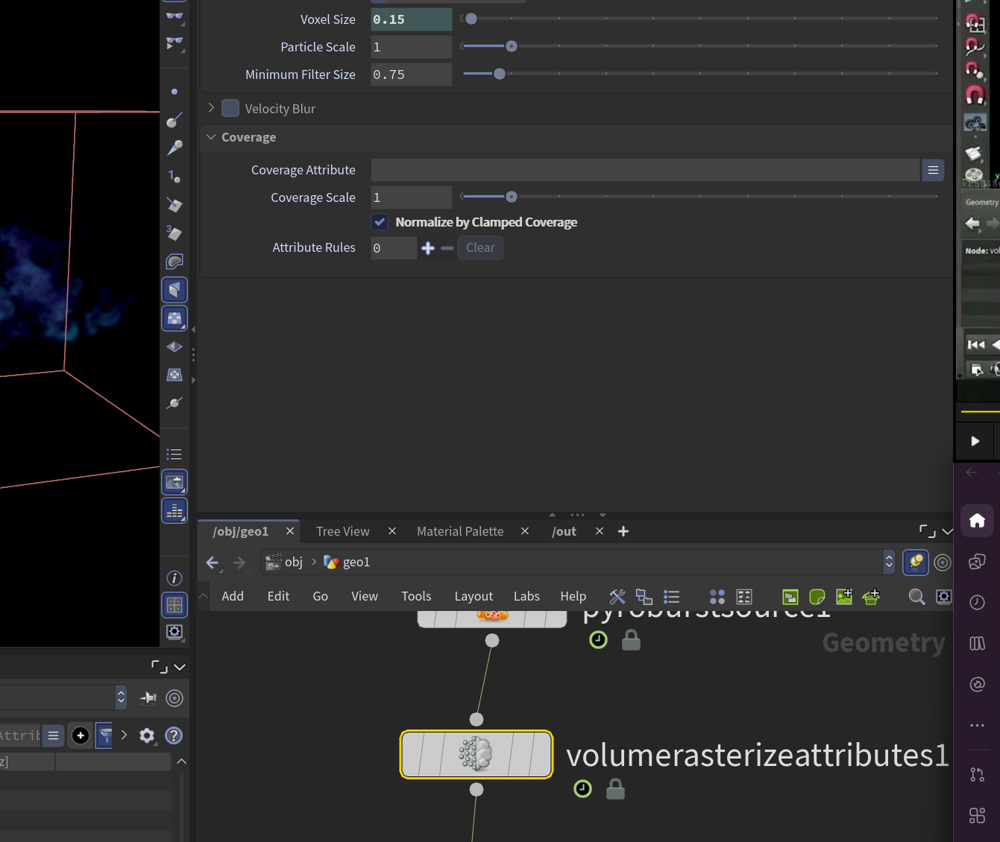

图 23：Coverage Attribute 继续留空，Normalize by Clamped Coverage 已勾选，此时 Attribute Rules 仍为 `0`。

然后我们可以参考一下官方这块的案例是怎么做的。在旁边添加一个 Pyro 的火球案例，来看它的体积转换这里：它把这个 **Normalize** 勾选了，然后添加了一条属性规则 `v`，方法是 **Weighted Average**。

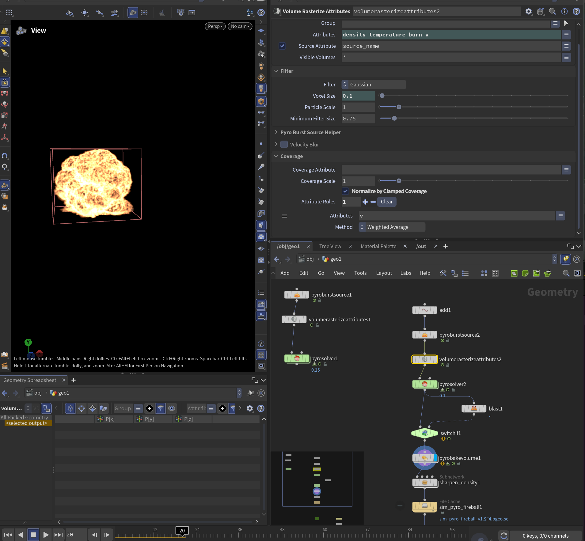

图 24：旁边保留官方火球案例作参考。它的转体积节点启用了 Normalize，并单独给小写速度属性 `v` 设置 Weighted Average；同时启用了 Source Attribute，名称为 `source_name`。自己的模拟体素尺寸是 `0.15`，参考案例这里是 `0.1`。

那这个速度规则有什么用呢？我们先不只是把参数照着抄过来，回到自己的节点上演示一下，直接看看转出来的数据有什么变化。

> **用词补充：**这里说的“平滑体素”，主要是粒子覆盖边缘的数值衰减更平顺，不是改变体素大小或额外做了一次整体模糊。Normalize 会将默认采样方式从 Weighted Average 改为 Covered Average；下面可以用 Attribute Rules 给指定体积覆盖这个默认方式。[Coverage 与 Attribute Rules 官方说明](https://www.sidefx.com/docs/houdini/nodes/sop/volumerasterizeattributes.html)

## 十四、接一个 Volume Slice，先看烟雾边缘是否有过渡

我们回到自己的节点，在体积转换后面连接一个 **Volume Slice**（`volumeslice`），用切片显示体积里的数据。这样我们可以在这里看烟雾的属性，而不只是凭最终火焰的外观判断。

这里接一条旁路出来就行，原来通向 Pyro Solver 的连接继续保留：

```text
pyroburstsource1
  ↓
volumerasterizeattributes1 ──→ volumeslice1（观察源体积切片）
  ↓
pyrosolver1
```

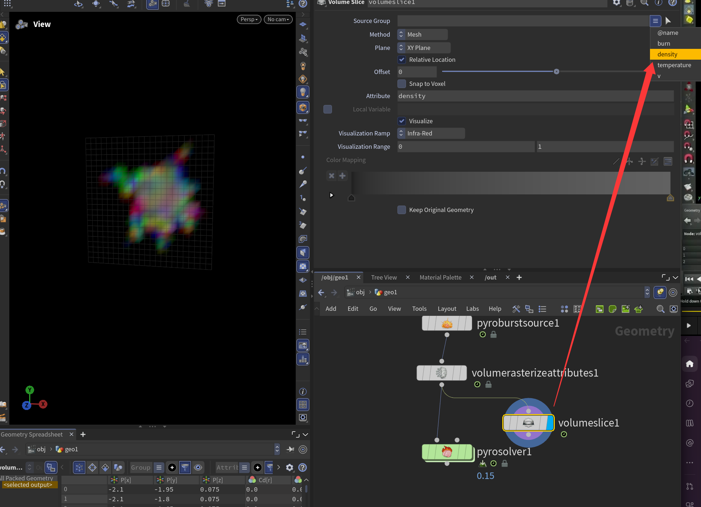

图 25：将显示旗标切到 Volume Slice。截图使用 Method = Mesh、XY Plane、Relative Location 勾选、Offset = `0`，并启用 Visualize。

我们先单独看密度，在 **Source Group** 中选择 `@name=density`。现在是勾选了 Normalize，它的烟雾边缘就很平滑。

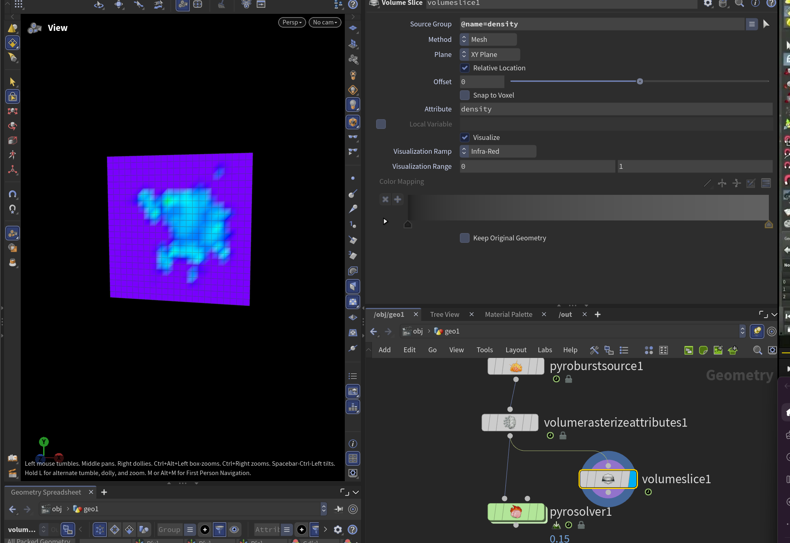

图 26：Source Group 为 `@name=density`，Visualization Range 为 `0～1`。在相同切片位置和显示范围下比较边缘。

如果不勾选，它的边缘就比较生硬。我们把这个 Normalize 再勾上，就会有一个平滑的过渡，源体积边缘看起来会更好一些。

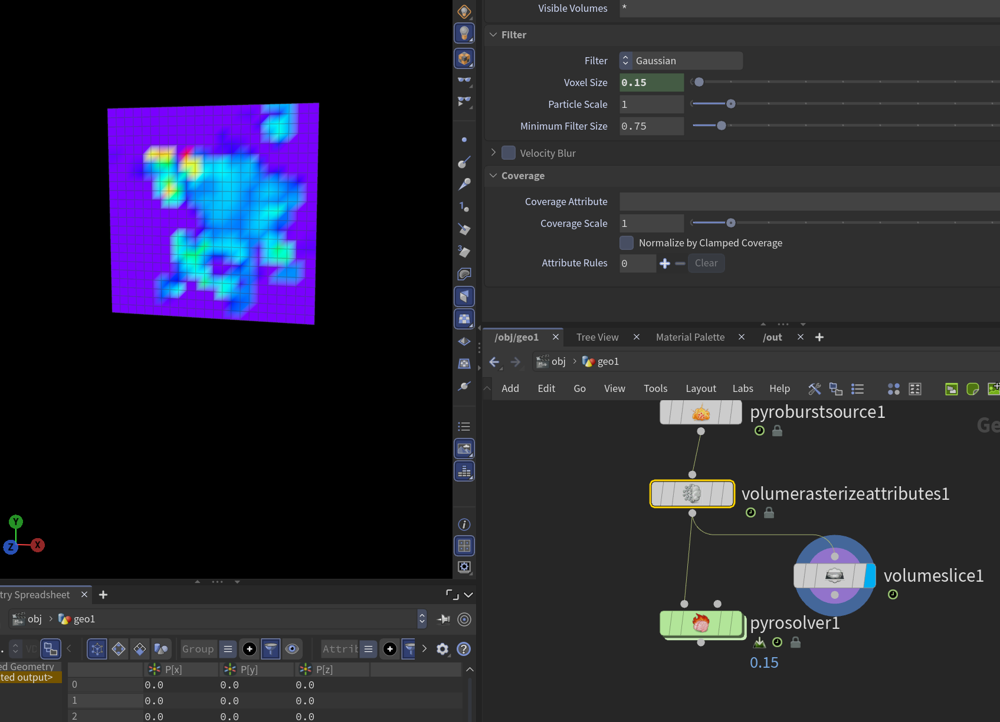

图 27：关闭 Normalize，Attribute Rules 为 `0`。与前面的勾选状态对比，观察边缘数值的变化。

> **操作补充：**Volume Slice 看的是体积的二维截面；这里使用的是 Mesh，不是切回发射源点。Source Group 决定取哪个输入体积，下面的 Attribute 则是切片输出的属性名。[Volume Slice 官方说明](https://www.sidefx.com/docs/houdini/nodes/sop/volumeslice.html)

## 十五、再试着把 density 填回去：为什么之前要清空覆盖属性

还有之前我们把覆盖属性取消了，它本来是 `density`。这里先试着把 **Coverage Attribute** 填回 `density`，看它烟雾的数据会变成什么样。

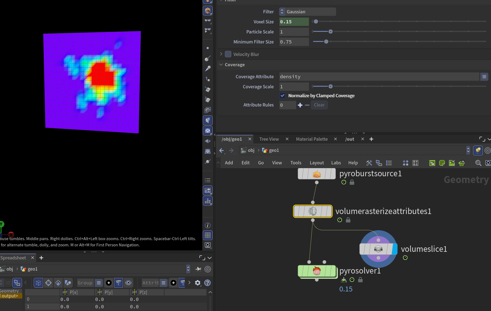

图 28：这是临时对比。Coverage Attribute 为 `density`，Normalize 已勾选；此时切片中心的密度显示与前面的结果明显不同。

然后我们在 **Volume Slice** 里将选择的体积改为温度，单独看 `temperature`，这时看到的是没有显示出温度分布。

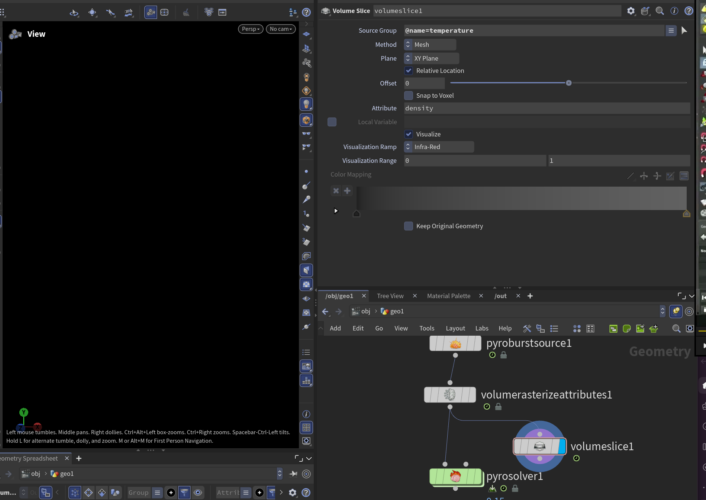

图 29：Source Group 已改为 `@name=temperature`。下方 Attribute 虽然仍写着 `density`，在 Mesh 模式下它是输出属性名，不表示这里又选回了输入密度体积。

所以我们在覆盖属性那里把 `density` 再删掉，回到之前留空的设置。这一步的制作思路是：当火焰不对时，先检查传进求解器的源体积；通过单独看温度，确认问题是不是已经出在转体积这里。

> **范围纠正：**“删掉 density 才有温度”“做火焰必须清空”描述的是本例遇到的情况。清空并不会新建温度属性，而是解除密度覆盖权重对采样的影响；也不能仅凭一张黑色切片就断定温度体积不存在，仍需结合切片位置、显示范围及实际体积值检查。

## 十六、主要再看速度：保留密度边缘的过渡，但不让速度跟着衰减

然后这里我们主要看它的速度。在 Volume Slice 中把 **Source Group** 改为 `@name=v`，保持同一帧、同一个切片位置，来回切换 Normalize 对比。

这是平滑之前的速度：

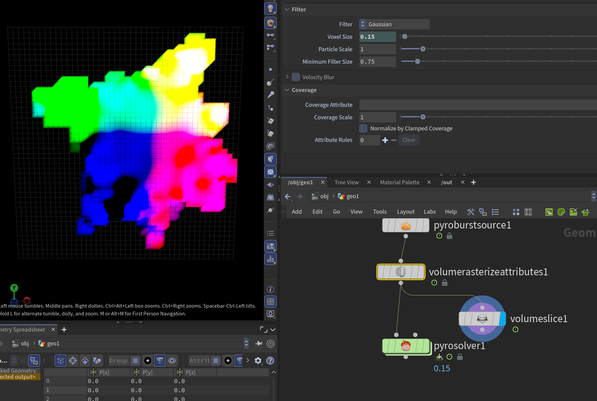

图 30：Normalize 未勾选，Attribute Rules 为 `0`。这里观察的是输入速度体积 `v`，不是求解器输出的 `vel`。

这是平滑之后的速度：

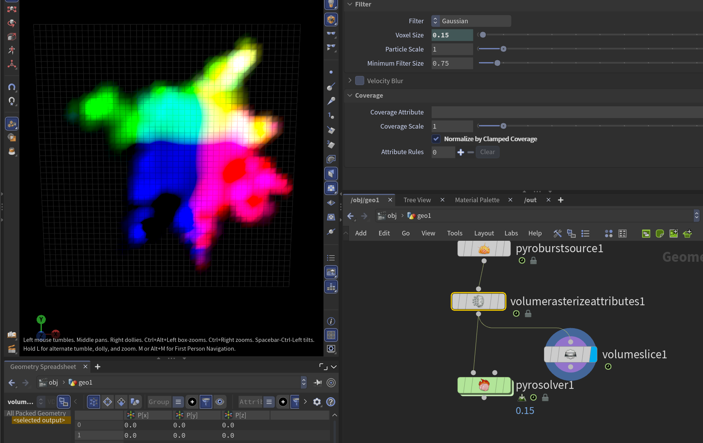

图 31：Normalize 勾选后，速度分布的边缘也有了渐弱过渡。

但是我们并不希望每次爆炸的时候，把它的速度也这样“平滑”掉。密度、温度的边缘可以渐弱，速度这边我们希望保留原来向外发射的力度，所以这里需要添加一条速度规则。

回到 **Volume Rasterize Attributes → Coverage → Attribute Rules**，点加号添加一条规则，**Attributes** 填小写的 `v`，**Method** 选择 **Weighted Average**。

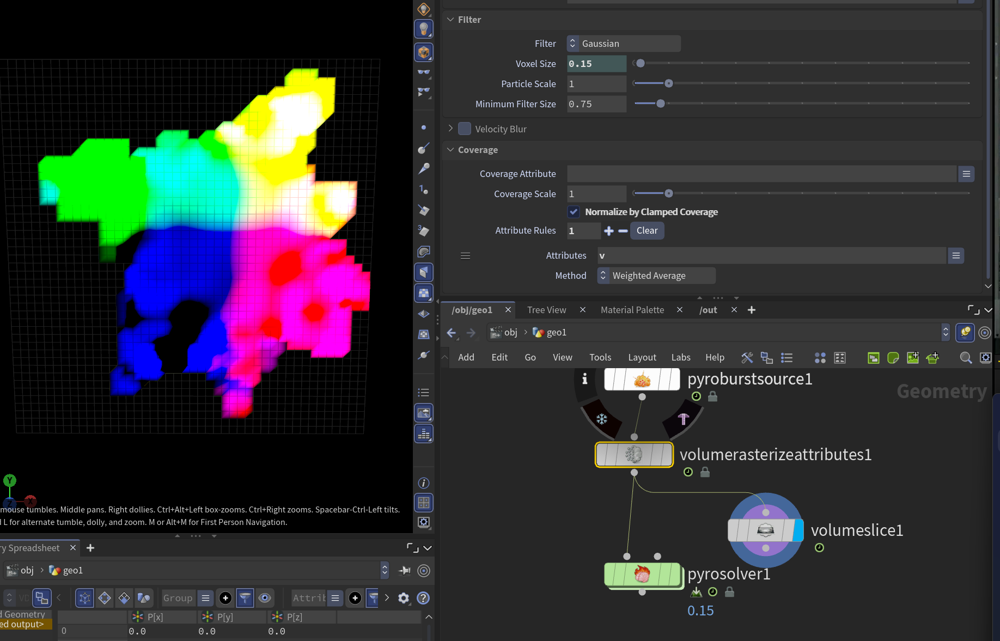

图 32：Normalize 仍勾选，Attribute Rules 为 `1`，其中 `v` 使用 Weighted Average。速度切片的边缘表现回到了前面未启用 Normalize 时的状态。

这样，无论勾选与否这个 Normalize，速度都使用自己指定的采样方式，不会再跟着这个开关改变。这也是我们在官方案例节点里看到的做法：其他源属性保留覆盖边缘的平滑过渡，速度单独处理。

> **补充：**这里避免的是覆盖衰减把边缘速度压低，并不是让速度完全不参与平均或插值。Weighted Average 本身仍会加权平均源点速度；这条规则只让 `v` 不受 Normalize 默认方法切换的影响。

## 十七、官方还用了 source_name：用两个发射源继续验证

然后再看官方节点这里，在 **Source Attribute** 中启用了一个 `source_name`。这样做有什么意义呢？

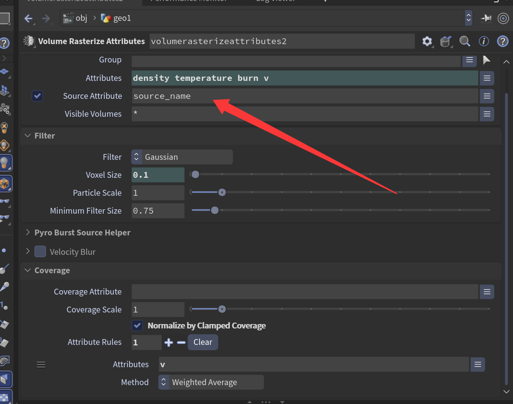

图 33：红色箭头指向 Source Attribute 的 `source_name`；下面仍是 Normalize 勾选，以及 `v → Weighted Average` 的规则。

接下来先用一个小实验看清它的作用：把密度和温度分别放在两个发射源上，再合并、转体积，比较开启 Source Attribute 前后的区别。

## 十八、球体只给密度、盒子只给温度，为什么合并后烟雾还是会上升

这里我创建一个 **Box** 和一个 **Sphere**，用这两个分别作为发射源，各自连接一个 **Pyro Source**。

这个小球我给它一个属性 **Density**，也就是 `density`，暂时不给它温度。

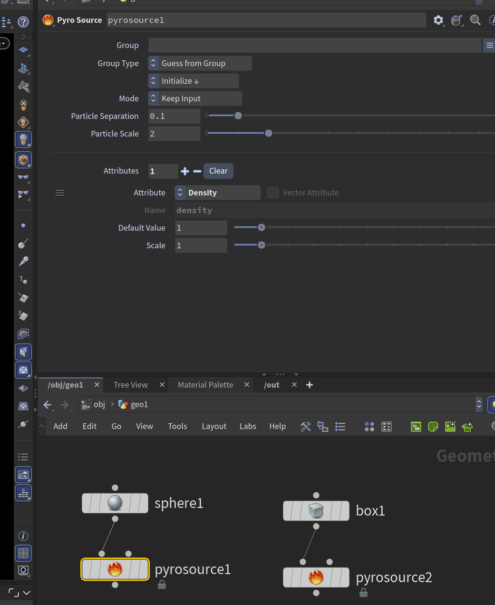

图 34：`sphere1 → pyrosource1`，Attributes 只有一项 Density。截图中 Default Value 与 Scale 都是 `1`。

然后这个盒子我给它一个属性 **Temperature**，也就是 `temperature`。

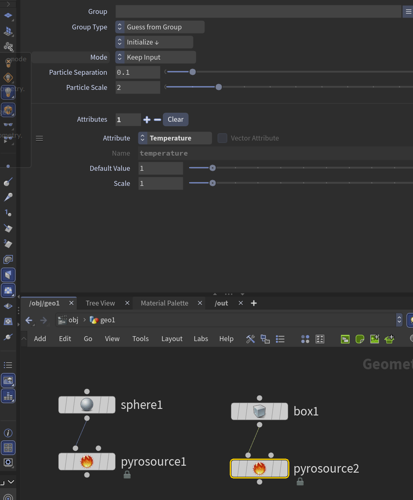

图 35：`box1 → pyrosource2`，Attributes 只有一项 Temperature，Default Value 与 Scale 同样为 `1`。两个 Pyro Source 都使用 Keep Input，Particle Separation 为 `0.1`，Particle Scale 为 `2`。

> **操作补充：**Keep Input 保留模型已有的点，不会重新撒点。所以盒子可能只有少量顶点作为源点，实际转出的体积还会受到点半径影响，不是自动把盒子内部均匀填满。[Pyro Source 官方说明](https://www.sidefx.com/docs/houdini/nodes/sop/pyrosource.html)

然后将这两个 **Merge** 到一起。现在看到的球外面的那些点，就是这个盒子的源点。

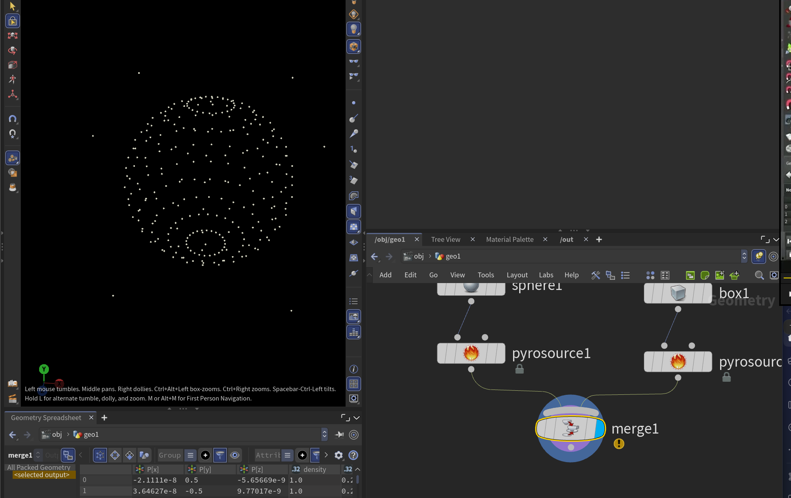

图 36：两个 Pyro Source 一起接入 `merge1`。先保留这个最简单的实验，不加入前面的爆炸燃烧源和速度噪声。

接着将它们转为体积，在 **Volume Rasterize Attributes** 中把 `density temperature` 添加进来，再连接一个 **Pyro Solver** 解算。

```text
sphere1 → pyrosource1（density） ─────┐
                                    ├→ merge1 → volumerasterizeattributes3 → pyrosolver3
box1    → pyrosource2（temperature） ─┘
```

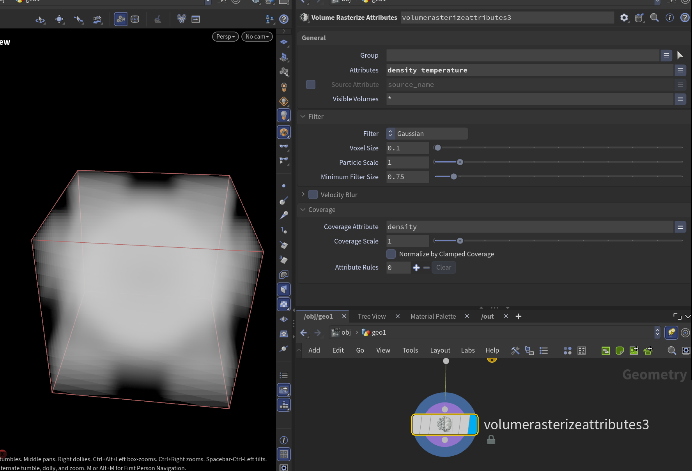

图 37：Attributes 为 `density temperature`，Source Attribute 此时未勾选。这个实验中 Voxel Size 为 `0.1`，Coverage Attribute 仍为 `density`，Normalize 未勾选，Attribute Rules 为 `0`；这是独立实验的设置，不是覆盖前面爆炸主体的设置。

这个时候你会发现，烟雾会上升。但是这个小球，我们并没有给它温度属性。按这个实验的思路，温度用来提供热浮力，那么为什么只给密度的小球，也像被加热了一样往上走？

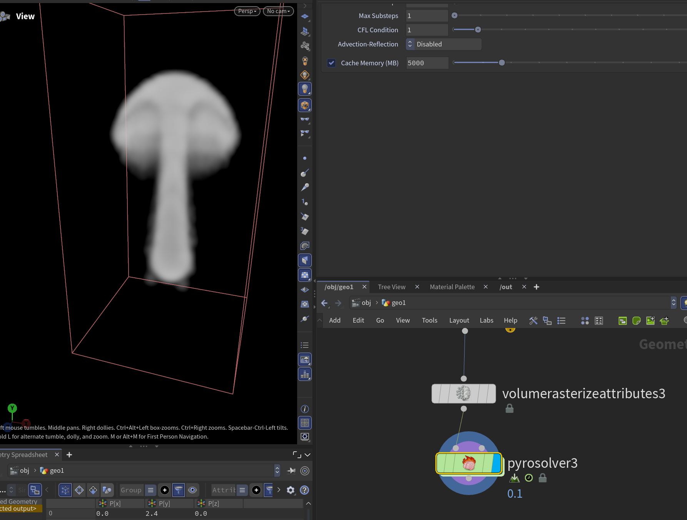

图 38：先保留这个结果，接下来从源点上的属性查原因，再重新模拟对比。

这是因为我们上面把两个来源 Merge 到一起，合并后的点同时有了这两列属性。从这次的结果看，可以先理解为：“密度源也有了温度属性，所以它会上升；温度源也有了密度，所以它也可能产生烟雾。”原本想让两个来源各管一件事，合并之后却没有把这个用途区分保留下来。

> **属性补齐的说明：**Merge 会统一输入几何的属性集合，但不是按空间重叠把两组点的数值互相复制。缺失属性的补值要检查其默认值和合并后的实际数据；本例后面的截图能看到，标为 density 的球体点上 temperature 已显示为 `1`。因此，“有了属性列”与“有了非零值”要分开检查，不能推广为所有 Merge 都会让两个源一起变热、一起出烟。[Merge 属性合并说明](https://www.sidefx.com/docs/houdini/nodes/sop/merge.html)

> **浮力的范围：**这里讨论的是由温度驱动的热浮力。没有温度差时，不会通过这项热浮力产生同样的上升，但烟雾仍可能受已有速度或其他力带动；这个新实验需要确认求解器的 Buoyancy 已启用。[Pyro Solver 浮力说明](https://www.sidefx.com/docs/houdini/nodes/sop/pyrosolver.html)

## 十九、给两个源分别写上 source_name，再让体积转换按名称选点

那这个时候，我们可以给发射源取一个独立的命名。先在小球的 Pyro Source 后面添加一个 **Attribute Wrangle**（`attribwrangle`），**Run Over** 使用 **Points**，这里需要写一个简单的表达式：

```c
s@source_name = "density";
```

可以看到，点上多了一个 `source_name`，它的内容叫 `density`。我们用这个名称标记：这批点用于提供密度。

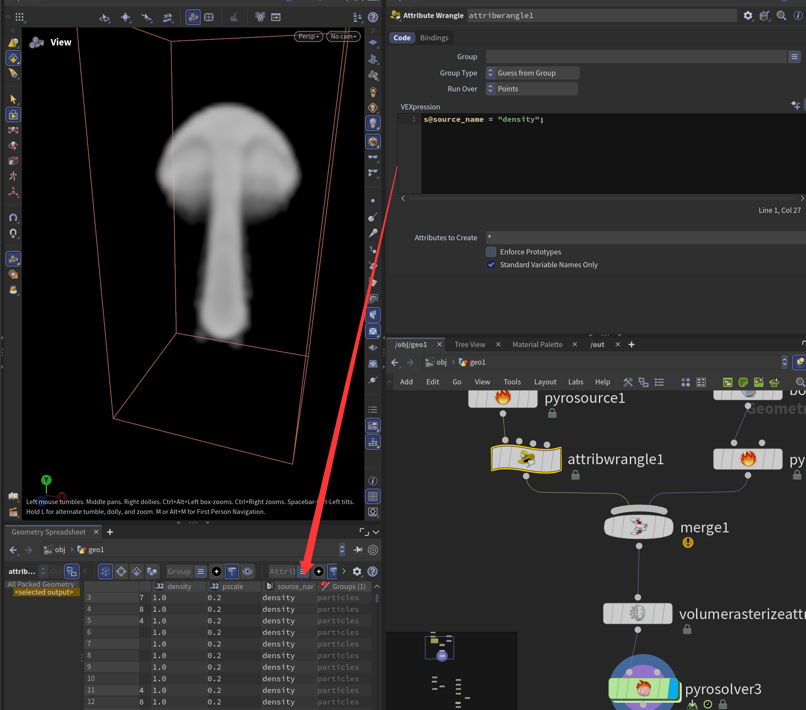

图 39：Wrangle 接在 `pyrosource1` 后、Merge 前；Geometry Spreadsheet 中可以看到字符串属性 source_name 的值为 density。仅添加标签还不够，后面还要启用对标签的读取。

然后给右边同样添加一个命名。在盒子的 Pyro Source 后面也接一个 Attribute Wrangle，写：

```c
s@source_name = "temperature";
```

这样两个来源合并之后，我们仍然能在表格中区分哪些点负责密度、哪些点负责温度。

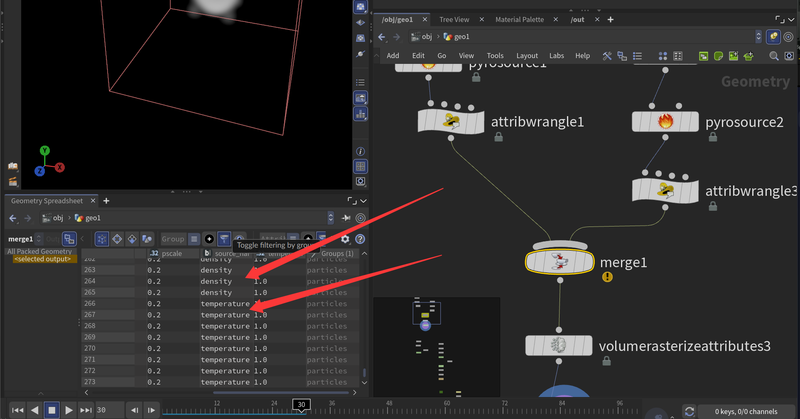

图 40：同一列 source_name 中保留了 density 与 temperature 两种标签。截图也能看到 density 标签的点上 temperature 为 `1`，说明标记用途并不会自动删除或清零其他数值属性。

> **代码补充：**`s@` 表示字符串属性；这里创建的是点属性 source_name，不是修改节点名称或体积名称。两段代码分别写在各自分支上，都在 Merge 之前执行。

那这个时候，我们在体积转换这里，把 **Source Attribute** 勾上，名称填写 `source_name`，然后重新模拟。

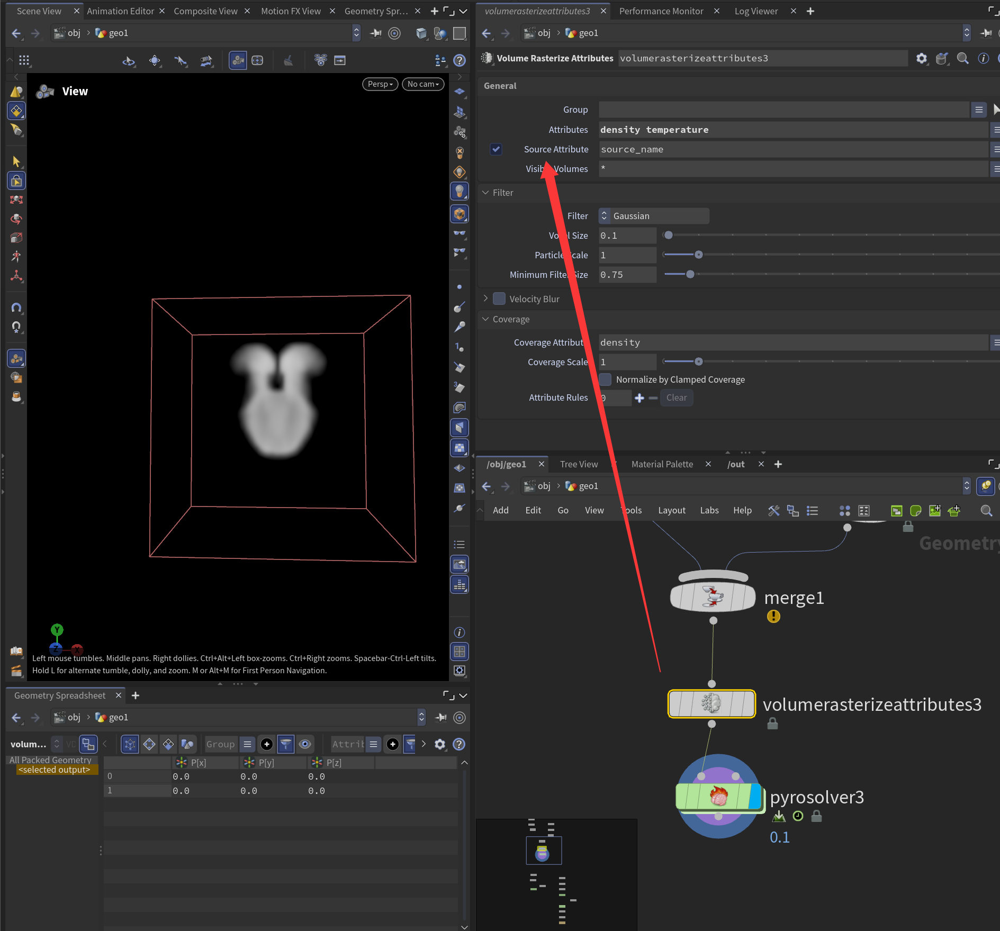

图 41：Source Attribute 已勾选，输入为 `source_name`。Attributes 仍是 `density temperature`，求解器仍使用同一条测试链。

注意看，这次能看到与前面不一样的上升形状。按这个实验的观察，主要是球体和盒体的发射范围重合的部分，烟雾受热后升上来，而不是让整个球体源都带着相同的温度发射。

> **这一勾的作用：**生成 density 体积时，只让标签匹配 density 的点参与；生成 temperature 时，只让标签匹配 temperature 的点参与。这样，即使合并后球体点上仍有 temperature 数值，也不会被当作温度源来采样。名称要与上游字符串属性一致，并且输入点上确实要存在该属性。[Source Attribute 官方说明](https://www.sidefx.com/docs/houdini/nodes/sop/volumerasterizeattributes.html)

## 二十、重合部分看得不明显，就把盒子移开一点再模拟

如果看得不明显，我们可以通过 **Transform** 节点将盒子往旁边移动一点，先看一下两个源的位置，然后重新模拟一遍。让两个来源只重合一部分，这样看就会非常明显。

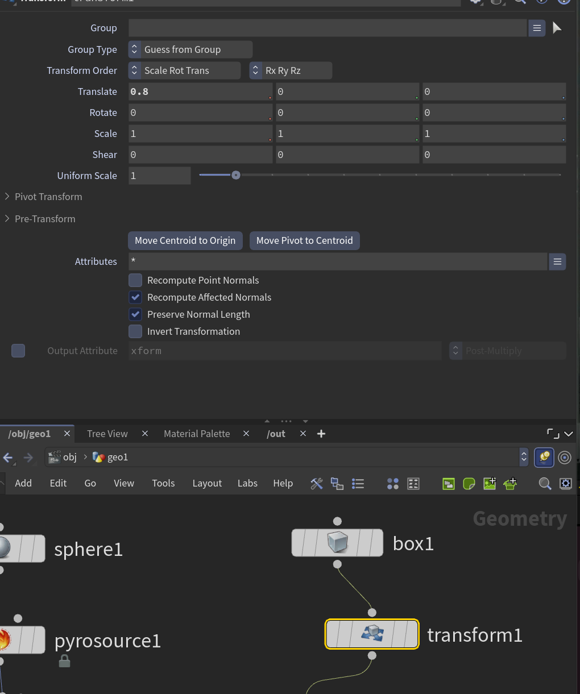

图 42：Transform 接在 Box 后、Pyro Source 前。截图 Translate 为 `(0.8, 0, 0)`，Rotate 为 `(0, 0, 0)`，Scale 为 `(1, 1, 1)`。

制作时说“向左移动一点”，这里保留的是把两个源错开的思路。具体到截图，是沿 **X 正方向移动 `0.8`**；视口里看起来向左还是向右，会随观察方向改变。

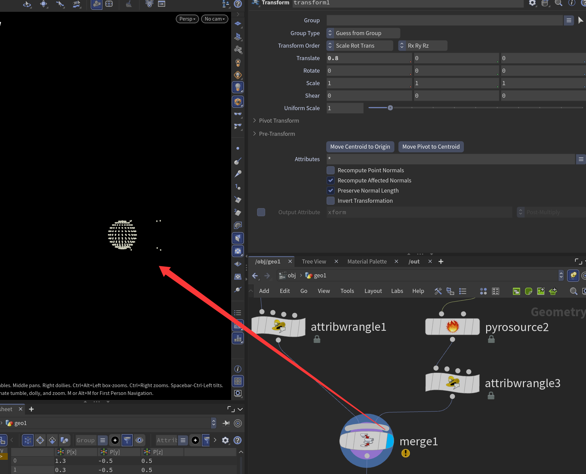

图 43：先看合并后的源点，确认盒子已偏离球体中心，而不是直接从模拟烟团猜测发射位置。

然后回到求解器，重置模拟并从起始帧重新播放。这样看就非常明显：烟雾上升的位置与温度源覆盖的位置有关，两个来源不再像最初那样混成同一个用途。

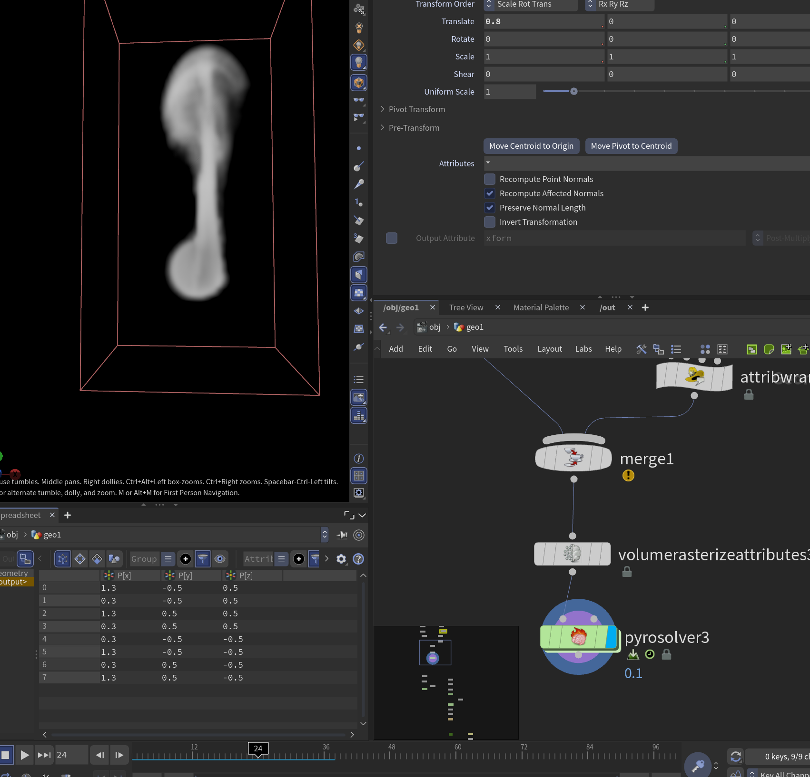

图 44：截图停在第 `24` 帧，保留偏移后的模拟结果作对比。

> **观察补充：**这里的“重合”指源体积的有效影响范围，受到 pscale、过滤和体素尺寸影响，不是两个模型的严格几何交集。模拟一旦开始，温度和烟雾还会随流场移动，所以后续形状也不会一直被限制在最初的重合范围里。

## 二十一、回到转体积逐个查看：密度来自球，温度来自盒子

然后我们在体积转换节点这里查看它的体积，单独查看 **density** 和 **temperature**。这样能直接验证刚才的命名有没有生效，而不只看最终烟雾有没有升上去。

先把 **Visible Volumes** 改为 `density`，只显示密度：

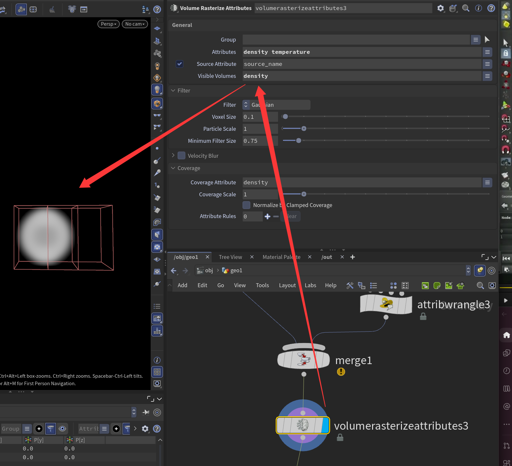

图 45：Visible Volumes 为 density，可以看到密度来源对应球体的范围。

再把 **Visible Volumes** 改为 `temperature`，只显示温度：

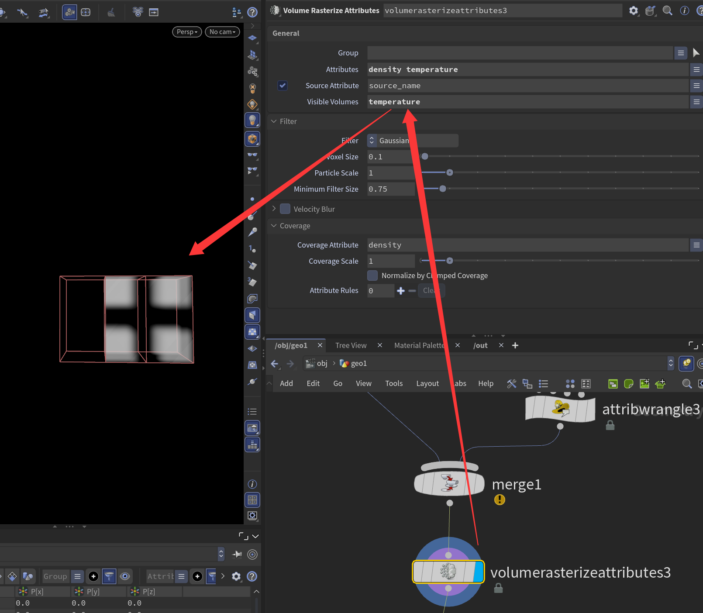

图 46：Visible Volumes 为 temperature，温度分布对应移开的盒子源点。这里仍是 Keep Input 的少量源点，因此显示的是它们转体积后的影响范围，不必呈现为填满的实心盒子。

温度只由盒子这一支提供，密度只由球体这一支提供。所以这就是官方节点里将 **Source Attribute** 开启的原因：我们把多个组件合在一起处理时，还需要保留“哪批点负责生成哪个体积”的区别。

> **显示补充：**Visible Volumes 只切换视口里显示哪个体积，并不删除另一个体积，也不改变传给求解器的数据。它与前面用 Volume Slice 查看截面是两种不同的检查方式。

球体与盒子的对比先做到这里，接下来回到爆炸源的实际组件，把刚才验证的设置用回去。

## 二十二、回到爆炸主体：按点的颜色区分组件，开启 Source Attribute 后再看效果

之前说过，这些粒子的颜色代表不同的源组件：密度（烟雾）是白色的点，温度是蓝色的点，火焰这边的燃烧源是黄色的点。现在回到 **Pyro Burst Source**，就能看到这些不同颜色的点混合在一个发射源的输出里。

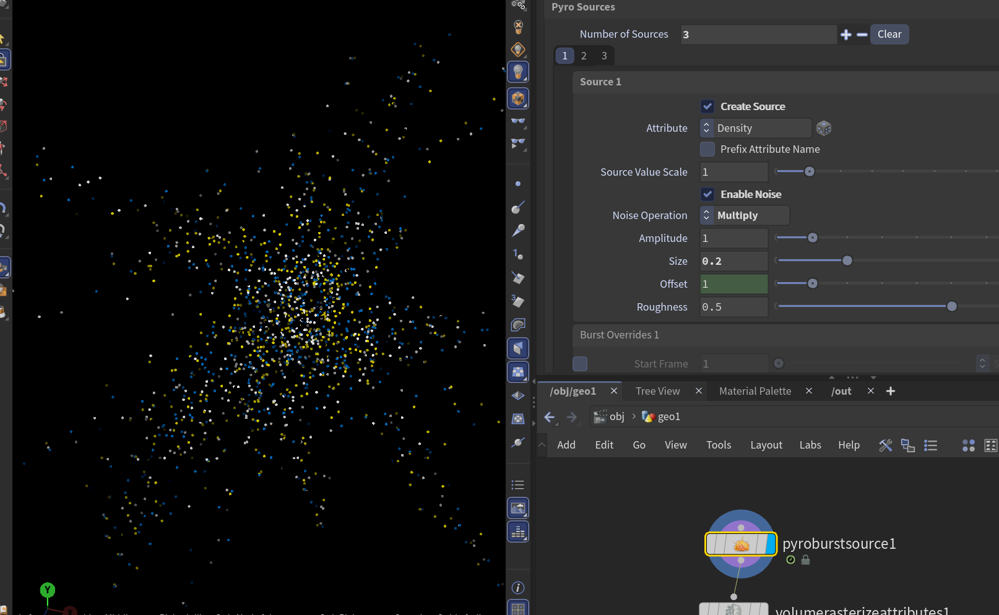

图 47：白色／灰白色对应 Density，蓝色对应 Temperature，黄色对应 Burn。这是源组件的预览颜色，不是最后烟雾和火焰的渲染颜色。截图仍保留密度源 Multiply、Amplitude `1`、Size `0.2` 的设置。

前面我们用球体和盒子做实验，是为了看清楚：虽然这些点合在一起传给了体积转换，但我们仍然希望它们各自负责自己的属性。回到 **Volume Rasterize Attributes**，把 **Source Attribute** 勾上，读取 `source_name`，让密度、温度和燃烧分别由匹配的源点参与采样。

> **原话纠正：**这一段原先写的是“为了让这里面所有的点，他们的属性互相赋予（烟雾有了温度、有了燃烧；温度有了烟雾、有了燃烧；燃烧有了烟雾、有了温度）”。结合前面的实验，这里应改为“为了**避免**不同组件的点混入彼此属性的采样”。这个开关按标签筛选源点，不会把温度、密度、燃烧互相赋值；例如 Burn 点上为零的 temperature 若参与温度平均，反而可能把结果拉低。[Pyro Burst Source 组件说明](https://www.sidefx.com/docs/houdini/nodes/sop/pyroburstsource.html)

勾选了这个之后，我们重置模拟，再从起始帧播放看一下。它现在的效果和之前差别特别大，所以前面觉得火焰不好看时，不能只往求解器里继续加湍流，也需要回头确认：体积转换有没有把发射源上准备好的属性正确传进去。

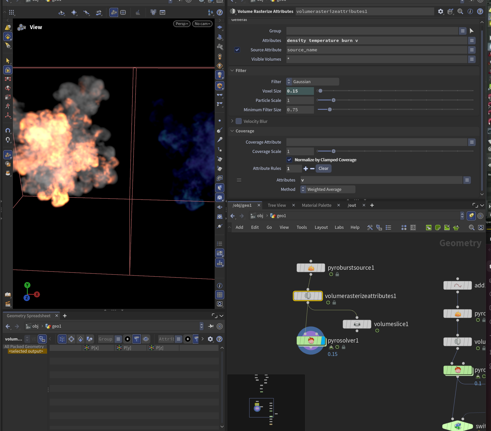

图 48：本次重新模拟后观察到的效果。Source Attribute 已启用，名称为 `source_name`，下方继续保留 Normalize 和速度的独立规则。此图记录当前结果；若要单独比较这个开关的影响，应保持同帧、同视角和其他设置一致。

体积转换这里的设置就先到这些：**Attributes** 保留 `density temperature burn v`，**Source Attribute** 勾选并使用 `source_name`；**Coverage Attribute** 留空，**Normalize by Clamped Coverage** 勾上，速度 `v` 单独用 **Weighted Average**。截图中的 Voxel Size 为 `0.15`，继续沿用前面的求解器参数引用；Particle Scale 为 `1`，Minimum Filter Size 为 `0.75`。

> **接回爆炸源时的补充：**Pyro Burst Source 可以直接输出 source_name，先确认其 Output Attributes 中已启用 Source Attribute，无需照搬小实验的 Wrangle，把整批爆炸点统一改成一个标签。它默认还会在各组件标签中加入 `v`，让这些点可共同参与速度采样。[爆炸源的 source_name 与速度说明](https://www.sidefx.com/docs/houdini/nodes/sop/pyroburstsource.html)

到这里，我们把参考案例里的设置先看一遍，再用切片和独立小实验验证，最后用回自己的爆炸主体。后面继续在这个结果上往下制作。

## 二十三、继续调整火焰造型：让湍流从开始的强翻卷逐渐减弱

接下来，我们继续调整这个火焰的造型，还是回到湍流上来。这个湍流可以给个动画，不一定要从头到尾保持同一个强度。这里先让开始的湍流强一些，后面再弱下来，看看火焰在不同阶段的造型变化。

### 1. 先用手动 K 帧，做一个湍流强度动画

当然，动画是可以直接 K 帧的。将时间拖到第 `1` 帧，然后在 **Pyro Solver → Shape → Turbulence** 的强度参数这里，按住 **Alt + 鼠标左键**，在第一帧创建一个关键帧。这里先沿用之前的强度 `10`。

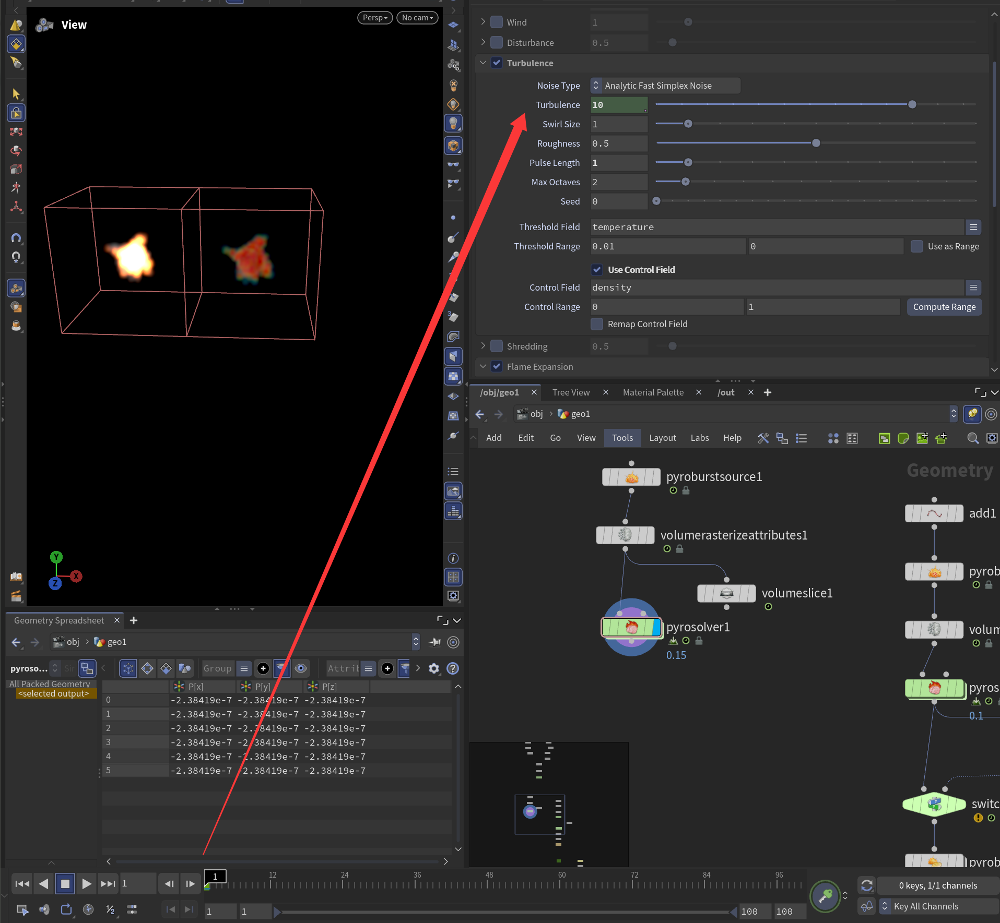

图 49：当前帧为 `1`，Turbulence 为 `10`，参数已带动画通道。

然后拖到后面的帧上，用同样的方法添加一个关键帧，值给 `1`。这样，我们就创建了一个湍流强度的关键帧动画：开始强，后面逐渐弱下来。

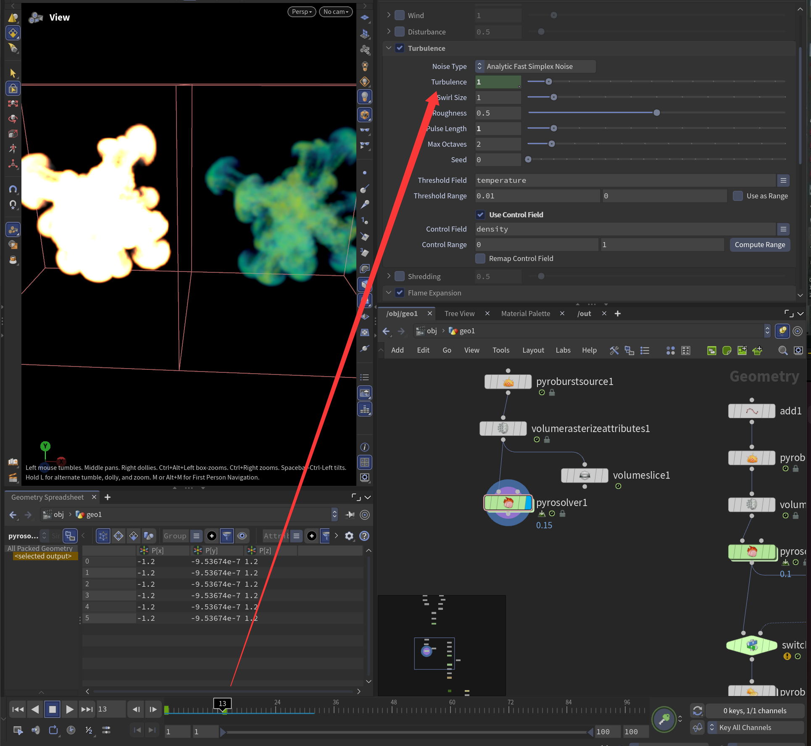

图 50：本次截图在第 `13` 帧，Turbulence 为 `1`。第一帧的 `10` 和这里的 `1` 是手动关键帧演示，后面会改用表达式。

### 2. 再看更方便的方法：参考官方案例，用表达式控制

还有一种更方便的方法，是用表达式来做这个随时间变化的动画。先按 **Ctrl + Shift + 鼠标左键**，取消刚才这个参数上的关键帧动画，再准备输入表达式。操作后确认原有关键帧通道已移除；也可以从参数右键菜单检查、删除通道。

表达式这部分，我们可以参考官方火球案例。看它的 Turbulence 参数，使用的是：

```hscript
fit($FF, ch("startframe"), ch("startframe") + 10, 5, 0.05)
```


图 51：参考案例在 `pyrosolver2` 的 Turbulence 参数中使用 fit 表达式。这里先参考它让强度随时间减弱的做法，不将其他湍流设置一起复制。

它的意思就是：从起始帧开始，经过后面的 `10` 帧，刚开始的强度是 `5`，到最后的强度是 `0.05`，做出这么一个湍流强度动画。

> **时间方向纠正：**原先说“起始帧之后，往前面 10 帧”，这里应理解为时间轴往后推进 `10` 帧，也就是 `起始帧 + 10`。假设起始帧为 `1`，那么变化区间是第 `1` 帧到第 `11` 帧，不是第 `1` 帧到第 `10` 帧。

这里 `$FF` 是当前浮点帧数，能包含子帧；`ch("startframe")` 读取当前求解器节点的 Start Frame 参数。`fit` 把这段帧范围线性映射到指定的强度范围：开始为 `5`，随后逐渐下降，到结束时为 `0.05`。超出时间范围后会保持端点值，不会继续往下减成负数。[fit 官方说明](https://www.sidefx.com/docs/houdini/expressions/fit.html)、[ch 参数引用说明](https://www.sidefx.com/docs/houdini/expressions/ch.html)

> **操作补充：**这里说“用表达式 K 帧”，实际是让参数通过表达式随时间求值，不需要手动放置起止两颗关键帧。将表达式直接填在求解器的 Turbulence 强度参数里，使用 HScript 表达式语言；它与前面 Wrangle 里的 VEX 代码使用位置不同。

### 3. 复制到自己的节点，再调整起止强度

我们把它复制到自己的节点上，然后稍微调整一下：

```hscript
fit($FF, ch("startframe"), ch("startframe") + 10, 3.5, 0.1)
```


图 52：回到自己的 `pyrosolver1`，把开始强度改为 `3.5`，结束强度改为 `0.1`，变化时长仍为 `10` 帧。Swirl Size 保持 `1`，Pulse Length 保持 `1`，Roughness 为 `0.5`，Max Octaves 为 `2`。

这样我们就保留了官方案例里“开始强、后面弱”的思路，但改成适合这次尝试的数值。如果 Start Frame 是 `1`，第 `1` 帧的强度就是 `3.5`，第 `6` 帧是 `1.8`，第 `11` 帧到达 `0.1`，之后保持 `0.1`。后面调整求解器起始帧，这段强度变化也会跟着起始帧一起移动。

这里改变的是湍流强度的时间变化；前面的 **Pulse Length = 1** 仍控制噪声图案自身的演变速度，两者可以配合使用。设置好后重置模拟，从起始帧重新播放，再看前期翻卷与后期运动的衔接。

## 二十四、烟雾消散太快：用温度控制，先把烟团保留下来

现在这个烟雾的消散太快了。回到 **Fields → Density → Dissipation**，我们可以给它一个场的限制，勾选 **Use Control Field**。它现在的控制场是 **temperature**，我们就用温度来控制烟雾的消散。

### 1. 先理解当前的关系：为什么高温反而消散得快

它现在的 **Control Range** 是 `0～1`，基础 **Dissipation** 为 `0.1`。先看这个从左下到右上的控制曲线，控制结果和消散强度是相乘的关系：温度为 `0` 的时候，`0 × 0.1`，消散强度是 `0`；温度为 `1` 的时候，`1 × 0.1`，消散强度就是 `0.1`。


图 53：当前第 `59` 帧，烟团已经很淡。Use Control Field 和 Remap Control Field 已勾选，Control Field 为 temperature，Control Range 为 `0～1`，Control Ramp 由低到高；Clamp Below 为 `0.005`。

这样显然不太符合我们这次想要的效果：温度高的地方，反而消散得更快。我们可以在前面把 **Field Guides → Temperature** 温度场指引打开，看看温度现在分布在哪里，再决定消散要怎么跟它配合。

> **计算补充：**这里相乘的是“温度经过 Control Range 归一化、再经过 Control Ramp 得到的控制系数”和基础消散强度。上面的 `0`、`1` 是当前范围与曲线下的端点例子，不是说任何设置下都直接拿原始温度乘以 Dissipation；它描述的是消散强度，也不是每帧直接减去固定的密度值。[Density 消散控制官方说明](https://www.sidefx.com/docs/houdini/nodes/sop/pyrosolver.html)

### 2. 把曲线反过来：热的时候慢，冷下来再快

现在我们要做的是：当温度比较高的时候，它的消散比较慢；当温度比较低的时候，它的消散比较快。这样更符合我们这次希望保留热烟团、冷却后再让它散掉的思路。

那我们就在这里重新设置曲线，把它反过来。保持 **Remap Control Field** 勾选，点击曲线右上方的第二个图标，**Reverse Domain**，将曲线左右反转。


图 54：箭头指向 Reverse Domain。反转后，曲线左边高、右边低，也就是低温对应较强消散，高温对应较弱消散。温度指引也已打开，便于对照观察。

我们再来重新模拟一下。同样是 `60` 帧左右，可以看到现在烟雾就比较完整了。


图 55：第 `60` 帧的对比结果。这时基础 Dissipation 仍为 `0.1`，Control Range 仍为 `0～1`，但曲线已经反转；烟雾保留情况与前面的正向控制有明显不同。

这样看起来，大多数烟雾都能保留下来，不会那么快消散。其实一直留着也不太自然，但是因为我们会在 **UE** 里把这个烟雾的消散加上，也就是用**溶解**的方式，所以这里先保留完整一些的烟团。这样我们的爆炸会稍显风格化一点。

这里的取舍是：Houdini 里先把烟团的形状和运动做出来，后面再到 UE 里安排它什么时候、以什么方式消失。UE 中的溶解是后续制作思路，这里还没有开始实现。

> **范围说明：**“高温慢、低温快”是本例采用的艺术控制，不是所有真实烟雾都必须遵循的物理规则。“不消散”也是对当前保留效果的描述：冷却后控制系数仍会变化，密度还可能受到 Clamp Below 等设置影响。

### 3. 后续截图中的消散设置也记录下来

后面这张截图里，消散参数又进一步调整了：**Dissipation** 为 `0.75`，**Clamp Below** 为 `0.01`，**Control Range** 改为 `0～0.1`，继续使用反向曲线和 temperature 控制。


图 56：这是后续阶段的设置，与前面 `0.1` 的基础消散、`0～1` 的控制范围分开记录。复现到本阶段时按这张图，不要把两组数值混用。

虽然基础消散调大了，但实际作用还要看温度经过范围与曲线后得到的系数；高温区域仍可能被压到很弱的消散。这样可以把较冷区域的消散加强，同时继续保留较热区域的烟团。

## 二十五、试一下从火焰生烟：理解作用后，这次先不用

然后下面这个 **Emit From Flame**，也就是从火焰发射烟雾，勾选以后重新模拟，发现变化不大。这里我们的判断是：本身烟雾的密度已经足够高了，所以新产生的烟雾不容易直接看出来。

为了看清楚它的作用，这里我们把 **Emission Scale** 强度调为 `10`，再看一下。


图 57：Density 下的 Emit From Flame 已启用，Operation 为 Maximum，Emission Scale 为 `10`，Flame Range 为 `0.2～0.5`。这是功能演示阶段，不是本次最终保留的开关状态。

而且，勾选这个以后，即使我们在体积转换这里把 `density` 属性去掉，只要仍然把燃烧源送入模拟、形成有效的 `flame` 场，解算这里也依旧能产生烟雾。这就是这个选项的作用：除了上游直接提供的烟雾密度，求解器也可以根据火焰场在模拟过程中生成密度。

这里截图的 Operation 是 **Maximum**，已有烟雾较浓时，火焰输出的密度如果没有超过它，变化就可能不明显；提高 Emission Scale，是为了让这个对比更容易看出来。

这个设置这里我们不用，演示完**取消勾选 Density 下的 Emit From Flame**。如果为了对比临时从转体积列表中移除了 `density`，也要恢复原来的 `density temperature burn v`，继续使用之前准备好的密度源。

## 二十六、再调温度与火焰寿命：让这次爆发保持短促

然后看温度，**Temperature → Cooling Rate** 冷却速率我们给个 `0.6`，Diffusion 先保持 `0`。

然后从火焰产生温度，我们也不太需要。因为我们的特效这个爆发是比较瞬间的，这种情况不太需要一直从火焰继续产生温度，所以这次的制作选择是关闭 **Temperature 下的 Emit From Flame**。


图 58：Cooling Rate 已为 `0.6`，Flame Lifespan 显示为 `2`。**注意：这张截图中 Temperature 的 Emit From Flame 仍处于勾选状态**，Operation 为 Pull、Strength 为 `2.5`、Emission Scale 为 `1`；按本段最终制作选择，应再取消该勾选。上方 Density 的 Emit From Flame 参数已灰显，表明那一项已关闭。

这两个同名选项需要分清：Density 下的是从火焰生烟，Temperature 下的是从火焰产生温度。我们这次两个都不使用，保留发射源直接提供的密度与温度。

下面是 **Flame → Flame Lifespan**，火焰生命时长。如果你觉得火焰存在时间太长了，可以将这个值调小一点。这里先保留截图中的 `2`，目前还没有指定新的数值。

> **寿命补充：**Flame Lifespan 的单位是秒，表示消耗掉 flame 场中数值 `1` 所需的时间，不是“第几帧”。实际可见火焰时长还会受源注入值、发射持续时间与显示设置影响；缩短它，是调整火焰持续时间的一种手段。[Flame Lifespan 官方说明](https://www.sidefx.com/docs/houdini/nodes/sop/pyrosolver.html)

这一轮先把烟团的保留、火焰生烟的尝试，以及温度冷却整理到这里。整体仍按前面的制作思路：保留足够完整的烟雾形状，让爆发短促一些，后续再配合 UE 的溶解做风格化消散。

## 二十七、继续找影响造型的主要因素：湍流 Seed 没看到变化，就回头看 Burst Shape

还是继续调整形状。这里我发现，无论我怎么挑选湍流的 **Seed** 值，这个模拟效果看起来都没有明显变化。这里需要确定一下，到底是什么影响了这个形状，而不是一直在湍流的随机值上来回挑选。

如果我们用 **Burst** 源模式的话，从这次的调整来看，基本可以确定，这个 **Burst Shape** 对整体轮廓的影响是比较大的。我们先回到 **Pyro Burst Source → Burst Shape**，看一下它的 **Shape Offset**。


图 59：当前 Shape Offset 为 `0`。这一阶段仍使用 Explosion，Initial Size 为 `1.5`，Spread Angle 为 `180`，Number of Trailings 为 `59`，Trailing Separation 为 `0.2`。

调整一下它的 **Shape Offset**，它的形状就发生了很大的改变。这次把它从 `0` 改为 `28`，再看重新模拟后的轮廓，就能看到明显差别。


图 60：Shape Offset 为 `28`，截图停在第 `32` 帧。保留这个结果，与前面的形状尝试对照；严格比较时还需要使用相同帧和视角。

所以这一步的制作思路是：想换一个整体爆炸造型时，先回到发射源，看看初始轮廓是不是已经决定了后面很大一部分形状。**Shape Offset** 本身就是用来改变爆发形状的随机选择；它与求解器里湍流的 Seed 是两个不同的控制。[Shape Offset 官方说明](https://www.sidefx.com/docs/houdini/nodes/sop/pyroburstsource.html)

同时，形状变化这么大，也有可能受到**速度**的影响。前面我们已经把源速度 `v` 传进了求解器，所以除了源点分布本身，还需要留意这些点带来的运动。这一部分先保留为接下来要验证的判断，暂时不把当前变化全部归因于速度。

> **排查补充：**“调 Seed 没变化”是这次看到的现象，还不能直接说明湍流 Seed 无效。比较前先确认没有读旧缓存，并从起始帧重新解算到同一帧；后续若要区分源形状与源速度的影响，可以固定其他设置，单独比较 `v → vel` 源映射启用与关闭的结果。当前还未记录这项对比的结论。

## 二十八、先定摄像机，再从最终取景里看完整烟团

在 **OBJ** 层级下创建摄像机。我们先确定完整体的形态，再从摄像机里整体看一下爆炸，而不是一直只在自由视角下挑局部细节。


图 61：`/obj` 下的 `cam1` 与 `geo1` 同级。摄像机 Resolution 为 `1024×1024`，Pixel Aspect Ratio 为 `1`，Projection 使用 **Perspective**，Focal Length 为 `50` mm。

这里先让展开后的完整烟团进入画面，再来整体调爆炸的外观。后面时间缩放也会改变烟团在各帧的状态，所以输出前还要沿时间轴检查整段取景，避免只在某一帧看起来完整，其他帧却出画。

## 二十九、烟雾更厚一点，阴影先压弱，留到 UE 材质里处理

然后确定完整体的形态后，再整体调一下爆炸的参数。这里在求解器后接上 **Pyro Bake Volume**（`pyrobakevolume1`），用它来调整烟雾、火焰和内部散射的外观。

烟雾浓度给高一点，给到 `3` 倍，也就是 **Smoke → Density Scale = 3**。然后阴影强度给低一点，**Shadow Density = 0.2**，因为阴影后面我主要在 **UE 材质里通过法线来添加**。


图 62：Density Scale 为 `3`，Shadow Density 为 `0.2`，Ambient Shadow Scale 为 `0.5`。Assign Material 已勾选，材质为 `matnet/Pyro_Shader`。

这里的制作取舍是：烟团要厚实，但先不要在颜色里留下太重的固定阴影；后面把法线带到 UE，再通过材质补上受光层次，让效果更方便跟场景配合。

> **位置补充：**这里的 Density Scale 是 Pyro Bake Volume 的外观倍率，与前面 Sourcing 中 `density → density` 的 Source Scale 是两个参数。UE 中基于法线的受光也属于后续材质表现，不能完全等同于体积自阴影。

### 打开 Fire，把火焰范围和颜色范围都改为 0.2～1

然后在 **Fire** 这里打开火焰，将火焰范围和颜色范围都调整为 `0.2～1`。


图 63：Fire 已勾选，Intensity Scale 为 `250`，强度使用 Use Ramp，Source Range 为 `0.2～1`；Color Mode 为 Color Ramp，下方颜色的 Source Range 也为 `0.2～1`。这里调整的是外观映射，没有改变上游发射源的温度数值。

## 三十、爆炸外观里很重要的一步：让烟雾缝隙透出内部亮光

然后做爆炸，有个比较重要的调整，在旁边 **Scatter** 散射这里。这个 Scatter 可以先理解为烟雾内部光线的烘焙，注意看，它会在烟雾的缝隙处产生亮光。


图 64：Scatter 已启用，Intensity Scale 为 `250`，Hot Core Scale 此时为 `0`；Color Mode 为 Color Ramp，Source Range 为 `0.1～1`，Blur 和 Masking 都已勾选。

原先说“它是用来遮蔽爆炸的”，这里更准确地说，是用 Scatter 做出爆炸内部的发光，再配合 Masking 压住部分发光，让烟团和缝隙的亮暗层次出来。不是把整团烟雾全部照亮，而是让人感觉内部有热量和亮光透出来。

接着按图继续调整，把 **Hot Core Scale** 给到 `100`，并配合下面的模糊和遮罩来看效果。


图 65：Hot Core Scale 已由 `0` 改为 `100`。Blur 中 Use Blur Steps 勾选，Number of Blur Steps 为 `3`，Blur Step Falloff 为 `0.64`，Filter Voxel Radius 为 `5`，Blur Iterations 为 `1`，Downsample 为 `2x`；Use World Space Radius Units 未勾选。Masking 中 Mask Center 为 `0.34`，Mask Width 为 `0.041`，Use Mask Ramp 未勾选。

这里保留从“先看到一点缝隙光”到“继续加强内部亮光”的调整过程。看的是内部光与烟团的关系，不能只把亮度一路拉高；同时还要用遮罩保留烟雾外层的形状。

> **原理补充：**Pyro Bake Volume 会生成 scatter 体积，近似表现发光在内部散射的效果；Blur 扩散这部分发光，Masking 再限制它出现的位置。它属于解算后的外观处理，不会反过来改变烟雾运动。[Scatter 官方说明](https://www.sidefx.com/docs/houdini/nodes/sop/pyrobakevolume.html)

## 三十一、最后调整时间缩放：希望开头爆发更剧烈，后面回到正常速度

最后我们再调整一下时间缩放。我希望它在刚开始的时候剧烈一些，所以回到 **Pyro Solver → Setup**，这里的 **Time Scale** 也可以添加一个动画。

沿用前面表达式控制的思路，本次截图填写：

```hscript
fit($FF, ch("startframe"), ch("startframe") + 10, 3, 1)
```


图 66：Time Scale 在起始帧为 `3`，到起始帧后第 `10` 帧降至 `1`，之后保持正常时间倍率。截图中 Voxel Size 已为 `0.08`，Velocity Voxel Scale 为 `1`，Cache Memory 为 `10000` MB；这是后续阶段的模拟分辨率，与前面的 `0.15` 分开记录。

这样开头的模拟推进得快一些，后面再回到正常速度。它与前面“湍流从强到弱”的表达式可以配合，但作用不同：一个控制模拟时间推进，一个控制湍流强度。更改 Time Scale 后要重新解算，不能直接把旧缓存当成新节奏的结果。

### 将截图里的平流设置也记下来

接着按图，在 **Advanced → Advection** 中，**Field Advection** 使用 **BFECC**，并勾选 **Use Field Advection Settings for Velocity**。


图 67：Field Advection 为 BFECC，速度沿用相同平流设置。

后面这张图还将 **Setup → Advection-Reflection** 从之前的 Disabled 改为 **Double-Project**，**Reflection Amount = 0.95**，作为这一轮的参数尝试记录。


图 68：Time Scale 的表达式继续保留，其余截图中 Global Substeps、Min Substeps、Max Substeps 和 CFL Condition 均为 `1`。

> **设置补充：**Double-Project 是本次截图中的尝试，不是爆炸必须开启的选项。官方对具有非零目标 divergence 的爆炸通常建议使用 Disabled；如果保留 Double-Project，应比较它对本例运动与稳定性的实际影响。[Advection-Reflection 官方说明](https://www.sidefx.com/docs/houdini/nodes/sop/pyrosolver.html)

## 三十二、准备渲染前，先把 1～80 帧缓存保存下来

然后就可以开始准备渲染了。渲染之前记得保存一下缓存，这里给它一个 **`1～80` 帧**的范围，先把这段模拟算好，再去输出序列。

在求解器后接一个 **File Cache**，按本次截图设置：**Evaluate As = Frame Range**，**Start/End/Inc = `1 / 80 / 1`**，**Simulation** 勾选，Substeps 为 `1`，Time Dependent Cache 勾选。


图 69：File Path 使用 Constructed，Base Name 为 `$HIPNAME.$OS`，Base Folder 为 `$HIP/geo`，Version 为 `1`，格式为 `bgeo.sc`。截图中的文件名预览为 `$HIPNAME.$OS_v1.$F4.bgeo.sc`。Load from Disk 此时还未勾选。

先保存 Houdini 工程，确认缓存目录，再点击 **Save to Disk**。算完之后勾选 **Load from Disk**，检查缓存能否正确读回，再接着渲染。

> **连接补充：**截图里 File Cache 暂时是从求解器分出来的旁路，Pyro Bake Volume 仍直接接求解器。保存后若希望渲染使用磁盘缓存，需要将 Pyro Bake Volume 的输入改接到读盘的 File Cache，例如 `pyrosolver1 → filecache1 → pyrobakevolume1`；仅在旁边存一份缓存，不会自动让原渲染分支改为读盘。

## 三十三、接着输出序列：先记录 Labs Flipbook 的渲染设置

接着我们去输出这个序列。在 **`/out`** 创建 **Labs Flipbook Textures**，本次节点名为 `flipbook_textures1`。然后设置如图，先指定刚才的摄像机和调好外观的 Pyro Bake Volume。


图 70：Render Intermediate Images 页签的本次配置。下面按截图记录，便于复现时逐项对照。

| 设置 | 截图值 |
| --- | --- |
| Start/End/Inc | `8 / 80 / 1` |
| Camera | `/obj/cam1` |
| Pyro Bake Volume Path | `/obj/geo1/pyrobakevolume1` |
| Resolution Per Frame | `512×512` |
| Columns/Rows | `8×8` |
| Total Resolution | `4096×4096` |
| Intermediate Directory | `$HIP/render/${HIPNAME}.${OS}/intermediate/` |
| 3D Resolution Limit | `512^3` |
| Color Space | `Gamma 2.2 (Houdini Default)` |

摄像机的 `1024×1024` 与这里实际单帧渲染的 `512×512` 分别记录：本次最终图集按每格 `512×512`、排列 `8×8` 来得到 `4096×4096`，不能把摄像机分辨率直接当成最终图集尺寸。[Labs Flipbook Textures 官方说明](https://www.sidefx.com/docs/houdini/nodes/out/labs--flipbook_textures-1.0.html)

> **帧数需要核对：**缓存 `1～80` 帧与渲染 `8～80` 帧是两段不同范围。截图的渲染范围含首尾共 `73` 帧，但 `8×8` 只有 `64` 格，当前不能直接当作完整覆盖这 73 帧的成品配置。前面[《特效贴图制作》第 24 节](4_2特效贴图制作.md)已记录本机版本超出图集容量时会截去尾帧，而不是自动均匀采样。正式输出前应明确选择 64 帧的片段、安排采样，或扩大布局；本次先保留截图值，不擅自改动取帧范围。

## 三十四、将烟雾颜色、火焰发光、运动向量和法线分别打包

再看 **Export**，本次按图启用 **Output Texture 1、2、5**，Texture 3、4 不用。这里把烟雾的非自发光颜色与火焰发光分开，后面在 UE 材质里就可以分别处理。


图 71：Export Directory 为 `$HIP/render/${HIPNAME}.${OS}/`，Asset Name 为 `${OS}`，输出格式使用 TGA。

| 输出 | 文件后缀 | R | G | B | A |
| --- | --- | --- | --- | --- | --- |
| Output Texture 1 | `_FC.tga` | Non-emissive.r | Non-emissive.g | Non-emissive.b | FinalColor.a |
| Output Texture 2 | `_ECD.tga` | Emissive.r | Emissive.g | Emissive.b | Depth |
| Output Texture 5 | `_MVN.tga` | MotionVector.r | MotionVector.g | Normal.r | Normal.g |

这里虽然第一张文件后缀仍叫 FC，但按本图的实际通道，它的 RGB 放的是 **Non-emissive**，并不是包含火焰发光的完整 Final Color；火焰自发光单独放在 ECD 的 RGB。MVN 的 RG 放运动向量，BA 放法线的两个分量，继续为后面的插帧和法线受光准备数据。

> **输出补充：**文件后缀不决定通道内容，UE 材质要按这里实际的打包方式读取。本次 ECD 的 Alpha 指定了 Depth，如果要使用它，需要对应的深度渲染通道有效；前一篇中跳过 Depth 的处理针对当时未使用深度的输出，不应直接照搬到这张图。当前截图未展开 Render Pass Control 和 Composite，相关通道是否渲染、合成是否匹配，仍需在正式输出时确认。

确认取帧范围、图集容量和所需通道后，再渲染中间图、检查合成结果并导出所选贴图。上面是 Houdini 的导出配置，接下来查看渲染结果，再到 PS 里把烟雾与火焰重新打包。

## 三十五、看一下渲染出来的贴图：先把火焰去色，准备合到烟雾贴图里

看一下渲染出来的贴图。导出的贴图我们需要放在 **PS（Photoshop）** 里处理一下，将 **ECD** 和 **FC** 这两张图放到 PS 里，我们需要把这些合成一张贴图。

前面在 Houdini 中把烟雾颜色和火焰分开导出，是为了分别取得它们的内容。现在这一步继续把它们放到同一张图的不同通道里，后面在 UE 材质中再分别读取烟雾、透明度和火焰。


图 72：打开 `flipbook_textures1_ECD.tga`，RGB 中是火焰自发光序列；旁边同时打开 `flipbook_textures1_FC.tga`，准备进行通道合成。

这个火焰，按 **Ctrl+U** 打开“色相／饱和度”，把饱和度去掉，设置为 **`-100`**。这里先留下火焰的灰度强弱，原来的橙黄色不再直接带入这次打包的通道。


图 73：饱和度为 `-100`，色相与明度均为 `0`。可以看到火焰由彩色变为灰度，仍保留了前期明亮、后期逐渐减弱的变化。

然后 **Ctrl+A 全选，再 Ctrl+C 复制**。这里把原先“Ctrl+A 复制”的操作补全：Ctrl+A 是全选，真正复制还需要按 Ctrl+C。复制的是去色后的火焰画面，后面要粘贴到蓝色通道。

## 三十六、复制一份 FC 留作取样，再将烟雾、Alpha、火焰放进 RGB

然后把这个 **Final Color（FC）复制一份**，将其中一份填充黑色。先留住一份原来的 FC，不然整张填黑之后，后面就没有烟雾基础颜色可以复制了。


图 74：原 FC 与它的副本并排显示，画布均为 `4096×4096`。一份保留原内容作为来源，另一份用于通道打包。

填充黑色时，先选中目标图的 **RGB 复合通道**，将它的颜色内容填黑；原来的 Alpha 暂时保留，后面还要把它复制到绿色通道。


图 75：左边这份已填黑，右边仍保留烟雾基础颜色。两份画布大小、图集排列和每格位置保持一致，后面按整张画布复制粘贴。

### 先把刚才复制的火焰粘贴到蓝色通道

然后将刚才复制的火焰粘贴到 **蓝色通道 B**。在目标图的“通道”面板里，单独选中“蓝”，再按 **Ctrl+V** 粘贴，这样就把灰度火焰放进了 B 通道。


图 76：左侧目标图单独查看蓝色通道，可以看到与去色后 ECD 对应的火焰纹理。右侧保留的 FC 仍作为后续复制烟雾颜色的来源。

### 再把原 FC 的 Alpha 移到绿色通道

然后将这个 **Alpha 粘贴到绿通道**，就是把 **FC 的 Alpha 移到绿色通道 G**。先单独选中原 FC 的 **Alpha 1**，Ctrl+A 全选、Ctrl+C 复制，再切到目标图的“绿”通道，Ctrl+V 粘贴。


图 77：绿色通道里是烟雾的透明度轮廓，黑色为透明区域，白色为不透明区域，边缘和后期烟雾保留灰度过渡。

这里要分清，取的是 **FC 中保存的 FinalColor.a**。前面 ECD 的 Alpha 打包的是 **Depth**，不是这一步要复制的烟雾透明度。

### 回到保留的 FC，把基础颜色放进红色通道

然后回到复制保留的这份 FC 里，将这个**基础颜色复制下来，粘贴到红通道 R**。这里烟雾本身是灰度的，所以我们用单个通道保存它的明暗与细节；操作时可以在保留的 FC 中单独选取一个灰度一致的颜色通道，全选复制，再粘贴到目标图的“红”通道。


图 78：左侧单独查看 R，已经能看到原 FC 的烟团明暗细节。右侧仍是保留的原始烟雾图，方便对照。

这里沿用文件名 FC，但按前面导出的实际设置，它的 RGB 是 **Non-emissive** 烟雾颜色。我们取的是这份不含火焰自发光的灰度内容；如果以后换成有明显彩色差异的烟雾，就不能用一个 R 通道完整保存原来的三通道彩色。

### 最后将目标图的 Alpha 填充为白色

然后 **Alpha 可以填充为白色**。因为我们已经把需要的烟雾透明度放到了 G，目标图原来的 Alpha 这次不再存烟雾轮廓，单独选中 **Alpha 1**，全选后填白就可以了。


图 79：目标图的 Alpha 1 已全部填白，即数值为 `1`。后续材质的烟雾透明度应读取 G，不能再继续读取这张图的 A。

## 三十七、保存最终两张贴图，再到 UE 里逐通道确认

这个就是我们最终需要保存的贴图。切回 **RGB 复合通道**，看一下合成后的结果：烟雾、透明度和火焰分别装进了三个通道，画面会呈现黄绿色等混合颜色，这是通道打包后的预览。


图 80：最终 RGB 预览。它的各通道分别有用途，后面在材质里单独取出使用，不直接把这份黄绿色画面作为爆炸最终颜色。

**R 通道是基础颜色，G 通道是 Alpha，B 通道是火焰。** 最后再对照一下各自的来源：

| 最终通道 | 放入的内容 | 来源 |
| --- | --- | --- |
| **R** | 烟雾基础颜色的灰度明暗 | 原 FC 的 Non-emissive RGB 中对应的灰度内容 |
| **G** | 烟雾透明度 Alpha | 原 FC 的 Alpha，即 FinalColor.a |
| **B** | 灰度火焰强度 | ECD 的自发光 RGB 经饱和度 `-100` 处理后的内容 |
| **A** | 全白，数值 `1` | 本次手动填充 |

将打包结果另存为 TGA。制作过程中保留原始 FC、ECD 或分层工作文件，成品文件再按自己的目录保存；如果要保留本次全白的 Alpha，保存 TGA 时选择包含 Alpha 的 **32 位**格式。

最终得到这两个贴图：一张是刚才在 PS 中重新合成的 **FC**，另一张是前面导出的 **MVN**。


图 81：最终整理出的 `flipbook_textures1_FC.tga` 和 `flipbook_textures1_MVN.tga`。FC 的通道含义已经按本节重新组织；MVN 沿用前面 **RG 为运动向量、BA 为法线两分量**的打包，没有在这次 PS 操作中改动。

这次合成只从 ECD 取了火焰 RGB，它原先 A 中的 Depth 没有被带进最终 FC；这里也没有把深度塞进 MVN。后续若要使用深度，需要另行保留相应数据。

### 在 UE 中分别查看 R、G、B，确认刚才没有贴错通道

然后在 UE 里打开这张最终的 FC，单独看一下它的三个通道。先看 **R**，应该是烟雾的基础颜色，能看到烟团的明暗和细节。


图 82：顶部仅启用 R，显示的是灰度烟雾基础颜色。

再看 **G**，应该是刚才从原 FC 移过来的 **Alpha**，能够看清烟雾的外轮廓和透明过渡。


图 83：顶部仅启用 G，显示烟雾透明度。它与 R 的烟雾明暗用途不同，不能因为两者都有烟团形状，就当作同一份内容。

最后看 **B**，应该是火焰。前面的帧比较亮，后面的帧逐渐减弱，这样就把火焰的时间变化单独保存下来了。


图 84：顶部仅启用 B，显示从 ECD 去色后放入的火焰强度，与 PS 中蓝色通道的内容对应。到这里，烟雾基础颜色、烟雾透明度和火焰已经整理到同一张 FC，另一张 MVN 留作后续运动插帧与法线受光使用。
