# Houdini火焰拖尾序列帧

这里我需要创建一种新的序列帧资源，**Pyro Trail**。

## 一、Pyro Trail Path 与 Pyro Trail Source

截图中先搭出了下面这两个节点：

```text
/obj/geo1
  trailpath1       Pyro Trail Path：生成拖尾运动路径
    ↓
  trailsource1     Pyro Trail Source：沿路径生成随时间变化的发射源点
```

**Pyro Trail Path** 负责确定拖尾的路径、发射方向、初始速度和时间；**Pyro Trail Source** 再利用这些路径生成烟火发射源。截图里的弧线是路径预览，这一步还没有展示火焰模拟及序列帧输出。[Pyro Trail Path 官方说明](https://www.sidefx.com/docs/houdini/nodes/sop/pyrotrailpath.html)、[Pyro Trail Source 官方说明](https://www.sidefx.com/docs/houdini/nodes/sop/pyrotrailsource.html)。

## 二、General：输入点与辅助显示

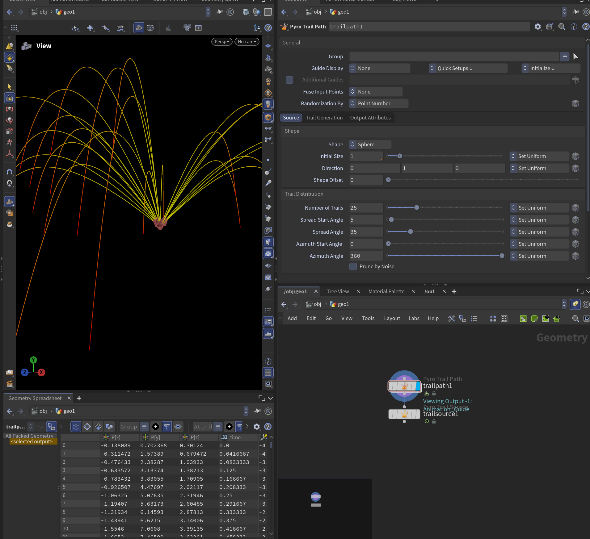

| 参数 | 作用 |
| --- | --- |
| **Group** | 指定用于生成拖尾的输入点组；留空时使用全部输入点。 |
| **Guide Display** | 控制辅助显示；Distribution Guide 可以显示拖尾起始方向的分布范围，便于查看角度设置。 |
| **Quick Setups** | 快速创建常用辅助节点或连接；其中 Pyro Trail Source 可创建下游拖尾发射源。 |
| **Initialize** | 批量初始化参数的控制方式：Force Uniform 统一使用面板值，Use Attribute 根据输入属性设置对应的属性控制。 |
| **Additional Guides** | 引入 Pyro Burst Source 作为辅助显示，方便对照爆炸主体与拖尾的时间关系。 |
| **Fuse Input Points** | 决定是否合并输入点。None 保留各点；All Into One 合成一个点；By Attribute 按相同属性值分组后合并。 |
| **Randomization By** | 决定随机变化以什么作为种子依据。Point Number 使用点编号；Seed Attribute 使用指定整数属性，便于在点顺序变化后保持随机结果稳定。 |

## 三、Source：拖尾从哪里发射、怎样分布

### 1. Shape：发射形状

| 参数 | 作用 |
| --- | --- |
| **Shape** | 选择拖尾起点的分布形状。Sphere 围绕输入点作球形分布；Line 沿 Direction 指定的轴线分布。 |
| **Initial Size** | 控制拖尾起始区域的大小；不是最终路径长度，也不是火焰宽度。 |
| **Direction** | 定义发射区域的主方向。Sphere 模式下，它是扩散角的参考轴；Line 模式下，它决定发射线的方向。 |
| **Shape Offset** | 改变起点的随机散布结果，在同一组形状设置下换一种拖尾分布。 |

### 2. Trail Distribution：数量与角度

| 参数 | 作用 |
| --- | --- |
| **Number of Trails** | 控制每个输入点生成多少条拖尾路径。 |
| **Spread Start Angle** | Sphere 模式下，设置起点分布相对 Direction 的最小偏离角，控制分布从离主方向多远的位置开始。 |
| **Spread Angle** | Sphere 模式下，控制从 Spread Start Angle 继续向外展开的角度范围。 |
| **Azimuth Start Angle** | 设置围绕 Direction 轴的方位起始角，改变拖尾分布朝向哪一侧。 |
| **Azimuth Angle** | 控制绕 Direction 轴展开的方位范围；范围越大，围绕主轴覆盖的区域越广。 |
| **Prune by Noise** | 按噪声剔除一部分拖尾，打破均匀分布；因此实际保留下来的路径可能少于 Number of Trails。 |

Spread 这一组控制“偏离主方向多少”，Azimuth 这一组控制“绕主方向分布在哪些方位”，可以结合 Distribution Guide 观察。[Source 参数说明](https://www.sidefx.com/docs/houdini/nodes/sop/pyrotrailpath.html#source)。

### 3. 参数右侧的控制方式

| 控件 | 作用 |
| --- | --- |
| **Set Uniform** | 对各输入点统一使用面板中指定的参数值。 |
| **Set Varying** | 让不同输入点在指定范围内使用不同的随机值。 |
| **Use Attribute** | 使用输入点上对应的属性控制参数，例如用 `pscale` 控制 Initial Size、用 `N` 控制 Direction。 |
| **骰子按钮** | 为对应参数创建或选中属性调整节点，进一步控制各输入元素的随机变化。 |

## 四、Trail Generation：速度、弹道与时间

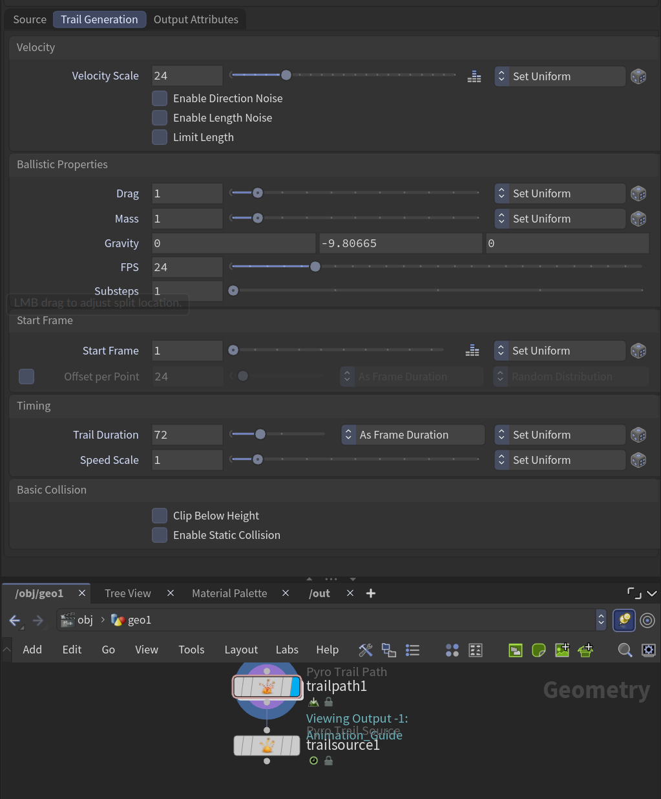

### 1. Velocity：初始速度

| 参数 | 作用 |
| --- | --- |
| **Velocity Scale** | 控制拖尾的初始发射速度大小；速度越大，相同运动时间内通常能飞得越远。 |
| **Enable Direction Noise** | 用噪声扰动初始速度方向，让各条路径的发射方向产生变化。 |
| **Enable Length Noise** | 用噪声改变初始速度向量的长度，也就是速度大小，从而使各条路径的飞行距离产生差异。 |
| **Limit Length** | 限制初始速度向量的大小范围。这里的 Length 指速度向量长度，并非直接裁切路径的几何长度。 |

### 2. Ballistic Properties：弹道属性

| 参数 | 作用 |
| --- | --- |
| **Drag** | 空气阻力，控制运动过程中速度衰减的程度；阻力越大，通常飞得越近。 |
| **Mass** | 质量，影响路径运动抵抗阻力的程度；在相同阻力条件下，质量越大，越不容易被阻力减速。 |
| **Gravity** | 重力向量，决定路径向哪个方向弯曲及弯曲程度。 |
| **FPS** | 控制每秒路径的采样分段数，通常与工程帧率对应；它用于路径生成，不会修改工程的全局播放帧率。 |
| **Substeps** | 在路径上进一步细分，增加曲线点数，便于后续变形等处理。 |

### 3. Start Frame：开始时间

| 参数 | 作用 |
| --- | --- |
| **Start Frame** | 设置拖尾从哪一帧开始运动，并写入路径的 `startframe` 属性。 |
| **Start Frame 右侧可视化按钮** | 辅助查看触发时间，区分尚未开始和已经开始的拖尾。 |
| **Offset per Point** | 为各条拖尾增加开始时间偏移，让同一个输入点生成的拖尾也能错开启动。 |
| **As Frame Duration / As Time Duration** | 选择偏移量以帧数还是秒数计量。 |
| **Random Distribution** | 在偏移范围内随机分配开始时间。 |

Start Frame 先作用于输入点，同一个输入点生成的路径会共享该开始时间；Offset per Point 则能进一步错开这些路径。

### 4. Timing：持续时间与沿路径的运动速度

| 参数 | 作用 |
| --- | --- |
| **Trail Duration** | 控制生成路径所覆盖的运动时长；在其他条件相同时，持续时间越长，路径通常越长。 |
| **As Frame Duration / As Time Duration** | 选择持续时间以帧数还是秒数计量。 |
| **Speed Scale** | 控制沿已有路径前进的快慢，用于调整运动节奏。 |

**Velocity Scale** 调整发射速度，参与形成弹道；**Speed Scale** 调整沿路径运行的快慢。这两个参数需要分开理解。[Trail Generation 参数说明](https://www.sidefx.com/docs/houdini/nodes/sop/pyrotrailpath.html#trail-generation)。

### 5. Basic Collision：基础碰撞

| 参数 | 作用 |
| --- | --- |
| **Clip Below Height** | 启用高度裁切；路径下降到指定的 Y 轴高度以下时终止。 |
| **Enable Static Collision** | 启用与指定静态几何的基础碰撞检测，用于路径的碰撞和反弹处理。 |

## 五、路径中保留的时间属性

截图的 Geometry Spreadsheet 中可以看到路径点的 `time` 属性。后续 Pyro Trail Source 需要利用路径的时间信息生成动画发射源。

| 属性 | 作用 |
| --- | --- |
| **time**（点属性） | 记录沿路径到达各点的相对时间，从每条曲线的起点开始累计。 |
| **startframe**（图元属性） | 记录每条路径的开始帧，与 `time` 配合确定拖尾在时间轴上的运动位置。 |

将路径继续传给 Pyro Trail Source 时，需要保留这两个属性。[路径时间属性说明](https://www.sidefx.com/docs/houdini/nodes/sop/pyrotrailpath.html#using-the-time-attribute)。

## 六、制作单条火焰拖尾：收拢分布，再调整弹道

因为这里我们只需要一个单一线条的火焰拖尾，所以我们这样设置参数。

### 1. Source：只生成一条路径，并确定发射方向

先在 **Source → Trail Distribution** 中，把 **Number of Trails** 改为 `1`，让这里仅生成一条路径。然后收拢角度分布，确定这条路径的发射方向。

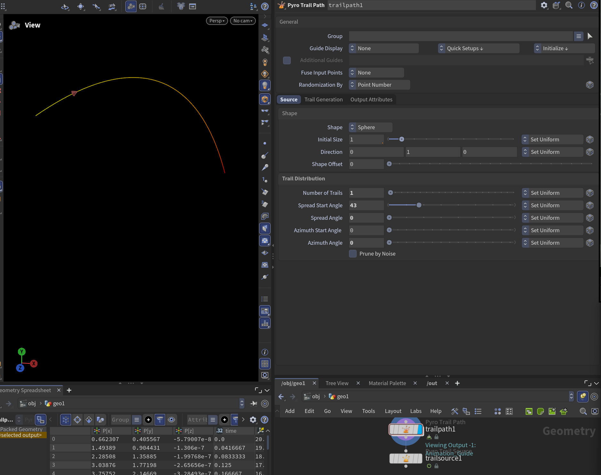

| 调整项 | 本次设置与作用 |
| --- | --- |
| **Number of Trails** | 设为 `1`，在本次单个发射位置上只生成一条拖尾路径。 |
| **Spread Start Angle** | 设为 `43°`，让发射方向相对 Direction 主轴倾斜，而不是沿主轴直冲出去。 |
| **Spread Angle** | 设为 `0°`，不再从上述起始角继续向外扩散，将偏离主轴的角度固定下来。 |
| **Azimuth Start Angle / Azimuth Angle** | 都设为 `0°`，固定绕主轴的方位，不再向周围展开。 |

这里仍然使用 **Sphere**，Direction 作为朝上的参考轴。单条路径由 Number of Trails 决定，角度参数则决定它朝哪里发射。

### 2. Trail Generation：调整速度、下坠和运动时长

接着进入 **Trail Generation**，调整这条路径的初始速度、重力和持续时间，让它形成截图中的弧形轨迹。

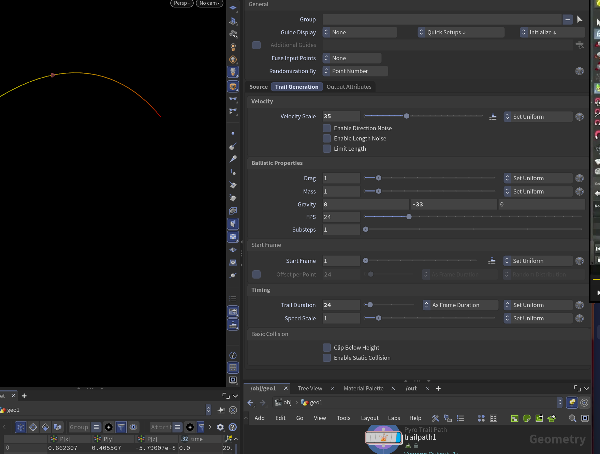

| 调整项 | 本次设置与作用 |
| --- | --- |
| **Velocity Scale** | 调整为 `35`，提高初始发射速度，影响路径向外飞出的距离和上升高度。 |
| **Gravity** | 调整为 `(0, -33, 0)`，增强沿 Y 轴负方向的重力，使轨迹更快向下弯曲。 |
| **Trail Duration** | 调整为 `24`，使用 **As Frame Duration**，将路径覆盖的运动时长设为 24 帧。 |

方向噪声和速度大小噪声暂不启用，先保留这条明确的弧形路径。

## 七、Pyro Trail Source：沿路径生成拖尾源点

接下来进入下游的 **Pyro Trail Source**（`trailsource1`），沿前面确定的路径生成拖尾发射源。

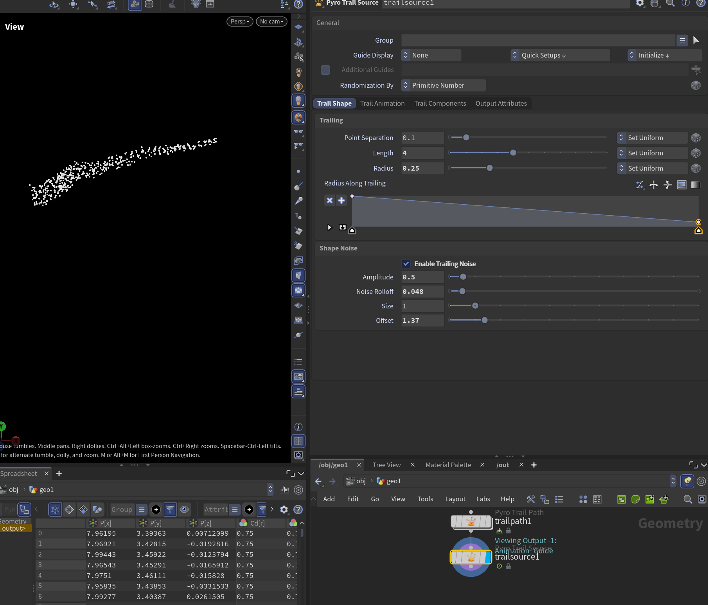

这里的 **Trail Shape** 控制当前拖尾源点的形状，参数作用整理如下：

| 参数 | 作用 |
| --- | --- |
| **Point Separation** | 控制源点间距，间距越小，点云越密集。 |
| **Length** | 控制运动头部后方拖尾源的长度，以场景空间单位计量。 |
| **Radius** | 控制拖尾源的整体半径，也就是粗细。 |
| **Radius Along Trailing** | 沿拖尾长度调整半径分布，曲线左端对应尾部，右端对应头部。 |
| **Enable Trailing Noise** | 对源点位置添加噪声，打破严格贴合路径的形状。 |
| **Amplitude** | 控制位置扰动的强度。 |
| **Noise Rolloff** | 控制噪声沿拖尾的衰减；增大时，靠近头部的扰动减弱。 |
| **Size** | 控制噪声图案的空间尺度。 |
| **Offset** | 偏移噪声采样位置，用来更换噪声图案。 |

这里的 Length 控制一段拖尾源有多长；上一节 Pyro Trail Path 的 Trail Duration 控制整条路径覆盖多长的运动时间。

## 八、Prefix Attribute Name：区分不同发射器的属性名称

这里有一个点，就是 **Prefix Attribute Name**。这个设置主要是为了避免和其他发射器节点的属性混淆。如果没有开启，那么源属性名称和其他烟火发射源一样，密度使用 `density`；开启之后，它就被命名为 `trail_density`。**这里我们不需要开启。**

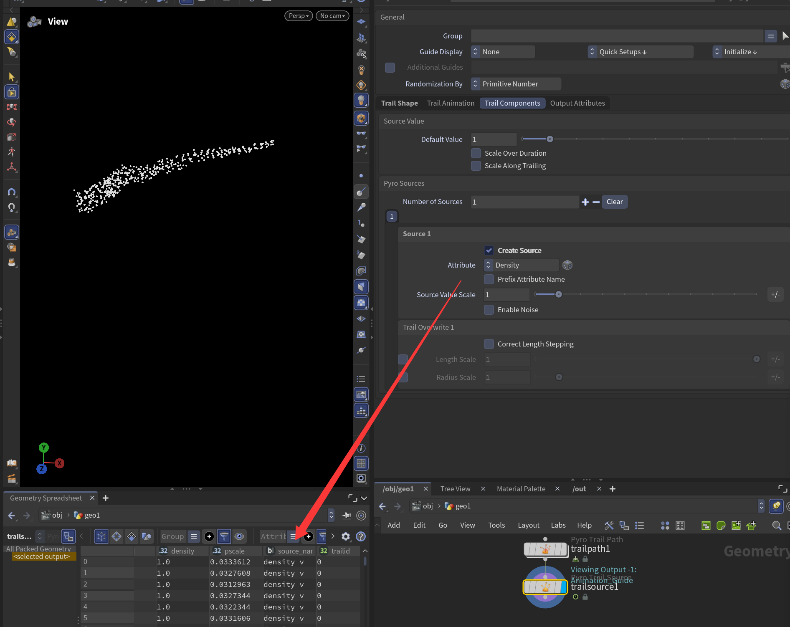

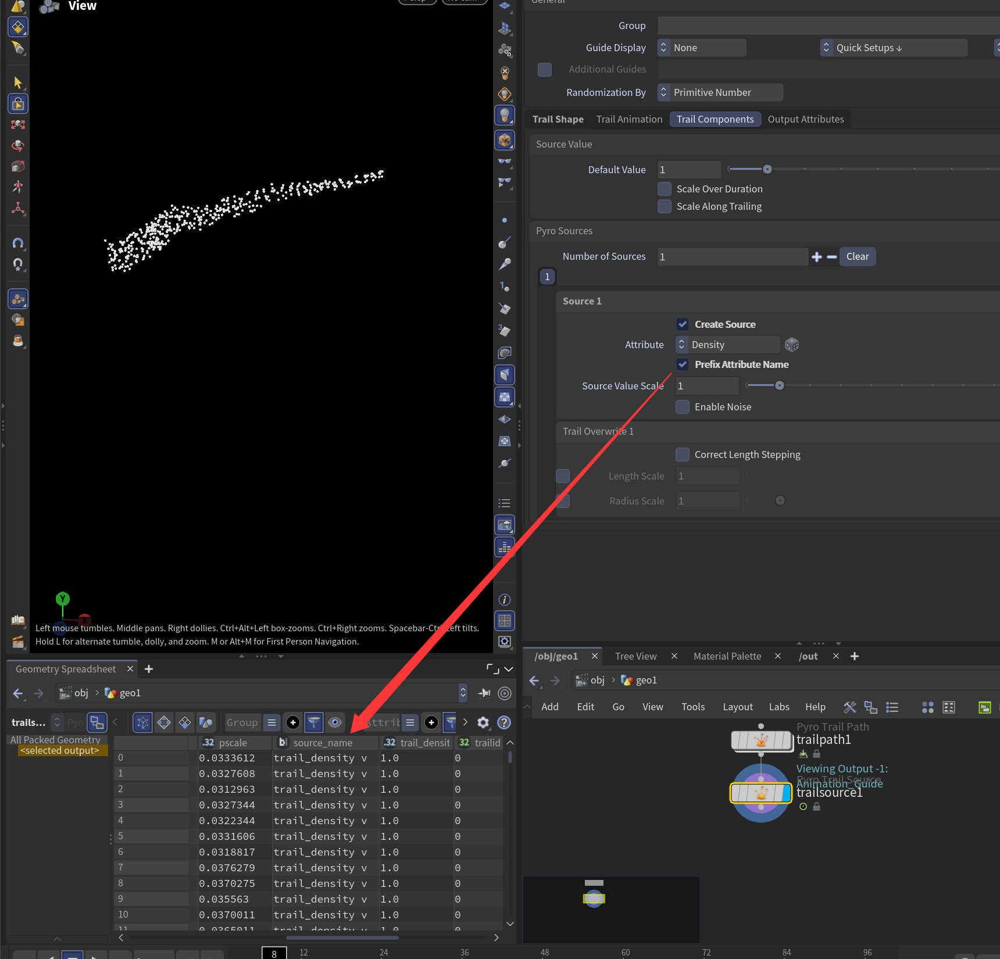

上面两张图是开关前后的对比，开启的截图用于说明命名变化，最终仍保持关闭。属性名称使用截图中的小写形式。这个开关改变的是输出属性的命名，不改变密度本身的含义。

## 九、Trail Components：添加温度和燃烧属性

然后这里我们需要再添加两个属性：**温度 Temperature** 和 **燃烧 Burn**，点击 **Number of Sources** 右侧的加号添加。

保留原来的 Density，再分别添加 Temperature 和 Burn，各组件的 **Create Source** 保持勾选，Prefix Attribute Name 保持关闭。

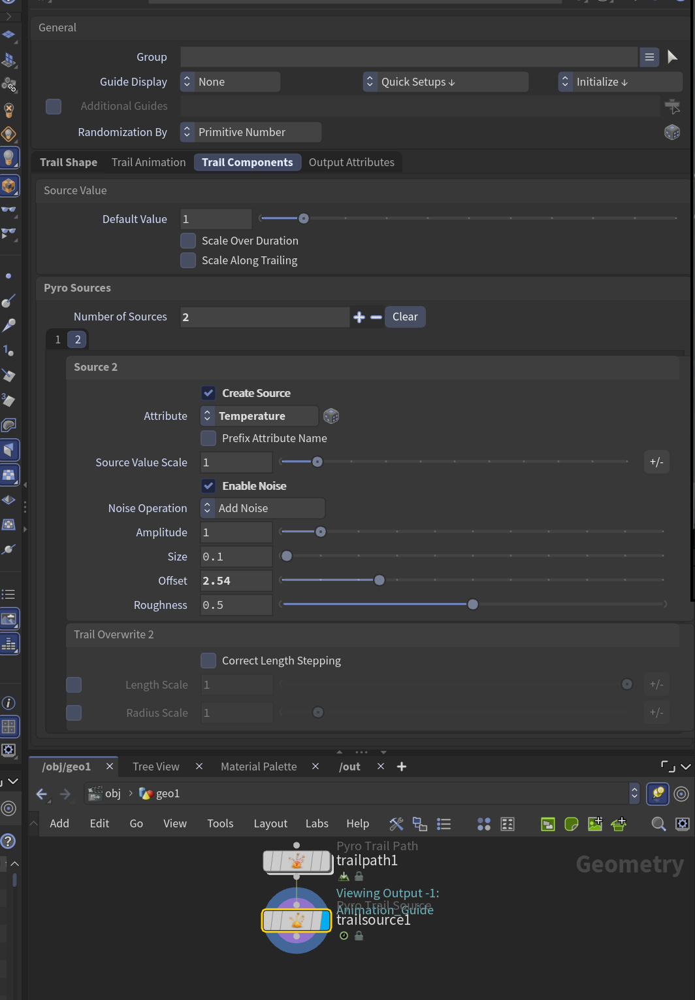

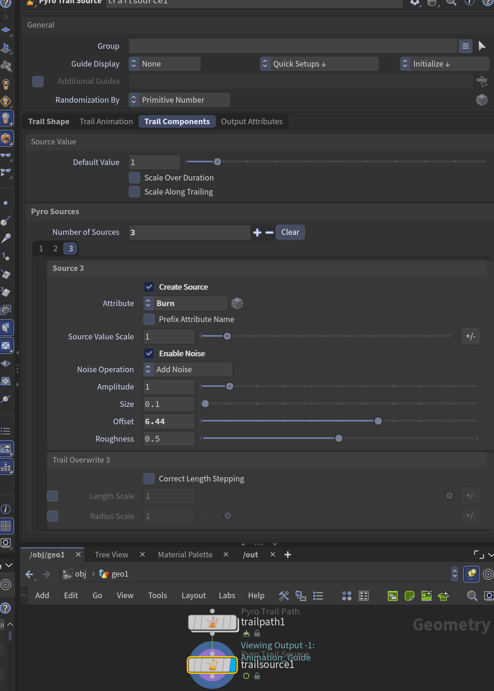

| 组件 | 输出属性 | 作用 |
| --- | --- | --- |
| **Density** | `density` | 提供烟雾密度源。 |
| **Temperature** | `temperature` | 提供温度源。 |
| **Burn** | `burn` | 提供燃烧源。 |

截图中的温度与燃烧组件还开启了属性噪声。这里整理它们的功能，方便和前面的形状噪声区分：

| 参数 | 作用 |
| --- | --- |
| **Source Value Scale** | 单独缩放当前组件的源属性强度。 |
| **Enable Noise** | 对当前组件的属性值添加噪声变化。 |
| **Noise Operation** | 决定噪声与源值的运算方式；Add Noise 相加，Multiply 相乘。 |
| **Amplitude** | 控制属性噪声的强度。 |
| **Size** | 控制属性噪声的空间尺度。 |
| **Offset** | 改变采样偏移，换一种属性噪声分布。 |
| **Roughness** | 控制噪声细节的粗糙程度。 |

Trail Shape 的噪声改变源点位置；这里的噪声改变密度、温度或燃烧等属性的数值。

## 十、Trail Overwrite：单独控制各属性的分布范围

然后注意下面的 **Trail Overwrite**。这里的 **Correct Length Stepping**，是为了避免速度过快、相邻帧之间移动距离过大而出现拖尾断开的情况，可以把它理解为针对拖尾连续性的修正。**这个在我们这里不需要开启。**

更准确地说，当某个组件的拖尾长度小于一帧内的移动距离时，这个选项会让它的长度至少覆盖该距离，避免连续帧发射出的体积之间留下空隙。[Correct Length Stepping 官方说明](https://www.sidefx.com/docs/houdini/nodes/sop/pyrotrailsource.html)。

它下面的 **Length Scale**，长度缩放，是用来控制当前属性的分布长度的；**Radius Scale** 控制当前属性的分布半径。

| 参数 | 作用 |
| --- | --- |
| **Correct Length Stepping** | 修正高速运动时拖尾源长度不足造成的间断。 |
| **Length Scale** | 在 Trail Shape 的 Length 基础上，单独缩放当前组件的长度。需要勾选左侧的覆盖开关才能生效。 |
| **Radius Scale** | 在 Trail Shape 的 Radius 基础上，单独缩放当前组件的半径。同样需要启用左侧的覆盖开关。 |

**燃烧的话给默认值 `1`**：截图中 Burn 的 Length Scale 和 Radius Scale 都启用并保持 `1`，沿用基础长度与半径。

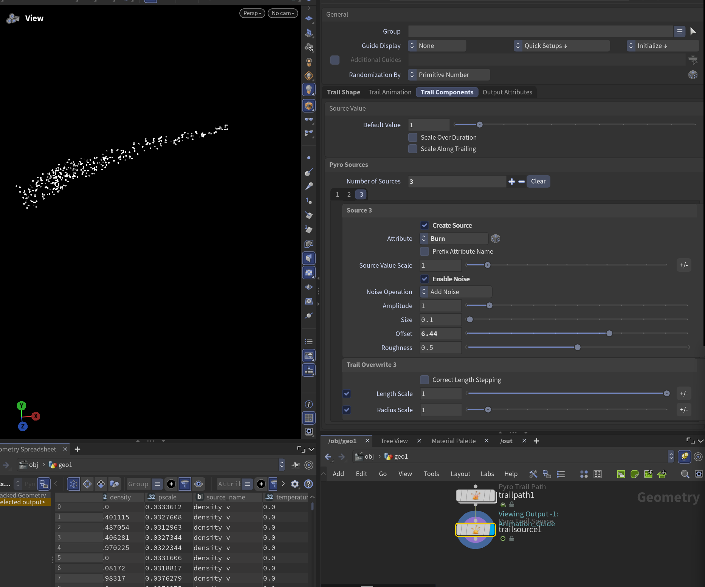

然后温度我们可以将长度缩放给个 **`0.6`**，即只让火焰拖尾头部的地方产生温度。具体操作是：切到 **Temperature**，勾选 Length Scale 左侧的开关，再将它设为 `0.6`。

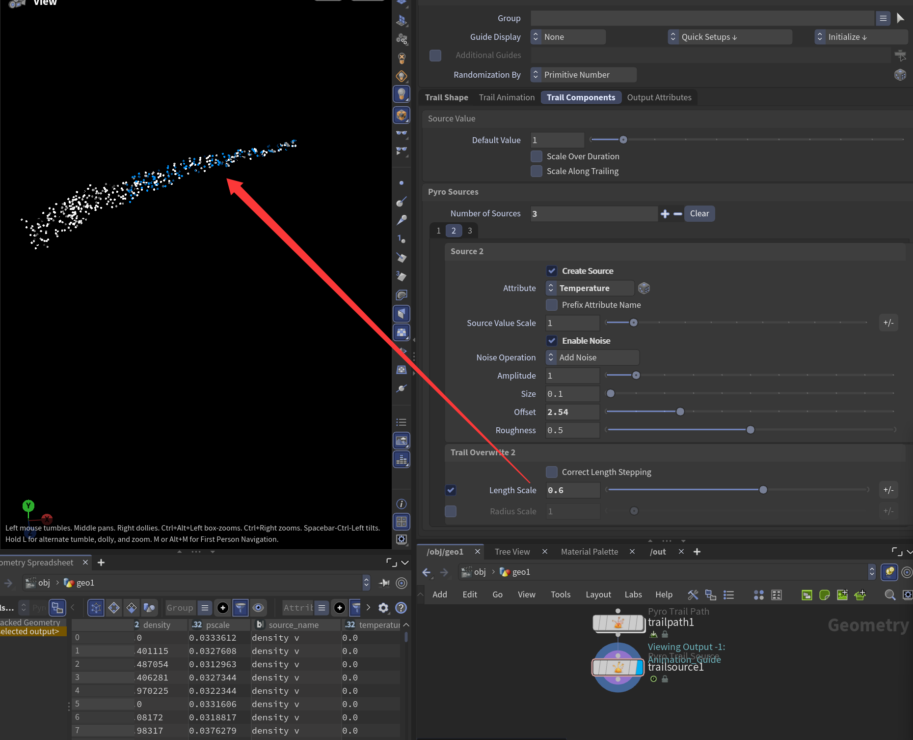

这里“只让头部产生温度”说的是**温度发射源的分布**：以运动头部为基准，向后保留基础拖尾长度的 60%，减少后方的温度发射范围。

## 十一、Scale Along Trailing：给头部到尾部的属性强度加渐变

然后这个拖尾我们也可以给一个头部到尾部的渐变，勾选 **Scale Along Trailing**。

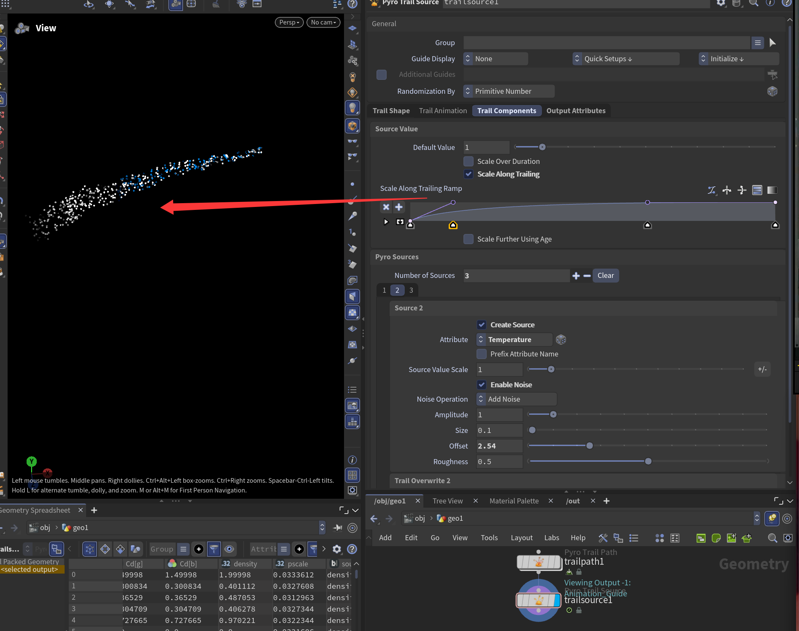

| 参数 | 作用 |
| --- | --- |
| **Scale Along Trailing** | 启用沿拖尾长度的属性强度缩放。 |
| **Scale Along Trailing Ramp** | 左端对应尾部，右端对应头部；曲线越低，对应位置的源属性越弱。截图中尾端较弱，朝头部逐渐增强。 |
| **Scale Further Using Age** | 在长度渐变之外，进一步根据拖尾年龄衰减源强度；本次没有开启。 |

这个开关位于 Trail Components 上方的公共 Source Value 区域，会作用于密度、温度、燃烧等组件，不只是当前选中的 Temperature。它控制源属性的强弱，与前面 Radius Along Trailing 控制粗细的用途不同。[沿拖尾缩放参数说明](https://www.sidefx.com/docs/houdini/nodes/sop/pyrotrailsource.html#trail-components)。

## 十二、Output Attributes：关闭速度输出

然后进入 **Output Attributes**，这里不需要速度，关闭 **Velocity**。

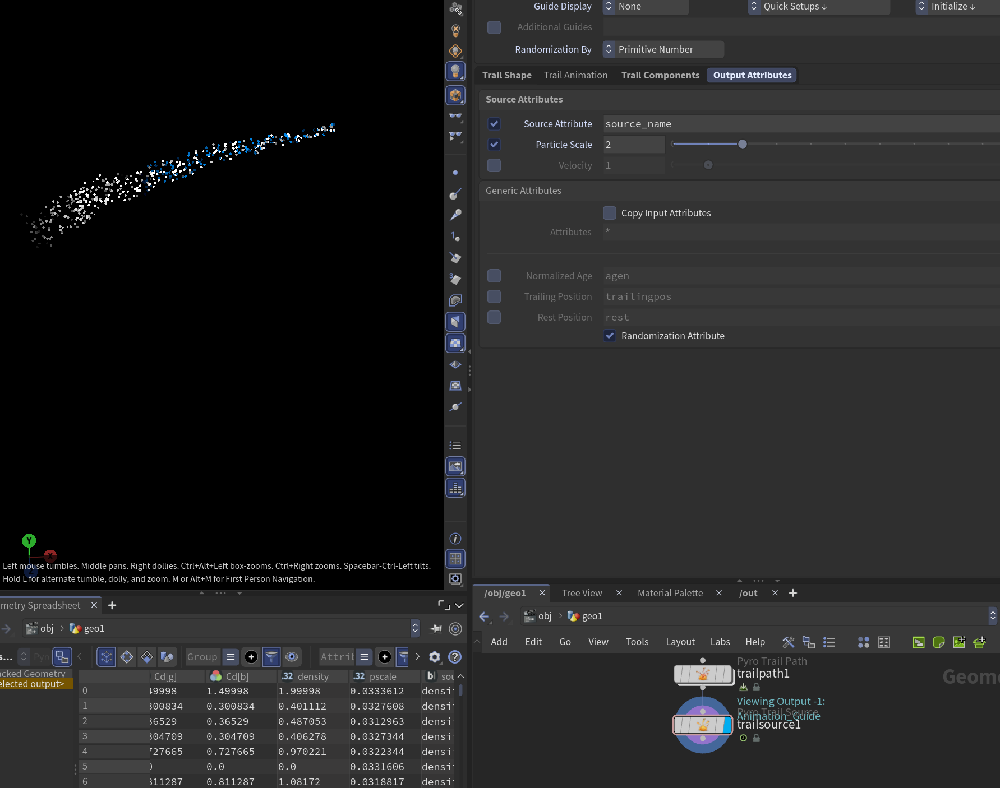

| 参数 | 作用与本次处理 |
| --- | --- |
| **Source Attribute** | 输出 `source_name`，标记各组源点贡献哪些属性，供后续转体积时区分；保持开启。 |
| **Particle Scale** | 输出源点半径属性 `pscale`，用于转体积时确定点的影响范围；保持开启。 |
| **Velocity** | 输出源点速度属性 `v`；本次关闭。 |

关闭这里的速度输出后，拖尾源仍会按输入路径随时间移动，只是不再额外输出 `v` 作为速度源属性。

## 十三、体积转换：添加三个属性，处理源属性与覆盖

下一步就是熟悉的体积转换，创建 **Volume Rasterize Attributes**（`volumerasterizeattributes`），然后把 `burn density temperature` 属性添加进来。

```text
trailpath1
  ↓
trailsource1
  ↓
volumerasterizeattributes1
  ↓
pyrosolver1
```

然后勾选 **Source Attribute**，使用上游输出的 `source_name`。原先这里的理解是“让每个点都混合上其他属性”，需要纠正一下：**它会按源名称筛选参与各个体积生成的点**。例如，生成温度体积时使用温度组件的点，避免其他组件上值为零的温度属性参与平均、把结果稀释。

还有下面 Coverage 覆盖这里的 **Normalize by Clamped Coverage** 也勾选，然后清掉 Coverage Attribute 里默认添加的 `density`。这里归一化就不需要再添加将速度排除在外的规则了，因为之前我们就没把速度添加进来。

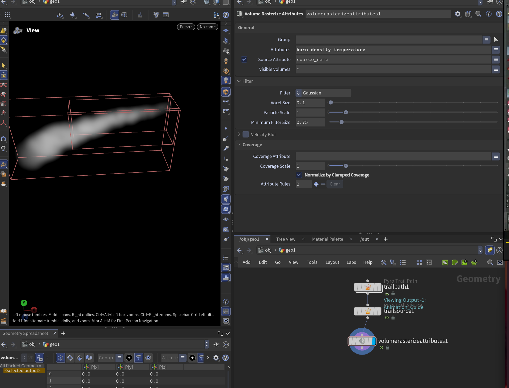

| 参数 | 作用与本次处理 |
| --- | --- |
| **Attributes** | 指定要转为体积的点属性；本次使用 `burn density temperature`。 |
| **Source Attribute** | 启用 `source_name` 筛选，让每种体积由相应组件的源点贡献。 |
| **Coverage Attribute** | 指定点的覆盖权重属性；这里清空 `density`，不再用密度值作为覆盖权重。 |
| **Normalize by Clamped Coverage** | 让采样结果按限制后的覆盖度衰减，在点覆盖区域的边缘形成平滑过渡。 |
| **Attribute Rules** | 单独指定某些体积的采样合成方式；本次没有速度体积，不添加速度的例外规则。 |

这里清空的是覆盖权重字段，Attributes 中的 `density` 继续保留。Normalize 的“平滑”是覆盖边缘的过渡，并非对模拟烟雾做模糊。[体积转换官方说明](https://www.sidefx.com/docs/houdini/nodes/sop/volumerasterizeattributes.html)。

## 十四、接入解算器，绑定体素大小并关闭浮力

接着是解算，创建 **Pyro Solver**（`pyrosolver`）。同样的，先完成体素大小的属性相对引用绑定，再关闭浮力。

在 **Pyro Solver → Setup → Voxel Size** 上右键选择 **Copy Parameter**，到 **Volume Rasterize Attributes → Filter → Voxel Size** 上右键选择 **Paste Relative References**。以后从求解器统一调整体素大小，体积转换节点跟随它变化。

然后进入 **Shape**，取消勾选 **Buoyancy**，关闭浮力。

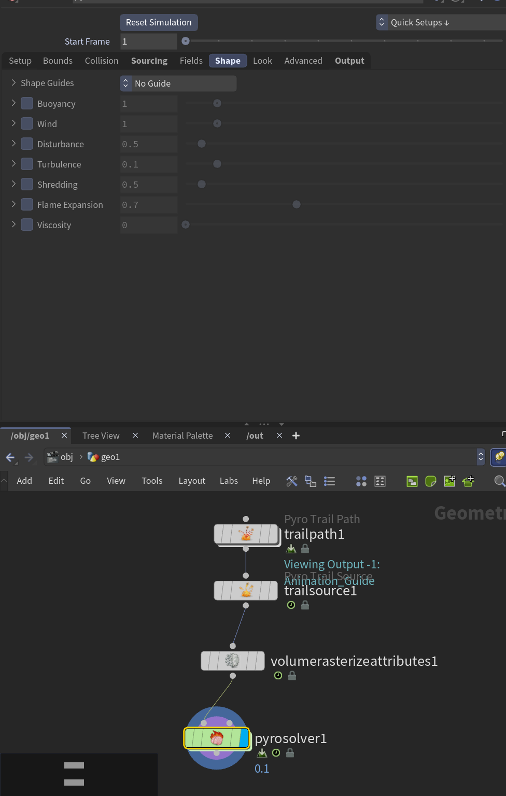

## 十五、创建摄像机，按 512 × 128 观察

然后创建摄像机，摄像机尺寸设为 **`512 × 128`**，在摄像机视角下观察。

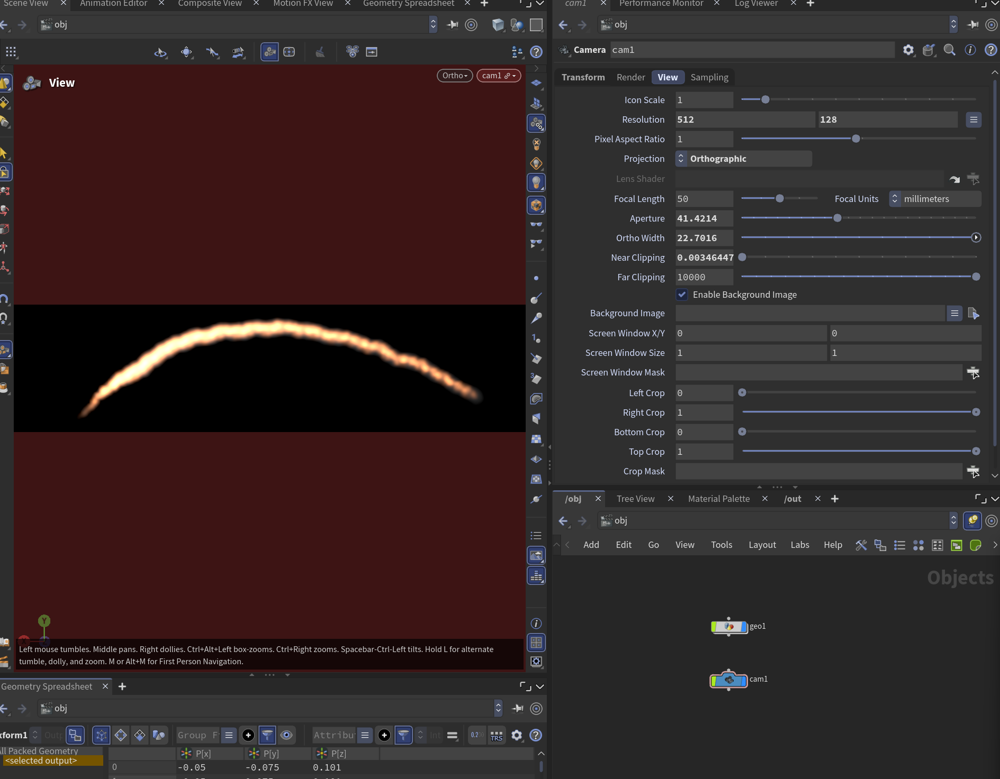

截图使用 **Orthographic** 正交投影，可以通过 **Ortho Width** 调整取景宽度，让拖尾落在画面中。这里的 `512 × 128` 是单帧分辨率，画面宽高比为 `4:1`。

先把火焰关掉，先调整它的烟雾：进入 **Pyro Solver → Look**，关闭 **Fire**，保留 **Smoke**，方便观察烟雾轮廓。

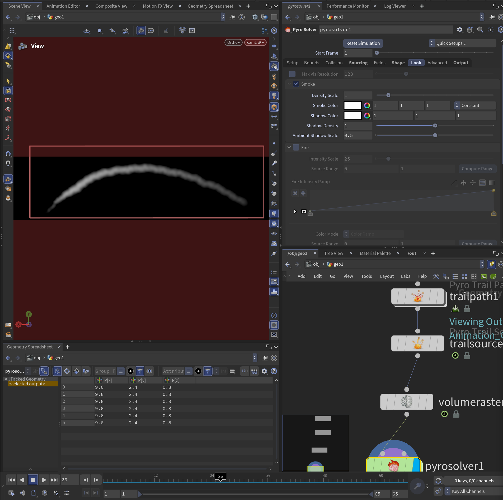

这里关闭的是火焰的显示，Fields 中的 Flame 仍参与模拟，后面还要利用它产生温度和膨胀。

然后我们需要的是**从第 2 帧到第 65 帧**，这样正好 **64 帧**：`65 - 2 + 1 = 64`。求解器仍从第 1 帧开始模拟，第 2～65 帧是本次需要取用的序列范围。

## 十六、Sourcing：添加 burn 到 divergence 的映射

现在的问题是，这个烟雾消散太快了。调整之前，先在 **Sourcing** 这里添加一个 **Divergence** 源，用来做火焰的膨胀。

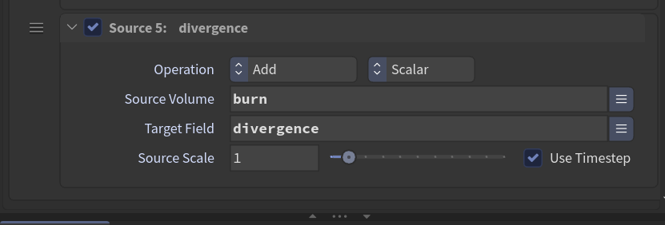

这里具体是增加一条 `burn → divergence` 的映射，复用已有的 burn 体积，不需要回到发射源再创建一个 divergence 属性。

| 参数 | 作用与设置 |
| --- | --- |
| **Operation：Add** | 将源值添加到目标场。 |
| **类型：Scalar** | 以标量处理源值。 |
| **Source Volume：burn** | 读取上游已经生成的燃烧源体积。 |
| **Target Field：divergence** | 将它用于散度场，正散度促使烟火向外膨胀。 |
| **Source Scale** | 缩放这一路注入的散度强度，后面会用它对比拖尾的粗细。 |
| **Use Timestep** | 按模拟时间步长缩放注入量。 |

## 十七、Fields：从火焰产生温度

现在烟雾消散太快，我们可以提高一下它的温度。在 **Fields → Temperature** 这里，勾选从火焰产生温度，也就是 **Emit From Flame**，然后强度给个 **`3`**，缩放给个 **`6`**。

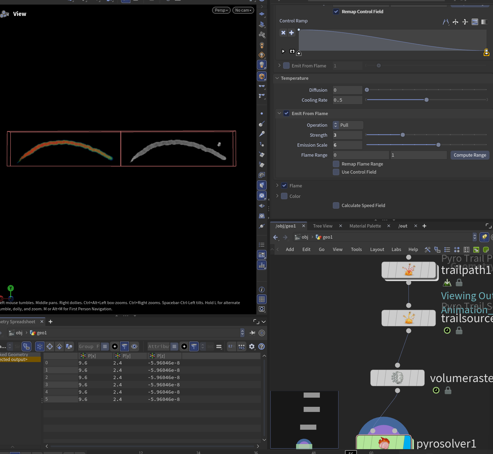

| 参数 | 作用与本次处理 |
| --- | --- |
| **Emit From Flame** | 利用模拟中的 `flame` 场产生温度。 |
| **Operation：Pull** | 当火焰产生的目标温度更高时，将已有温度向它推近，避免持续相加累积。 |
| **Strength** | 控制 Pull 推近目标温度的强度；本次设为 `3`。 |
| **Emission Scale** | 缩放火焰产生的目标温度；本次设为 `6`。 |

这里保留“烟雾消散太快，所以先提高温度”的调试思路，但温度并不直接决定密度消散速度：它是否能减缓消散，要结合 **Fields → Density** 的 Dissipation、Use Control Field 及重映射曲线判断。截图中露出了递减的 Control Ramp，但没有完整展示其控制场，不能仅凭提高温度就认定消散一定变慢。[温度与密度场官方说明](https://www.sidefx.com/docs/houdini/nodes/sop/pyrosolver.html#fields)。

## 十八、调整膨胀：先比较 Divergence，再缩小源点影响范围

### 1. 启用 Flame Expansion，观察膨胀后的粗细

然后调整形状，打开 **Shape → Flame Expansion** 火焰膨胀，速率 **Expansion Rate** 给个 **`1.2`**。可以看到，现在膨胀得有点粗。

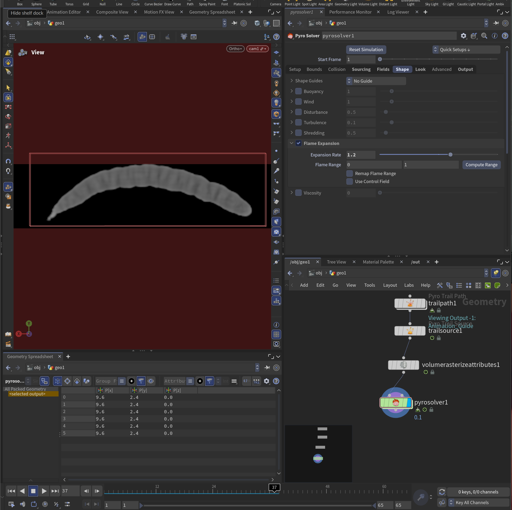

Flame Expansion 根据 `flame` 场产生膨胀；前面 Sourcing 的 `burn → divergence` 也直接注入散度，这两路都会影响膨胀。Expansion Rate 控制的是膨胀强度。[火焰膨胀官方说明](https://www.sidefx.com/docs/houdini/nodes/sop/pyrosolver.html#shape)。

### 2. 尝试降低 Sourcing 中的 Divergence 缩放

这个膨胀速度和 **Sourcing** 里的 **Divergence** 有关。按这次操作记录，之前这里给的是 **`5` 倍**，调整为 **`1`**，它就没这么胖了。

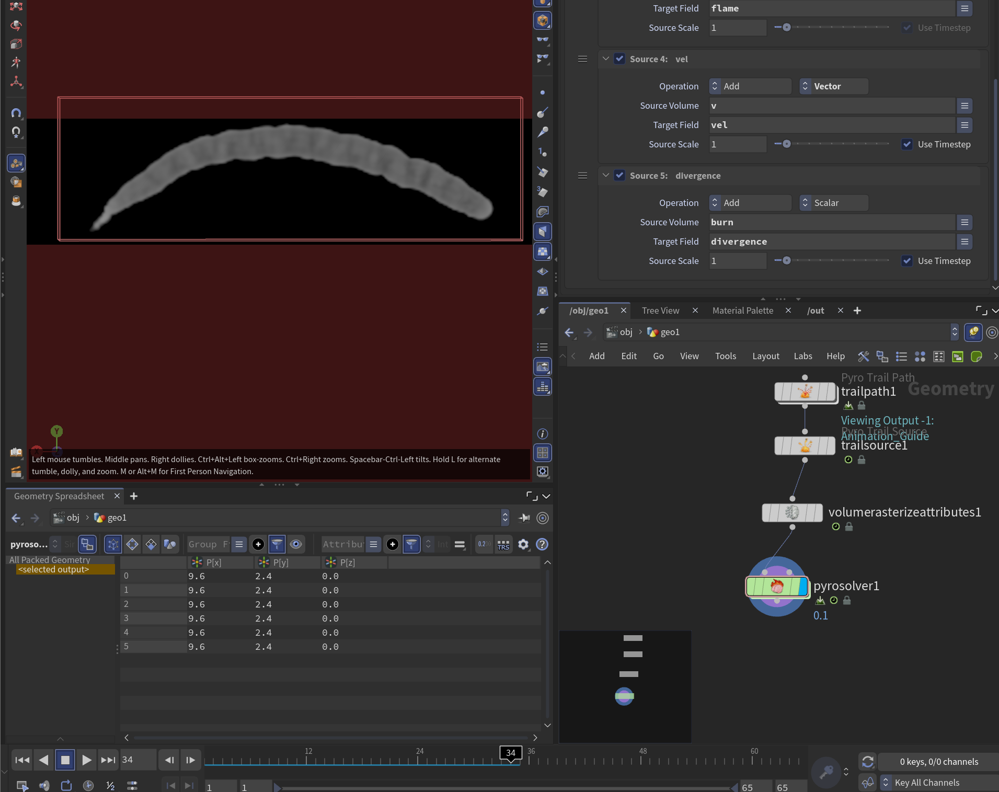

这里还是还原回来，我们调整另外一个值。也就是：**Source Scale 从 `5` 改为 `1` 是对比尝试，之后再还原为 `5`**。本节两张 Sourcing 截图都显示 `1`，记录的是该对比阶段，还原操作以这段制作记录为准。

### 3. 回到体积转换，将 Particle Scale 改为 0.65

在体积转换这里，我们可以将粒子缩放 **Particle Scale** 调小一点，给个 **`0.65`**，这个效果差不多。

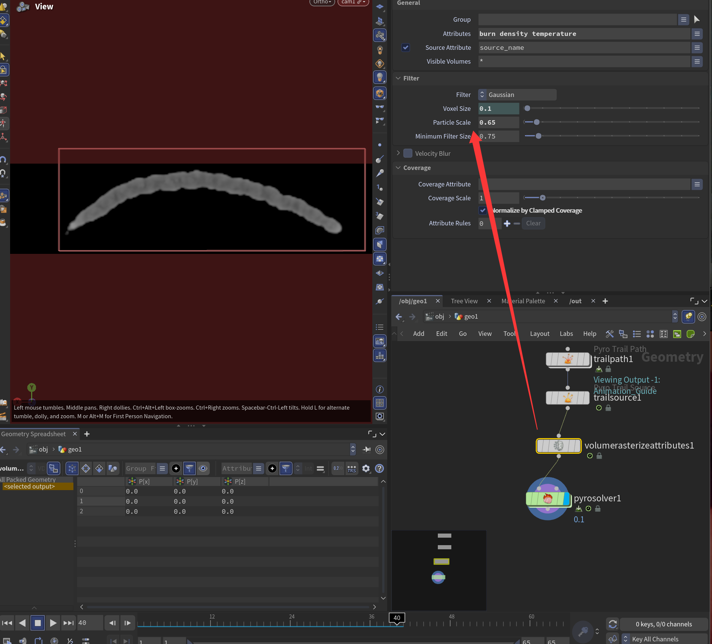

Particle Scale 缩放的是源点 `pscale` 在转体积时的影响半径。调小后，注入的源体积更细，后续烟雾轮廓也随之收窄。这保留了膨胀设置，同时从源体积的粗细上调整效果。

这一轮的制作思路是：先从摄像机里观察烟雾，再处理温度和膨胀；发现拖尾太粗后，先比较 Divergence 的影响，最后还原它，改用体积转换的 Particle Scale 收细发射源。修改影响模拟的参数后，需要回到起始帧重新解算，再比较结果。

## 十九、给湍流添加随时间衰减的表达式，再挑选种子

给湍流添加一个表达式，然后找一个合适的种子，调一个好看的烟雾效果。

在 **Pyro Solver → Shape** 中启用 **Turbulence**，给它的强度参数填写下面的 **HScript 表达式**：

```hscript
fit($FF, ch("startframe"), ch("startframe") + 25, 1, 0.02)
```

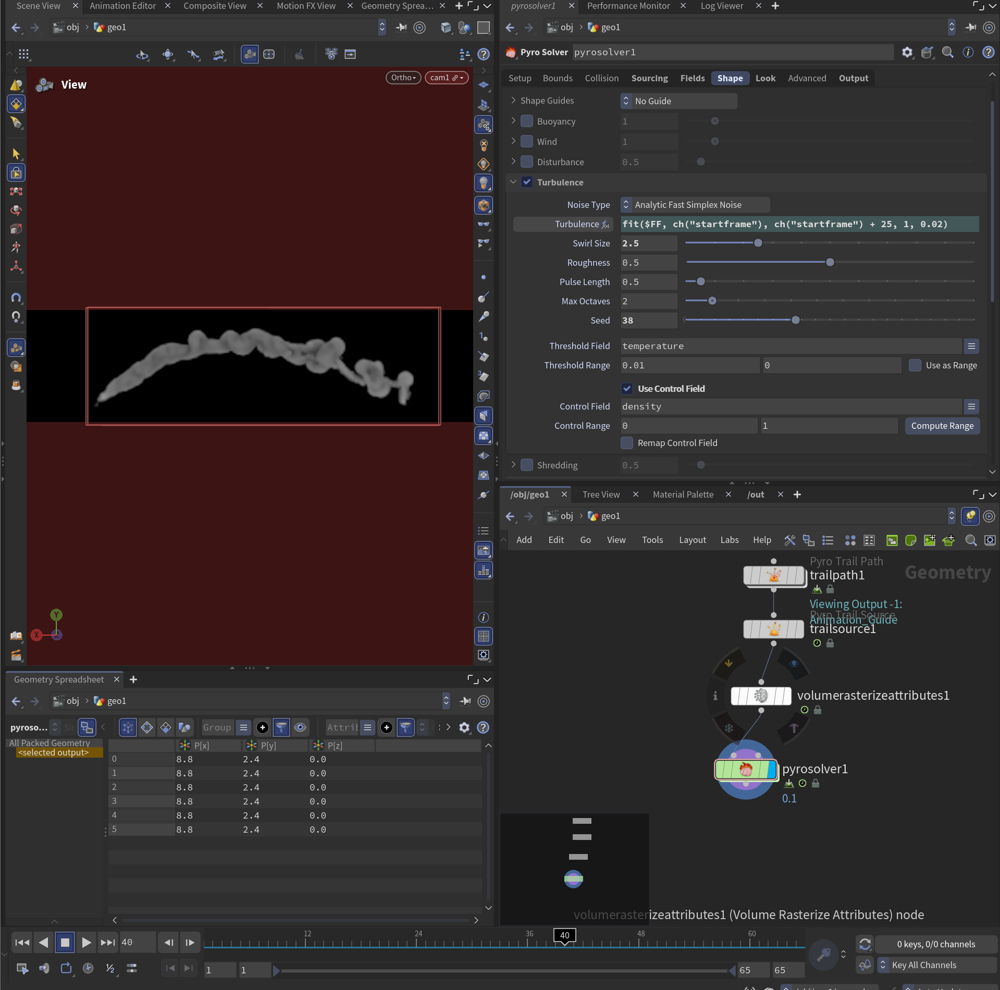

| 表达式部分 | 含义 |
| --- | --- |
| **`$FF`** | 当前浮点帧号，包含子帧时间。 |
| **`ch("startframe")`** | 读取当前求解器节点的 Start Frame，作为衰减起点。 |
| **`ch("startframe") + 25`** | 从开始帧向后经过 25 帧，作为衰减终点。 |
| **`1, 0.02`** | 将这段时间内的湍流强度从 `1` 线性降低到 `0.02`。 |
| **`fit(...)`** | 将帧号从输入区间映射到强度区间，超出区间后保持端点值。 |

这样开始阶段的扰动较强，后面逐渐减弱。求解器从第 1 帧开始时，第 1 帧强度为 `1`，第 26 帧降到 `0.02`，之后保持 `0.02`。[fit 表达式官方说明](https://www.sidefx.com/docs/houdini/expressions/fit.html)。

再调整 **Seed**，更换湍流噪声的随机图案，挑选好看的烟雾形状。这次截图选用的种子是 `38`。

| 湍流参数 | 作用 |
| --- | --- |
| **Swirl Size** | 控制基础涡旋的空间尺度，影响烟雾卷动的大小。 |
| **Roughness** | 控制较高频率的小涡旋相对基础涡旋的强度。 |
| **Pulse Length** | 控制噪声随时间变化的快慢，增大后变化更慢。 |
| **Max Octaves** | 控制叠加的噪声层数，影响多尺度涡旋的细节。 |
| **Seed** | 改变噪声的随机图案。 |
| **Threshold Field / Threshold Range** | 利用指定场及其阈值限制湍流的作用区域。 |
| **Use Control Field / Control Field** | 用额外的场缩放湍流强度；截图中使用 `density`。 |
| **Control Range / Remap Control Field** | 设置控制场到强度权重的映射范围，并可启用曲线进一步重映射。 |

## 二十、烟雾有点多：密度源从 Add 改为 Max

现在烟雾有点多，在 **Sourcing** 这里，把密度的源合成方式从 **Add** 改为 **Max**，界面中的完整名称是 **Maximum**。

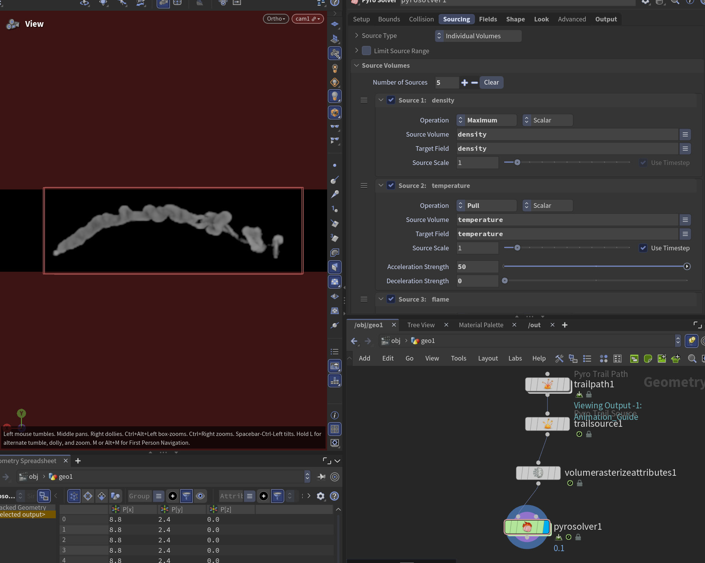

| 合成方式 | 作用 |
| --- | --- |
| **Add** | 将输入的密度源加到已有密度上，反复注入会继续累积。 |
| **Maximum** | 比较已有密度和经过源缩放的输入密度，取较大值，减少源区域反复相加造成的堆积。 |

这里调整的是求解器中 `density → density` 的源合成操作。

## 二十一、打开火焰：先调显示，再提高火焰源强度

现在烟雾效果差不多了，把火焰打开，调整火焰。到 **Look** 这里把 **Fire** 打开，强度 **Intensity Scale** 给 **`50`**。

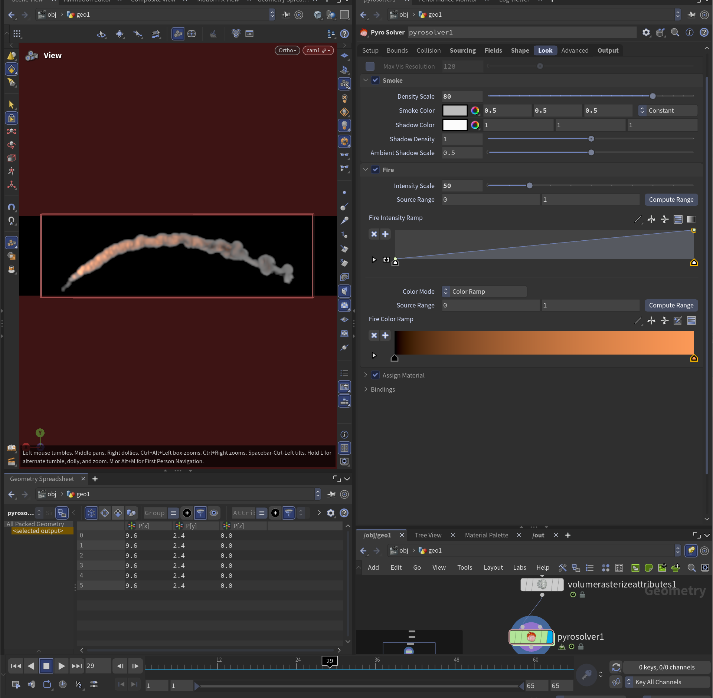

发现火焰还是有点少，这个时候就应该调整火焰的发射源。在 **Sourcing → flame** 这里，我们把源缩放调大，截图中 **Source Scale** 调到 **`2`**。

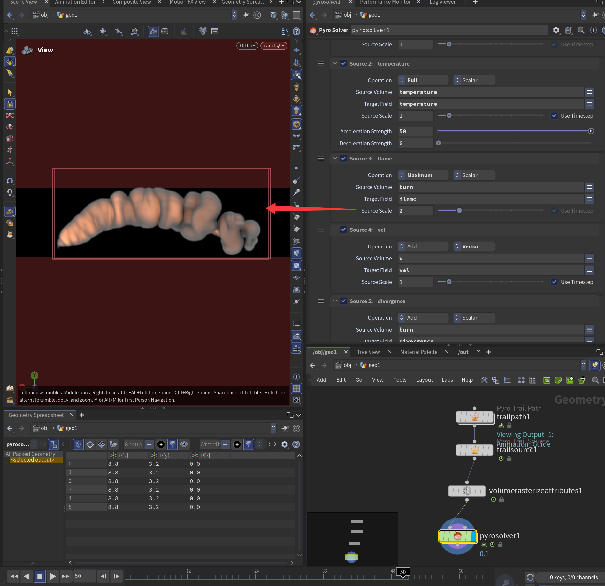

| 调整位置 | 作用 |
| --- | --- |
| **Look → Fire → Intensity Scale** | 调整火焰的外观亮度。 |
| **Sourcing → flame → Source Scale** | 缩放 `burn → flame` 映射的输入值，改变注入模拟的火焰场强度。 |

这里先提高显示强度，再根据效果回到发射源调整，保留这两步的区别，便于之后回看。

## 二十二、增强火焰后，回头降低膨胀

这个时候，如果调整火焰源缩放，会发现之前关联的火焰膨胀变得很夸张。我们回过头来调整一下这个膨胀，改小一点，**Expansion Rate 给个 `0.5`**，效果好多了。

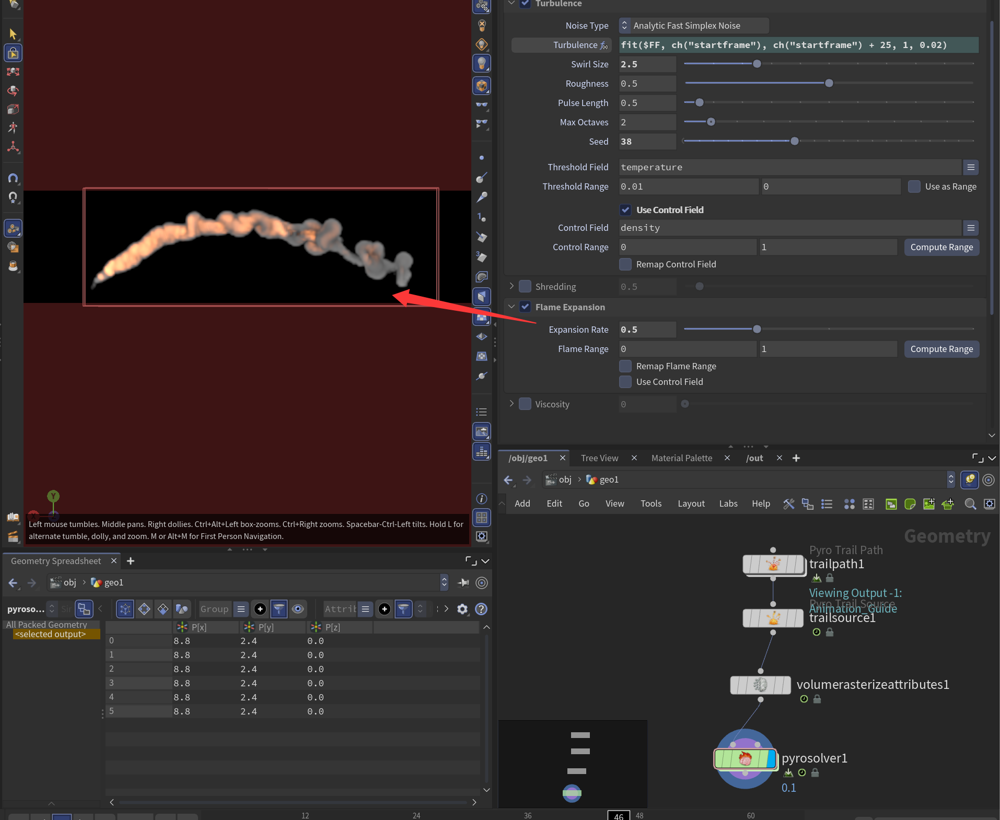

Flame Expansion 使用 `flame` 场驱动膨胀，因此提高火焰源之后，膨胀效果也可能增强。这里降低的是 **Shape → Flame Expansion** 的速率，从前面使用的 `1.2` 调整为 `0.5`。[Flame Expansion 官方说明](https://www.sidefx.com/docs/houdini/nodes/sop/pyrosolver.html#shape)。

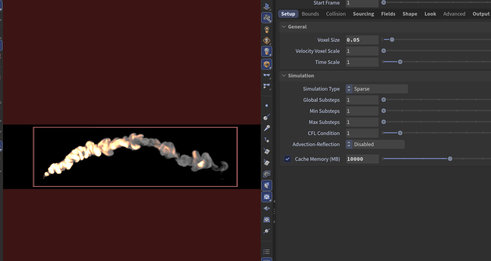

这张 Setup 截图还记录了 **Voxel Size** 已从前面的 `0.1` 调小到 `0.05`，提高体积模拟的空间分辨率。前面已经绑定相对引用，体积转换节点的 Voxel Size 也会跟随求解器变化。

## 二十三、火焰断断续续：回到 Burn 噪声调整分布

现在这个火焰有个问题，就是断断续续的。这次排查回到 **Pyro Trail Source**（`trailsource1`），因为我们在这里给了一个 **Burn** 的属性随机，它的模式是 **Add Noise**，导致 Burn 的值有些地方很低，火焰就容易出现间断。

原先这里的理解是：“Add 模式导致 Burn 的最终值是 `0～2`。”在基础值为 `1`、噪声振幅为 `1` 时，可以先这样理解它的相加过程：

```text
基础值 1 + 噪声（-1～1） → 0～2
```

这里的 `0～2` 是暂不计沿拖尾渐变、其他缩放等因素时的范围；实际输出还会受前面启用的 Scale Along Trailing 等设置影响。

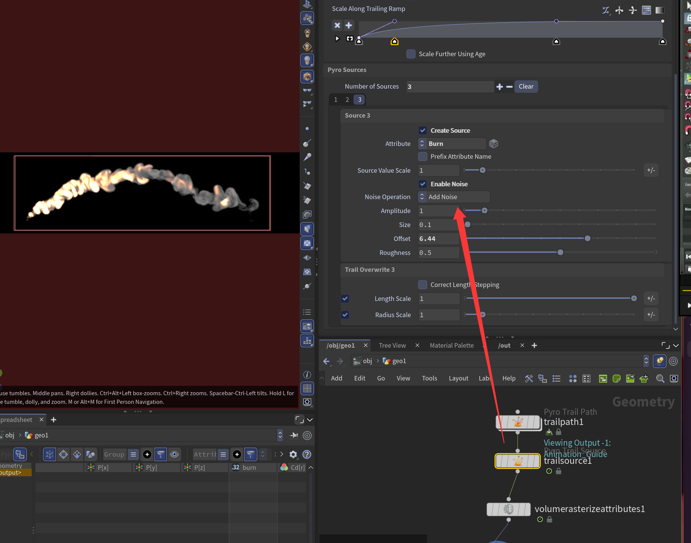

我们把 **Amplitude 振幅调小一点，然后稍微提高一下源缩放**。调小振幅后，噪声对基础值的加减幅度收窄，减少局部 Burn 被压得过低的情况；再提高源缩放，补足整体的燃烧源强度。

这里区分两个缩放位置：**Trail Components → Burn → Source Value Scale** 控制上游 Burn 组件强度；前面 **Sourcing → flame → Source Scale** 控制求解器接收 `burn` 时的缩放。调试时按所在节点确认字段。

上图记录的是检查噪声的阶段；这次文字没有指定调小振幅、提高源缩放之后的最终数值，因此保留调整方向，后续按连续性和火焰量继续观察。

## 二十四、添加 Pyro Bake Volume，准备渲染输出

现在形态调整差不多了，添加一个后期处理 **Pyro Bake Volume**（`pyrobakevolume`），然后就能渲染输出了。

将它接在 Pyro Solver 后面，用来整理模拟完成后的烟雾、火焰与散射外观，供视口显示和渲染使用。[Pyro Bake Volume 官方说明](https://www.sidefx.com/docs/houdini/nodes/sop/pyrobakevolume.html)。

```text
trailpath1
  ↓
trailsource1
  ↓
volumerasterizeattributes1
  ↓
pyrosolver1
  ↓
Pyro Bake Volume
  ↓ 由输出节点引用
/out/flipbook_textures1        Labs Flipbook Textures
```

在 `/out` 中创建 **Labs Flipbook Textures**，指定摄像机与 Pyro Bake Volume 的路径。本次截图引用的外观节点名是 `pyrolook_fireball2`。

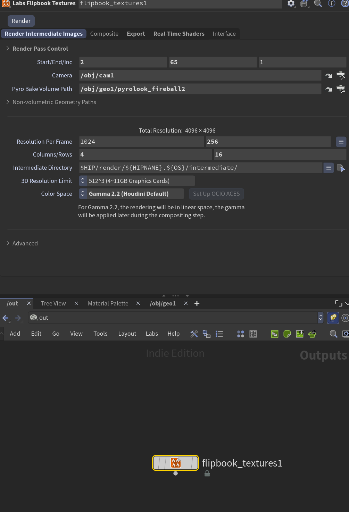

| 参数 | 作用与本次处理 |
| --- | --- |
| **Start/End/Inc** | 设置起始帧、结束帧与采样间隔；使用 `2 / 65 / 1`，连续取前面确定的 64 帧。 |
| **Camera** | 指定渲染取景，本次引用 `/obj/cam1`。 |
| **Pyro Bake Volume Path** | 指定要渲染的体积外观节点，本次引用 `/obj/geo1/pyrolook_fireball2`。 |
| **Resolution Per Frame** | 设置每格图像的渲染分辨率，本次使用 `1024 × 256`，保持拖尾画面的 `4:1` 比例。 |
| **Columns/Rows** | 设置图集的列数与行数；本次排列为 `4 × 16`，正好容纳 64 帧。 |
| **Intermediate Directory** | 保存渲染出的中间图，供后续合成读取。 |
| **3D Resolution Limit** | 限制渲染体积的三维分辨率，影响可用细节与显存占用。 |
| **Color Space** | 指定颜色相关贴图的输出色彩空间，本次沿用 Gamma 2.2。 |

前面摄像机设置的是 `512 × 128`，这里单帧渲染提高到 `1024 × 256`，宽高比仍然一致。结合图集布局，得到截图中的总分辨率：

```text
宽：1024 × 4  = 4096
高： 256 × 16 = 4096
帧数：4 × 16  = 64
```

## 二十五、Export：分别输出烟雾、火焰与运动向量／法线

接着进入 **Export**，按截图启用 **Output Texture 1、2、5**，分别保存烟雾颜色与透明度、火焰自发光，以及运动向量和法线分量。

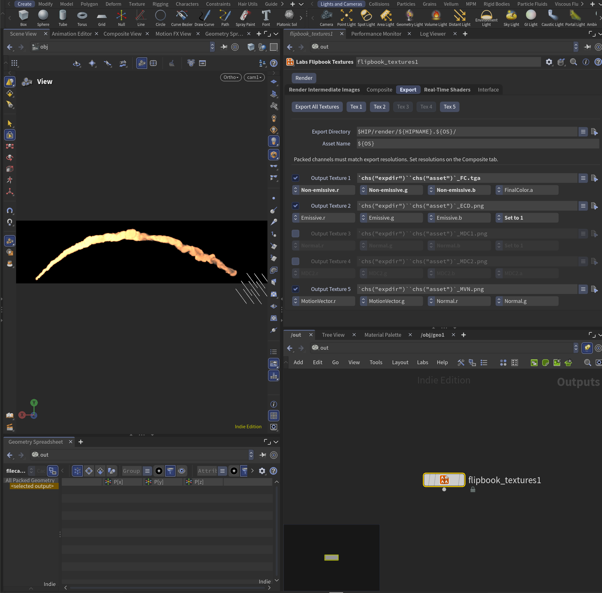

| 输出 | 文件后缀 | R | G | B | A |
| --- | --- | --- | --- | --- | --- |
| **Output Texture 1** | `_FC.tga` | Non-emissive.r | Non-emissive.g | Non-emissive.b | FinalColor.a |
| **Output Texture 2** | `_ECD.png` | Emissive.r | Emissive.g | Emissive.b | Set to 1 |
| **Output Texture 5** | `_MVN.png` | MotionVector.r | MotionVector.g | Normal.r | Normal.g |

FC 的 RGB 保存烟雾的非自发光颜色，A 保存透明度；ECD 的 RGB 保存火焰自发光；MVN 的 RG 保存运动向量，BA 保存法线的两个分量。本次 ECD 的 A 填 `1`，没有打包深度。

| 导出控件 | 作用 |
| --- | --- |
| **Export Directory** | 指定最终贴图的保存目录。 |
| **Asset Name** | 指定输出文件使用的资源名称。 |
| **Output Texture 开关** | 决定是否导出对应的通道打包贴图。 |
| **各通道下拉框** | 为输出图像的 R、G、B、A 分别选择数据来源。 |
| **Export All Textures** | 导出已启用的贴图，使用已有渲染与合成结果。 |
| **Render** | 按当前配置执行渲染、合成与导出流程。 |

需要打包到同一张图的通道，应在 **Composite** 中使用一致的导出分辨率。设置好后渲染输出，再进行 PS 通道整理。[Labs Flipbook Textures 官方说明](https://www.sidefx.com/docs/houdini/nodes/out/labs--flipbook_textures-1.0.html)。

## 二十六、沿用之前的 PS 通道合并，再导入 UE

和之前 **PS 调整通道、合并贴图**一样，处理完就能导入 **UE** 使用了。

这里继续沿用[《Houdini爆炸贴图》第三十五～三十七节](4_3Houdini爆炸贴图.md)的处理方法：保留一份原始 FC 作为取样来源，将 ECD 中的火焰去色，再把烟雾、透明度和灰度火焰放入目标图的不同通道。

| PS 合并后的通道 | 保存内容 | 来源 |
| --- | --- | --- |
| **R** | 烟雾的灰度明暗 | 原 FC 的 Non-emissive 灰度内容。 |
| **G** | 烟雾透明度 | 原 FC 的 Alpha，即 FinalColor.a。 |
| **B** | 灰度火焰强度 | ECD 的自发光 RGB 去色后的内容。 |
| **A** | 全白，数值为 `1` | 手动填充。 |

最后保存合并后的 FC，MVN 沿用导出的通道打包。导入 UE 后，按这次 **4 列、16 行、64 帧**的布局读取序列帧，并按合并后的通道含义使用烟雾、透明度和火焰；MVN 则保留运动向量与法线数据。
