# 无人机

本阶段为无人机添加受击流光：以子弹命中位置为中心，在模型表面形成向外扩散的亮带。先使用 SphereMask 生成空间灰度渐变，再用渐变重映射一张 Mask 纹理，得到环状流光；随后引入法线纹理扰动，并改用按尾部到头部排序的第二套 UV，让纹理分布更加工整。最后在伤害事件中通过时间轴驱动材质参数，并用无人机的位移量实时补偿受击点位置，使流光中心随受击位移一起移动。

## 1. 受击流光的材质思路

本次在无人机材质 `/Game/Characters/Drone/M_Drone` 中添加受击效果节点。核心是把“表面像素与命中点之间的距离”转换成灰度，再将灰度转换成发光亮带。

```text
绝对世界位置 + 命中点 Position + Radius
  → SphereMask 空间渐变
  → 可选的纹理扰动
  → 使用渐变采样 Mask 纹理
  → Power 调整亮带
  → 合入无人机的自发光
```

`Position` 决定效果中心，`Radius` 决定作用范围。让中心对应子弹命中点，并随时间调整扩散参数，就能制作从受击位置向外传播的流光。第 2～5 节记录材质搭建与 UV 优化，第 6～7 节记录伤害事件中的参数驱动和位置补偿。

## 2. 使用 SphereMask 生成受击点周围的渐变

### 2.1 节点连接

添加 **Absolute World Position（绝对世界位置）**、向量参数 `Position`、标量参数 `Radius`，连接到 SphereMask：

```text
Absolute World Position.XYZ → SphereMask.A
Position.RGB               → SphereMask.B
Radius                     → SphereMask.Radius
SphereMask.Hardness        = 0
```

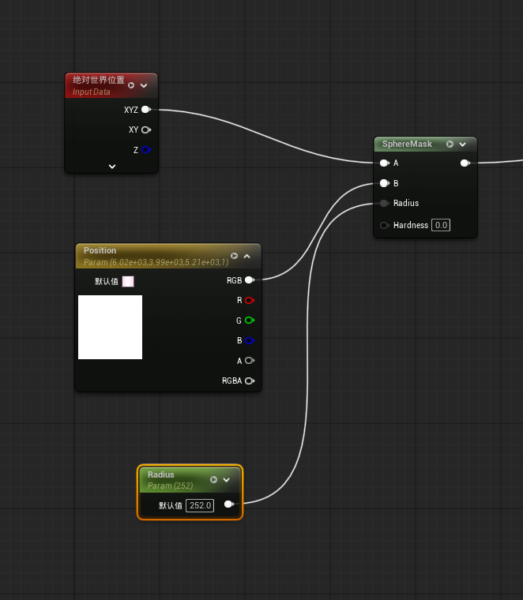

| 参数或输入 | 作用 | 当前截图中的设置 |
| --- | --- | --- |
| `Absolute World Position` | 当前表面像素的世界位置 | 使用 XYZ |
| `Position` | 球形渐变的中心，后续对应命中点 | 使用向量参数的 RGB 存储 XYZ |
| `Radius` | 渐变作用范围 | 第一张节点图为 `252` |
| `Hardness` | 控制边缘过渡的软硬 | `0`，保留柔和渐变 |

SphereMask 根据 A、B 的距离生成遮罩，中心附近较亮，向外逐渐变暗，范围外为黑色。这里使用世界位置，因此 `Position` 也应传入世界空间坐标，`Radius` 与它们使用同一距离单位。[SphereMask 官方说明](https://dev.epicgames.com/documentation/unreal-engine/utility-material-expressions-in-unreal-engine#spheremask)

### 2.2 渐变预览

先观察球形渐变在无人机表面的分布。图中白色区域覆盖中心附近的机身，向外柔和衰减。场景中的小球和变换工具用于观察中心位置，实际流光仍由无人机表面的材质计算产生。

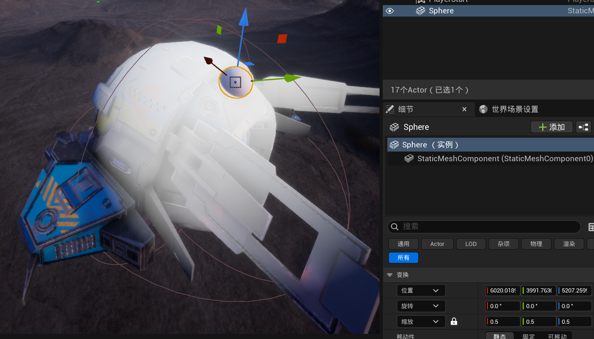

此时得到的是一片带过渡的亮区，还没有收束成一道流光，需要继续用纹理重新组织灰度分布。

## 3. 用 Mask 纹理将渐变重映射为流光

### 3.1 选择亮带纹理

本次使用 `/Game/Effect/Textures/Mask/EF_T_Mask_0015`。纹理中包含较窄的高亮区域和灰度过渡，适合把连续渐变转换为有明暗层次的亮带。

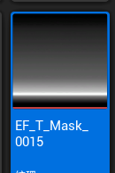

### 3.2 将 SphereMask 结果作为采样坐标

将 SphereMask 的输出接入这张 Mask 的 **Texture Sample.UVs**，采样结果再经过 Power。截图中的指数为 `5`，这一阶段的 `Radius` 调整为 `500`。

```text
SphereMask 输出  → Mask Texture Sample.UVs
Texture Sample.RGB → Power.Base
Power.Exp          = 5
```

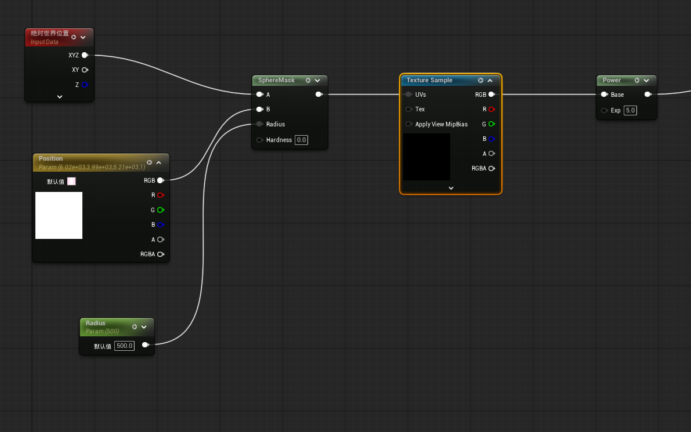

这里把渐变作为纹理查找坐标，利用纹理自身的亮暗分布重新映射距离信息。相同渐变值对应相同的采样位置，所以纹理中的高亮带会落到无人机表面距离中心相近的区域，形成环状亮带。

截图将标量渐变直接接入二维 UVs，相当于使用 `(G, G)` 采样。当前纹理的主要明暗变化沿纵向分布，因此能得到所需亮带；后续若更换纹理，需要确认采样方向是否仍然合适。

对于 0～1 的 Mask 灰度，`Power = 5` 会压低中低亮度，保留较亮部分，使流光更集中。这个步骤调整的是亮带的灰度轮廓。

### 3.3 环状流光效果

完成重映射后，原先大片的柔和亮区变成围绕中心分布的发光环，已经具备从受击点向外扩散的视觉基础。

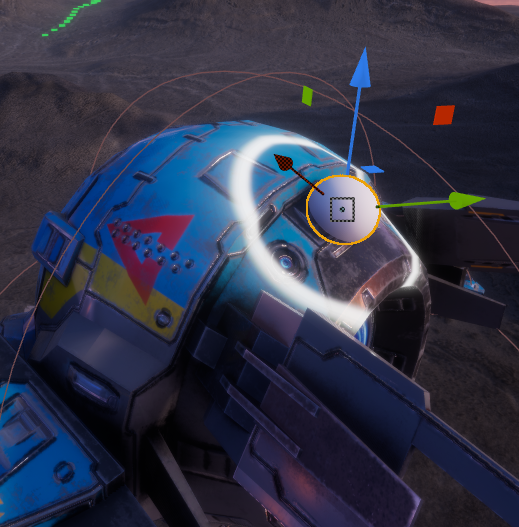

`Position` 控制亮带围绕哪个位置分布；实际播放扩散还需要随时间驱动 `Radius` 或后续的重映射进度，固定参数只能显示某一时刻的形态。

## 4. 使用法线纹理扰动流光

### 4.1 将法线纹理的通道值作为噪声

规则的环状流光比较平滑。继续使用一张法线纹理，为渐变叠加局部变化，让亮带产生不规则起伏。

截图中的法线纹理取 **R 通道**，先乘以扰动强度 `NoisIntensity`，再与 SphereMask 输出相加。这里借用法线纹理的通道值作为扰动数据，没有将其接入材质的 Normal 输入。

```text
Noise_UV.RGBA             → EF_MF_TextureUV.RGBA
EF_MF_TextureUV.Result    → 法线 Texture Sample.UVs
法线 Texture Sample.R     → Multiply.A
NoisIntensity             → Multiply.B
Multiply 输出             → Add.B
SphereMask 输出           → Add.A
Add 输出                  → 后续 Mask 重映射
```

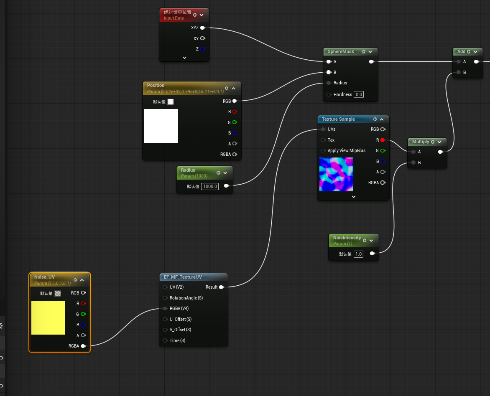

用符号表示这一步：

```text
G  = SphereMask 输出
N  = 法线纹理采样的 R 通道
I  = NoisIntensity
G' = G + N × I

G' → Mask 纹理采样 → Power → 流光亮带
```

扰动加在 **Mask 重映射之前**，因此改变的是亮带在表面的分布位置，而不只是给成形后的流光叠加明暗。

### 4.2 当前参数与效果

| 参数或节点 | 截图设置与作用 |
| --- | --- |
| `Radius` | `1000`，本阶段调试使用的作用范围 |
| `Noise_UV` | 向量参数，截图为 `(1, 1, 0.1, 0.1)`，接入 UV 函数的 RGBA 输入 |
| `EF_MF_TextureUV` | 项目中的 UV 处理函数，输出用于采样扰动纹理 |
| `NoisIntensity` | `1.0`，控制纹理扰动对渐变的影响；沿用截图中的参数拼写 |

`Noise_UV` 各分量的具体意义以项目函数内部实现为准，当前截图只展示了外部接线。

加入扰动后，亮带产生了弯折和起伏，但机身与多个附属结构上同时出现了较多亮线，整体分布显得杂乱。

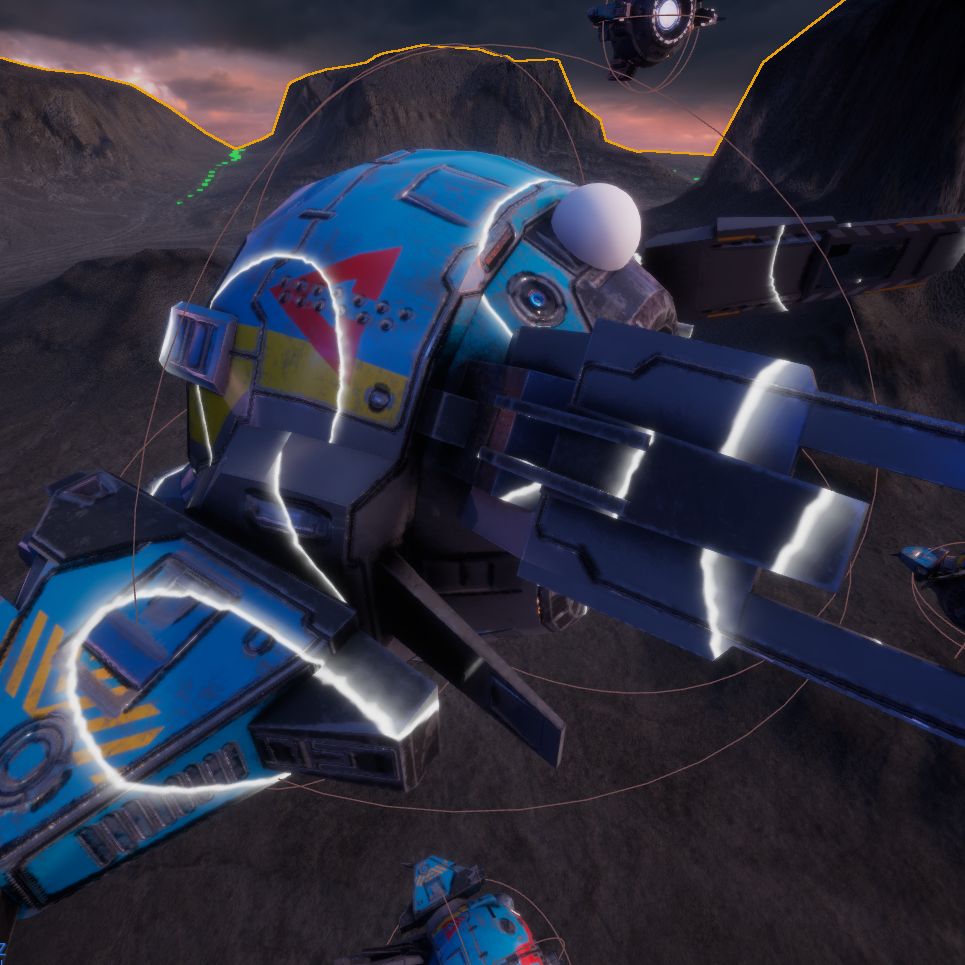

当前节点图没有展示 Mask 采样器的寻址设置，因此还不能仅凭画面把额外亮线全部归因于 UV。后续可同时检查扰动强度、重映射坐标范围，以及 Mask 超出 0～1 后的采样表现。

## 5. 使用第二套 UV 优化扰动排布

### 5.1 在 3ds Max 中查看第二套 UV

将无人机模型从 UE 导出，再导入 **3ds Max**，查看已经整理好的第二套 UV。这套 UV 按无人机的前后结构排序：**尾部位于 UV 视图上方，头部位于下方，主体及两侧结构分布在中间区域。**

选中尾部结构，可以看到对应的 UV 位于上方。这样的排列为特效纹理提供了更明确的方向关系。

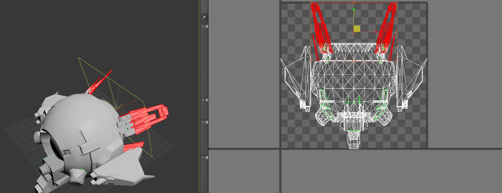

再选中主体外壳与两侧结构，可以看到它们主要对应中部区域，头部相关结构继续排列在下方。这里展示的是本次模型已经完成的排序，不是仅切换 UV 通道就会自动生成的结果。

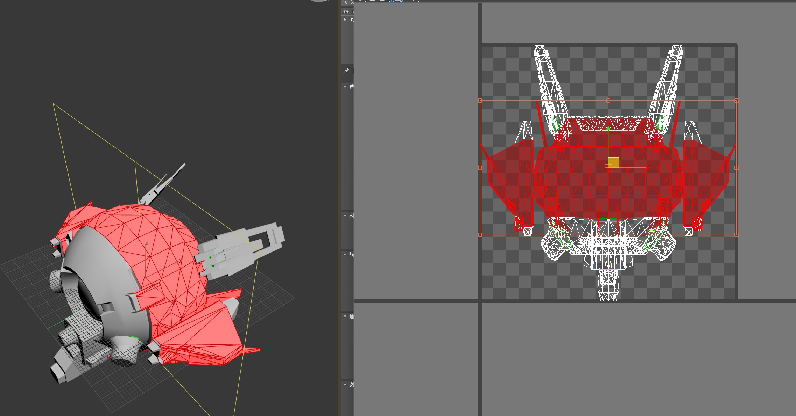

这套 UV 用于组织扰动纹理在机身上的分布，受击中心仍由世界空间中的 `Position` 控制。

### 5.2 在材质中指定第二套 UV

UE 的 UV 索引从 0 开始，第二套 UV 对应 **TextureCoordinate 的 Coordinate Index = 1**。[TextureCoordinate 官方说明](https://dev.epicgames.com/documentation/unreal-engine/coordinates-material-expressions-in-unreal-engine#texturecoordinate)

在原有扰动分支中添加 `TexCoord[1]`，接入 `EF_MF_TextureUV` 的 UV 输入，再用函数输出采样法线纹理：

```text
TexCoord（Coordinate Index = 1）→ EF_MF_TextureUV.UV
Noise_UV.RGBA                   → EF_MF_TextureUV.RGBA
EF_MF_TextureUV.Result          → 法线 Texture Sample.UVs
法线 Texture Sample.R           → 原有扰动与 Mask 重映射链
```

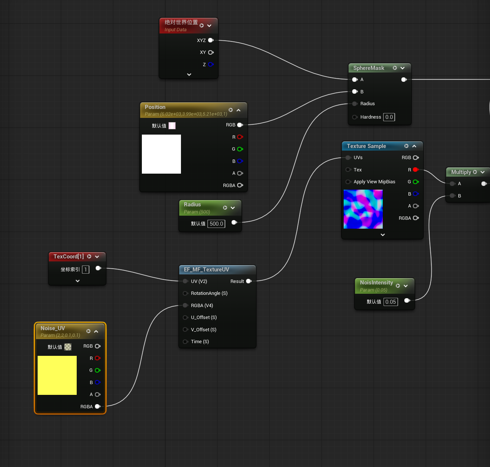

本次同时调整了参数，和第 4 节的初步测试对比如下：

| 设置 | 初步扰动测试 | 第二套 UV 阶段 |
| --- | --- | --- |
| 扰动纹理的坐标来源 | 未显式接入第二套 UV | `TexCoord[1]` 接入 UV 函数 |
| `Noise_UV` | `(1, 1, 0.1, 0.1)` | `(2, 2, 0.1, 0.1)` |
| `NoisIntensity` | `1.0` | `0.05` |
| 材质预览中的 `Radius` | `1000` | `500` |

第二套 UV 改善纹理的空间排布，减小 `NoisIntensity` 则让扰动更加克制。由于这些设置同时发生了变化，不能把效果改善全部归因于 UV 通道切换。这里的 `Radius = 500` 是材质预览值，运行时将由时间轴覆盖。

### 5.3 调整后的材质效果

调整后，流光仍保留局部起伏，但整体更接近一条连贯的环状亮带，分布比初步测试时工整。

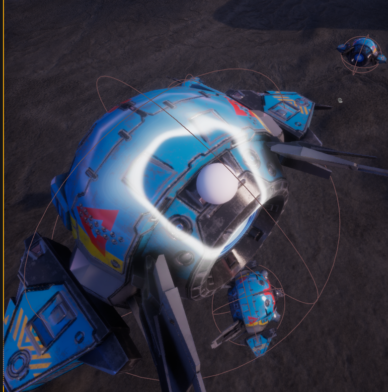

## 6. 在伤害事件中使用时间轴驱动流光

### 6.1 先设置命中点，再播放半径动画

在无人机蓝图 `/Game/Blueprint/Monster/BP_Drone` 的伤害处理链中，通过动态材质实例变量 `Drone DMIBase` 设置材质参数。初版接线先将 `Bullet Impact Position` 写入 `Position`，再从头播放 `Timeline_HitFlow`。

```text
伤害处理执行链
  → Set Vector Parameter Value
      Target         = Drone DMIBase
      Parameter Name = Position
      Value          = Bullet Impact Position（转换为颜色类型）
  → Timeline_HitFlow.Play from Start

Timeline_HitFlow.Update
  → Set Scalar Parameter Value
      Target         = Drone DMIBase
      Parameter Name = Radius
      Value          = Timeline_HitFlow.Offset
```

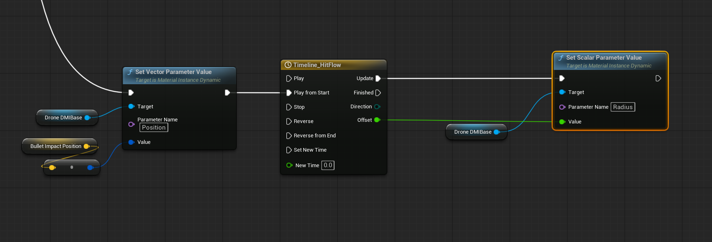

时间轴的浮点轨道名为 **`Offset`**，但在这里输出的是材质 `Radius` 的数值，并不表示无人机的位移向量。`Play from Start` 会从时间轴起点重新播放，使再次受击时能重新触发扩散。[Timeline 官方说明](https://dev.epicgames.com/documentation/en-us/unreal-engine/timelines-in-unreal-engine)

`Position` 的向量坐标经过类型转换后写入材质向量参数，材质端仍使用 RGB 作为 XYZ。这里需要操作无人机当前使用的动态材质实例；实例的创建和赋值过程没有在本次截图中展开。

时间轴编辑器及其关键帧未展示，因此暂不记录播放时长、半径起止值和曲线形状。

### 6.2 运行时观察

接入伤害事件后，射击无人机时已经能够看到机身上的受击流光。

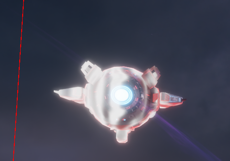

但无人机之前已经添加了受击位移：如果 `Position` 只在命中时设置一次，它会停留在原来的世界位置。无人机随后移动，模型表面与这个固定中心之间的相对关系就会改变，流光看起来会发生滑动或偏移。

## 7. 根据受击位移实时补偿命中点

### 7.1 使用当前位移量更新流光中心

为让流光中心随无人机一起平移，保存命中时的无人机位置 `Hit Initial Location`，并在时间轴的每次 Update 中计算相对该位置的位移量，再加回原始命中点：

```text
CurrentLocation = Get Actor Location（self）
InitialLocation = Hit Initial Location
ImpactPosition  = Bullet Impact Position

DeltaLocation = CurrentLocation - InitialLocation
Position      = ImpactPosition + DeltaLocation
```

例如无人机相对命中时沿 X 轴移动了 20，流光中心也沿 X 轴移动 20，就能保持相对于机身的命中位置。

`Get Actor Location` 返回 Actor 根组件的位置。截图用它与 `Hit Initial Location` 相减，再将结果与 `Bullet Impact Position` 相加。[Get Actor Location 官方说明](https://dev.epicgames.com/documentation/en-us/unreal-engine/BlueprintAPI/Transformation/GetActorLocation)

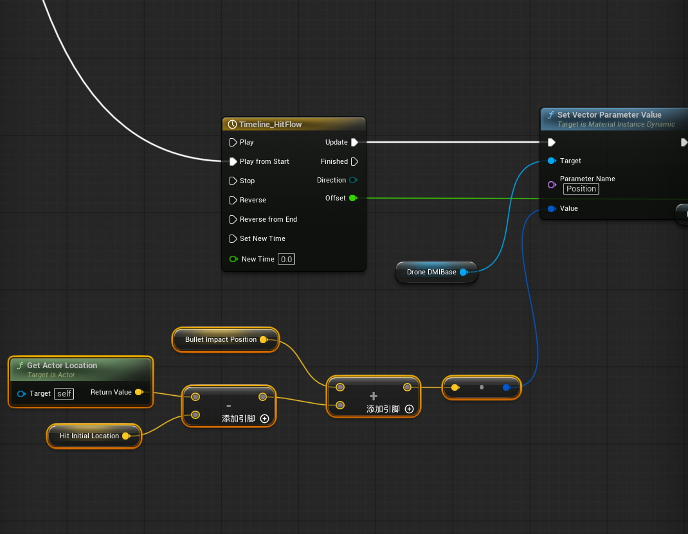

### 7.2 将 Position 和 Radius 放在同一次 Update 中更新

原先放在时间轴之前的 `Set Vector Parameter Value（Position）`，改为在时间轴 Update 中执行，再继续更新 `Radius`：

```text
伤害事件中记录本次命中数据
  Bullet Impact Position = 本次命中的世界坐标
  Hit Initial Location   = 本次受击位移开始前的 Actor 世界位置
  → Timeline_HitFlow.Play from Start

Timeline_HitFlow.Update
  → Set Vector Parameter Value（Position）
      Value = Bullet Impact Position
            + (Get Actor Location - Hit Initial Location)
  → Set Scalar Parameter Value（Radius）
      Value = Timeline_HitFlow.Offset
```

最后一张截图展示了 Update 中更新 `Position` 的节点，`Radius` 延续前面的时间轴驱动方式。命中数据的保存节点没有在截图中展开，上述保存时机用于说明这套计算所需的初始状态。

同一次播放中，`Bullet Impact Position` 和 `Hit Initial Location` 保持为本次受击的初始数据，每次从它们重新计算当前中心；不要把已经补偿后的中心再加上完整位移量，避免重复累加。再次受击并重播时，应同步刷新这两项数据。

### 7.3 补偿范围

这套加法补偿处理的是 **Actor 的平移**：无人机和流光中心一起移动，SphereMask 使用的相对距离不再受这段整体平移影响。

如果受击动画还会明显旋转机身，或只移动 Mesh 而没有移动 Actor 根组件，仅使用 Actor 位置差还不足以让中心始终贴住同一个表面点。进一步完善时，可在命中时把世界命中点转换到实际移动组件的局部空间，再在 Update 中通过该组件的当前变换转换回世界空间，写入 `Position`。这属于后续对旋转及组件独立运动的扩展，本次截图记录的是平移补偿方案。
