# 特效贴图制作

## 一、一次性爆发源：Pyro Burst Source

制作爆炸等一次性爆发的流体效果时，可以使用 **Pyro Burst Source** 创建发射源，控制爆发的初始形状、方向以及拖尾分布。

本文按操作阶段记录参数变化；同一参数在后续步骤中调整时，以正在进行的阶段为准。

**当前进度：**已完成烟雾图集渲染、TGA 通道打包及 UE 导入，并修复 MVN 的 RG 全图无变化问题：通过专用运动向量分支清除材质绑定，再以会话补丁单独重渲染 Motion Vector、导出 Tex 5，UE 中已能看到运动纹理。本机采用透视摄影机、跳过 Depth；渲染排查见第 24 节，运动向量完整调试与复现步骤见第 25 节。最终截图中的 MVN sRGB 仍勾选，数据贴图的 sRGB 应另行关闭。

### 1. 创建节点

1. 在 `/obj` 层级创建一个 **Geometry** 节点。
2. 双击进入 Geometry 节点内部。
3. 按 `Tab`，搜索 `Pyro`，找到并创建 **Pyro Burst Source** 节点。
4. 在参数面板中打开 **Burst Shape** 页签，调整爆发形状。

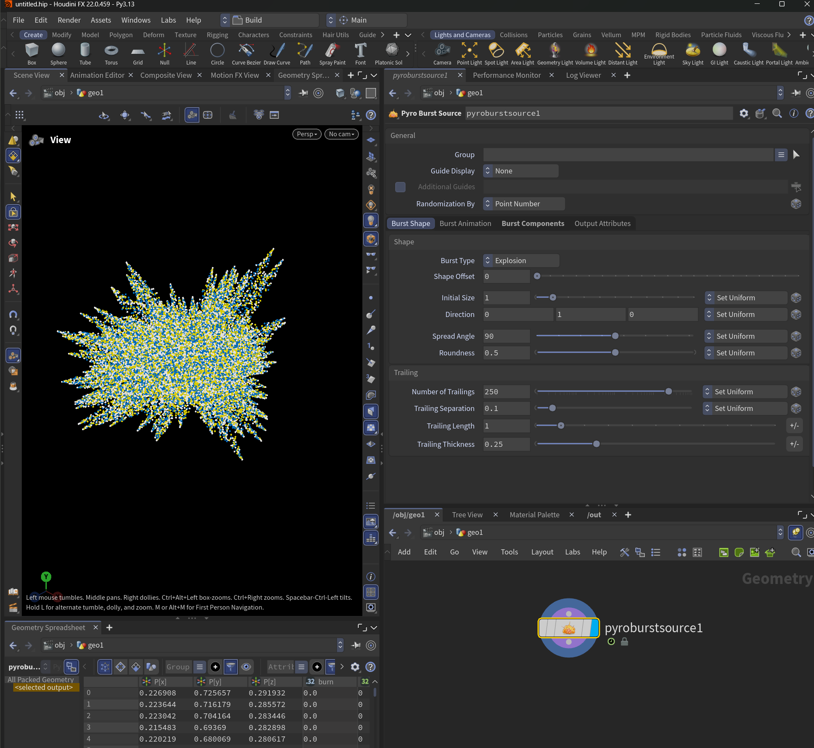

图 1：本次操作截图。左侧为爆发源点预览，右上为基础形状与 Trailing 参数，右下为 Pyro Burst Source 节点。

### 2. Explosion：基础形状参数

以下数值来自本次提供的截图，作为当前案例的参考值，不代表所有项目都应使用这些设置。

| 参数 | 中文含义 | 作用与调整效果 | 截图数值 |
| --- | --- | --- | --- |
| **Burst Type** | 爆发类型 | 本例使用 **Explosion**，即爆炸类型。 | `Explosion` |
| **Shape Offset** | 形状随机偏移 | 可以理解为控制形状的随机种子；改变数值，可以获得不同的爆发轮廓。 | `0` |
| **Initial Size** | 初始大小 | 控制爆发源的起始尺寸。 | `1` |
| **Direction** | 爆发方向 | 按 `X、Y、Z` 填写方向向量；`(0, 1, 0)` 表示朝 Y 轴正方向。 | `(0, 1, 0)` |
| **Spread Angle** | 发散角度 | 控制爆发围绕指定方向展开的角度范围。 | `90` |
| **Roundness** | 圆整度 | 数值越大，各尖刺长度越接近，整体轮廓越规整；数值越小，尖刺长短差异越明显。 | `0.5` |

#### 坐标轴区别

- **Houdini：Y 轴向上**，向上的方向向量为 `(0, 1, 0)`。
- **UE：Z 轴向上**，向上的方向向量为 `(0, 0, 1)`。

因此，在 Houdini 中调整 Direction 时，需要留意它与 UE 的坐标轴区别。

#### Roundness 的理解

Roundness 可以直观理解为“整体是否圆整”。更准确地说，它控制形状的对称性和尖刺长度的一致性：接近 `1` 时，各尖刺长度更一致；较低时，轮廓更加参差不齐。

### 3. Trailing：拖尾参数

在 **Burst Shape** 页签中继续向下，找到 **Trailing** 区域。

| 参数 | 中文含义 | 作用与调整效果 | 截图数值 |
| --- | --- | --- | --- |
| **Number of Trailings** | 拖尾数量 | 控制生成形状时的尖刺数量；数值越大，尖刺越多。 | `250` |
| **Trailing Separation** | 拖尾点间距 | 控制源点的疏密；数值越大，点越稀疏、数量越少；数值越小，点越密集。 | `0.1` |
| **Trailing Length** | 拖尾长度 | 控制拖尾向爆发中心延伸的长度；缩短后，源点会更集中在形状外层。 | `1` |
| **Trailing Thickness** | 拖尾厚度 | 控制拖尾内端、靠近中心处的宽度；增大后，尖刺根部会更粗。 | `0.25` |

需要区分：**Number of Trailings 控制尖刺数量，Trailing Separation 控制点的密度。**

Trailing Length 即使设得很大，拖尾也只会延伸到爆发中心。Trailing Thickness 过大，则可能破坏原有的爆发轮廓。

### 4. Muzzle Flash：枪口闪光与定向喷发

看完 Explosion 后，将 **Burst Type** 切换为 **Muzzle Flash**（枪口闪光）。这种类型会沿指定方向形成拉长的爆发轮廓，适合制作枪口火焰、向上喷发等具有明显方向性的发射源。

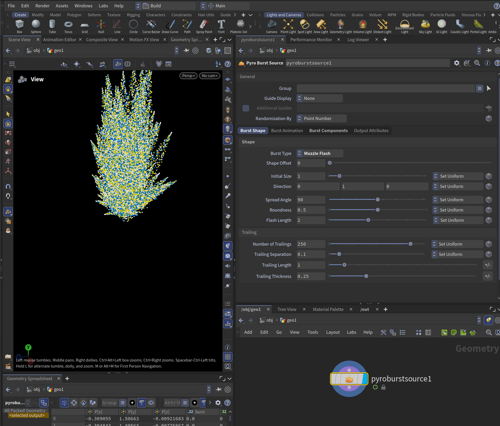

图 2：Muzzle Flash 类型。Direction 为 `(0, 1, 0)`，Flash Length 为 `2`，源点整体沿 Y 轴向上拉长。

它的大部分参数与前面的 Explosion 相同，可以沿用形状随机偏移、初始大小、方向、发散角度、圆整度以及 Trailing 参数的理解。重点关注新增的 **Flash Length**，它用于调整沿喷发方向的形状长度。

#### 参数补充与截图数值

| 参数或参数组 | 截图数值 | 说明 |
| --- | --- | --- |
| **Flash Length** | `2` | 沿 Direction 调整喷发轮廓的长度。官方文档中对应的名称为 **Muzzle Length**，查找时可对照这两个名称。 |
| **Shape Offset / Initial Size** | `0` / `1` | 分别调整随机轮廓和初始尺寸，含义与 Explosion 一致。 |
| **Direction** | `(0, 1, 0)` | 本例沿 Y 轴向上喷发；改变向量可以调整喷发朝向。 |
| **Spread Angle / Roundness** | `90` / `0.5` | 沿用前文对发散角度和轮廓圆整度的理解。 |
| **Number of Trailings / Trailing Separation** | `250` / `0.1` | 分别控制尖刺数量与源点疏密。 |
| **Trailing Length / Trailing Thickness** | `1` / `0.25` | 分别控制拖尾向内延伸的长度与根部宽度。 |

### 5. Blast Rings：分层爆炸烟环

接下来将 **Burst Type** 切换为 **Blast Rings**。它用于生成分层环状的爆发源，可以作为蘑菇云周围、火球上方烟环效果的起点。

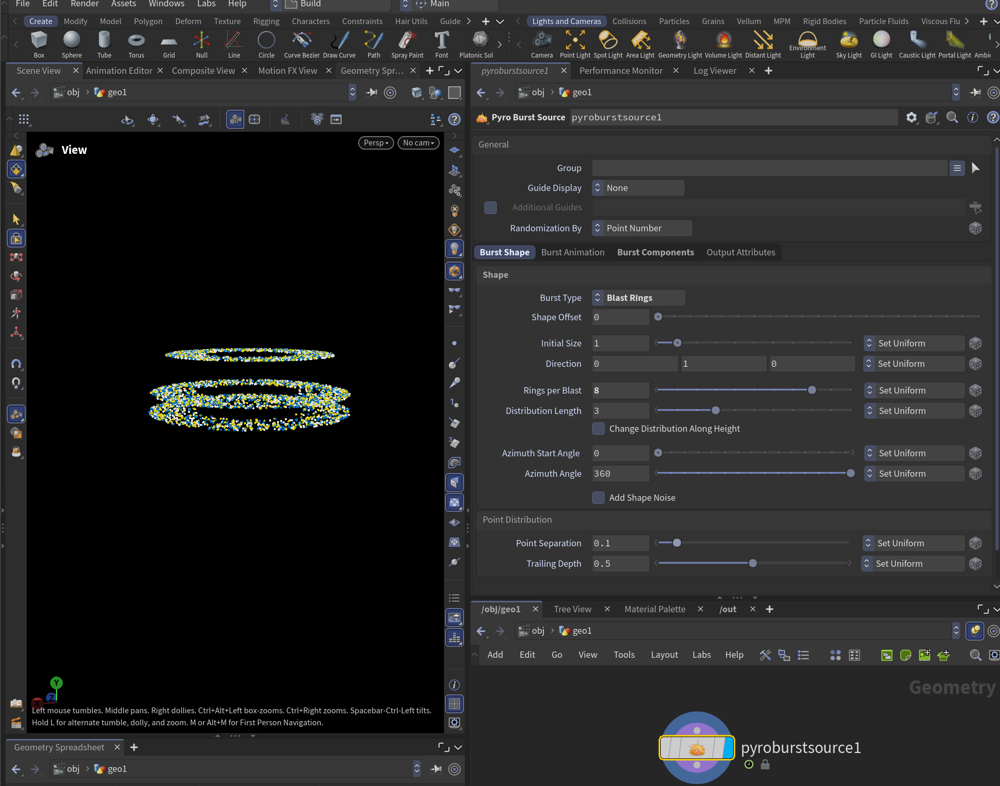

图 3：完整圆环示例。Rings per Blast 为 `8`，Distribution Length 为 `3`，Azimuth Angle 为 `360`。

#### 主要参数

| 参数 | 中文含义 | 作用与调整效果 | 图 3 数值 |
| --- | --- | --- | --- |
| **Rings per Blast** | 每次爆发的环数 | 调整烟环的数量，也可以直观理解为调整层数。 | `8` |
| **Distribution Length** | 分布长度 | 控制环沿 Direction 分布的长度。本例 Direction 朝上，因此可理解为沿高度方向的分布范围。 | `3` |
| **Azimuth Angle** | 方位角覆盖范围 | 从环的横截面观察，控制圆周覆盖多少角度；`360` 为完整圆环，减小后会形成带缺口的环或圆弧。 | `360` |

#### Azimuth Angle：从完整圆环变为带缺口的圆弧

“调整横截面”可以更具体地理解为：**调整环在圆周方向上的覆盖角度**。将 Azimuth Angle 从 `360` 降低，可以让原本闭合的圆环出现开口。

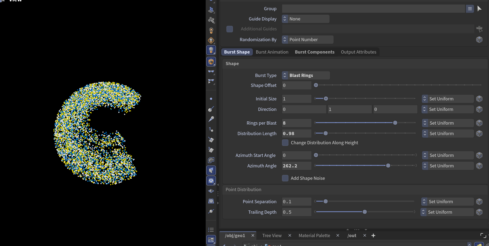

图 4：Azimuth Angle 为 `262.2` 时的开口环形预览。此图的 Distribution Length 同时改为 `0.98`，因此与图 3 相比，除了圆周开口，轴向分布范围也发生了变化。

| 对照项目 | 图 3：完整圆环 | 图 4：开口圆弧 | 查阅要点 |
| --- | --- | --- | --- |
| **Rings per Blast** | `8` | `8` | 环数设置保持一致。 |
| **Distribution Length** | `3` | `0.98` | 轴向分布长度也有调整，不能把两图所有形状差异都归因于方位角。 |
| **Azimuth Angle** | `360` | `262.2` | 圆周覆盖角度缩小，环出现缺口。 |
| **Azimuth Start Angle** | `0` | `0` | 方位角朝向设置保持一致。 |

#### 其他参数与使用细节补充

| 参数或细节 | 截图设置 | 补充说明 |
| --- | --- | --- |
| **Rings per Blast 的名称** | `8` | 本次截图使用此名称；官方文档中称为 **Rings per Burst**。 |
| **Direction** | `(0, 1, 0)` | 定义烟环沿哪个方向分布，Distribution Length 沿此方向计量。 |
| **Azimuth Start Angle** | `0` | 调整圆周覆盖的方位；与 Azimuth Angle 配合可调整开口朝向。 |
| **Change Distribution Along Height** | 关闭 | 开启后可通过 Distribution Ramp 调整环沿分布长度的分布。 |
| **Add Shape Noise** | 关闭 | 开启后给环形轮廓添加噪声，打破过于规则的形状。 |
| **Point Separation** | `0.1` | 控制源点间距；减小会增加点的密度。 |
| **Trailing Depth** | `0.5` | 控制源点向形状内部延伸的深度。 |
| **当前帧可见环数** | 以视口为准 | 环会随爆发扩张逐步生成，设置为 `8` 时，某一帧不一定已经显示全部 8 层。 |

以上类型与参数的精确定义参考 [SideFX 官方文档：Burst Shape](https://www.sidefx.com/docs/houdini/nodes/sop/pyroburstsource.html#burst-shape)。截图中的名称和数值优先按本次实际界面记录。

### 6. Shockwave：本次素材使用的冲击波类型

回到本次特效素材的制作，将 **Burst Type** 切换为 **Shockwave**（冲击波）。它可以通过球面上的角度范围生成完整球形、半球或局部切片状的发射源，适合制作冲击波素材。

#### 两组角度的区别

本类型有两组角度：**Spread 系列控制球面沿方向轴的展开范围，Azimuth 系列控制绕方向轴的圆周覆盖范围。** Direction 为 `(0, 1, 0)` 时，可以分别从侧面和沿 Y 轴俯视的方向观察它们的效果。

原操作中“球体的内部角度和外部角度”，可以用来辅助理解球面切片的边界；记录参数时，更适合使用“起始角度”和“展开角度”，避免与后面的内外扩散混淆。

| 参数 | 中文含义 | 调整作用 |
| --- | --- | --- |
| **Spread Start Angle** | 展开起始角度 | 控制球面上的点从哪个角度开始分布。 |
| **Spread Angle** | 展开角度 | 与起始角度配合，控制球面展开的角度范围。 |
| **Azimuth Start Angle** | 方位起始角度 | 控制绕 Direction 轴的覆盖朝向；有缺口时可用来调整开口朝向。 |
| **Azimuth Angle** | 方位覆盖角度 | 控制横截面上的圆周覆盖范围；`360` 为完整一周，减小后出现缺口。 |

角度含义参考 [SideFX 官方参数说明（日文版，包含 Shockwave 的 Spread Angle 说明）](https://www.sidefx.com/ja/docs/houdini/nodes/sop/pyroburstsource.html#burst-shape)。

#### 截图对照：局部球面与完整球形

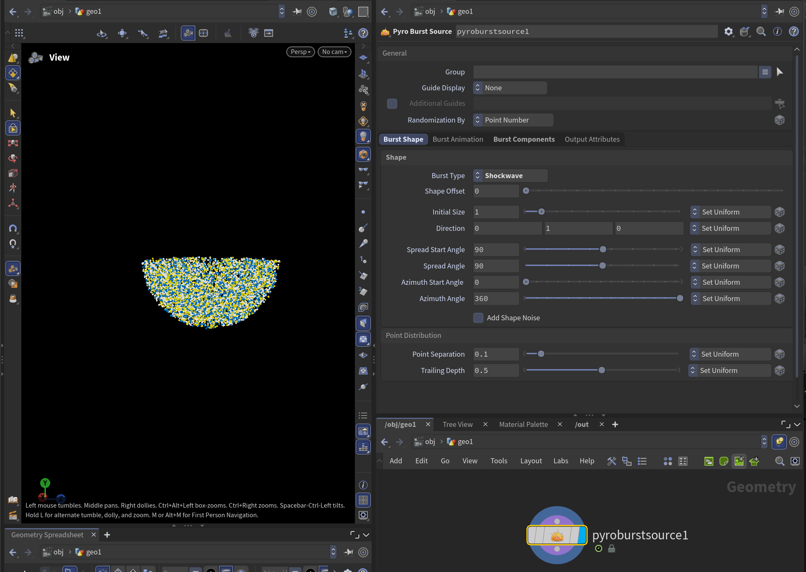

图 5：Spread Start Angle 为 `90`、Spread Angle 为 `90`，视口呈碗状的局部球面轮廓；Azimuth Angle 为 `360`，圆周方向完整覆盖。

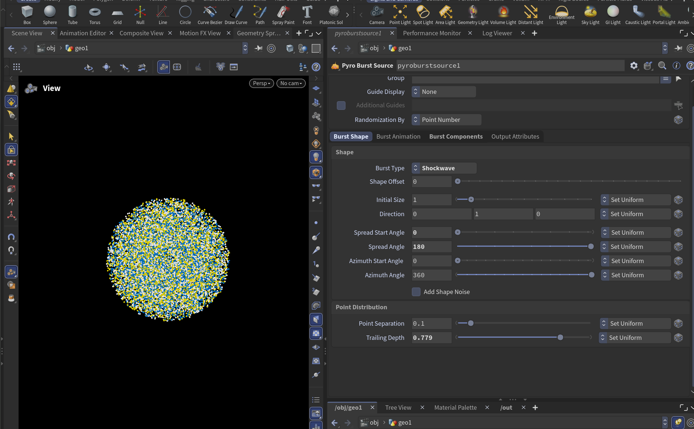

图 6：Spread Start Angle 为 `0`、Spread Angle 为 `180`，Azimuth Angle 为 `360`，源点呈完整球形轮廓。

| 参数 | 图 5：局部球面 | 图 6：完整球形 | 对照说明 |
| --- | --- | --- | --- |
| **Initial Size** | `1` | `1` | 初始尺寸一致。 |
| **Direction** | `(0, 1, 0)` | `(0, 1, 0)` | 方向轴一致。 |
| **Spread Start Angle** | `90` | `0` | 调整球面分布的起始角度。 |
| **Spread Angle** | `90` | `180` | 调整球面展开范围。 |
| **Azimuth Start Angle** | `0` | `0` | 方位朝向设置一致。 |
| **Azimuth Angle** | `360` | `360` | 两图都覆盖完整圆周。 |
| **Point Separation** | `0.1` | `0.1` | 点间距一致。 |
| **Trailing Depth** | `0.5` | `0.779` | 向内部填充的深度也有变化，不能把点云内部的全部差异归因于角度。 |
| **Add Shape Noise** | 关闭 | 关闭 | 本次对照未启用形状噪声。 |

### 7. Burst Animation：起始时间与内外扩散

完成形状设置后，切换到 **Burst Animation** 页签。这里控制爆发源何时开始、扩张动画持续多久，以及内外区域如何扩散。

#### 起始帧与持续时间

| 参数 | 中文含义 | 截图数值 | 作用 |
| --- | --- | --- | --- |
| **Start Frame** | 起始帧 | `1` | 从第 1 帧触发爆发。 |
| **Frame Duration** | 持续帧数 | `5` | 设置源点扩张动画的持续时间，单位为帧。 |

#### Interior Expansion 与 Exterior Expansion

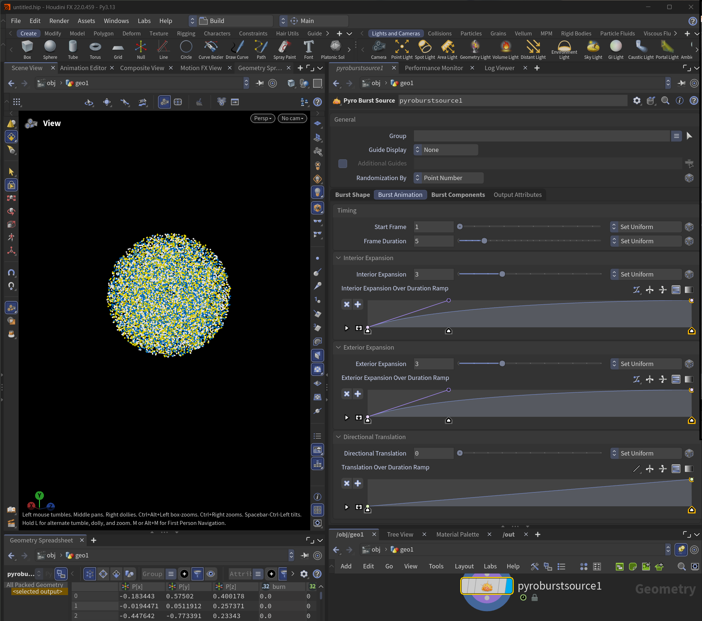

图 7：参数观察阶段，Interior Expansion 和 Exterior Expansion 都为 `3`；Start Frame 为 `1`，Frame Duration 为 `5`。

**Exterior Expansion（外部扩散）**控制冲击波外缘的最终扩张尺度。设为 `3`，可以理解为在持续时间内将外缘扩张到初始尺度的 **3 倍**，具体快慢由对应的 Ramp 曲线控制。

**Interior Expansion（内部扩散）**主要控制冲击波内缘的扩张。直观上，越靠近内侧的源点越体现内部扩散设置的影响。它与外部扩散配合，可以改变扩张过程中内外缘的相对位置和环带厚度。

| 参数或细节 | 补充说明 |
| --- | --- |
| **Interior Expansion** | 内缘最终扩张倍率，以 Initial Size 为基础。 |
| **Exterior Expansion** | 外缘最终扩张倍率，以 Initial Size 为基础。 |
| **倍率 `3` 的含义** | 最终达到初始尺度的 3 倍；它表示尺寸倍率。 |
| **Interior Expansion Over Duration Ramp** | 控制内缘在持续时间内的扩张节奏。 |
| **Exterior Expansion Over Duration Ramp** | 控制外缘在持续时间内的扩张节奏。 |
| **Ramp 的读法** | 横轴为持续时间进度，纵轴为扩张进度；曲线越陡的区段，变化越快。 |
| **Directional Translation** | 沿 Direction 方向的位移；两张动画参数截图中都为 `0`。 |
| **截图的比较方式** | 截图未显示当前帧数，应通过播放时间轴观察扩张过程，单张静态预览不能说明扩张速度。 |

内外缘倍率与曲线定义参考 [SideFX 官方文档：Burst Animation](https://www.sidefx.com/docs/houdini/nodes/sop/pyroburstsource.html#burst-animation)。

#### 本次素材设置：内外扩散都设为 1

本次将 **Interior Expansion** 和 **Exterior Expansion** 都改为 `1`，把素材在游戏中的整体放大、缩小交给 **Niagara** 控制，方便后续根据效果需要调整尺寸和变化节奏。

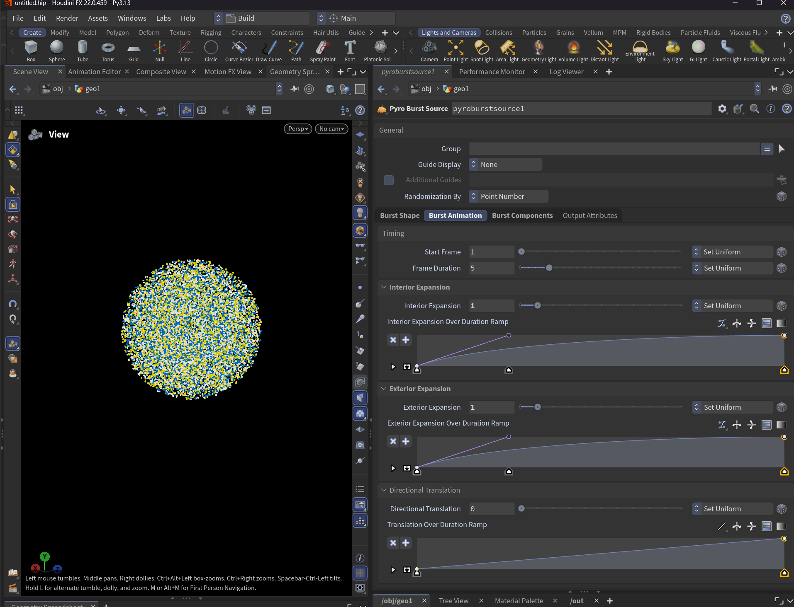

图 8：本次采用的扩散设置。内外扩散均为 `1`，起始帧与持续帧数仍分别为 `1` 和 `5`。

| 参数 | 观察阶段（图 7） | 本次采用（图 8） | 设置意图 |
| --- | --- | --- | --- |
| **Start Frame** | `1` | `1` | 保持触发时间。 |
| **Frame Duration** | `5` | `5` | 保留当前源动画时长设置。 |
| **Interior Expansion** | `3` | `1` | 内缘不额外增加扩张倍率。 |
| **Exterior Expansion** | `3` | `1` | 外缘不额外增加扩张倍率。 |
| **Directional Translation** | `0` | `0` | 保持无定向位移。 |

| 工作流细节补充 | 说明 |
| --- | --- |
| **`1` 的含义** | 表示尺寸倍率保持为 1，不是将源的强度或点数设为零。 |
| **Niagara 的整体缩放** | 用于调节整体尺寸；如果需要内外缘以不同速度运动，相应的内部形变仍需要素材动画或额外控制来表现。 |

Pyro Burst Source 输出的是用于后续 Pyro 模拟的源点；本节记录的是发射源的形状与动画设置。

### 8. Burst Components：源属性、Density 噪声与关闭 Burn

继续切换到 **Burst Components** 页签。本例初始创建了三个源组件，分别对应 **Density**、**Temperature** 和 **Burn**，可以通过 Pyro Sources 下方的 `1 / 2 / 3` 页签分别查看与设置。

#### 三个源组件与视口颜色

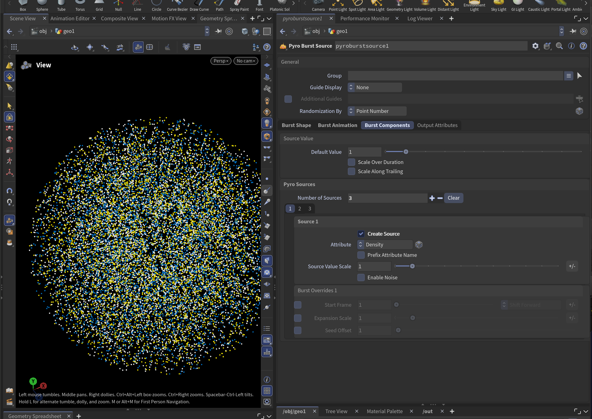

图 9：Number of Sources 为 `3`，当前选中 Source 1，Attribute 为 Density；此时视口中同时显示白色、蓝色和黄色源点。

| 源组件 | Attribute | 点属性名 | 本次视口颜色 | 本次处理 |
| --- | --- | --- | --- | --- |
| **Source 1** | Density（密度） | `density` | 白色／浅灰色 | 保留，作为烟雾密度源。 |
| **Source 2** | Temperature（温度） | `temperature` | 蓝色 | 保留，作为温度源。 |
| **Source 3** | Burn（燃烧） | `burn` | 黄色 | 本次不用燃烧，关闭该组件。 |

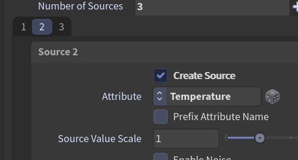

图 10：切到页签 `2`，确认 Source 2 为 Temperature，Create Source 已勾选。

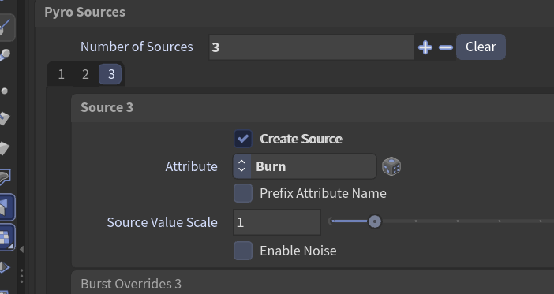

图 11：切到页签 `3`，确认 Source 3 为 Burn；此图记录关闭前的状态。

| 概念补充 | 说明 |
| --- | --- |
| **源组件与点属性** | 每个组件生成对应属性的源点，后续再转换为体积用于模拟。 |
| **视口颜色** | 白／灰、蓝、黄用于区分源组件；它们不是最终烟雾或火焰的渲染颜色。 |
| **Number of Sources** | 表示组件条目数量；关闭某个条目的 Create Source 后，条目本身仍可保留。 |

#### Density：启用噪声与 Amplitude

选择页签 `1`，在 Density 组件中勾选 **Enable Noise**，即可展开噪声设置，用噪声改变不同位置的密度源值，增加烟雾浓淡分布的随机变化。

**Amplitude（振幅）控制噪声强度：值越大，Density 的局部差异越明显；值越小，差异越弱。** 本次先了解它的作用，暂不继续调整噪声参数。

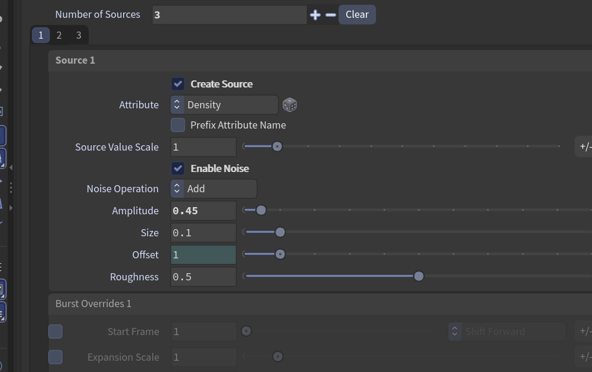

图 12：噪声参数观察截图。Enable Noise 已开启，Noise Operation 为 Add，Amplitude 为 `0.45`。这些数值用于记录当前界面，不作为所有素材的固定配置。

| 参数 | 中文含义 | 图 12 设置 | 补充说明 |
| --- | --- | --- | --- |
| **Enable Noise** | 启用噪声 | 开启 | 给当前组件的源值加入噪声变化。 |
| **Noise Operation** | 噪声运算方式 | `Add` | Add 将噪声叠加到源值；Multiply 则用噪声乘以源值。 |
| **Amplitude** | 振幅 | `0.45` | 控制变化强度；Add 模式下，生成的噪声在正负振幅范围内变化。 |
| **Size** | 噪声尺度 | `0.1` | 控制噪声块的大小，影响浓淡变化的空间尺度。 |
| **Offset** | 噪声偏移 | `1` | 改变采样的噪声图案，获得不同的密度分布。 |
| **Roughness** | 粗糙度 | `0.5` | 较大时增加细碎变化，较小时更平滑。 |
| **与形状噪声的区别** | — | — | 此处改变 Density 源值；Burst Shape 中的 Add Shape Noise 用于改变源的形状。 |

源组件与噪声定义参考 [SideFX 官方文档：Burst Components](https://www.sidefx.com/docs/houdini/nodes/sop/pyroburstsource.html#burst-components)。

#### 本次操作：关闭 Burn，保留 Density 与 Temperature

本次冲击波素材不使用燃烧源，因此关闭 Burn 组件：

1. 在 Pyro Sources 中切到页签 `3`。
2. 确认 Attribute 为 **Burn**。
3. 取消勾选该组件的 **Create Source**。
4. 观察视口：黄色 Burn 源点消失，保留白色／浅灰色 Density 源点和蓝色 Temperature 源点。

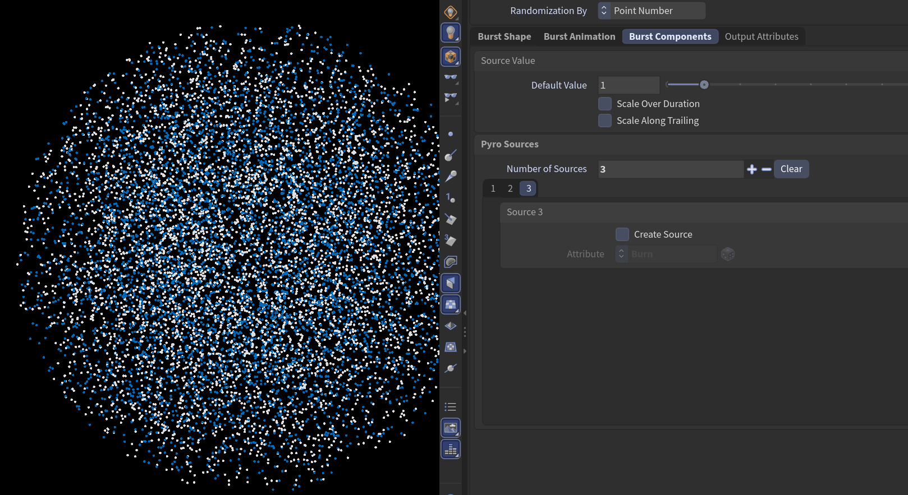

图 13：Burn 的 Create Source 已关闭，黄色源点消失。Number of Sources 仍为 `3`，说明这里只停用了第三个组件，保留了原有条目。

#### 当前面板其他参数补充

| 参数 | 截图设置 | 作用 |
| --- | --- | --- |
| **Default Value** | `1` | 对各源属性值进行全局缩放，颜色源 Cd 除外。 |
| **Source Value Scale** | 启用时各组件截图均为 `1` | 单独缩放当前组件的源值。 |
| **Prefix Attribute Name** | 关闭 | 开启后给源属性名加上 `burst_` 前缀。 |
| **Scale Over Duration** | 关闭 | 开启后用曲线控制源值随爆发时间的变化。 |
| **Scale Along Trailing** | 关闭 | 开启后用曲线控制源值沿拖尾内外位置的变化。 |

以上补充参数参考 [SideFX 官方文档：源值与组件控制](https://www.sidefx.com/docs/houdini/nodes/sop/pyroburstsource.html#burst-components)。本阶段保留 Density、Temperature，关闭 Burn；Density 噪声先记录参数含义，暂不继续调节。

### 9. Output Attributes：速度输出、向量显示与速度噪声

接下来切换到 **Output Attributes**（输出属性）页签。本次给发射源保留一定速度，并通过视口中的向量显示观察速度方向与强弱，再按需要加入随机变化。

#### 启用 Velocity：输出速度属性 v

确认 **Velocity** 左侧复选框已勾选，使节点输出点速度属性 **`v`**，再通过右侧数值调整速度倍率。

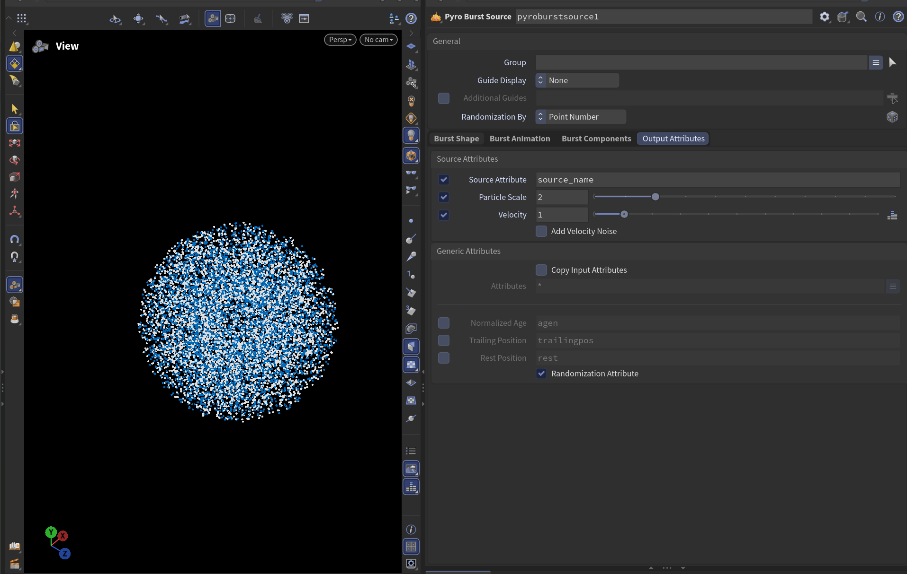

图 14：初始观察截图。Source Attribute、Particle Scale、Velocity 均已开启；Particle Scale 为 `2`，Velocity 为 `1`，Add Velocity Noise 尚未开启。

| 参数 | 图 14 设置 | 补充说明 |
| --- | --- | --- |
| **Source Attribute** | 开启，名称为 `source_name` | 标识各源点参与哪些属性的体积转换。 |
| **Particle Scale** | 开启，`2` | 输出 `pscale`，数值用于缩放源点的代表尺寸。 |
| **Velocity** | 开启，`1` | 输出 `v`；数值是速度倍率，`1` 表示保持原倍率。 |
| **Add Velocity Noise** | 关闭 | 开启后给速度加入噪声扰动。 |

上述输出与倍率含义参考 [SideFX 官方文档：Output Attributes](https://www.sidefx.com/docs/houdini/nodes/sop/pyroburstsource.html#output-attributes)。

#### 在视口显示速度向量

1. 点击 **Velocity 参数最右侧的属性可视化图标**，建立或切换速度显示。
2. 在左侧视口的**右边缘竖向工具栏**中找到 **Visualizers** 图标；如果未显示，可沿工具栏滚动查找。
3. 右键点击该图标，打开 **Visualizers** 列表。
4. 在列表中找到 **`v`**，勾选启用。
5. 点击 `v` 右侧的**铅笔图标**，打开 **Edit Visualizer**，编辑速度的显示方式。

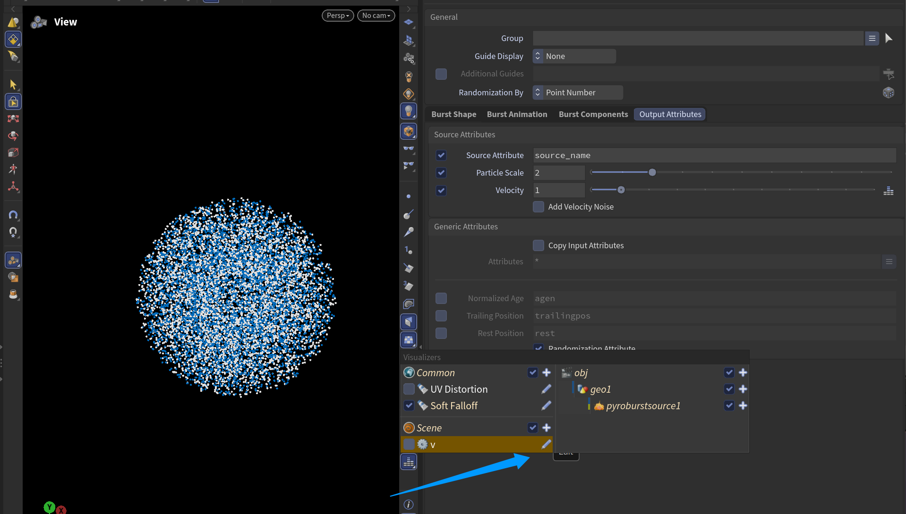

图 15：Visualizers 列表中的 `v` 项。蓝色箭头指向右侧铅笔按钮，用于编辑该速度可视化。

#### 调小 Length Scale，让速度向量更容易观察

打开 Edit Visualizer 后，确认显示的 Attribute 为 `v`、Style 为 **Vector**。如果线段过长、遮挡源点，可将 **Length Scale（长度缩放）**调小。

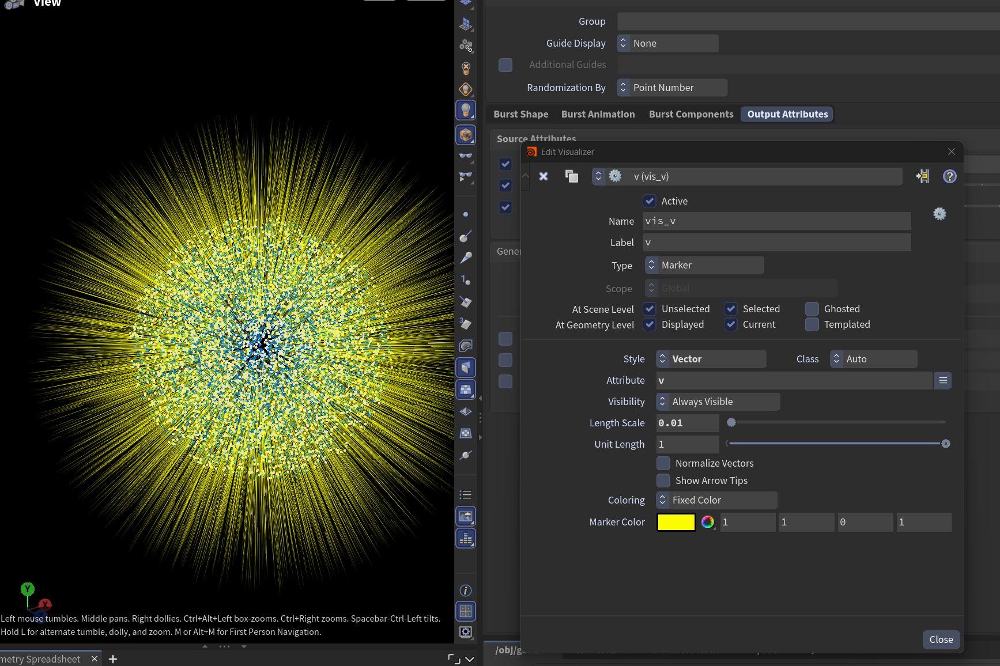

图 16：Length Scale 为 `0.01`，向量显示为黄色线段。该数值作为显示设置参考，可根据当前场景尺度继续调整。

| 显示参数 | 图 16 设置 | 补充说明 |
| --- | --- | --- |
| **Active** | 开启 | 启用该可视化。 |
| **Type / Style** | `Marker` / `Vector` | 以向量线段显示属性。 |
| **Attribute** | `v` | 读取速度属性。 |
| **Visibility** | `Always Visible` | 显示所有符合条件的元素；点密集时线段也会较密集。 |
| **Length Scale** | `0.01` | 缩放视口线段长度，方便观察。 |
| **Normalize Vectors** | 关闭 | 保留向量长度差异，便于比较速度强弱。 |
| **Show Arrow Tips** | 关闭 | 开启后在线段末端显示箭头，便于辨认方向。 |
| **Coloring / Marker Color** | `Fixed Color` / 黄色 | 统一使用黄色绘制速度线段。 |

**Length Scale 只调整显示长度；Velocity 会改变输出速度的倍率。** 观察速度强弱时，应保持相同的显示缩放，并留意 Normalize Vectors 是否开启。[向量显示参数说明](https://www.sidefx.com/docs/houdini/visualizers/marker.html)

| 颜色查阅提醒 | 说明 |
| --- | --- |
| **黄色速度线段** | 来自本节的 Marker Color 设置；上一节的黄色 Burn 源点是另一种显示用途。当前仍保持 Burn 关闭。 |

#### Add Velocity Noise：给速度加入随机变化

速度也可以加入随机扰动。在 Output Attributes 中勾选 **Add Velocity Noise**，展开噪声参数。它用于打破过于整齐的速度分布，使不同位置的速度方向或大小产生变化。

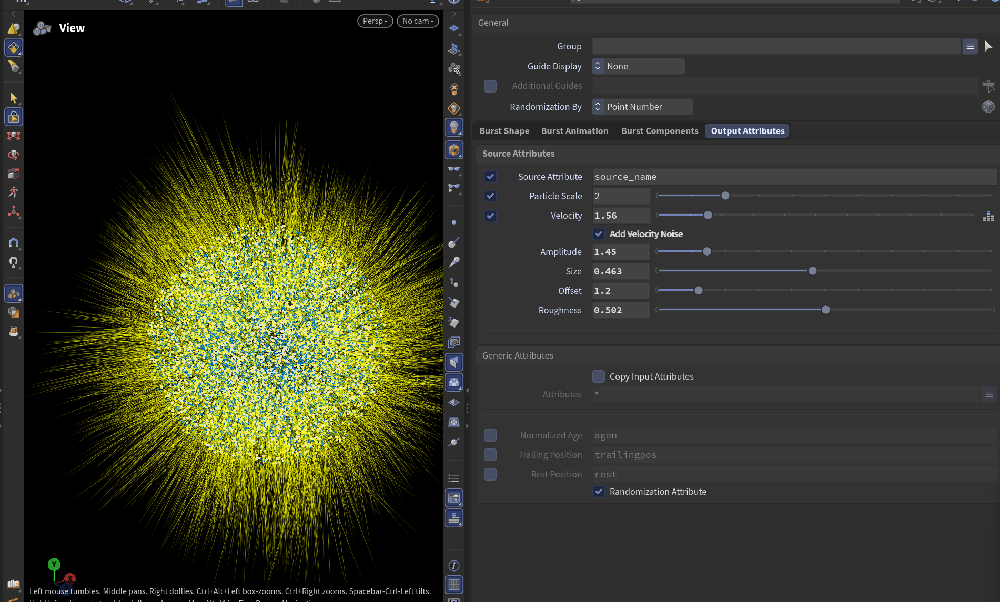

图 17：Velocity 调为 `1.56`，Add Velocity Noise 已开启；视口中的速度向量呈现不均匀变化。此图记录参数实验，不将这些数值作为通用预设。

| 参数 | 图 17 数值 | 作用 |
| --- | --- | --- |
| **Velocity** | `1.56` | 调整速度倍率；与图 14 的 `1` 相比，这项也发生了变化。 |
| **Add Velocity Noise** | 开启 | 给输出速度加入噪声扰动。 |
| **Amplitude** | `1.45` | 控制速度扰动强度。 |
| **Size** | `0.463` | 控制噪声的空间尺度。 |
| **Offset** | `1.2` | 偏移噪声采样，改变随机图案。 |
| **Roughness** | `0.502` | 控制噪声细节的粗糙程度。 |

速度噪声参数参考 [SideFX 官方文档：速度输出与噪声](https://www.sidefx.com/docs/houdini/nodes/sop/pyroburstsource.html#output-attributes)。

| 不同噪声的作用对象 | 调整内容 |
| --- | --- |
| **Burst Shape → Add Shape Noise** | 发射源的形状。 |
| **Burst Components → Density → Enable Noise** | 密度源值的浓淡分布。 |
| **Output Attributes → Add Velocity Noise** | 速度属性 `v` 的变化。 |

### 10. Volume Rasterize Attributes：将源点转换为体积

发射源准备好后，下一步将粒子（源点）上的属性转换为体积，供解算器使用。

1. 在 Geometry 内按 `Tab`，搜索并创建 **Volume Rasterize Attributes**。
2. 连接 `pyroburstsource1 → volumerasterizeattributes1`。
3. 在 **Attributes** 中添加本次需要转换的属性，使用空格分隔：

```text
density temperature v
```

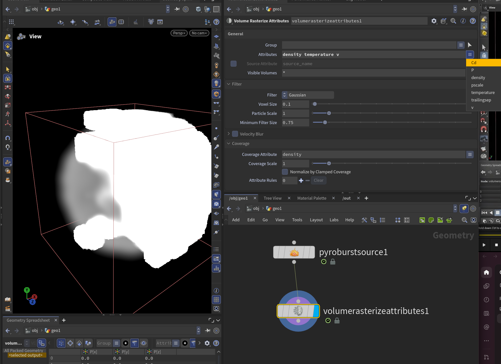

图 18：Attributes 中已填写 `density temperature v`，Voxel Size 为 `0.1`。节点输出由源点转换为 VDB 体积。

| 属性 | 数据类型 | 本次用途 |
| --- | --- | --- |
| **density** | 标量 | 烟雾密度源。 |
| **temperature** | 标量 | 温度源。 |
| **v** | 向量 | 速度源，保留上一节设置的速度与扰动。 |

#### 转体积参数补充

| 参数或细节 | 图 18 设置 | 说明 |
| --- | --- | --- |
| **Filter** | `Gaussian` | 将源点的贡献平滑采样到体素中。 |
| **Voxel Size** | `0.1` | 生成体积的体素尺寸，下一节将引用求解器的设置。 |
| **Particle Scale** | `1` | 进一步缩放输入点的 `pscale`，影响点的覆盖范围。 |
| **Source Attribute** | 关闭，名称框为 `source_name` | 对本例的多组件源，建议开启并使用上游输出的 `source_name`，让各体积只使用对应组件的源点。 |
| **Attributes 与 Source Attribute** | 两个不同参数 | 前者选择生成哪些体积，后者筛选各体积采用哪些点。 |

后续第 13 节将记录本次实际排错：截图中 Source Attribute 仍关闭，将 Coverage Attribute 从 `density` 清空后恢复温度与湍流效果。组件筛选与覆盖权重是两项独立设置。

上述转换与参数含义参考 [SideFX 官方文档：Volume Rasterize Attributes](https://www.sidefx.com/docs/houdini/nodes/sop/volumerasterizeattributes.html)。

### 11. Pyro Solver：接入体积、统一体素大小与缓存设置

#### 创建并连接求解器

按 `Tab` 搜索并创建 **Pyro Solver**，将 Volume Rasterize Attributes 的输出连接到它的**第一个输入（发射源体积）**，再将显示旗标切到求解器。

```text
pyroburstsource1                 准备密度、温度与速度源点
    ↓
volumerasterizeattributes1       将 density、temperature、v 转换为体积
    ↓
pyrosolver1                     计算烟雾随时间的运动
```

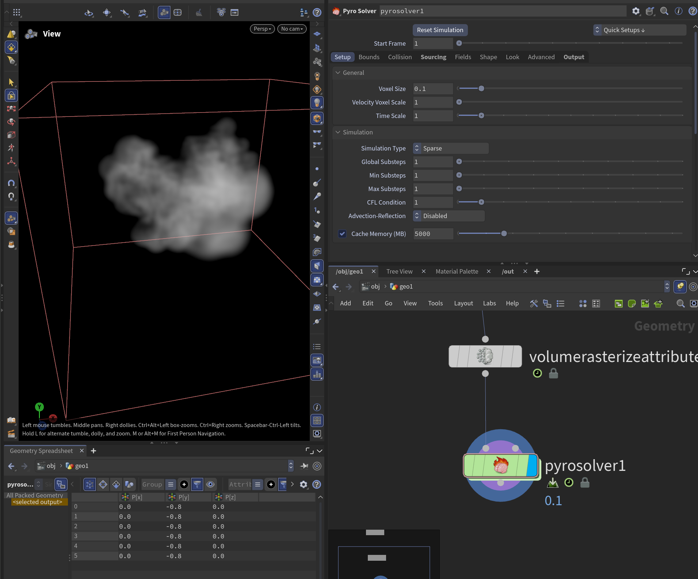

图 19：体积转换节点已连接到 Pyro Solver。Setup 中 Voxel Size 为 `0.1`，Simulation Type 为 Sparse，截图中的 Cache Memory 为 `5000 MB`。

#### 将体积转换的 Voxel Size 引用到求解器

养成统一管理体素尺寸的习惯：**以 Pyro Solver 为控制端，让 Volume Rasterize Attributes 的 Voxel Size 读取求解器的值。**

1. 打开 **Pyro Solver → Setup**。
2. 在 **Voxel Size** 参数上右键，选择 **Copy Parameter**。
3. 切回 **Volume Rasterize Attributes**。
4. 在其 **Voxel Size** 参数上右键，选择 **Paste Relative References**。
5. 后续直接修改求解器的 Voxel Size，体积转换节点便会同步更新。

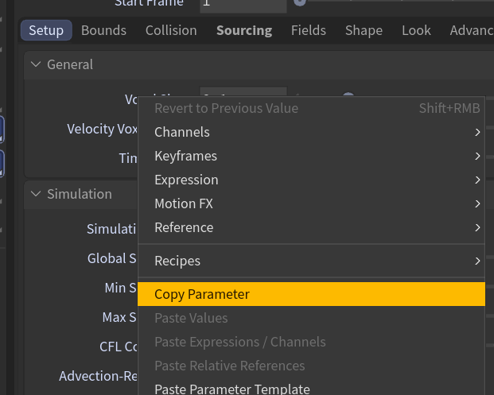

图 20：在求解器的体素大小参数上复制参数引用。

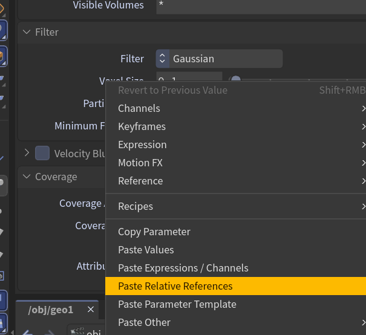

图 21：在体积转换节点上选择 Paste Relative References，建立参数联动。

| 引用细节 | 说明 |
| --- | --- |
| **控制端** | `pyrosolver1` 的 Voxel Size。 |
| **读取端** | `volumerasterizeattributes1` 的 Voxel Size。 |
| **表达式示例** | 同级节点且采用当前命名时，可得到 `ch("../pyrosolver1/divsize")`；以菜单实际生成的表达式为准。 |
| **体素尺寸的影响** | 数值越小，采样越细，通常需要更多计算与内存。 |
| **已有相关笔记** | [Houdini Pyro 笔记](HoudiniPyro.md) 中也记录了相同的体素引用流程。 |

#### 提高模拟缓存上限

在 **Setup → Simulation** 中保持内存缓存启用，将 **Cache Memory (MB)** 按本次操作要求设为 **`50000`**。

| 项目 | 数值或含义 |
| --- | --- |
| **图 19 显示值** | `5000 MB`。 |
| **本次要求设置值** | `50000 MB`，约 50 GB。 |
| **Cache Memory 的作用** | 设置模拟历史状态的内存缓存上限，便于回看已经计算的帧。 |
| **容量选择** | 按机器可用 RAM 调整；该值是缓存上限，不是整个 Houdini 进程的内存上限。 |

后续本机排错确认物理内存约为 32 GB，因此 `50000 MB` 仅保留为当时的教程操作记录，不作为这台电脑的推荐值。重新模拟时可先以 `2000～4000 MB` 测试；磁盘缓存完成后的关闭操作见第 19 节。

求解器输入、体素与缓存定义参考 [SideFX 官方文档：Pyro Solver](https://www.sidefx.com/docs/houdini/nodes/sop/pyrosolver.html)。

### 12. Shape 与 Fields：关闭浮力、减缓消散并关闭火焰

#### Shape：关闭 Buoyancy

切换到 **Pyro Solver → Shape**，取消勾选 **Buoyancy（浮力）**。本次先关闭浮力造成的上升趋势，让已有源速度参与形成冲击波烟雾的运动。

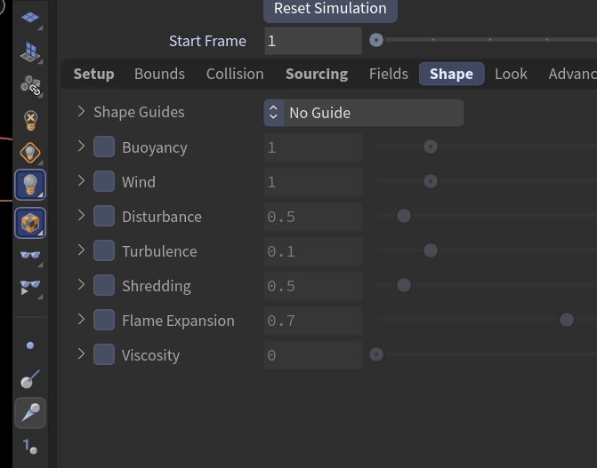

图 22：Buoyancy 已取消勾选。灰色强度框仍显示 `1`，该值在此开关关闭时不生效；截图中其余 Shape 项也均未开启。

| Shape 设置补充 | 说明 |
| --- | --- |
| **关闭 Buoyancy** | 停用浮力贡献，源速度与其他已启用的运动控制仍可影响烟雾。 |
| **其余 Shape 项** | 截图中的 Wind、Disturbance、Turbulence、Shredding、Flame Expansion、Viscosity 均未开启；本阶段先保留该状态。 |

#### Fields：减小 Dissipation，延长烟雾保留时间

切换到 **Fields**，在 **Density** 下保持 **Dissipation（消散）**启用，将数值调低。消散越慢，烟雾密度保留得越久；本次截图使用 **`0.07`**。

本次没有火焰效果，因此同时取消勾选 **Flame**。这与前面在 Pyro Burst Source 中关闭 Burn 相对应：发射源不生成燃烧组件，求解器也不需要创建火焰场。

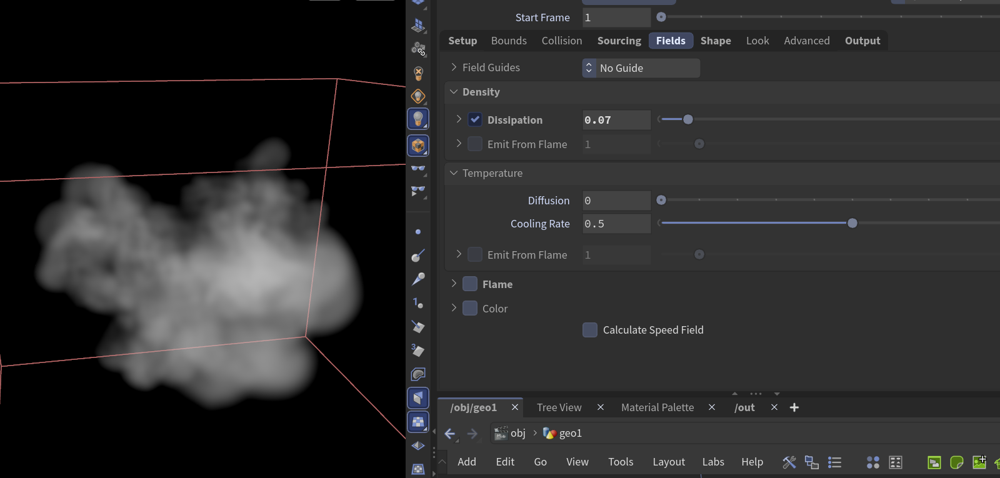

图 23：Density 的 Dissipation 为 `0.07`，Flame 已关闭；视口中显示当前烟雾预览。

| 参数 | 图 23 设置 | 补充说明 |
| --- | --- | --- |
| **Density → Dissipation** | 开启，`0.07` | 减小可减缓密度消散，让烟雾保留更久。 |
| **Density → Emit From Flame** | 关闭 | 本次不从火焰产生额外密度。 |
| **Temperature → Diffusion** | `0` | 保留截图中的温度扩散设置。 |
| **Temperature → Cooling Rate** | `0.5` | 控制温度冷却速度；与烟雾密度的消散分别设置。 |
| **Temperature → Emit From Flame** | 关闭 | 本次不从火焰产生额外温度。 |
| **Flame** | 关闭 | 本次无需火焰场。 |
| **Color / Calculate Speed Field** | 均关闭 | 本阶段保留截图设置。 |

调整求解参数后，点击 **Reset Simulation**，回到模拟起始帧重新播放，观察烟雾运动和消散过程。[浮力、消散、火焰场与重置说明](https://www.sidefx.com/docs/houdini/nodes/sop/pyrosolver.html)

### 13. 调整烟雾大形：暂停源速度、排查湍流并选择形态

本轮先把烟雾的大轮廓调好，之后再恢复源速度、用速度噪声丰富细节。调整顺序为：**关闭源速度 → 启用湍流 → 排查温度输入 → 调整涡旋尺度 → 增大发射源 → 选择 Seed**。

#### 暂时关闭爆发源的 Velocity

回到 **Pyro Burst Source → Output Attributes**，取消勾选 **Velocity**，暂时关闭这一项速度输出。

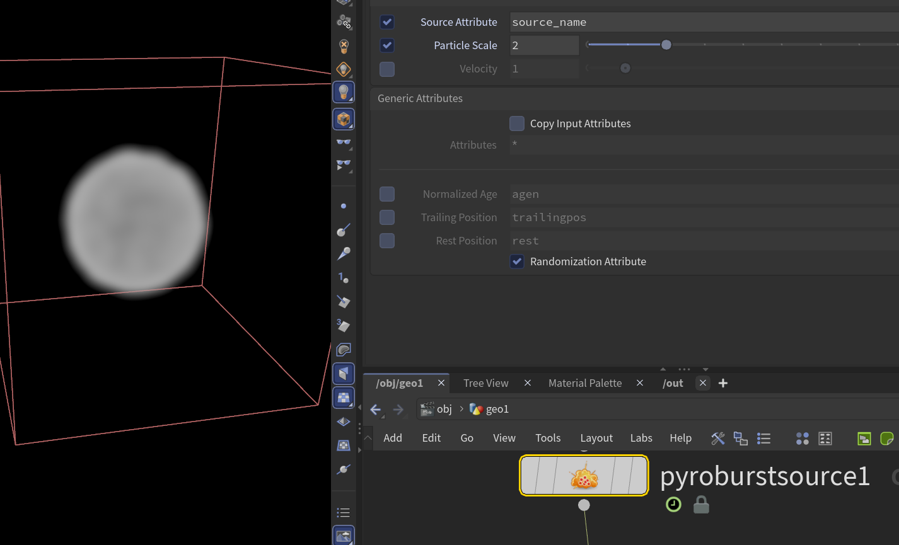

图 24：Velocity 已关闭，灰色数值框保留 `1`。此阶段先观察源形状与求解器塑形，后续再加入源速度变化。

| 速度设置补充 | 说明 |
| --- | --- |
| **当前阶段** | 暂停源点速度输出，前面速度噪声章节作为参数实验记录保留。 |
| **求解器的速度场** | Turbulence 等算子仍可在模拟中改变速度，关闭源 Velocity 不代表烟雾完全静止。 |
| **转体积列表中的 v** | 截图仍保留 `density temperature v`；列表只选择待转换属性，不会自动生成上游已停用的 `v`。 |

#### Turbulence 调到 4，仍然看不到明显扰动

回到 **Pyro Solver → Shape**，启用并展开 **Turbulence（湍流）**，将强度调到 **`4`**。本次即使提高强度，烟雾仍然保持较平滑的团块，没有出现预期的扰动，因此开始检查它依赖的温度场。

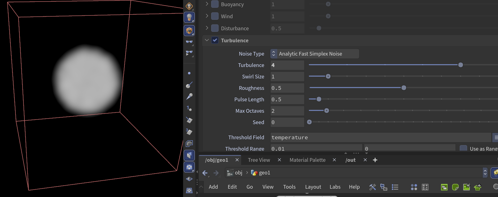

图 25：Turbulence 为 `4`，Swirl Size 为 `1`，Seed 为 `0`；Threshold Field 指向 `temperature`。

切到 **Fields**，将 **Field Guides** 改为 **Temperature**，观察温度指引。本次未看到预期的温度显示，怀疑温度源没有有效传入模拟。

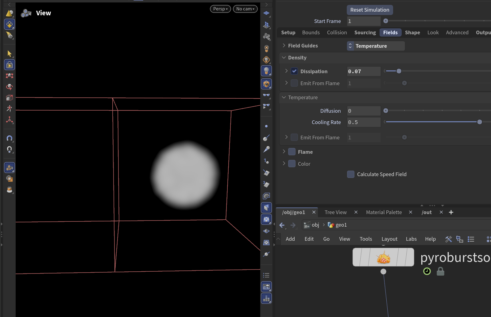

图 26：Field Guides 已选 Temperature，但未显示预期的彩色温度指引。这是本轮排查温度输入的线索。

| 排错细节 | 说明 |
| --- | --- |
| **Threshold Field = temperature** | 本次湍流通过温度场限定作用区域，因此关闭浮力后，温度输入仍会影响湍流。 |
| **Threshold Range = 0.01、0** | 截图中 Use as Range 未勾选，仅第一项阈值生效；温度需超过 `0.01` 才允许湍流作用。 |
| **指引未显示时** | 可继续检查上游点属性、转体积后的 temperature 数值、Sourcing 映射与指引范围；仅凭颜色不能断定字段不存在。 |

阈值控制规则参考 [SideFX 官方文档：Turbulence](https://www.sidefx.com/docs/houdini/nodes/sop/pyrosolver.html#shape)。

#### 本次修复：清空 Coverage Attribute

检查 **Volume Rasterize Attributes → Coverage**，发现 **Coverage Attribute** 当前填的是 `density`。

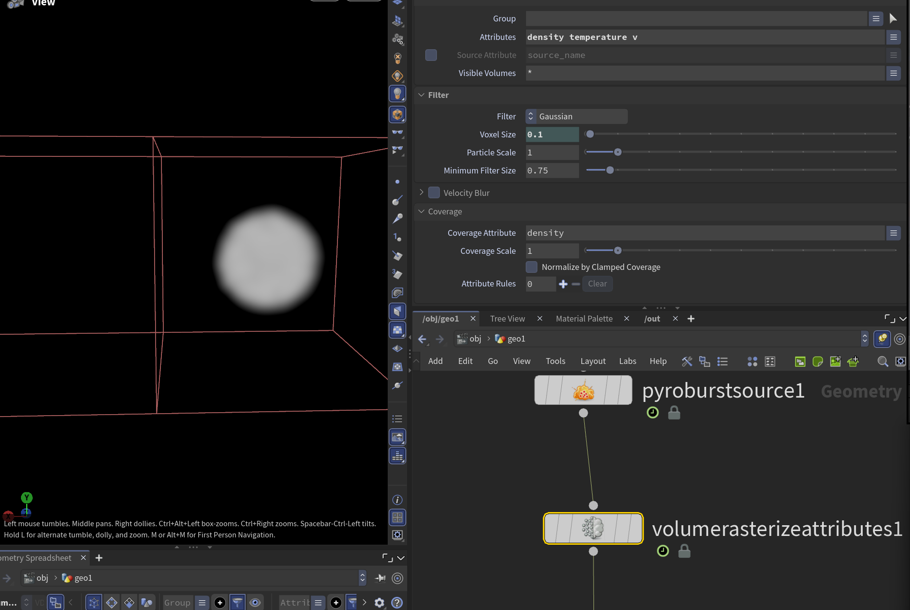

图 27：修复前，Coverage Attribute 为 `density`，Source Attribute 关闭。

针对本次 Burst 源的配置，**将 Coverage Attribute 输入框中的 `density` 删除，留空**，然后 Reset Simulation，从起始帧重新计算。重新模拟后，可以看到温度指引，烟雾也开始出现湍流扰动。

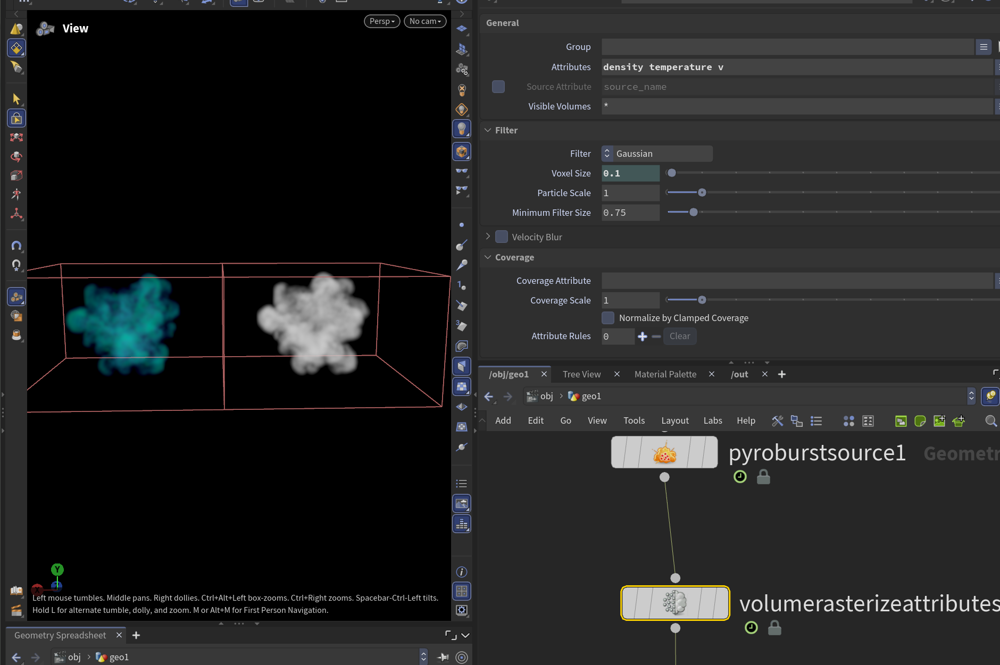

图 28：Coverage Attribute 已留空，视口同时显示彩色温度指引与烟雾预览，温度和塑形效果恢复。

| Coverage 细节补充 | 说明 |
| --- | --- |
| **Coverage Attribute** | 指定源点贡献的覆盖权重属性。本次“取消”指清空此输入框。 |
| **为什么 density 可能影响温度** | Burst 各组件分别生成源点，温度组件点上的 density 可能为 `0`；用 density 作权重，可能使这些点无法有效贡献温度。此处是结合组件数据结构与修复现象作出的解释。 |
| **清空后的处理** | 不再用 density 作为覆盖权重，按默认覆盖权重处理源点。 |
| **Source Attribute 与 Coverage Attribute** | 前者筛选参与各体积的组件点，后者决定覆盖权重；本次对照中只清空了后者。 |
| **适用范围** | 记录为本例的修复方法；不同源的属性组织不同，不能据此要求所有 Burst 或所有 Pyro 源都清空 Coverage。 |

覆盖权重规则参考 [Volume Rasterize Attributes：Coverage](https://www.sidefx.com/docs/houdini/nodes/sop/volumerasterizeattributes.html#coverage)，组件属性结构参考 [Pyro Burst Source：Burst components](https://www.sidefx.com/docs/houdini/nodes/sop/pyroburstsource.html#burst-components)。

#### 增大 Swirl Size，调整为更大的涡旋

确认湍流正常生效后，继续调整轮廓。将 **Swirl Size** 从 `1` 增大到 **`4.2`**，让扰动呈现更大的空间尺度，减少当前观感中过于细碎的变化。

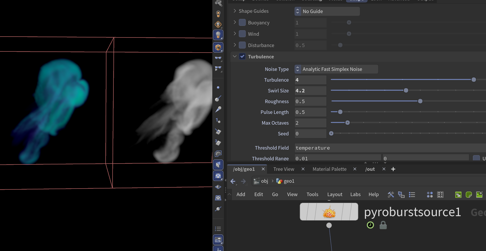

图 29：Turbulence 为 `4`，Swirl Size 为 `4.2`，Seed 仍为 `0`。涡旋尺度增大会改变整体推动方式与轮廓。

#### 增大 Initial Size，让发射源覆盖更大范围

当前烟雾的体量偏小，回到 **Pyro Burst Source → Burst Shape**，将 **Initial Size** 从前面的 `1` 增大到 **`3`**，扩大初始源的空间范围，再重新模拟观察形状。

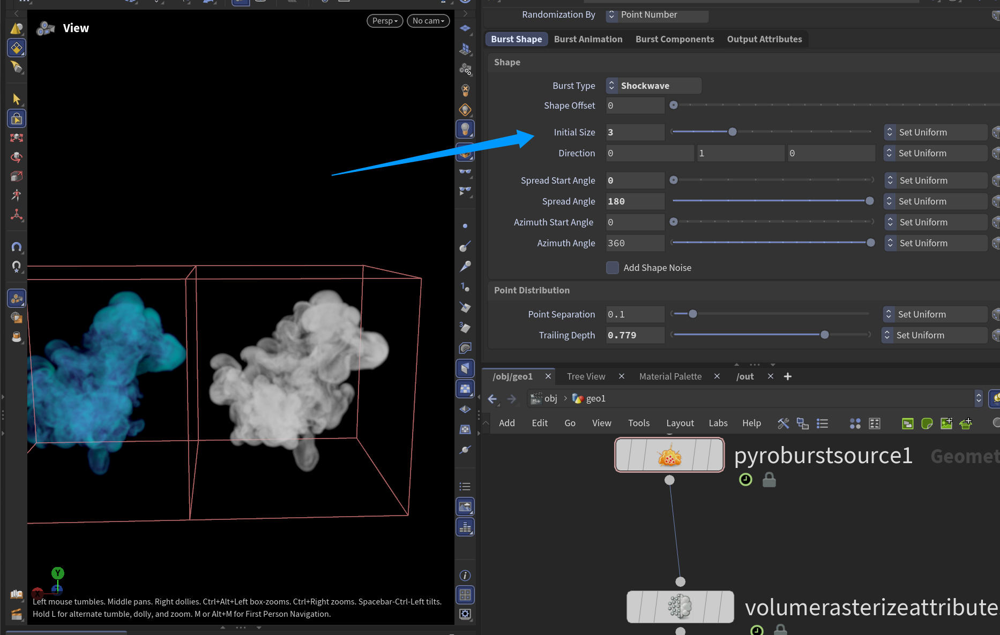

图 30：蓝色箭头指向 Initial Size，本次设为 `3`。Burst Type 仍为 Shockwave。

| 尺寸细节补充 | 说明 |
| --- | --- |
| **Initial Size** | 调整初始发射源的尺寸；这里用它增加烟雾的空间体量。 |
| **与密度强度的区别** | 若希望相同范围内的烟更浓，可另调 Density 源值；增加尺寸与增加浓度是两种调整。 |

#### 调整求解器的 Seed，挑选合适轮廓

回到 **Pyro Solver → Shape → Turbulence**，在强度和涡旋尺度基本确定后，尝试不同 **Seed**，挑选更适合当前素材的烟雾形态。本次截图将 Seed 改为 **`43`**。

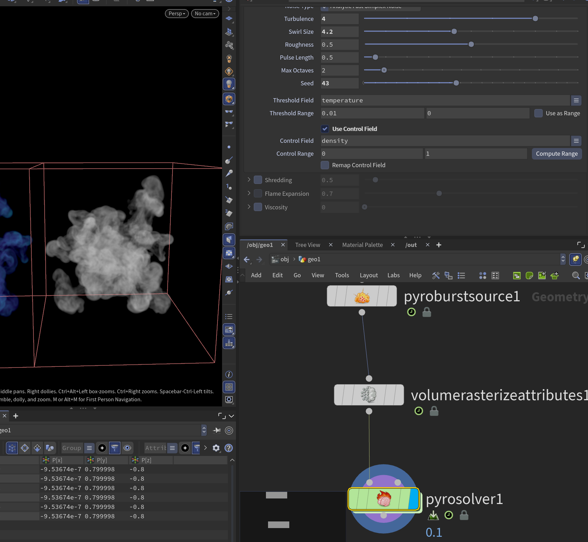

图 31：Turbulence 为 `4`，Swirl Size 为 `4.2`，Seed 为 `43`。Use Control Field 开启，Control Field 为 `density`。

| 湍流参数补充 | 本轮截图值 | 作用 |
| --- | --- | --- |
| **Noise Type** | `Analytic Fast Simplex Noise` | 当前使用的噪声类型。 |
| **Turbulence** | `4` | 控制湍流强度。 |
| **Swirl Size** | `1 → 4.2` | 控制基础涡旋的空间尺寸；大值产生更连贯的大范围推动。 |
| **Roughness** | `0.5` | 控制细层噪声的相对强度。 |
| **Pulse Length** | `0.5` | 控制噪声随时间变化的节奏，大值变化较慢。 |
| **Max Octaves** | `2` | 控制叠加噪声层数。 |
| **Seed** | `0 → 43` | 改变湍流分布，用于挑选轮廓。 |
| **Use Control Field / Control Field** | 开启 / `density` | 进一步按密度缩放湍流强度。 |
| **Control Range** | `0、1` | 对控制场数值进行映射。 |
| **Remap Control Field** | 关闭 | 本轮未额外启用控制场重映射曲线。 |

湍流参数分工参考 [SideFX 官方文档：Pyro Solver 的 Shape 设置](https://www.sidefx.com/docs/houdini/nodes/sop/pyrosolver.html#shape)。注意本节调整的是**求解器的 Turbulence Seed**；爆发源的 Shape Offset 则用于改变初始源形，两者控制不同阶段。

#### 本轮设置记录

| 所在节点 | 设置项 | 当前阶段 |
| --- | --- | --- |
| **Pyro Burst Source** | Velocity | 关闭，后续再恢复速度细节。 |
| **Pyro Burst Source** | Initial Size | `3`。 |
| **Volume Rasterize Attributes** | Coverage Attribute | 留空。 |
| **Volume Rasterize Attributes** | Source Attribute | 本轮截图保持关闭，组件筛选作为独立选项检查。 |
| **Pyro Solver** | Turbulence / Swirl Size / Seed | `4` / `4.2` / `43`。 |
| **Pyro Solver** | Buoyancy / Flame | 延续前节，均关闭。 |
| **Pyro Solver** | Dissipation | 延续前节，`0.07`。 |

比较不同 Seed 或源尺寸时，固定其他设置，Reset Simulation 后从起始帧重新计算，并在相同帧观察轮廓。

### 14. 创建正交摄影机：确定素材输出视角

为后续素材输出创建一台摄影机，并从摄影机视角确定构图。

#### 从当前视口创建摄影机

1. 本例使用 Labs Flipbook Textures 1.0，先返回 **`/obj` 层级**，在视口中确定初步取景，以创建供该工具使用的对象级摄影机。
2. 点击视口右上角当前显示 **No cam** 的摄影机菜单。
3. 选择 **New Camera（New Cam）**，创建摄影机，例如 `cam1`。
4. 确认摄影机菜单已切换到 `cam1`。

**Houdini 22 的 New Camera 会根据当前网络上下文选择相机类型。** 在对象网络中创建 Camera 对象，在 SOP 网络中可创建 Camera SOP，不能笼统认为该菜单总是创建 OBJ 相机。本机 Labs Flipbook Textures 1.0 的相机检查要求对象级 `cam`，因此本例保留 `/obj/cam1`。教程在 Pyro Solver 上下文中的旧版操作，应结合版本差异理解；返回 OBJ 创建本例相机本身不会形成固定的图集留白。[从当前视图创建摄影机与上下文规则](https://www.sidefx.com/docs/houdini/basics/view.html)

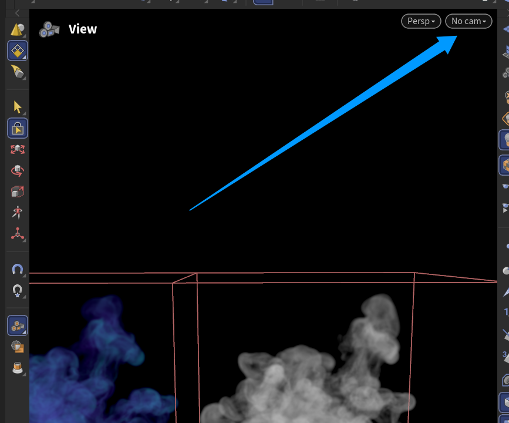

图 32：蓝色箭头指向 No cam 菜单。本次在 OBJ 层级创建摄影机，使 `cam1` 与 `geo1` 同处对象层级。

#### 设置正方形分辨率与正交投影

选择摄影机，打开 **View** 页签，将 **Resolution** 设为 **`1024 × 1024`**；也可使用 **`512 × 512`**。本次素材采用正方形画面，同时保持 **Pixel Aspect Ratio 为 `1`**。

将 **Projection** 从 **Perspective（透视）**改为 **Orthographic（正交）**。

此处记录教程阶段的设置。本机后续出现正交取景与 Labs 输出不一致，改用 Perspective 后输出占比能随摄影机调整；最终处理见第 24 节。

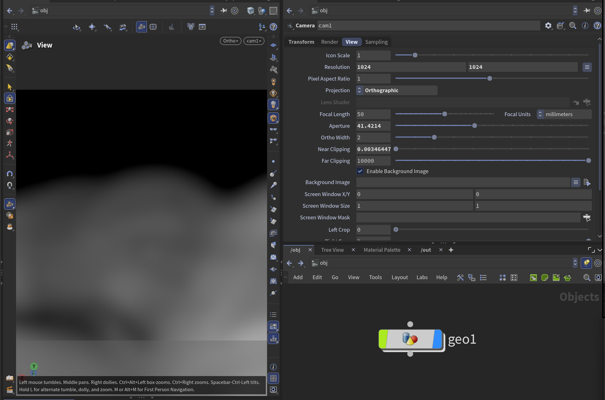

图 33：Resolution 为 `1024 × 1024`，Pixel Aspect Ratio 为 `1`，Projection 为 Orthographic。刚切换时，取景范围可能尚未覆盖完整烟雾，需要继续调整。

| 摄影机参数 | 本次设置 | 补充说明 |
| --- | --- | --- |
| **Resolution** | `1024 × 1024` | 摄影机输出图像的像素尺寸；本次也可选 `512 × 512`。 |
| **Pixel Aspect Ratio** | `1` | 使用正方形像素。 |
| **Projection** | `Orthographic` | 使用平行投影，避免透视中的近大远小。 |
| **Ortho Width** | 构图后为 `28.6181` | 控制正交取景范围的宽度；需要纳入更多烟雾时可增大。该数值依当前场景而定。 |

摄影机参数参考 [SideFX 官方文档：Camera](https://www.sidefx.com/docs/houdini/nodes/obj/cam.html)。

#### Link 摄影机到视口并调整构图

从摄影机视角查看时，打开摄影机菜单，或右键点击视口右侧工具栏中的 **Link or lock camera/light** 图标，选择 **Link Camera/Light to View**。让视口操作带动摄影机，再调整构图。旧教程中的“锁定摄影机到视口”，在本例应按关联视口的意图理解，使用 Link。

| 当前版本选项 | 含义 | 适用时机 |
| --- | --- | --- |
| **Link Camera/Light to View** | 将视口操作写入关联摄影机，通常在松开鼠标后更新。 | 正在调整摄影机构图时使用。 |
| **Lock Camera/Light Tumbling** | 锁住摄影机，阻止常规视口导航改变它。 | 构图确定后保护摄影机。 |
| **Export View Continuously** | 在操作过程中持续写入摄影机。 | 默认无需开启；关闭时松开鼠标后仍会更新。 |

正交相机的画面范围可直接通过 **Ortho Width** 调整：数值越小，画面中的烟雾越大。[视口与摄影机的关联、锁定规则](https://www.sidefx.com/docs/houdini/basics/view.html)

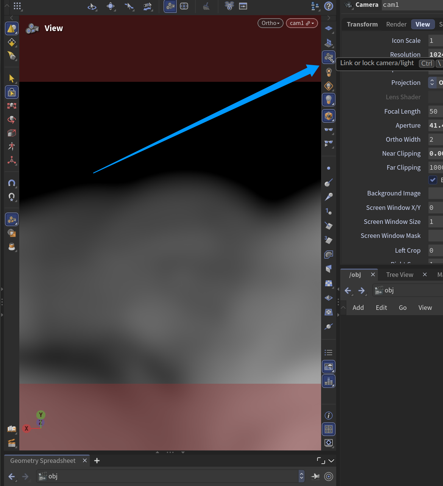

图 34：蓝色箭头指向共用的 Link or lock 图标；本例调整构图时，应选择其 Link Camera/Light to View 模式。

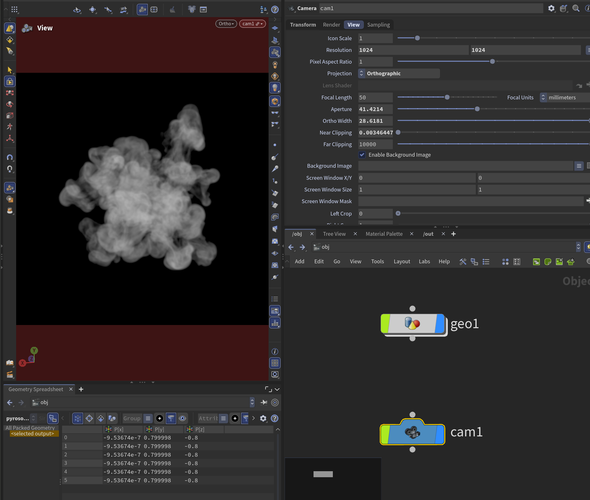

图 35：构图调整后的视角，Ortho Width 为 `28.6181`，摄影机节点为 `cam1`。

| 构图与输出补充 | 说明 |
| --- | --- |
| **Link 期间** | 视口导航会调整关联的摄影机；构图确定后可解除关联，再浏览其他角度。 |
| **留出画面边距** | 查看需要输出的整个帧段，给烟雾最大范围留出余量，避免动画中途超出画面。 |
| **后续输出** | 选择 `cam1` 作为输出摄影机，并核对输出节点是否覆盖了摄影机分辨率。 |

### 15. Disturbance：在大形基础上增加局部细节

确定大形与取景后，回到 **Pyro Solver → Shape**，启用并展开 **Disturbance（干扰／扰动）**。本次将强度设为 **`2`**，并扩大密度阈值影响的范围。

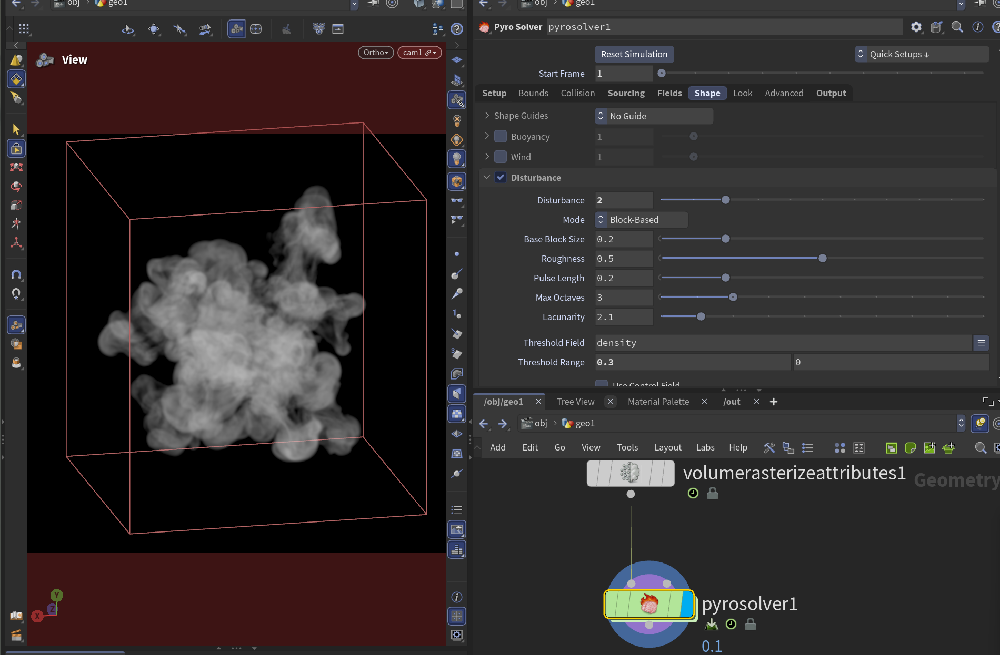

图 36：Disturbance 为 `2`，模式为 Block-Based，Threshold Field 为 `density`，Threshold Range 按界面顺序填写 **`0.3 → 0`**。

原记录中的“阈值调到 0～0.3”，是指这段密度范围；实际填写顺序要以截图为准。这里的 **`0.3 → 0` 是反向强度映射**：密度接近 `0` 时作用较强，增至 `0.3` 时作用降为 `0`。提高前一个值，可以让更多原本较浓的区域参与扰动。

| 参数 | 图 36 设置 | 补充说明 |
| --- | --- | --- |
| **Disturbance** | `2` | 控制局部扰动强度。 |
| **Mode** | `Block-Based` | 使用分块噪声模式。 |
| **Base Block Size** | `0.2` | 基础噪声块的空间尺度。 |
| **Roughness** | `0.5` | 控制后续噪声层的相对幅度。 |
| **Pulse Length** | `0.2` | 当前模式下噪声图案保持的时间长度。 |
| **Max Octaves** | `3` | 最多叠加三层噪声。 |
| **Lacunarity** | `2.1` | 控制相邻噪声层的块尺寸比例。 |
| **Threshold Field** | `density` | 按密度分布调节扰动作用。 |
| **Threshold Range** | `0.3 → 0` | 稀薄处作用强，密度达到 `0.3` 后不再施加此项扰动。 |

扰动与阈值映射规则参考 [SideFX 官方文档：Pyro Solver 的 Shape 设置](https://www.sidefx.com/docs/houdini/nodes/sop/pyrosolver.html#shape)。

重新模拟后，本次仍不容易看出细节变化，接下来分别检查**模拟网格精度**和**视口体积显示精度**。

### 16. 提高细节：减小体素并提高视口 3D 纹理上限

#### 减小求解器的 Voxel Size

在 **Pyro Solver → Setup** 中，将 **Voxel Size** 从 `0.1` 改为 **`0.05`**。网格变细后，可以表达更多局部变化。前面已建立体素参数引用，因此 Volume Rasterize Attributes 的 Voxel Size 也应同步变为 `0.05`。

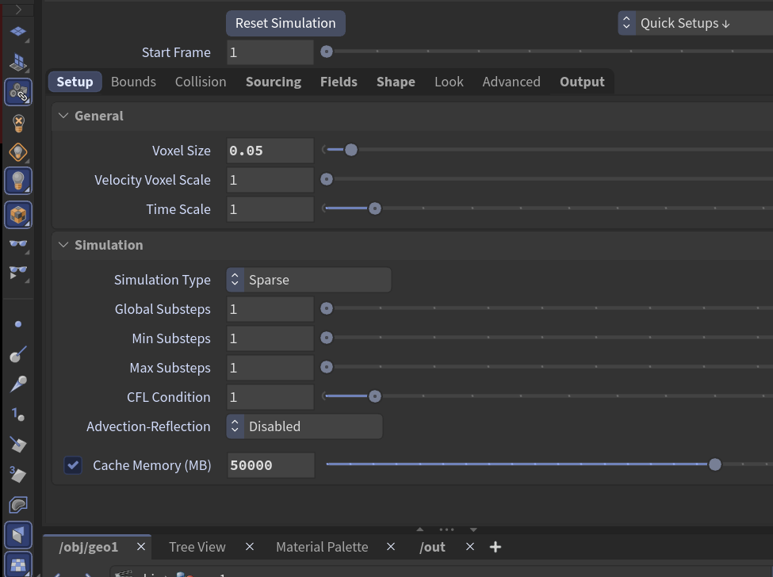

图 37：Voxel Size 为 `0.05`，Velocity Voxel Scale 与 Time Scale 都为 `1`。此图也确认 Cache Memory 已设为前面要求的 **`50000 MB`**。

| 模拟精度补充 | 说明 |
| --- | --- |
| **较大的体素** | 难以表达更小的扰动结构，即使提高扰动强度，也可能看不出预期细节。 |
| **减小体素** | 提高模拟空间分辨率，同时增加计算与内存需求。 |
| **参数引用检查** | 在求解器改为 `0.05` 后，确认体积转换节点仍通过引用读取该值。 |
| **重新计算** | 改变 Voxel Size 后需 Reset Simulation，从起始帧重算。 |

体素精度定义参考 [SideFX 官方文档：Pyro Solver 的 Setup 设置](https://www.sidefx.com/docs/houdini/nodes/sop/pyrosolver.html#setup)。

#### 将视口 3D 纹理分辨率上限从 256 提高到 1024

1. 将鼠标移到**场景视口**，按 **`D`** 打开 **Display Options**。
2. 切到 **Texture** 页签。
3. 找到 **3D Textures → Limit Resolution**。本次截图中已勾选，三个方向均为 `256`。
4. 保持 Limit Resolution 开启，将三个值改为 **`1024、1024、1024`**。
5. 点击 **Save As Default**，按本次操作保存为默认显示设置。
6. 关闭窗口，回到求解器，重算本轮已经修改过体素与扰动参数的模拟。

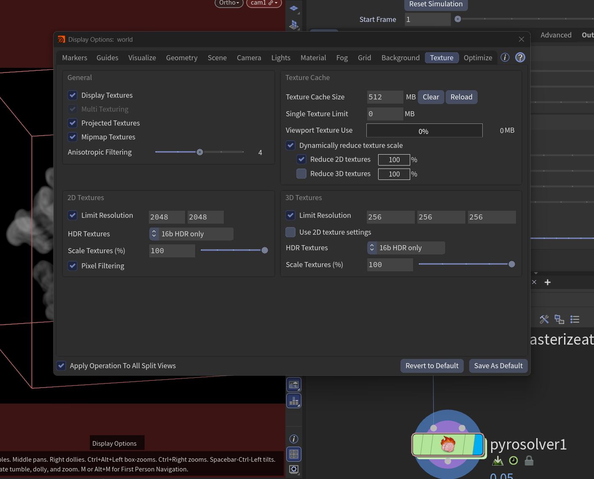

图 38：调整前，3D Textures 的 Limit Resolution 为 `256 × 256 × 256`。它控制体积在视口中的纹理显示上限。

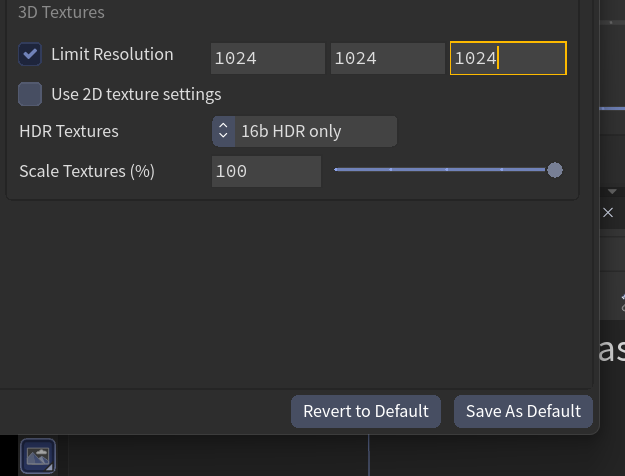

图 39：三个方向的上限都改为 `1024`，右下角为 Save As Default 按钮。

| 显示设置补充 | 说明 |
| --- | --- |
| **Limit Resolution** | 限制显示体积所用 3D 纹理的分辨率；提高上限可以减少显示降采样造成的细节损失。 |
| **上限与实际尺寸** | `1024³` 是上限，实际纹理大小取决于显示的数据；不会给原本较粗的模拟凭空增加细节。 |
| **显存影响** | 更高的 3D 纹理分辨率可能增加视口的显存占用。 |
| **刷新与重算** | 此限制针对新建的 3D 纹理。单独改变显示上限无需重新求解物理过程；本轮同时改了体素和扰动，因此重新模拟。 |
| **Save As Default** | 保存默认显示偏好，供后续视口使用。 |

显示限制说明参考 [SideFX 官方文档：Display Options 的 3D Textures 设置](https://www.sidefx.com/docs/houdini/ref/windows/displayopts_3d.html)。

#### 三种“分辨率”的区别

| 设置 | 本轮数值 | 控制对象 |
| --- | --- | --- |
| **摄影机 Resolution** | `1024 × 1024` | 输出画面的二维像素尺寸。 |
| **求解器 Voxel Size** | `0.05` | 模拟网格精度，数值越小网格越细。 |
| **视口 3D Textures → Limit Resolution** | `1024 × 1024 × 1024` | 体积在视口中的显示分辨率上限。 |

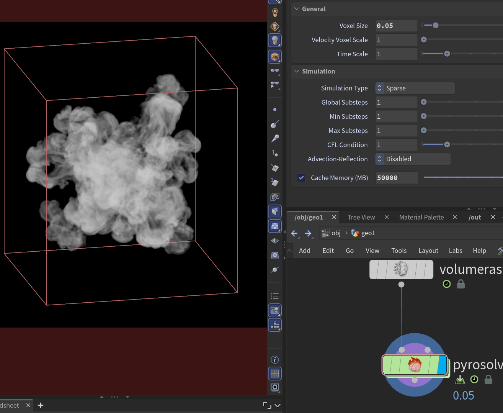

图 40：重新模拟后的烟雾预览，局部细节比此前更丰富。此轮同时调整了扰动、模拟体素和显示上限，最终观感体现了这些设置的共同影响。

### 17. 增强烟雾浓度：调整 Density 的 Source Value Scale

如果觉得烟雾浓度不够，可以回到 **Pyro Burst Source → Burst Components**，选择 Attribute 为 **Density** 的源组件，将 **Source Value Scale** 调大。例如从 `1` 改为 **`10`**，让密度源值按 10 倍缩放。

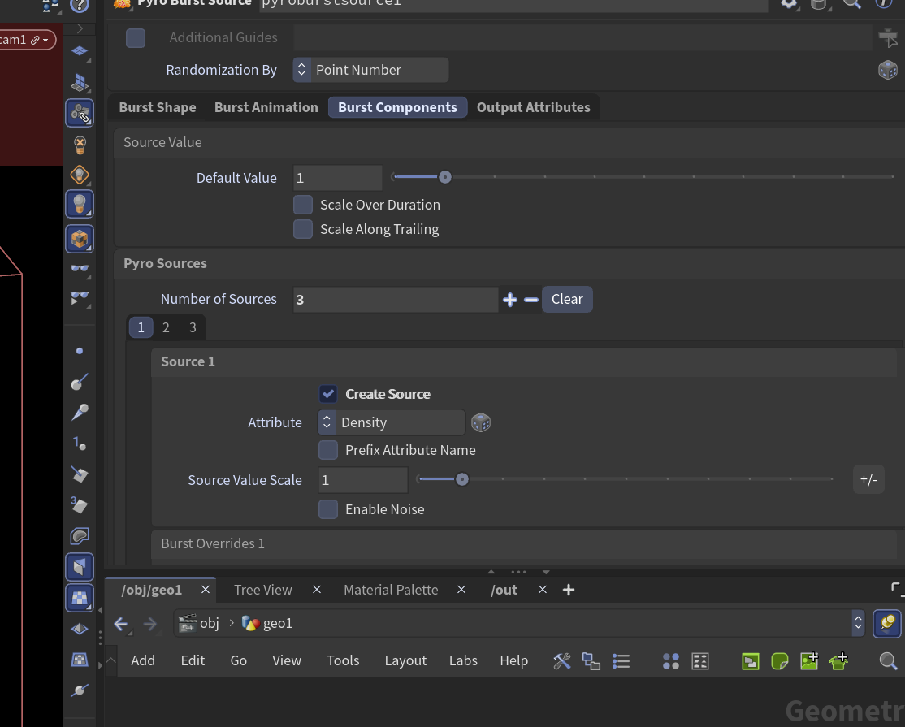

图 41：Density 组件中 Source Value Scale 的位置。截图记录的是调整前的 **`1`**；本次操作建议尝试 **`10`**。

| 设置细节 | 说明 |
| --- | --- |
| **调整对象** | Density 组件的 Source Value Scale，本次尝试 `1 → 10`。 |
| **Default Value** | 截图保持 `1`；它是多个源组件的全局缩放，本次只调整 Density 组件。 |
| **与前文控制场的关系** | 本例有使用 density 控制湍流和扰动的设置，提高源密度后，也应重新观察这些算子的作用范围。 |
| **重新计算** | 这是模拟上游的源值调整，需要重算后再保存新的缓存。 |

组件缩放定义参考 [SideFX 官方文档：Pyro Burst Source](https://www.sidefx.com/docs/houdini/nodes/sop/pyroburstsource.html#burst-components)。

### 18. Pyro Bake Volume 与 File Cache：保存正式模拟缓存

#### 添加 Pyro Bake Volume

烟雾形态基本满意后，继续准备后续外观处理。在 Geometry 内按 `Tab`，搜索并创建 **Pyro Bake Volume**，连接到求解器下游。

节点的准确名称是 **Pyro Bake Volume**，内部名称为 `pyrobakevolume`，对应操作记录中的“Pyrobackvolume”。本节先建立节点并缓存模拟，具体外观与输出参数后续再调整。

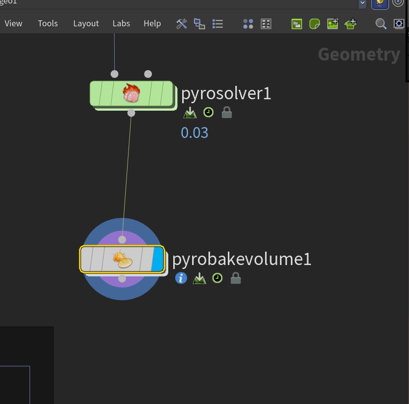

图 42：`pyrosolver1 → pyrobakevolume1`，求解器下方已显示体素大小 `0.03`。

| 节点分工补充 | 说明 |
| --- | --- |
| **Pyro Bake Volume** | 用于求解后的体积外观处理、视口显示与渲染准备。 |
| **File Cache** | 将逐帧体积数据保存到磁盘，并在后续直接读取。 |
| **素材输出** | 添加 Bake 节点和保存模拟缓存后，仍需另行设置摄影机渲染或贴图序列输出。 |

节点用途参考 [SideFX 官方文档：Pyro Bake Volume](https://www.sidefx.com/docs/houdini/nodes/sop/pyrobakevolume.html)。

#### 添加 File Cache，独立设置 1～50 帧

在后续烘焙与输出之前，先保存模拟缓存：

1. 搜索并创建 **File Cache**，将 Pyro Solver 的输出连接到它。
2. 在 **Sequence** 中将 **Evaluate As** 设为 **Frame Range**，保持 **Simulation** 勾选，按时间顺序计算模拟。
3. 检查 **Start/End/Inc**。本次新建时起止帧与时间轴范围有关联，截图中输入框呈浅蓝绿色。
4. 按住 **`Ctrl + Shift`**，鼠标左键点击对应参数标签，解除通道关联；也可以在对应参数上右键选择 **Delete Channels**。
5. 将 **Start / End / Inc** 分别设为 **`1 / 50 / 1`**，独立输出第 1～50 帧。

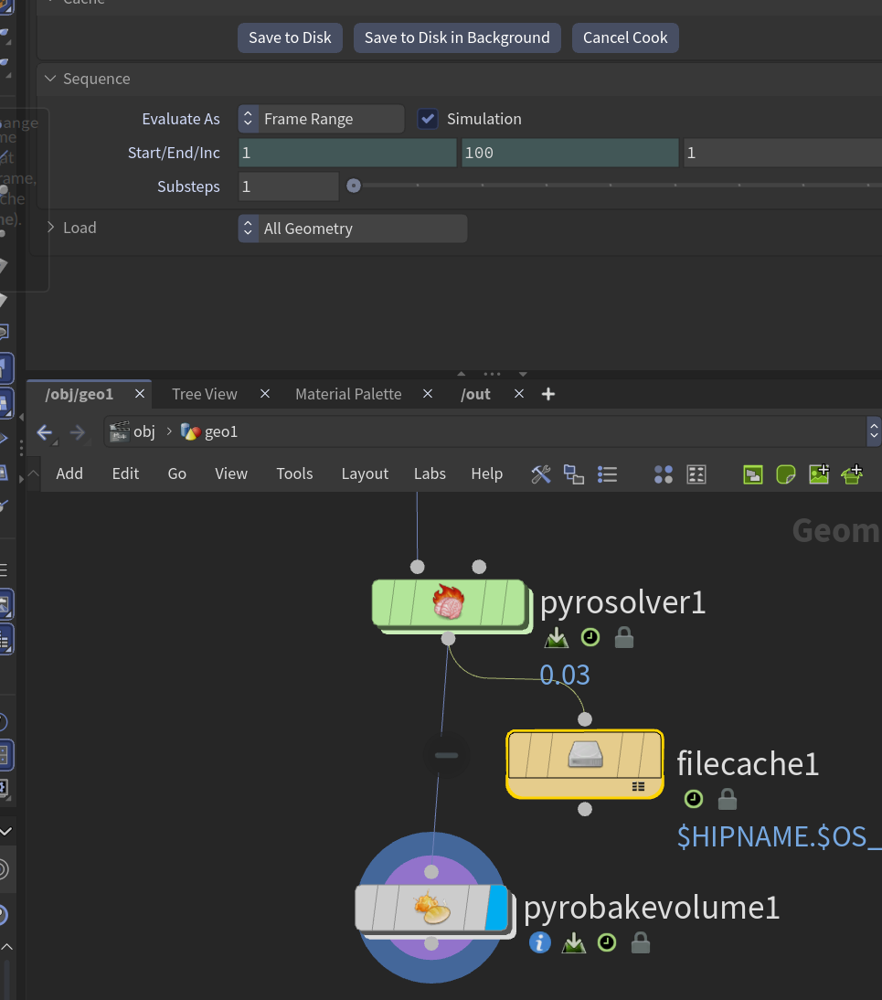

图 43：截图中帧范围仍为 **`1 / 100 / 1`**，是调整前状态；本次目标为 **`1 / 50 / 1`**。浅蓝绿色框记录了参数关联状态，可通过查看表达式确认。

解除参数引用的菜单方式参考 [SideFX 官方文档：Parameter references](https://www.sidefx.com/docs/houdini/network/copying.html)。

| File Cache 参数 | 本次目标或操作 | 补充说明 |
| --- | --- | --- |
| **Evaluate As** | `Frame Range` | 按帧范围输出。 |
| **Simulation** | 开启 | 本次 Pyro 模拟的后续帧依赖前面的计算结果。 |
| **Start / End / Inc** | `1 / 50 / 1` | 含首尾共 50 帧，逐帧保存。 |
| **Substeps** | `1` | 保留截图设置。 |
| **Time Dependent Cache** | 检查已开启 | 将动画保存为随帧变化的文件序列。 |
| **缓存路径与版本** | 保存前确认 | 先保存 `.hip` 场景，再核对缓存目录、文件名和版本；截图未展示完整路径。 |
| **Load from Disk** | 缓存完成后确认开启 | 从磁盘读取已保存数据，供下游继续使用。 |

#### 保存前最后确定体素大小

回到 **Pyro Solver → Setup → Voxel Size**，本次将体素大小由 `0.05` 进一步改为 **`0.03`**。同时确认 Volume Rasterize Attributes 仍通过参数引用同步读取此值。

**体素不是越小越好，应以目标素材的轮廓和观感为准。** 更细的体素能够表达更多细节，但过于细碎的形态也可能偏离需要的效果。本次最终尝试 `0.03`，而非将其作为所有素材的固定标准。

#### Save to Disk：写入磁盘并交给下游读取

确认密度、体素大小、缓存路径及 `1～50` 帧范围后，重置模拟，点击 File Cache 中的 **Save to Disk**，计算并写出缓存。完成后检查文件序列与 **Load from Disk** 状态。

图 43 中，File Cache 是从求解器引出的分支，Pyro Bake Volume 仍直接连接求解器。**要让后续外观处理使用已保存的缓存，需要将 Bake 的输入改接 File Cache 输出。** 推荐后续连接关系如下：

```text
Pyro Burst Source
    ↓
Volume Rasterize Attributes
    ↓
Pyro Solver                     Voxel Size = 0.03
    ↓
File Cache                      帧范围 1 / 50 / 1，保存后读取磁盘
    ↓
Pyro Bake Volume
    ↓
后续摄影机渲染／贴图序列输出
```

| 缓存使用补充 | 说明 |
| --- | --- |
| **Cache Memory 与 File Cache** | 前者是模拟内存缓存上限，后者明确将数据写到磁盘。 |
| **Save to Disk** | 按当前路径和帧范围保存数据；按钮本身不表示已经完成素材渲染。 |
| **后续修改上游** | 关闭 Load from Disk，重算并保存新的缓存版本，再切回磁盘读取。 |
| **修改下游外观** | 在 File Cache 下游调整 Pyro Bake Volume，可以复用已有模拟数据。 |

缓存序列、Simulation 与磁盘读写说明参考 [SideFX 官方文档：File Cache](https://www.sidefx.com/docs/houdini/nodes/sop/filecache.html)。

### 19. 接入磁盘缓存，关闭求解器内存缓存并挑选片段

#### 将 File Cache 接到 Pyro Bake Volume 上游

缓存保存完成后，确认 File Cache 的 **Load from Disk** 已开启，再将 **File Cache 的输出连接到 Pyro Bake Volume 的输入**，让后续外观处理读取已保存的体积数据。

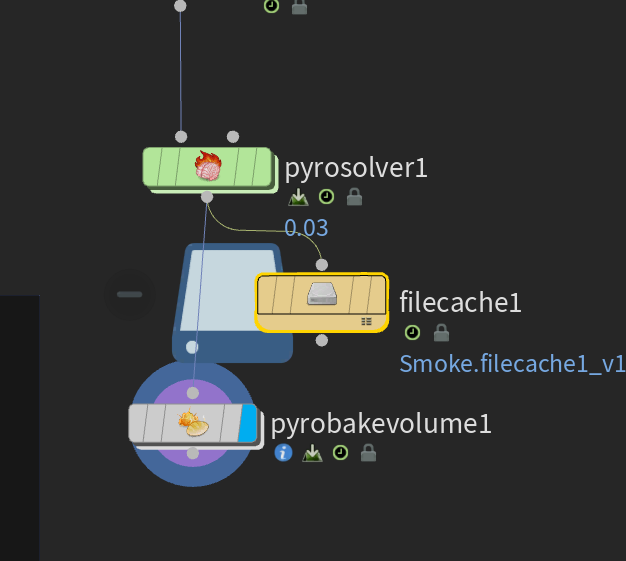

图 44：改接前的状态，File Cache 位于求解器分支，Pyro Bake Volume 仍有直接读取求解器的连接。

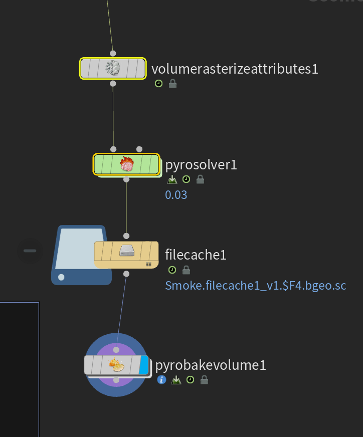

图 45：改接完成，连接关系为 `Pyro Solver → File Cache → Pyro Bake Volume`。截图中的缓存序列名为 `Smoke.filecache1_v1.$F4.bgeo.sc`。

#### 关闭不再需要的模拟历史缓存

已经可以从磁盘读取结果后，回到 **Pyro Solver → Setup**，取消勾选 **Cache Memory (MB)** 左侧的复选框，关闭求解器的模拟历史内存缓存。

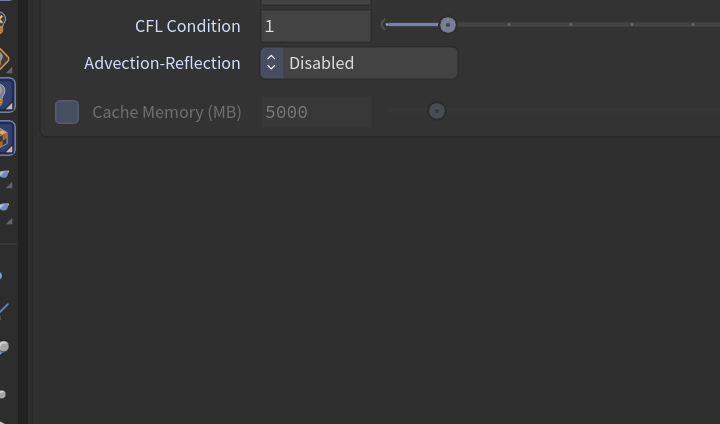

图 46：Cache Memory 已关闭，灰色框仍显示 `5000`，该值在开关关闭时不生效。

| 缓存与内存补充 | 说明 |
| --- | --- |
| **当前数据来源** | File Cache 开启 Load from Disk，按需读取已保存的文件。 |
| **关闭的缓存** | 求解器为回看模拟历史状态保留的内存缓存。 |
| **仍需使用的内存** | 加载体积、处理外观和显示／渲染仍会使用内存；关闭缓存不代表所有内存立即释放。 |
| **已有占用仍很高时** | 保存场景，正常退出并重新打开，再从磁盘缓存继续工作。 |

缓存开关与磁盘读取参考 [Pyro Solver](https://www.sidefx.com/docs/houdini/nodes/sop/pyrosolver.html) 和 [File Cache](https://www.sidefx.com/docs/houdini/nodes/sop/filecache.html) 官方文档。

#### 预览并选择需要的片段

播放磁盘缓存，挑选轮廓与变化节奏合适的部分。本次选择 **第 `15～38` 帧**，作为后续 Flipbook 的源片段；它位于前面已保存的 `1～50` 帧缓存范围内。

### 20. Labs Flipbook Textures：设置摄影机、体积路径与图集尺寸

#### 切换到 OUT 层级并创建节点

1. 在网络编辑器的层级菜单中切换到 **`/out`**。
2. 按 `Tab`，搜索 **`flipbook_textures`**，创建 **Labs Flipbook Textures**，例如命名为 `flipbook_textures1`。
3. 打开 **Render Intermediate Images** 页签，设置源片段和渲染输入。

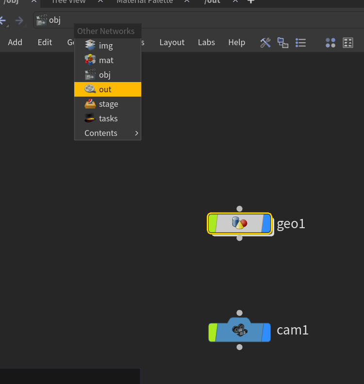

图 47：在 Other Networks 菜单中选择 out。摄影机仍位于 `/obj`，通过节点路径指定给渲染节点。

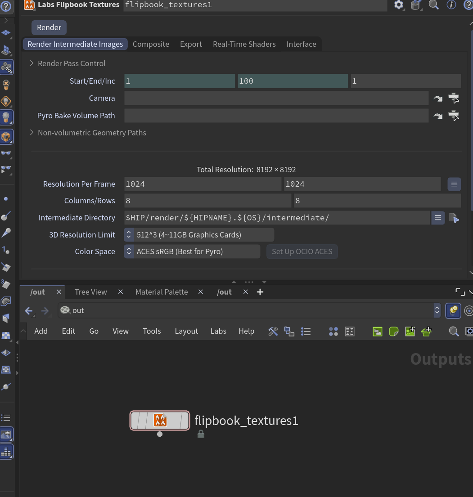

图 48：新建节点时的界面，尚未配置摄影机和体积路径；本图显示帧范围 `1～100`、单帧 `1024²`、布局 `8×8`，后续按本次素材需要修改。

#### 设置 15～38 帧与摄影机

解除 **Start/End/Inc** 的帧范围关联，方法同前面的 File Cache：使用 `Ctrl + Shift + 鼠标左键` 点击对应参数标签，或右键选择 **Delete Channels**，再填写 **`15 / 38 / 1`**。

将 **Camera** 指向之前在 OBJ 层级创建的摄影机：

```text
/obj/cam1
```

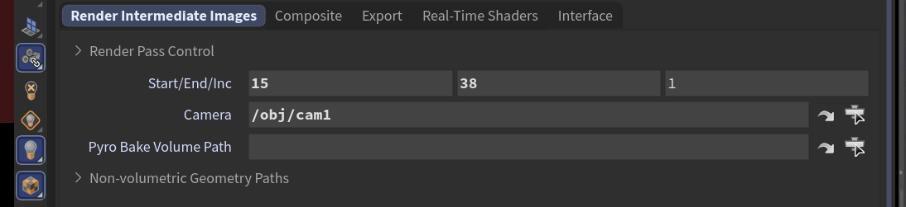

图 49：Start/End/Inc 为 `15 / 38 / 1`，Camera 为 `/obj/cam1`。

#### 填写 Pyro Bake Volume Path

将之前的 `pyrobakevolume1` 节点路径复制到 **Pyro Bake Volume Path** 中；也可以使用右侧的节点选择按钮指定。本例完整路径为：

```text
/obj/geo1/pyrobakevolume1
```

这里填写节点路径，无需在 OUT 网络中复制一份体积节点。

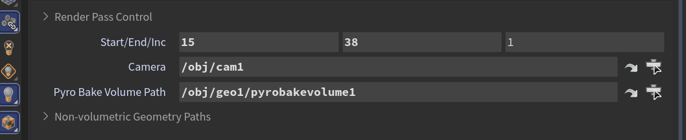

图 50：摄影机和体积路径均已填写。若实际节点改名或位于其他 Geometry 内，应选择相应的实际路径。

#### 单帧 512×512、4×4 布局与 Gamma 2.2

将 **Resolution Per Frame** 设为 **`512 × 512`**，**Columns/Rows** 设为 **`4 / 4`**。图集共有 16 格，宽高分别为 `512 × 4`，因此总分辨率为 **`2048 × 2048`**。

在 **Color Space** 中选择 **Gamma 2.2 (Houdini Default)**，保持本次颜色处理流程。


图 51：Total Resolution 显示 `2048 × 2048`。截图中的提示说明：Gamma 2.2 模式先在线性空间渲染，再在合成阶段应用 Gamma。

| 参数 | 本次设置 | 补充说明 |
| --- | --- | --- |
| **Start/End/Inc** | `15 / 38 / 1` | 选择要渲染的源帧范围。 |
| **Camera** | `/obj/cam1` | 此阶段为前面建立的正交摄影机；后续排错改用透视测试摄影机 `/obj/camtest`，按实际输出节点路径选择。 |
| **Pyro Bake Volume Path** | `/obj/geo1/pyrobakevolume1` | 选择从磁盘缓存读取数据的 Bake 节点。 |
| **Resolution Per Frame** | `512 × 512` | 单帧／单格的渲染尺寸；可与摄影机的 `1024²` 不同，保持一致宽高比即可。 |
| **Columns/Rows** | `4 / 4` | 图集格子布局，总计 16 格。 |
| **Total Resolution** | `2048 × 2048` | 按单格尺寸与行列数计算的总尺寸。 |
| **3D Resolution Limit** | `512³` | 本次节点的体积显示上限设置，独立于前面手动视口的上限。 |
| **Color Space** | `Gamma 2.2 (Houdini Default)` | 本次采用的颜色空间选项。 |
| **Intermediate Directory** | `$HIP/render/${HIPNAME}.${OS}/intermediate/` | 保存中间渲染图像的目录，后续合成使用这些图像。 |

输入路径、分辨率和颜色空间含义参考 [SideFX 官方文档：Labs Flipbook Textures](https://www.sidefx.com/docs/houdini/nodes/out/labs--flipbook_textures-1.0.html)。

#### 源帧数与图集格数：导出前核对

本次截图同时记录了 **`15～38` 帧**与 **`4×4` 布局**：含首尾的源片段共有 **24 帧**，图集只有 **16 格**。已核对本机 SideFX Labs 22.0 中 `labs::flipbook_textures::1.0` 的节点定义：它通过隐藏的 **Start/End/Inc Internal（f）** 将实际结束帧限制在图集容量内。

```text
实际结束帧 = min(填写的结束帧, 起始帧 + (列数 × 行数 - 1) × 步长)
本例       = min(38, 15 + (4 × 4 - 1) × 1)
           = 30
```

因此，本机该节点在 **`15 / 38 / 1`、`4×4`** 设置下实际使用 **`15～30` 帧**，`31～38` 帧超出图集容量而不进入本次输出；不会自动把整段均匀抽样为 16 帧。

| 目标 | 需要核对或调整的内容 |
| --- | --- |
| **保持截图的 2048²、4×4 目标** | 步长为 1 时实际使用 `15～30` 共 16 帧；若要保留到第 38 帧，可将起始帧改为 `23`，使用 `23～38`。 |
| **完整保留 24 个源帧，每帧一格** | 可改为 4 列 6 行，单格 512² 时总尺寸为 `2048 × 3072`。 |
| **采用 4×4 且逐帧对应** | 另选 16 个连续源帧，例如 `15～30`；这属于替代方案，本次记录仍保留截图的 `15～38`。 |
| **最终导出尺寸** | 还应核对 Composite 页签各类贴图的 Export Resolution，避免它覆盖预期的总尺寸。 |

内部帧范围表达式核对自本机 `SideFXLabs22.0/otls/SideFX_Labs.hda` 中的 `labs::flipbook_textures::1.0` 参数定义；自定义或其他版本的资产应以实际定义为准。

### 21. Export：选择颜色与运动向量／法线贴图并渲染

切换到 **Export** 页签，按截图保留首尾两个输出，取消勾选中间三个：**启用 Output Texture 1、5，关闭 Output Texture 2、3、4**。


图 52：输出颜色贴图与运动向量／法线打包贴图。Export Directory 使用 `$HIP/render/${HIPNAME}.${OS}/`，Asset Name 使用 `${OS}`。

| 输出项 | 本次状态 | 文件后缀 | 截图中的 RGBA 通道内容 |
| --- | --- | --- | --- |
| **Output Texture 1** | 开启 | `_FC.png` | `FinalColor.r / FinalColor.g / FinalColor.b / FinalColor.a`。 |
| **Output Texture 2** | 关闭 | `_ECD.png` | `Emissive.r / Emissive.g / Emissive.b / Depth`。 |
| **Output Texture 3** | 关闭 | `_MDC1.png` | `MDC1.r / MDC1.g / MDC1.b / MDC1.a`。 |
| **Output Texture 4** | 关闭 | `_MDC2.png` | `MDC2.r / MDC2.g / MDC2.b / MDC2.a`。 |
| **Output Texture 5** | 开启 | `_MVN.png` | `MotionVector.r / MotionVector.g / Normal.r / Normal.g`。 |

确认路径、片段、图集布局与输出项后，点击节点顶部 **Render**，等待渲染、合成和导出完成，再到 Export Directory 检查输出贴图。

| 导出细节补充 | 说明 |
| --- | --- |
| **Render** | 执行渲染、合成与导出流程；不等同于只把已有结果写到磁盘。 |
| **Export 与渲染通道** | 关闭 Output Texture 2～4 只控制最终文件输出；需要减少中间通道计算时，应另查 Render Pass Control 及保留输出所需的通道。 |
| **运动向量／法线** | 第 5 张贴图包含数据通道；Color Space 的颜色设置不能直接理解为对所有数据通道统一加 Gamma。 |
| **检查输出** | 查看 `_FC.png` 的颜色和透明度、`_MVN.png` 的通道内容、实际尺寸以及动画格子的时间顺序。 |

渲染流程与输出通道参考 [Labs Flipbook Textures 官方说明](https://www.sidefx.com/docs/houdini/nodes/out/labs--flipbook_textures-1.0.html)。本节记录最初的 PNG 配置；成功输出及 TGA 重打包见下一节，实际崩溃处理见第 24 节。

### 22. 渲染完成：检查 PNG，重打包通道并导出 TGA

#### 在 render 文件夹检查输出

等待渲染、合成和导出完成后，打开 **Export Directory** 指定的目录。默认路径为：

```text
$HIP/render/${HIPNAME}.${OS}/
```

其中 `$HIP` 是 Houdini 工程文件所在目录，`${HIPNAME}` 是工程名，`${OS}` 是当前输出节点名。本机工程为 `F:/study/Houdini/Smoke/Smoke.hip`，节点名为 `flipbook_textures1`，对应目录为：

```text
F:/study/Houdini/Smoke/render/Smoke.flipbook_textures1/
```

此处的 render 属于 Houdini 工程目录，不是 UE 项目的目录。首次成功导出可看到 `flipbook_textures1_FC.png` 和 `flipbook_textures1_MVN.png`。


图 53：已输出的两张 PNG。文件缩略图可用于初步确认，具体通道仍应在图像查看器中单独查看。


图 54：修改前，Texture 1 为完整 FinalColor RGBA，Texture 5 为运动向量与法线打包。

#### 将文件格式改为 TGA，按用途重打包通道

本次烟雾在 UE 中只需要一份灰度明暗信息和一份透明度，可以将 **Output Texture 1** 改为下面的通道布局。这里是针对本素材的打包约定，不适用于需要保留完整彩色 RGB 的素材。

| 输出贴图 | 文件名示例 | R | G | B | A |
| --- | --- | --- | --- | --- | --- |
| **Output Texture 1** | `flipbook_textures1_FC.tga` | `FinalColor.r`，灰度明暗来源 | `FinalColor.a`，透明度／遮罩 | `Set to 1`，常量 1 | `FinalColor.a`，截图中继续保留透明度 |
| **Output Texture 5** | `flipbook_textures1_MVN.tga` | `MotionVector.r` | `MotionVector.g` | `Normal.r` | `Normal.g` |

具体操作：

1. 在 **Export** 页签保留 **Output Texture 1、5**，关闭 **2、3、4**。
2. 将启用的两条输出路径末尾由 `.png` 改为 `.tga`，保留前面的目录和命名表达式。
3. Texture 1 的 **R 保持 FinalColor.r**，**G 改为 FinalColor.a**，**B 改为 Set to 1**；A 按截图继续保持 FinalColor.a。
4. Texture 5 的通道布局保持不变。


图 55：Texture 1 已改为 `_FC.tga`，G 存透明度，B 固定为 1；A 也保留相同透明度。Texture 5 已改为 `_MVN.tga`，原有数据通道不变。

**“只需要 R 和 Alpha”指需要两类有效信息，不代表本次文件只含两个通道。** 截图中的 TGA 仍按 RGBA 输出，透明度同时存在 G 和 A。后续材质可按本次约定从 G 读取透明度；不能再将打包后的 RGB 直接当作普通彩色贴图使用。

#### 只重新导出，不重复渲染

如果摄影机、帧范围和渲染内容没有变化，中间图像仍然有效，本次只改了文件格式和通道打包，直接点击 **Export All Textures** 即可。它会合成、打包并写出当前启用的贴图，无需重新计算烟雾或重新渲染各个中间通道。


图 56：目录中保留 `intermediate`、原来的两张 PNG，以及新导出的两张 TGA。导出 TGA 不会自动删除原 PNG；Windows 未显示 TGA 缩略图本身不代表文件导出失败。

| 按钮／操作 | 适用情况 |
| --- | --- |
| **Render / Render All Passes** | 取景、源片段或渲染内容改变，需要重新生成中间图像。Render 还会继续执行导出。 |
| **Export All Textures** | 中间图像有效，只更改格式、打包或合成设置，重新导出当前启用的所有贴图。 |
| **Tex 1 / Tex 5** | 仅导出对应的一张贴图，便于分开检查。 |
| **更改摄影机或投影** | 必须重新渲染所需通道，不能仅重新导出，也不能混用旧摄影机下的颜色、法线或运动向量。 |

### 23. 将两张 TGA 导入 UE

回到 UE，在 **Content Browser（内容浏览器）** 中打开目标素材目录，通过 **Import** 选择两张 TGA，或将文件直接拖入内容浏览器，再保存生成的 Texture 资产。

| 导入文件 | 本次保存的信息 | 后续使用时注意 |
| --- | --- | --- |
| **`*_FC.tga`** | R 为灰度明暗，G 为透明度，B 为 1，A 也为透明度。 | 按通道连接材质；它已是打包贴图，不能只根据 `_FC` 后缀当作普通 RGB 颜色。 |
| **`*_MVN.tga`** | RG 为运动向量，BA 为两路法线信息。 | 不要直接按普通 RGB 法线贴图解释；需匹配 Labs 的编码和材质解码方式，检查导入压缩是否保留所需通道。 |

导入后核对贴图尺寸、Alpha 与各通道是否保留，以及两张图集是否具有一致的行列布局和时间顺序。颜色空间、压缩与采样设置应结合后续材质逐项确定；文件名和 TGA 格式本身不会自动完成这些配置。

本节先记录文件导入步骤；Niagara 播放、材质连接和运动向量解码在后续制作中继续补充。

**后续检查补充：**本机 FC 曾被 UE 识别为 Normalmap (BC5)，MVN 也曾出现 RG 只有一片黄色。前者是 UE 导入设置，后者经源文件检查确认缺少运动向量变化，不能混为同一问题。具体排查与恢复过程见第 25 节。

### 24. 本机渲染问题排查记录与最终处理

本节记录本次 Houdini FX **22.0.459 / Python 3.13** 的排查过程。区分实际验证结果、日志证据与推断；不把单机表现写成所有版本都存在的限制。

#### 缓存阶段：SHFS 提示、启动窗口报错与内存压力


图 57：提示正在查找 `F:/Program Files/Side Effects Software/shfs`。检查发现 SHFS 安装位置与提示查找位置不一致，应通过 Launcher／安装器检查路径并验证 SHFS 文件。

| 现象或检查 | 记录与处理边界 |
| --- | --- |
| **SHFS not currently installed** | 表示对应运行环境配置存在问题，不能单凭此提示认定电脑性能不足，也不能直接证明它导致后面的 Depth 崩溃。参考 [SHFS 官方说明](https://www.sidefx.com/docs/houdini/ref/shfs.html)。 |
| **启动脚本 `main_win.windowHandle()` 报 NoneType** | 堆栈位于启动窗口的 Qt 界面初始化。可关闭启动时显示 Start Here 窗口作隔离测试；尚未确认它与后面的渲染崩溃同因。 |
| **求解器 Cache Memory = 50000 MB** | 本机物理内存约 32 GB，此值只是教程阶段记录，不适合作为本机通用推荐值。此前检查曾看到系统提交内存接近上限，资源压力值得单独处理。 |
| **磁盘缓存完成后** | 确认 File Cache 开启 Load from Disk，Bake 读取 File Cache；关闭不需要的求解器历史缓存。必要时正常退出并重开工程，从磁盘缓存继续，见第 19 节。 |

#### 摄影机：主视口放大，输出图集中的烟雾却始终偏小

本次正交摄影机调整 Ortho Width 后，主视口已经明显裁切烟雾，但 Labs 图集中的烟雾占比仍然偏小。检查过 Camera 路径与方形宽高比；不能仅通过提高摄影机分辨率来改变烟雾占画面的比例。


图 58：主视口已放大，实际输出却未同步反映同等取景变化。这不是“正交摄影机必须靠向前移动来放大”的问题。

**已验证的处理：改用 Perspective（透视）摄影机。** 先做单帧测试，取景拉近后烟雾能占据大部分画面，拉远后也能正常缩小，再以固定构图输出整段。


图 59：透视测试得到的 512×512 单帧。后续单帧拉远测试也能正常改变画面占比。

| 问题 | 本次结论 |
| --- | --- |
| **是否因为在 OBJ 创建摄影机？** | 不能据此归因。当前 Labs 资产要求对象级 `cam`，OBJ 相机是有效输入。 |
| **调整时用 Link 还是 Lock？** | 用 **Link Camera/Light to View** 让导航修改相机；**Lock Camera/Light Tumbling** 会阻止常规摄影机导航，见第 14 节。 |
| **正交画面如何改变占比？** | 调整 **Ortho Width**；透视摄影机则可通过距离、焦距等调整。像素分辨率与主体占比是不同问题。 |
| **根因是否已确认？** | 怀疑 Labs 使用的浮动视口与正交摄影机状态同步存在兼容问题；这是结合本机脚本和对照测试的推断，尚未由官方确认。 |
| **是否只能用透视制作特效？** | 本机当前流程用透视绕过问题；Houdini 并非不能渲染正交图像。两种投影影响画面内容，不会自动改变图集格数、尺寸与通道布局。 |
| **切换投影后** | 重新渲染所有保留通道，颜色、运动向量、法线使用同一套摄影机和帧范围。 |

#### 帧范围与图集容量：不要误以为会自动均匀抽样

本机 Labs 定义会按图集容量限制实际结束帧，具体公式见第 20 节。`4×4`、步长为 1 时最多放 16 个连续源帧：

| 输入帧范围 | 含首尾的帧数 | 本机 4×4、步长 1 的实际输出 |
| --- | --- | --- |
| `15～38` | 24 | `15～30` |
| `21～38` | 18 | `21～36` |
| `18～35` | 18 | `18～33` |
| `23～38` | 16 | `23～38` |

先确定要保留的动作片段，再统一核对帧数与格数。超出容量的尾帧不会被本机该版本自动均匀采样进去。

#### 渲染末尾反复崩溃：Depth 通道与 Vulkan 路径


图 60：Fatal Error 中的 `crash.Smoke.shiheng_17496.hip` 是崩溃时保存的恢复工程，不是“图集已经导出成功”的通知。

两次读取到的崩溃日志都进入以下路径：

```text
RV_Instance::getExt
DM_RenderVulkan::resizeTransparentBuffer
DM_RenderVulkan::renderHeadlight / renderLighting
ROP_OpenGL.dll
```

其中一次记录显示：Final Color、Non-emissive Color、MDC、Surface Normal 已完成，Motion Vector 在 **2026-10-28 21:39** 完成；之后的 Depth 没有完成记录。结合本机节点脚本的执行顺序与 OpenGL ROP 堆栈，证据指向最后的 Depth 渲染环节。


图 61：排查阶段截图。Depth 当时仍为 OpenGL ROP；最终处理应将这一行左侧菜单改为 **Skip This Pass**，本图不是已跳过后的状态。

**本次最终验证：更新显卡驱动后问题仍存在；将 Depth 设为 Skip This Pass 后，本次图集成功输出，见图 53～56。**

操作路径为 **Labs Flipbook Textures → Render Intermediate Images → Render Pass Control → Render Depth 左侧菜单 → Skip This Pass**。当前保留的 Texture 1（灰度／透明度）与 Texture 5（运动向量／法线）没有使用 Depth；Texture 2 中的深度输出也已关闭，因此本次可跳过该通道。若后续材质需要深度贴图，应另外解决深度渲染流程。

| 排查项 | 本次得到的结论 |
| --- | --- |
| **更新显卡驱动** | 用户已尝试，未解决此处崩溃，不能继续当作已验证修复。 |
| **跳过 Depth** | 本次成功绕过崩溃；这是流程上的处理，不代表底层问题已修复。 |
| **Export 关闭中间三个输出** | 只控制最终文件，不等于跳过中间通道。真正跳过渲染需在 Render Pass Control 设置。 |
| **Vulkan 与 OpenGL 名称** | 官方说明 Houdini 22 的 OpenGL ROP 实际已使用 Vulkan，且已弃用、建议迁移到 Flipbook ROP；名称与日志并不矛盾。 |
| **是否证明显卡损坏或显存不足？** | 没有。当前日志只能定位相关渲染路径，不能单凭函数名判断硬件损坏，也没有本次崩溃瞬间显存耗尽的测量证据。 |

版本行为参考 [OpenGL ROP 官方说明](https://www.sidefx.com/docs/houdini/nodes/out/opengl.html)。迁移到新版 Flipbook ROP 是官方方向，但并非当前 Labs Depth 菜单中的直接替换选项，需要调整流程并验证输出。

#### 崩溃后继续工作：区分模拟缓存、中间图像和最终贴图

| 已有数据／按钮 | 能复用什么，不能代表什么 |
| --- | --- |
| **File Cache 的磁盘序列** | Load from Disk 开启且文件完整时可免于重算流体；不代表各个图像通道已渲染。 |
| **`intermediate/*.pic.gz`** | 已渲染的通道图像，可供合成和导出复用；需检查预览、帧段及内容，文件存在或尺寸较小都不能单独证明有效或无效。 |
| **最终 PNG／TGA** | 检查对应文件实际生成、可打开且通道正确，才确认需要的贴图已输出。 |
| **顶部 Render** | 会重新执行未跳过的通道，再导出；不是自动从崩溃位置续跑。 |
| **Export All Textures / Tex 1 / Tex 5** | 在所需中间图像完整且配置匹配时，只重新合成和导出；使用第 22 节的步骤。 |

#### 相似公开案例：提供线索，不当作同一 Bug 的确认

| 来源 | 他人记录与处理 | 与本机的关系 |
| --- | --- | --- |
| [开发者技术文档：sheet_child](https://healkeiser.github.io/fxhoudinimcp/2.23.0/technical/sheet_child/) | 记录 Houdini 22.0.368 同一 hython 进程第二次执行 OpenGL ROP 会段错误；每次用新进程在主线程渲染一次后退出。 | 相似的 Houdini 22／OpenGL ROP 崩溃，但未说明是 Labs Depth，也未核对相同堆栈；本机未验证该方法。 |
| [SideFX 论坛：Vulkan／Flipbook ROP 崩溃](https://www.sidefx.com/forum/topic/97655/lofi/?page=2) | 2024-10-03 官方回复，旧版本的相关问题已在当时 build 347 修复，并建议使用含更多视口修复的 build 370。 | 说明有些渲染问题需要更新 Houdini 本体；不是 22.0.459 对应修复版本的证明。 |
| [Labs Flipbook 官方文档](https://www.sidefx.com/docs/houdini/nodes/out/labs--flipbook_textures-1.0.html) | 3D Resolution Limit 过高可能因显存不足崩溃；Warmup Time 可帮助大型数据加载，并可能避免部分崩溃。 | 属于通用资源缓解方向，不能写成本机 Depth 问题的确定原因或已验证修复。 |

### 25. MVN 的 RG 一片黄：从通道检查到运动向量重新导出

#### 现象与结论：FC 导入设置、MV 数据缺失是两个问题

导入 UE 后，FC 与教程颜色明显不同；MVN 只显示 RG 时是一整片黄色，而显示 BA 时能看到纹理。本轮针对这两个问题分别排查，最后恢复了 MVN 的运动纹理。


图 62：当前打开的是 FC，但压缩设置为 Normalmap (BC5)、纹理组为 WorldNormalMap。不能用普通法线导入设置处理本次 FC 通道打包贴图。


图 63：修改压缩为 Default 后，MVN 的 RG 仍没有变化，说明不能仅通过 UE 导入设置恢复原文件中缺失的运动信息。


图 64：本机与教程均能从 BA 看到变化。通道组合预览含透明度混合，不等同于直接显示一张完整 RGB 法线图。

| 部分 | 信息含义 | 本次检查结果 |
| --- | --- | --- |
| **FC** | 本次 R 为灰度明暗，G/A 为透明度，B 为 1。 | 直接读取 TGA，R/G/A 有变化、B 固定为 255，符合设置；UE 曾误按法线压缩处理。 |
| **MVN 的 RG** | 屏幕／贴图空间的二维运动向量，包含方向和位移大小，并非单纯的世界空间流体方向。 | 修复前 TGA 全图为 `(128, 128)`；在当时的标准 8 位重映射编码下接近零位移，没有有效运动纹理。 |
| **MVN 的 BA** | 两路法线信息，供匹配的材质重建法线。 | 修复前已有变化；不能因 RG 异常就认定整张 MVN 没有数据。 |

FC 先按教程将 **Compression Settings 改为 Default、Texture Group 改为 World**，并对照教程开启 sRGB 检查外观。它的 B 固定为 1，若要比较黄绿色的 RG 组合，应关闭 B 预览。FC 的颜色处理应与后续材质约定一致，不要把这一设置直接套给 MVN。

**MVN 是数据贴图，应关闭 sRGB，并保留所需 RGBA 通道。** 普通 Normalmap BC5 不适合本次 RG=运动向量、BA=法线的打包方式，因为它不保留完整的原始 RGBA。运动向量编码与材质解码也必须一致。参考 [Epic 纹理压缩说明](https://dev.epicgames.com/documentation/unreal-engine/texture-compression-settings?application_version=4.27) 与 [Labs Motion Vector 编码说明](https://www.sidefx.com/docs/houdini/nodes/out/labs--flipbook_textures-1.0.html#motion-vector)。

#### 先检查磁盘缓存，避免误把速度缺失当成根因

只读检查已保存的第 20 帧缓存，确认包含 `density、temperature、flame、vel.x、vel.y、vel.z`。速度分量有明显非零范围：

| 第 20 帧字段 | 最小值（约） | 最大值（约） |
| --- | --- | --- |
| **vel.x** | `-23.29` | `22.13` |
| **vel.y** | `-28.00` | `28.73` |
| **vel.z** | `-28.13` | `24.83` |

保存的工程中，Pyro Solver 的速度场导出也是开启的。因此，本次不能直接归因于“没有保存速度”，也不必先重算整段烟雾。此前关闭的是爆发源的初始 Velocity，不能据此认定求解器湍流产生的速度也为零。

#### 在视口显示运动向量：Wrangle 必须使用 Detail

最初在 Pyro Bake Volume 后接 Attribute Wrangle，填写：

```c
i@volvis_normals = 0;
i@volvis_motionvec = 1;
```

**Run Over 必须为 Detail (only once)**，因为这两个是控制体积显示的 Detail 属性。若使用 Points，它们只会成为点属性，不会按预期切换体积显示模式。


图 65：Run Over 仍为 Points，表格中每个点都有数值，但视口仍是普通白色烟雾。


图 66：Detail 设置正确后，视口变黑。本次只是进入了显示模式，尚未得到可见的运动纹理。

#### 对照测试：转换速度场、绕过 Bake、保持同一摄影机

在 File Cache 与 Bake 之间加入 **Labs VDB Transform Properties**，将三个标量速度场合并为向量 VDB `vel`：

| 参数 | 本次设置 |
| --- | --- |
| **Source Field** | `vel` |
| **Vector Field Type** | `Displacement/Velocity/Acceleration` |
| **Remove Source Scalar VDBs** | 开启 |
| **Output Motion Vector Visualization** | 关闭，由末端 Wrangle 控制显示 |


图 67：单独转换速度场格式未解决问题。只读检查第 21 帧临时网络，转换和 Bake 后都仍保留 `vel` VDB，且没有节点错误。

接着让 Wrangle 临时直接读取 VDB Transform Properties，绕过 Bake，此时出现了运动向量颜色。由于这次操作同时从摄影机切到了 No cam，又将视口切回 **同一台 camtest** 做对照，仍能看到红绿变化。


图 68：保持第 21 帧，从 camtest 查看仍正常，问题范围缩小到经过 Bake 时的显示配置／材质绑定，不能直接认定是摄影机或整个 Vulkan 功能不可用。

#### 接回 Bake：恢复显示字典仍不足，清除材质绑定后恢复

比较输入和输出发现，Bake 会改写体积显示字典 `volvis`，并重新指定图元材质 `shop_materialpath`。先把 Wrangle 第一输入接回 Bake，第二输入接 Bake 前的 VDB Transform Properties，只恢复显示字典：

```c
d@volvis = detail(1, "volvis");
i@volvis_normals = 0;
i@volvis_motionvec = 1;
```


图 69：只恢复显示字典仍不够，不能将这段中间代码记录为最终修复。

随后增加 `removeprimattrib(0, "shop_materialpath");`，清除**当前测试分支输出**的图元材质绑定，红绿变化恢复。最终有效组合如下：

```text
File Cache（Load from Disk）
    ↓
Labs VDB Transform Properties（Source Field = vel）
    ├────────────→ Attribute Wrangle 的第二输入（索引 1）
    ↓
Pyro Bake Volume
    └────────────→ Attribute Wrangle 的第一输入（索引 0）
```

Attribute Wrangle 保持 **Detail (only once)**：

```c
// 第二输入的索引是 1：恢复 Bake 前的体积显示配置。
d@volvis = detail(1, "volvis");

// 只清除这个输出分支的图元材质绑定，不删除材质节点。
removeprimattrib(0, "shop_materialpath");

i@volvis_normals = 0;
i@volvis_motionvec = 1;
```


图 70：在相同摄影机、相同帧和其余测试条件下，增加清除材质绑定这一行后恢复了运动纹理。

**已验证的是上述组合有效，且清除材质绑定是本轮关键一步。** 没有单独验证恢复字典或 VDB 转换在最终组合中是否都必需，不将它们写成各自独立有效的修复。也没有因此确认所有 Houdini 22 工程都会发生同一问题。

该分支专门输出运动向量，不用于普通颜色渲染；原 Bake 分支保留。保存 `.hip` 可以保留节点、连接与 VEX 代码。本例路径为 `/obj/geo1/attribwrangle1`，若改名需同步调整后面的脚本路由。

体积显示属性含义参考 [Geometry attributes：volvis_motionvec / volvis_normals](https://www.sidefx.com/docs/houdini/model/attributes.html)，速度字段转换参考 [Labs VDB Transform Properties](https://www.sidefx.com/docs/houdini/nodes/sop/labs--vdb_transform_properties-1.0.html)，自动材质绑定参考 [Pyro Bake Volume](https://www.sidefx.com/docs/houdini/nodes/sop/pyrobakevolume.html)。

#### 将已验证的分支用于 Labs 的 Motion Vector 渲染

主视口显示恢复，并不代表 Labs 会自动读取这条分支。本机 Labs 的 Motion Vector 渲染原来选择内部 `motion_vector/geo/RENDER_MV` 节点；仅在场景中添加 Wrangle，不能自动修复最终 MVN。

本次使用 [会话补丁脚本](Tools/flipbook_motion_vector_workaround.py)，仅在目标 ROP 渲染 Motion Vector 时，将用于浮动渲染视口的 SOP 改为已经验证的 Wrangle。颜色、法线等其他通道仍按原流程读取。

| 脚本参数／限制 | 本次约定 |
| --- | --- |
| **目标 ROP** | `/out/flipbook_textures1` |
| **运动向量来源** | `/obj/geo1/attribwrangle1`，保持上面的有效代码与两条输入连接。 |
| **Pyro Bake Volume Path** | 保持指向原 Bake 节点，不改为 Wrangle；当前 Labs 对主输入的检查要求有效 Bake 节点。 |
| **场景适用范围** | 针对本次单一烟雾素材，不作为含额外几何体等复杂场景的通用方案。 |
| **生效范围** | 仅当前 Houdini 会话；不改写安装目录的 HDA，也不会自动开始渲染。 |
| **重启之后** | 场景节点仍可保留，但会话补丁需重新执行；保存 `.hip` 不会将该 Python 路由补丁永久写回 HDA。 |
| **Depth** | 仍保持 Skip This Pass；Depth 崩溃与本轮 MV 材质绑定问题分别处理。 |

**Python Shell 的打开与执行步骤：**

1. 点击 Houdini 顶部 **Windows → Python Shell**。
2. 点击窗口中 `>>>` 提示符后面的输入位置。
3. 粘贴下面的一整行，按 **Enter**，不需要输入 `>>>`：

```python
exec(open(r"F:/study/SC_Initial/Note/Tools/flipbook_motion_vector_workaround.py", encoding="utf-8").read())
```

看到 `Installed session-only Motion Vector routing for /out/flipbook_textures1`，表示脚本已安装路由，此时尚未开始渲染。实际渲染时还会打印 `Motion Vector source: /obj/geo1/attribwrangle1`。

回到 Labs 节点，打开 **Render Intermediate Images → Render Pass Control**，只点击 **Render Motion Vector**，不用重新点击顶部总 Render，也不用重算模拟缓存。


图 71：本次实际浮动视口渲染已恢复红绿运动纹理；这一步是 Motion Vector 中间图渲染成功，还需继续打包导出。

如需在当前会话撤销补丁，可在执行过脚本的同一 Python Shell 中运行：

```python
remove_motion_vector_workaround()
```

也可重启 Houdini 清除会话补丁。项目路径改变时，应同步调整脚本执行路径、目标 ROP 和来源 SOP。

#### 只重新导出 Tex 5，在 UE 重新导入并检查 RG

1. 确认摄影机、源帧范围和图集布局仍与 FC、法线使用的设置一致；若中途改变过这些设置，需要重新生成对应通道，避免错位。
2. 在 **Export** 页签保持 Texture 5 文件名后缀为 `_MVN.tga`。
3. 通道保持 `MotionVector.r / MotionVector.g / Normal.r / Normal.g`，点击 **Tex 5**，仅重新打包导出 MVN。
4. 回到 UE，打开原 MVN Texture，点击 **Reimport（重新导入）**，再保存。
5. 关闭 B、A 预览，只显示 R、G，确认从整片常量黄色变为有方向与强弱变化的运动纹理；再分别核对 BA 和图集对应格子的对齐关系。


图 72：本轮最终结果，用户确认 RG 已恢复；背景保留接近中性值的黄色本身并非错误，关键是烟雾区域已有变化。图中显示 DXT5、2048×2048。外围延展区域可能来自运动向量边界填充，后续应结合 Padding Ratio 与实际材质检查，不能只按普通颜色图判断。

**图 72 的 sRGB 仍处于勾选状态。** 这张截图证明运动数据已经恢复，不证明导入设置已经全部完成；本次 MVN 作为数据使用，应关闭 sRGB、保留 RGBA，并在材质中使用匹配的编码解码。标准重映射编码与 SideFX Labs 高精度 R8G8 编码有不同的采样要求，不能只按贴图预览颜色选择压缩与过滤方式。后续仍需验证实际材质的插帧效果。

#### 本轮复查要点

| 现象 | 先检查什么 | 本轮结果 |
| --- | --- | --- |
| **FC 看起来像紫蓝法线图** | UE 压缩是否误设 Normalmap BC5、纹理组是否误设 WorldNormalMap。 | 与 MV 缺失是独立问题，先按本次通道约定修正导入设置。 |
| **MVN 的 RG 全图固定** | 检查源 TGA 与中间 MV，不要只改 UE 预览或 sRGB。 | 修复前源文件确实为固定 `(128,128)`。 |
| **Wrangle 中有数值但显示仍是白烟** | Run Over 是否为 Detail。 | 初次误用 Points；改为 Detail 后才进入运动向量显示模式。 |
| **进入模式后黑屏** | 缓存速度、字段形式、Bake 显示属性与材质绑定，逐项对照。 | 缓存速度非零；转换 VDB、恢复字典各自未能单独解决；最终清除材质绑定后显示恢复。 |
| **主视口正常，导出仍是旧结果** | Labs 实际渲染来源与是否重新生成了 Motion Vector 中间图。 | 安装会话路由补丁，Render Motion Vector → Tex 5 → UE Reimport 后恢复。 |
| **担心需要整段重算** | 磁盘缓存是否完整，摄影机、帧段及其他通道是否变化。 | 本轮复用缓存；在相同设置下只补渲染 Motion Vector，再导出 MVN。 |

### 26. 已学习类型速查

| Burst Type | 主要轮廓与用途 | 重点参数 |
| --- | --- | --- |
| **Explosion** | 爆炸团块与向外伸出的尖刺。 | Roundness、Number of Trailings、Trailing Length。 |
| **Muzzle Flash** | 沿指定方向拉长，适合枪口闪光和定向喷发。 | Direction、Flash Length、Spread Angle。 |
| **Blast Rings** | 多层环形源，适合分层烟环与蘑菇云周围的环状效果。 | Rings per Blast、Distribution Length、Azimuth Angle。 |
| **Shockwave** | 球面切片、半球或完整球形的冲击波源，本次素材使用的类型。 | Spread Start Angle、Spread Angle、Azimuth Angle、内外扩散倍率。 |

### 27. 参考资料

主体内容根据操作记录与截图整理；参数的精确定义、名称对照及补充细节参考 [SideFX 官方文档：Pyro Burst Source](https://www.sidefx.com/docs/houdini/nodes/sop/pyroburstsource.html)。

粒子转体积与求解器设置另参考 [Volume Rasterize Attributes](https://www.sidefx.com/docs/houdini/nodes/sop/volumerasterizeattributes.html) 和 [Pyro Solver](https://www.sidefx.com/docs/houdini/nodes/sop/pyrosolver.html) 官方文档。

摄影机与视口显示设置参考 [Camera](https://www.sidefx.com/docs/houdini/nodes/obj/cam.html) 和 [Display Options](https://www.sidefx.com/docs/houdini/ref/windows/displayopts_3d.html) 官方文档。

体积外观与磁盘缓存另参考 [Pyro Bake Volume](https://www.sidefx.com/docs/houdini/nodes/sop/pyrobakevolume.html) 和 [File Cache](https://www.sidefx.com/docs/houdini/nodes/sop/filecache.html) 官方文档。

图集渲染、合成与导出参考 [Labs Flipbook Textures](https://www.sidefx.com/docs/houdini/nodes/out/labs--flipbook_textures-1.0.html) 官方文档，并对照本机 SideFX Labs 22.0 随附的节点帮助。

渲染版本差异与相似崩溃案例见第 24 节的对应来源；最终是否有效，以本机测试结果为准。

运动向量字段、通道编码与 UE 导入设置另见第 25 节的对应官方来源；本轮的节点对照、MPlay 渲染及 UE 重新导入结果以图 62～72 和本机检查记录为依据。
