# 角色飞行特效技术细节

飞行特效包含骨骼采样拖尾 `NS_FlyTrail`、四颗彩色石头组成的环绕特效 `NS_FlyStone`，以及径向模糊与 RGB 色差分离的屏幕后处理。本文围绕 UE 5.8 的 Niagara 模块、参数计算、渲染器绑定、坐标空间、组件启停及后处理材质展开。

## 1. 相关资产与作用

| 资产 | 项目路径 | 用途或引用关系 |
| --- | --- | --- |
| 飞行拖尾系统 | `/Game/Effect/Niagara/Motion/NS_FlyTrail` | 当前飞行拖尾，动画蓝图通过 Spawn System Attached 创建组件 |
| 条带发射器 | `/Game/Effect/Common/NiagaraEmiter/NE_Ribbon` | NS_FlyTrail 与 NS_FlyStone 中 Ribbon 发射器的父资产；各系统分别覆盖生成方式和外观 |
| 环绕石头系统 | `/Game/Effect/Niagara/Motion/NS_FlyStone` | NE_Mesh 驱动四颗石头及两层精灵；NE_Ribbon 接收宝石位置事件，生成各自的拖尾 |
| 网格体发射器模板 | `/Game/Effect/Common/NiagaraEmiter/NE_Mesh` | NS_FlyStone 中 NE_Mesh 的父发射器；系统内覆盖网格体、材质、模块和渲染器配置 |
| 石头网格体 | `/Game/Effect/Meshs/Other/EF_SM_Gemstone_0001` | 环绕粒子的 Mesh Renderer 使用的模型 |
| 石头材质 | `/Game/Effect/Common/Material/Other/EF_M_Gemstone` | Mesh Renderer 的覆盖材质；Opaque 混合模式 |
| 辉光材质实例 | `/Game/Effect/MaterialInstance/Simple/EF_MI_Flare3` | 第一层 Sprite；父材质为 EF_M_Flare，Additive 混合模式 |
| 十字闪光材质实例 | `/Game/Effect/MaterialInstance/Simple/EF_MI_Simple1` | 第二层 Sprite；父材质为 EF_M_Simple，Additive 混合模式 |
| 飞行后处理材质 | `/Game/Effect/Common/Material/Other/EF_M_PP_RadiaBlur` | Post Process 域；在 Scene Color After Tonemapping 对场景颜色做径向多次采样和 RGB 分离 |
| 飞行后处理材质参数集 | `/Game/Effect/Common/Material/Other/MPC_RediaBlur` | BlurIntensity 作为模糊与色差共用的全局控制系数；资产名称沿用项目中的 Redia 拼写 |
| 径向模糊材质函数 | `/Game/Effect/Common/MaterialFunction/EF_MF_BlurRadial` | 四次 PostProcessInput0 采样取平均，供各颜色通道复用 |
| 缩放模块 | `/Game/Effect/Common/NiagaraModule/NM_NiagaraScale` | 位于粒子生成阶段 |
| 预览骨骼网格体 | `/Game/Characters/AO_Nyx/Nyx_Skeletal_C` | Skeletal Mesh Location 中设置的预览网格体 |
| 动画蓝图 | `/Game/Characters/AO_Nyx/Blueprint/AB_Nyx` | 创建并保存拖尾组件，接收飞行过渡通知并控制启停 |
| 角色蓝图 | `/Game/Blueprint/Role/BP_Nyx` | 初始化时转换的角色类型，提供 Mesh 和 Character Movement |
| 发射器浏览器扩展 | `/Game/Effect/Common/TABC_MyEmitter` | 当前项目的 Niagara 发射器标签分类配置 |

NS_FlyTrail 资产中还包含下列材质实例引用：

- `/Game/Effect/MaterialInstance/Ribbon/EF_MI_Ribbon`
- `/Game/Effect/MaterialInstance/Ribbon/EF_MI_Ribbon_soft2`

两个材质实例都引用 `/Game/Effect/Common/Material/EF_M_Ribbon`。其中 soft2 资产还引用 `EF_T_Mask_0010` 和 `EF_T_TrailCon_0013`。这里记录资产引用关系，不将引用列表等同于渲染器当前启用的材质列表。

## 2. 飞行拖尾 Niagara 配置

### 2.1 发射器堆栈

截图中的 NS_FlyTrail 使用 NE_Ribbon 发射器，模拟类型显示为 CPU。模块顺序如下：

| 阶段 | 模块或渲染器，按截图顺序 |
| --- | --- |
| 发射器更新 | Emitter State；Spawn Per Unit |
| 粒子生成 | Initialize Particle；NM Niagara Scale；Skeletal Mesh Location |
| 粒子更新 | Particle State；Scale Color；Scale Ribbon Width；Curl Noise Force；Solve Forces and Velocity |
| 渲染 | Ribbon Renderer（条带渲染器） |

Emitter State 的堆栈摘要显示 `Self / Infinite`。Spawn Per Unit 按移动距离生成粒子，后续粒子更新包含颜色、条带宽度、卷曲噪声力以及力和速度求解。具体生成密度、寿命、宽度曲线及噪声数值未在当前截图中展开，暂不记录数值。

### 2.2 骨骼位置采样

Skeletal Mesh Location 放在粒子生成阶段，堆栈摘要显示 `Bones`。截图中的配置为：

| 参数 | 当前截图中的值 |
| --- | --- |
| Source Mode | `Default` |
| Preview Mesh | `Nyx_Skeletal_C` |
| Default Mesh | `None` |
| Source Actor | 未指定 |
| Component Tags | 0 个元素 |
| Skinning Mode | `Skin on the Fly` |
| Sampling Regions | 0 个元素 |
| Whole Mesh LOD | `-1` |
| Filtered Sockets | 0 个元素 |
| UV Set Index | `0` |

Filtered Bones 中配置了以下四个骨骼，NS_FlyTrail 资产中也能核对到这些名称：

1. `Bip001-R-Finger21`
2. `Bip001-L-Finger21`
3. `FX_LegL`
4. `FX_LegR`

这四项是骨骼采样的过滤列表，不能仅凭列表数量认定最终固定输出四条独立 Ribbon。Preview Mesh 用于编辑器预览；运行时的组件附着方式见下一节。

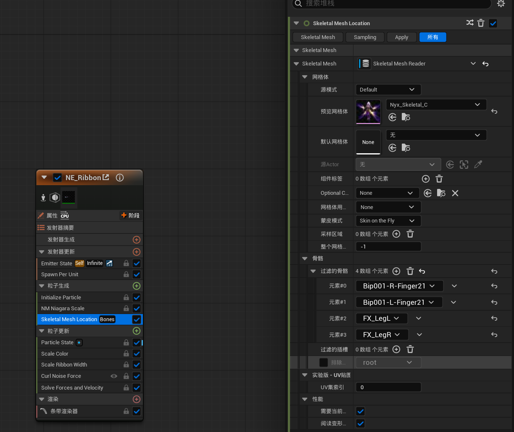

## 3. 动画蓝图中的创建与启停

### 3.1 初始化时创建拖尾组件

AB_Nyx 的初始化连线为：

```text
Event Blueprint Initialize Animation
  → Cast To BP_Nyx（Object 来自 Try Get Pawn Owner）
  → 保存 Character
  → 获取并保存 Character Movement
  → Spawn System Attached
  → 将返回组件保存到 Fly Trail
```

Spawn System Attached 的参数如下：

| 参数 | 当前设置 |
| --- | --- |
| System Template | `NS_FlyTrail` |
| Attach to Component | Character 的 `Mesh` |
| Attach Point Name | `Bip001-Pelvis` |
| Location | Mesh 的 Get Socket Transform 输出的世界位置 |
| Rotation | 同一 Get Socket Transform 输出的世界旋转 |
| Location Type | `Keep World Position` |
| Auto Destroy | 未勾选 |
| Auto Activate | 未勾选 |
| Pooling Method | `None` |
| Pre Cull Check | 勾选 |

Get Socket Transform 的 In Socket Name 同样为 `Bip001-Pelvis`，Transform Space 为 `RTS World`；输出的 Scale 没有接入截图中的创建节点。

创建时关闭自动激活，返回值保存到 `Fly Trail` 变量（资产内部名称为 `FlyTrail`）。之后的激活和停用事件都操作这一组件引用。

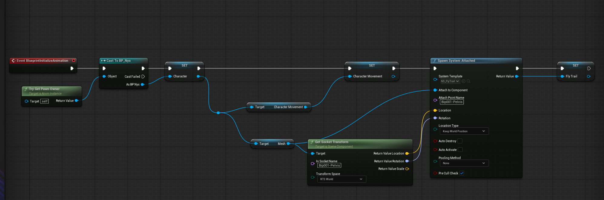

### 3.2 在飞行状态过渡开始时发出通知

FlyingState 状态机截图包含 `Idle/Hover`、`Start`、`MoveLoop` 和 `MoveEnd`。当前用于控制拖尾的是以下两条过渡的 Start Transition Event（过渡开始通知）：

| 状态过渡 | 过渡开始通知 | 拖尾操作 |
| --- | --- | --- |
| Start → MoveLoop | `FlyStartToLoop` | 激活 |
| MoveLoop → MoveEnd | `FlyLoopToEnd` | 停用 |

两条过渡截图中的混合时长均为 `0.2 s`，模式为 `Hermite-Cubic InOut`。End Transition Event 和 Interrupt Transition Event 均为 `None`。MoveLoop → MoveEnd 的截图还显示过渡条件摘要 `NOT IsSprint`。

通知配置在状态机的过渡详情中，触发时点是过渡开始，而不是等待过渡混合结束。

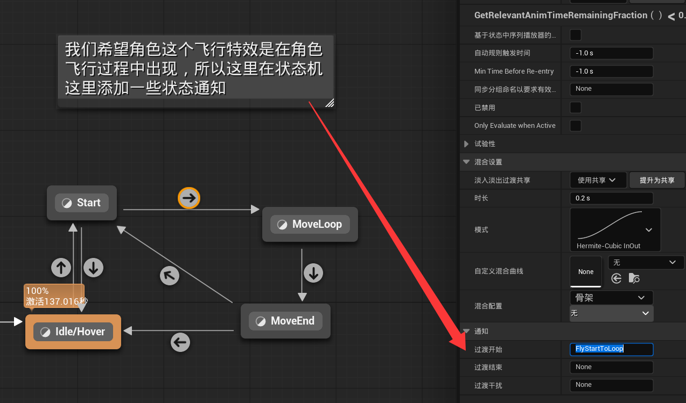

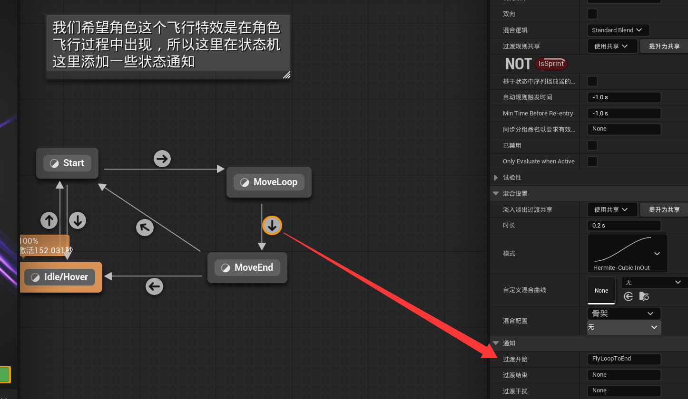

### 3.3 事件图表接收通知

在 AB_Nyx 的事件图表中搜索 `fly`，可以添加以下动画通知事件：

- `Event AnimNotify_FlyStartToLoop`
- `Event AnimNotify_FlyLoopToEnd`

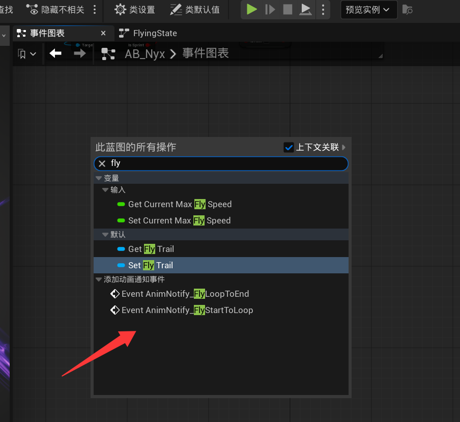

当前连线为：

```text
AnimNotify_FlyStartToLoop → Fly Trail.Activate（Reset 未勾选）
AnimNotify_FlyLoopToEnd   → Fly Trail.Deactivate → Character.CE_RunEnd
```

结束通知先停用 Fly Trail，再调用角色上的 `CE_RunEnd` 收拢宝石特效。Fly Trail 的 Deactivate 不会立即清空所有粒子，粒子消失时间取决于 Niagara 生命周期及停用处理。宝石组件 Fly Particle 的收拢、停用与销毁链见第 7 节。

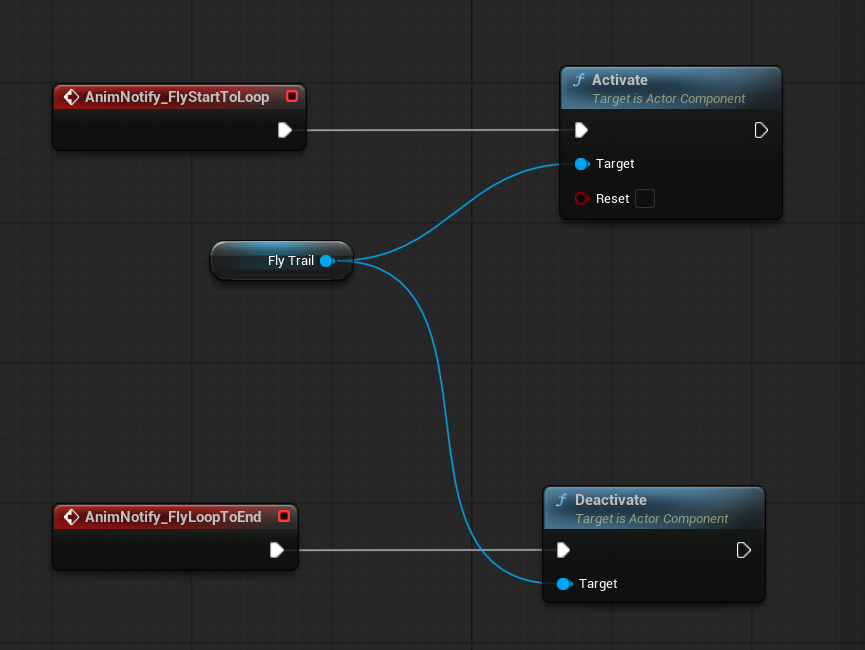

## 4. Niagara 发射器资产标签归类

### 4.1 资产标签与浏览器分类

UE 5.8 使用 User Asset Tags 管理资产标签。发射器详情中的 Asset Description（资产描述）是说明文字，在其中填写 `A_Effect` 不会创建标签。

给发射器添加标签的入口在内容浏览器：选中一个或多个发射器资产，右键打开 Manage Tags（管理标签；部分菜单布局中位于 Asset Actions 下），添加或勾选所需标签并保存。

资产有了标签后，还需要浏览器配置中的对应过滤项，才能在“添加发射器”窗口中按该分类筛选。UE 5.7 起旧 Niagara 专用标签已迁移到 User Asset Tags；旧教程中的 Niagara Asset Tag Definitions 不应直接作为本项目的新建流程。[官方迁移说明](https://dev.epicgames.com/documentation/unreal-engine/upgrading-niagara-tags-in-unreal-engine?lang=en-US)

### 4.2 当前项目的浏览器扩展

当前实际资产是 `/Game/Effect/Common/TABC_MyEmitter`，名称为单数 `Emitter`。资产中已确认：

| 配置 | 当前值 |
| --- | --- |
| 资产类型 | `TaggedAssetBrowserConfiguration` |
| Is Extension | `True` |
| Profile Name | `NiagaraWizard.Emitters` |

资产中还包含 `My_Effect` 分区名称及 `A_Effect` 标签过滤项。扩展通过相同的 Profile Name 与 Niagara 发射器浏览器的默认配置合并；文件名本身不负责关联浏览器。

### 4.3 从默认配置复制的操作路径

可通过复制引擎默认配置创建项目自己的浏览器扩展：

1. 打开项目设置，搜索 `Emitter Asset Wizard Configuration`，通过引用旁的浏览按钮定位 `TABC_EmitterWizard`。
2. 如果内容浏览器未显示引擎或插件资产，开启 Show Engine Content 和 Show Plugin Content。
3. 默认配置路径为 `/Niagara/DefaultAssets/TABC_EmitterWizard`。复制到项目自己的目录，只编辑项目副本。
4. 在副本中勾选 Is Extension，将 Profile Name 设为 `NiagaraWizard.Emitters`。
5. 删除复制过来的、扩展不需要的默认分区和过滤项，添加自己的分区及 User Asset Tag 过滤项；标签名称应与发射器资产上的标签一致。
6. 保存后重新打开“添加发射器”窗口检查分类。

使用扩展时，项目设置中的 Emitter Asset Wizard Configuration 保持原来的默认配置引用，不改为扩展资产。浏览器的扩展机制及分区过滤方式见[功能开发者说明](https://herr-edgy.com/posts/tagged-asset-browser/)。

### 4.4 复制配置后的 All 和 Recent 验证提示

复制默认配置并启用 Is Extension 后，如果 UE 验证提示 All 和 Recent 类型的层级元素不被允许，需要清理副本中继承过来的默认过滤项。

这里应删除的是项目副本中复制过来的 **All 和 Recent 过滤项**，不是删除整个配置资产，也不是删除编辑器固定的 All 视图按钮。原浏览器仍由默认配置提供这些过滤功能，扩展保留自己的分类即可。

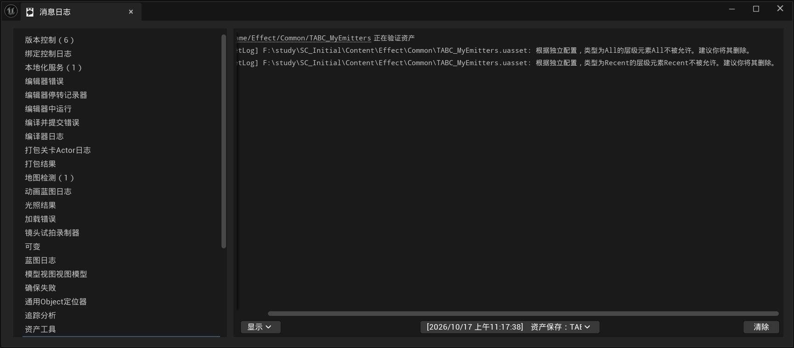

## 5. 四颗彩色石头环绕：NS_FlyStone

### 5.1 一个粒子同时绘制石头、辉光和十字闪光

`NS_FlyStone` 中的 `NE_Mesh` 使用 CPU 模拟，开启 **Local Space**，`Spawn Burst Instantaneous` 的 **Spawn Count = 4**。每个粒子同时交给一个 Mesh Renderer 和两个 Sprite Renderer 绘制：

```text
4 个粒子的 Position
  ├─ Mesh Renderer：彩色石头，读取 MeshOrientation 和 Scale
  ├─ Sprite Renderer：辉光，读取 SpriteSize 和 Color
  └─ Sprite Renderer：十字闪光，读取 StarLightSize 和 StarLightColor
```

三个渲染器共享同一批粒子的位置和生命周期，所以石头转到哪里，两层发光就跟到哪里，不需要额外发射器再做粒子位置同步。四颗石头加八张精灵面片仍由四个模拟粒子驱动；增加 Renderer 会增加绘制开销，不增加模拟粒子数量。

系统内派生发射器的模块顺序如下。父资产 `NE_Mesh` 是模板，不能把父资产中的默认球体、生成数量等设置当成 `NS_FlyStone` 的实际覆盖值。

| 阶段 | 模块，按执行顺序 | 作用 |
| --- | --- | --- |
| 发射器更新 | Emitter State；Spawn Burst Instantaneous | 管理发射器循环；一次 Burst 生成四个粒子 |
| 粒子生成 | Initialize Particle；Initial Mesh Orientation；NM Niagara Scale；设置 StarLightCameraOffset | 初始化粒子外观、随机初始姿态及缩放；写入两层精灵共用的摄像机偏移 |
| 粒子更新 | Particle State；Update Mesh Orientation；Scale Mesh Size；Scale Sprite Size；Scale Color；Rotate Around Point；设置 StarLightSize、StarLightColor；Solve Forces and Velocity；Generate Location Event | 更新生命周期、自转、外观及公转位置；在位置计算后发送宝石位置事件 |
| 渲染 | Mesh Renderer；辉光 Sprite Renderer；十字闪光 Sprite Renderer | 从同一粒子数据中读取各自绑定的属性 |

`Emitter State` 的 `Self / Infinite` 表示发射器自己管理无限循环。**一次 Burst 的数量、发射器循环和粒子寿命是三件事**：Spawn Count 为 4 只决定每次 Burst 生成四个粒子，长期保持恰好四颗还取决于循环时是否再次 Burst、粒子是否到龄销毁。不能只靠 Infinite 判断粒子会永久存活。

### 5.2 Rotate Around Point：用中心、半径和相位直接求位置

这里使用的是引擎脚本 `/Niagara/Modules/Spawn/Location/RotateAroundPoint`，放在 **Particle Update** 中，每帧计算环绕位置。截图 1 是固定半径、速率为零的配置；截图 10 将半径和速率接到了用户参数。

| 输入 | 截图及资产中的配置 | 对结果的影响 |
| --- | --- | --- |
| Rotation Phase | `Return Normalized Exec Index` | 给各粒子不同的初始角度，决定四颗石头如何分布 |
| Normalized Index Scale | `1.0` | 相位按完整一圈分配 |
| Normalized Index Includes One | 关闭 | 周期分布不包含末端 1，避免首尾位置重合 |
| Rotation Rate | 截图 1 为 `0.0`；参数化后绑定 `User.RotationSpeed`，默认 `0.0` | 公转速率，单位为圈/秒；零速率仍保留相位布局 |
| Set Particle Position | 开启 | 将计算结果直接写入 `Particles.Position` |
| Radius | 初始 `100.0`；参数化后为 `100.0 × User.Radius` | 控制轨道半径；用户参数是倍率 |
| Rotation Center | `(0, 0, 0)` | 环绕中心，必须按模拟空间理解 |
| Derive the Rotation Axis | 开启 | 直接指定轨道平面的 X、Y 基向量 |
| X Axis | `(1, 0, 0)` | 轨道平面的第一个方向 |
| Y Axis | `(0, 1, 0)` | 轨道平面的第二个方向；这组配置在模拟空间的 XY 平面环绕 |

可用以下计算理解此节点。设粒子相位为 `Phase_i`，累计公转量为 `Turn_i`：

```text
Turn_i ← Turn_i + RotationRate × DeltaTime
Angle_i = 2π × (Turn_i + Phase_i)
Position_i = Center + Radius × (cos(Angle_i) × XAxis + sin(Angle_i) × YAxis)
```

`Rotation Phase` 使用“圈”的归一化表示：`0.25` 对应 90°，`0.5` 对应 180°。`Rotation Rate = 1` 表示一秒一圈，`0.5` 表示两秒一圈；负值改变转动方向。具体顺逆时针还取决于基向量顺序和观察方向。

这个版本的节点保存累计转量，按 `速率 × DeltaTime` 增加。运行中调整 `User.RotationSpeed` 会改变此后的角度增量；将速率改为 0 会停在累计角度上。它与直接用“当前速率 × 总运行时间”求角度的做法不同，后者在修改速率时容易跳角。

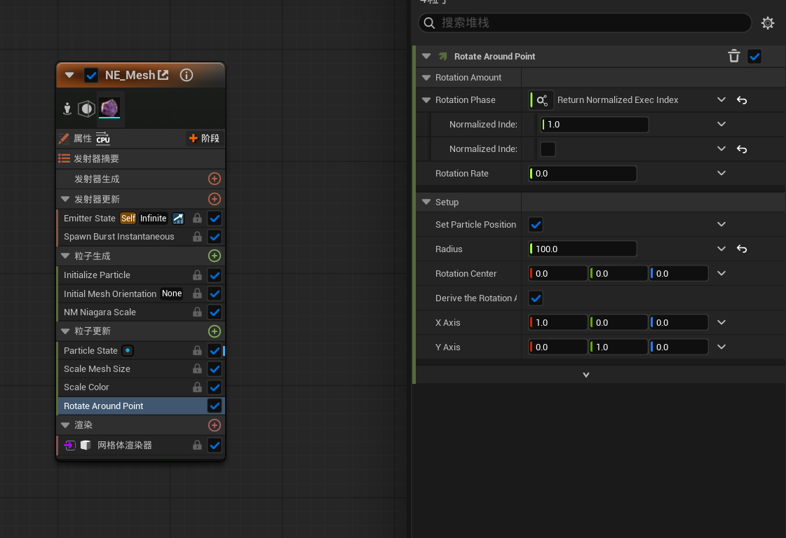

### 5.3 Rotation Center 与 Local Space：零点究竟在哪里

**Local Space 开启时，`Rotation Center = (0,0,0)` 指 Niagara 组件的本地原点。** 石头的本地轨道经过组件变换后进入世界空间：

```text
WorldPosition = NiagaraComponentTransform.TransformPosition(LocalPosition)
```

当 Niagara 组件附着到角色身体中心附近的骨骼或插槽，且相对位置设置正确时，本地零点才会表现为角色身体中心。它不会自动识别角色模型中心、包围盒中心、胶囊体中心或某个骨骼。组件挂在脚下，石头就围绕脚下；组件带相对位置偏移，中心也会跟着偏移。本项目的 `BP_Nyx.CE_RunStart` 将 NS_FlyStone 附着到 Mesh 的 `Bip001-Pelvis`，创建时位置取该插槽世界位置，旋转取角色世界旋转，详见第 7 节。

开启本地空间后，角色带动组件移动时，已有粒子也会随组件移动；组件转向时，轨道平面会随组件旋转。因此 `(1,0,0)` 与 `(0,1,0)` 指的是组件的本地 XY 平面，角色倾斜时它未必与世界水平面平行。组件缩放还会影响轨道在世界中的尺寸，非均匀缩放可能让本地圆轨道显示成椭圆。

**Local Space 关闭时，中心需要表达世界位置。** 将中心保持为世界位置 `(0,0,0)`，石头会绕世界原点转；仅把 Niagara 组件附着到角色上，并不能把这个硬编码的中心变成角色位置。要在世界空间围绕移动角色，需要每帧输入角色、插槽或组件的世界位置，并确保转换到该节点所使用的模拟位置空间。

UE 5 的 Niagara `Position` 类型支持大世界坐标，世界模拟内部可能使用相对系统所在 LWC Tile 的坐标。传入世界中心时应使用 Position 类型及正确的空间转换，避免把未经转换的绝对世界 Vector 当作模拟位置。文中“世界原点”指世界位置零点，不应混同内部模拟坐标中某个裸三元组的含义。

| 目标效果 | 空间与中心的配置思路 |
| --- | --- |
| 石头贴着角色移动、轨道随身体转向 | Local Space 开启；本地中心设为零或适当偏移，组件附着位置决定整体中心 |
| 石头跟随角色移动，但始终绕世界竖直轴旋转 | 世界空间中逐帧更新中心，轨道轴按世界方向设置；或将世界方向正确变换到本地空间 |
| 石头围绕场景固定点旋转 | 世界空间；中心使用该固定点的世界位置 |

排查“围绕错误位置旋转”时，应同时核对 Local Space、Niagara 组件附着点、组件相对变换和 Rotation Center 的来源。

### 5.4 四颗石头均匀分布：Normalized Exec Index 的闭区间陷阱

`Return Normalized Exec Index` 用执行索引生成相位。对这一批四个粒子，关闭 **Normalized Index Includes One**，并将 **Normalized Index Scale = 1**，可理解为：

| 执行索引 i | 相位 i / 4 | 角度 |
| --- | --- | --- |
| 0 | `0.00` | 0° |
| 1 | `0.25` | 90° |
| 2 | `0.50` | 180° |
| 3 | `0.75` | 270° |

如果包含 1，四个样本会分布为 `0、1/3、2/3、1`，对应 `0°、120°、240°、360°`。由于 360° 与 0° 重合，四个粒子只占据三个不同位置。这就是周期函数输入通常要排除区间末端的原因。

Rotation Rate 为零时，这个相位仍能把四颗石头排开；将四个相位都设成零，则会四颗重叠。随机相位可以制造散乱分布，但不能保证等间距。

Execution Index 是执行顺序，并非永久稳定的粒子 ID。用它在 Update 中计算相位时，粒子死亡、重新生成或执行顺序变化可能让相位重新分配。固定数量的同步 Burst 适合这种布局；要求中途增减粒子仍保持原相位时，应在 Spawn 保存独立相位属性，再在 Update 中读取。

### 5.5 轨道平面与模块顺序

**Derive the Rotation Axis** 开启时，节点允许直接输入 X Axis、Y Axis，以两个基向量确定旋转平面；关闭时改由 Rotation Axis 与 X Axis 推导另一个基向量。当前 `(1,0,0)`、`(0,1,0)` 对应绕模拟空间 Z 方向的轨道。调整两条基向量可以倾斜轨道；应使用有效的方向，避免零向量或两方向平行导致平面退化。

**Set Particle Position** 开启后，节点每帧按中心和半径重新写位置，所以最终轨迹由这条计算链决定。堆栈中它前面的位移可能被覆盖，后面的位移还会继续改变结果。叠加上下起伏时，可在它之后添加 Z 偏移；使用速度、噪声力时则要考虑求解模块与该位置覆盖的先后关系。

关闭 Set Particle Position 后，节点仍能计算轨道输出，但不直接改写粒子位置，可在后续模块读取 `Output.RotateAroundPoint.OutputPosition` 再混合或叠加。节点直接改 Position 不等于同步写入了真实轨道速度，不能默认依赖 `Particles.Velocity` 的拉伸、朝向或事件会自动获得正确的公转切线速度。

### 5.6 Update Mesh Orientation：石头自身旋转

公转修改的是粒子位置，石头自转修改的是 `Particles.MeshOrientation`。截图 2 的配置为：

| 参数 | 配置 | 含义 |
| --- | --- | --- |
| Initial Mesh Orientation | `Random` | 出生时随机初始姿态，避免四颗石头同角度摆放 |
| Orientation Method | `Rotation Rate` | 随时间持续更新朝向 |
| Rotation Vector | `Random Vector` | 为每颗粒子生成随机旋转向量 |
| Vector Scale | `1.0` | 控制随机旋转向量的幅度 |
| Constrain to Hemisphere | 关闭 | 不把随机方向约束到单个半球 |
| Evaluation Type | `Spawn Only` | 每颗粒子出生时确定随机向量，之后保持该随机选择 |
| Rotation Rate | `0.5` | 对旋转向量与 DeltaTime 的计算作速率缩放，不是公转半径或公转相位 |
| Rotation Coordinate Space | `Mesh` | 按石头网格体自身坐标解释旋转向量 |

这里把随机求值设为 Spawn Only，可让石头持续沿自身选定的旋转方式翻转。若在 Update 中每帧重新随机旋转向量，转轴会不断改变，表现更接近抖动或乱翻。初始姿态的随机和旋转向量的随机分别决定“从什么姿态开始”与“之后怎样旋转”。

MeshOrientation 由 Mesh Renderer 读取。两层 Sprite 使用自己的朝向模式和 `SpriteRotation`，不会因为石头 Mesh 自转就自动跟着翻面。

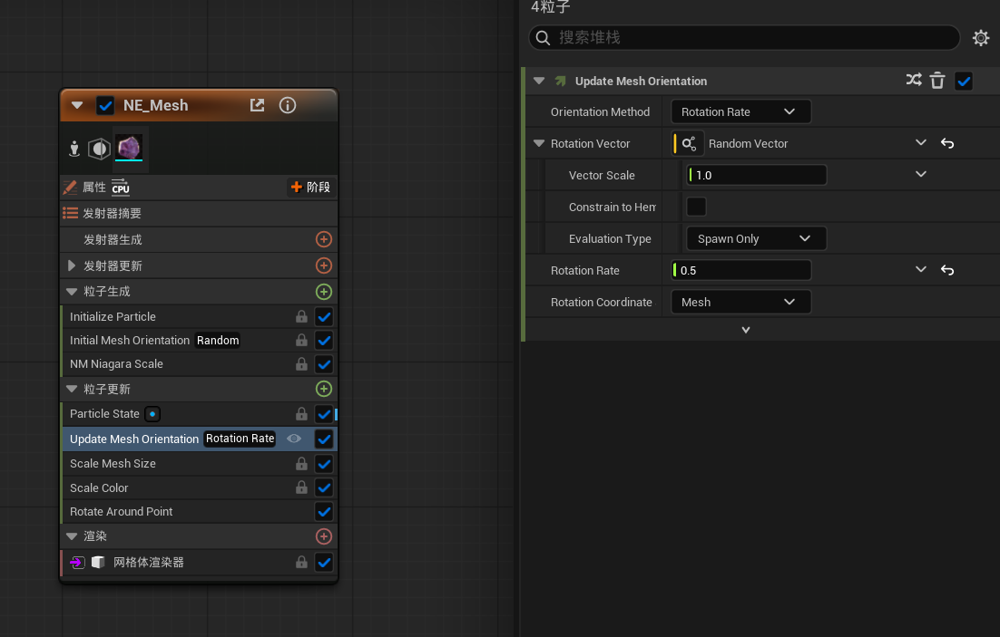

### 5.7 第二个 Sprite 独立大小：自定义 Vector2D 与 Renderer Binding

同一发射器里的多个 Sprite Renderer 默认都读取 `Particles.SpriteSize`。直接修改 Initialize Particle 或 Scale Sprite Size，会影响所有仍绑定这个属性的精灵。让十字闪光独立调整，需要创建第二份粒子属性，并让指定 Renderer 读取它。

操作链为：

1. 在 Particle Update 中添加设置粒子参数的模块（Set Variables / Set New or Existing Parameter）。
2. 新建 **Vector2D** 类型的 `Particles.StarLightSize`。使用 `Particles` 命名空间，使每个粒子都拥有自己的二维大小。
3. 为它选择 `Multiply Vector 2D by Float`，将基础大小设为 `(200,300)`。
4. Float 使用 `Random Range Float`，范围 `1.0～1.2`，Evaluation Type 为 `Every Frame`。
5. 打开**第二个 Sprite Renderer** 的 Bindings，将 **Sprite Size Binding** 从 `Particles.SpriteSize` 换成 `Particles.StarLightSize`。

Vector2D 的两个分量控制精灵面片的宽和高。共同乘同一个 Float 会维持 `2:3` 的长宽比；在 `User.Size = 1` 时，宽约为 `200～240`，高约为 `300～360`，宽高同步变化，不会各自独立随机变形。

截图 3～4 展示了创建和绑定过程。保存资产中的计算还嵌套了 `User.Size`，完整关系为：

```text
Particles.StarLightSize = (200,300) × User.Size × RandomRangeFloat(1.0,1.2)
```

例如 `User.Size = 0.5` 时，十字闪光的宽约为 `100～120`，高约为 `150～180`。Vector2D 的数值是面片尺寸，实际发亮区域还受纹理透明边缘和材质形状影响。

自定义参数的名字本身没有特殊渲染含义。**写入 StarLightSize 和修改 Sprite Size Binding 必须成对完成**：只创建变量而不改绑定，精灵继续读取 SpriteSize；只改绑定而不赋值，无法得到预期尺寸。[Niagara Renderer 属性绑定参考](https://dev.epicgames.com/documentation/unreal-engine/render-module-reference-for-niagara-effects-in-unreal-engine?lang=en-US)

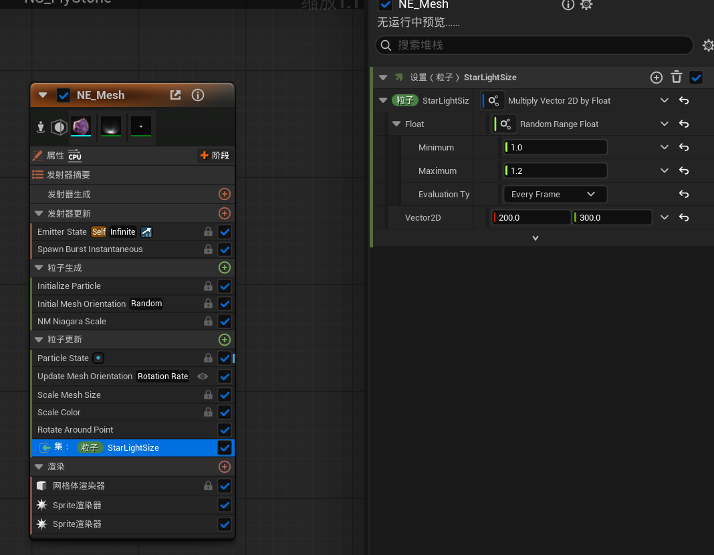

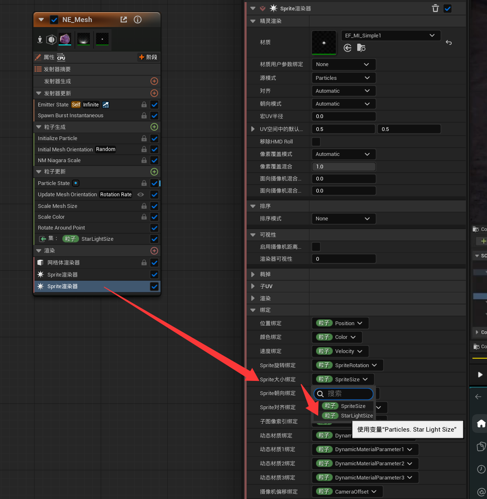

### 5.8 第二个 Sprite 独立颜色：Linear Color、RGBA 关联与 HDR

同一个 Set Variables 模块中还设置了 **Linear Color** 类型的 `Particles.StarLightColor`。动态输入使用 `Random Range Linear Color`：

| 参数 | 配置及作用 |
| --- | --- |
| Minimum | 暖黄；资产线性值约 `(3.0, 1.827642, 0.594718, 1.0)` |
| Maximum | 紫色；资产线性值约 `(2.544388, 1.297080, 8.0, 1.0)` |
| Color Channel Mode | `Link RGBA` |
| Evaluation Type | `Every Frame` |
| 第二个 Sprite 的 Color Binding | `Particles.StarLightColor` |

Link RGBA 表示用同一个随机权重在两组完整 RGBA 之间插值，可理解为 `lerp(Minimum, Maximum, Random)`；不是分别随机 R、G、B、A。颜色取值沿两端颜色之间变化，可以避免独立通道随机产生额外的色相组合。这里两端 Alpha 都是 1，所以随机颜色不会自行带来透明度变化。

RGB 大于 1 是线性 HDR 发光值，例如紫色端 B 为 8。它与材质中的发光强度一起决定亮度；屏幕上最终的光晕还受 Bloom、曝光与色调映射影响。辉光和十字闪光是发光精灵面片，不等于给场景添加照明用的 Light Renderer。

Scale Color 通常处理 `Particles.Color`，第二层已改读 `Particles.StarLightColor`。要让第二层也跟随生命周期淡出，需要在计算 StarLightColor 时显式乘入同一淡出系数，或单独控制其 Alpha / 发光强度。直接缩放 Color 不会自动同步到自定义属性。

Renderer 的颜色属性还要由材质读取才能显示。两层 Sprite 的父材质 `EF_M_Flare`、`EF_M_Simple` 中都有 Particle Color 节点；石头的 `EF_M_Gemstone` 使用自身贴图、颜色和 HueShift 等材质逻辑，导出的材质图中没有 Particle Color 节点，因此不能仅凭 Mesh Renderer 的默认 Color Binding 判断 Scale Color 会改变石头表面颜色。

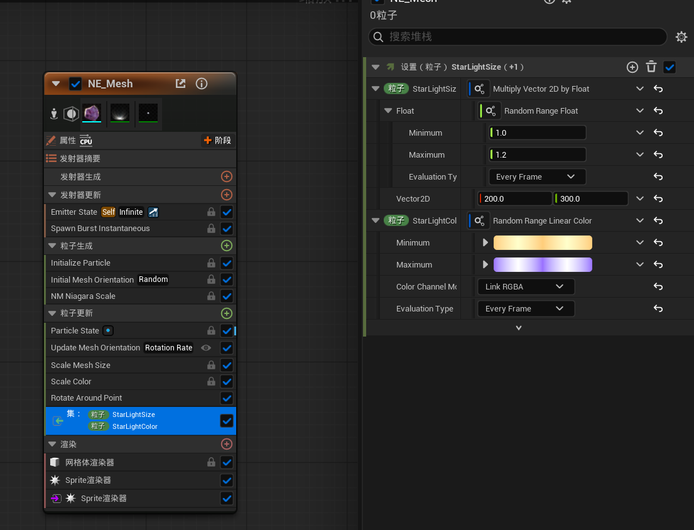

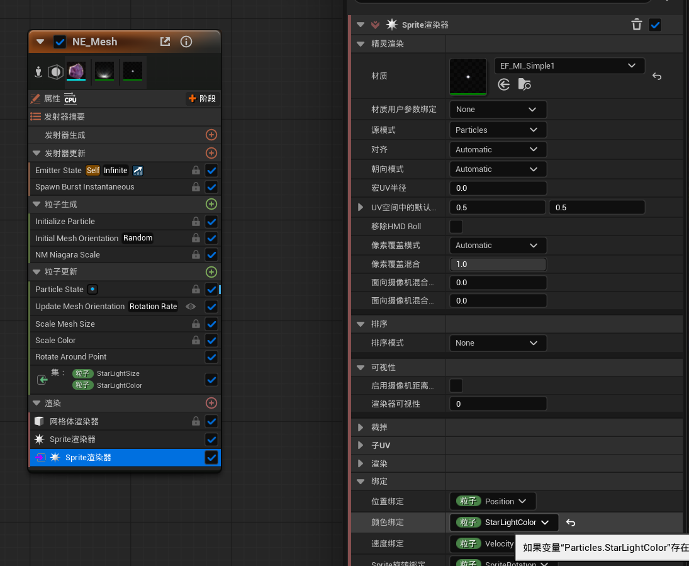

### 5.9 Every Frame 与 Spawn Only：闪烁和稳定差异的来源

当前 StarLightSize 的随机倍率与 StarLightColor 都在 Particle Update 中，以 **Every Frame** 求值。它们会每帧重新取随机样本，产生尺寸和颜色的快速闪动；随机取值本身没有时间插值，不能把它当成平滑的呼吸或颜色渐变。

如果需要每颗石头有稳定但彼此不同的闪光大小或颜色，应让随机输入使用 Spawn Only，或在 Particle Spawn 保存随机属性。若仍需响应运行时 `User.Size`，可将随机倍率保存在 Spawn，再在 Update 中计算 `基础尺寸 × 固定随机倍率 × User.Size`。

需要连续呼吸时，可以将随机的初始相位与随时间变化的正弦或曲线结合。**模块放在哪个阶段**决定何时写属性，**Evaluation Type** 决定随机样本怎样随时间变化；位于 Update 的动态输入也可以使用 Spawn Only 获得稳定随机结果。截图 2 的自转向量与截图 5 的闪光颜色，正好体现了两种不同目的。

### 5.10 两层精灵共用独立 CameraOffset：让辉光位于石头表面前方

截图 7～8 在 Particle Spawn 中设置 Float 属性：

```text
Particles.StarLightCameraOffset = 5.0
```

两个 Sprite Renderer 的 **Camera Offset Binding** 都改为 `Particles.StarLightCameraOffset`，Mesh Renderer 继续使用自己的默认摄像机偏移属性。这样可以只改变两层精灵的显示位置，石头的网格体和公转计算保持原位置。

UE 5.8 的 Sprite 顶点计算沿“粒子指向摄像机”的归一化方向应用偏移：

```text
OffsetDirection = normalize(CameraWorldPosition - ParticleWorldPosition)
SpriteDisplayPosition = ParticleWorldPosition + OffsetDirection × CameraOffset
```

正值靠近摄像机，负值远离摄像机。`5.0` 表示约 5 个世界单位的渲染偏移，不是 5 个像素，也不是排序优先级。它随视角改变方向，不是固定沿世界 Z 抬高面片；该操作不改写模拟中的 `Particles.Position`。

同一粒子原本把精灵中心放在石头中心附近，石头表面可能遮住部分精灵。小幅正偏移可以把两层发光推向可见表面。需要结合石头实际尺寸、视角及材质 Depth Fade 调整，偏移不足时仍会被遮挡，过大时光效会脱离模型，并改变它与场景几何的遮挡关系。

使用独立属性的关键在于 **Renderer Binding 隔离**。UE 5.8 的 Mesh Renderer 也支持 Camera Offset Binding，如果直接修改默认的 `Particles.CameraOffset`，所有仍读取默认属性的渲染器都可能受到影响。将两个 Sprite 单独改读 StarLightCameraOffset，就能把这次调整限定到发光层。

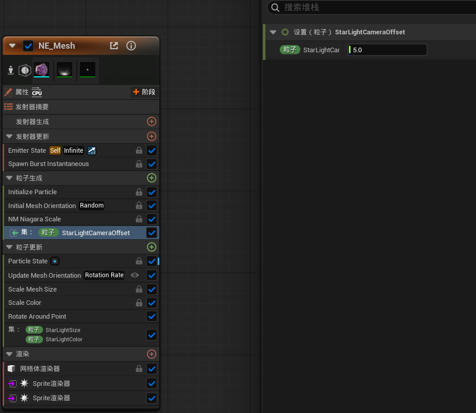

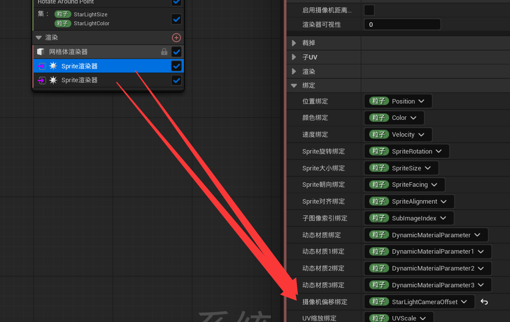

### 5.11 深度偏移、粒子排序与 Renderer 排序的区别

这几个设置都与画面层次有关，但控制的对象不同：

| 设置 | 控制对象 | 本特效中的含义 |
| --- | --- | --- |
| Camera Offset Binding | 渲染顶点沿视线方向的位置 | 两层精灵使用 StarLightCameraOffset，使其相对石头更靠近摄像机 |
| Sort Mode | 同一个 Renderer 内各粒子的排序 | 截图中的 Sprite 为 `None`；View Depth、View Distance 等用于粒子间排序 |
| Sort Order Hint | 系统中可比较的同类材质 Renderer 绘制次序 | 较小值先绘制；保存资产中的三个 Renderer 均使用默认 `0` |
| 材质深度测试与混合模式 | 与场景几何的遮挡、颜色混合 | 石头 Opaque，两层 Sprite Additive，材质深度测试均开启 |

渲染器在堆栈里排在后面，不代表它必然覆盖前面的模型。Sort Order Hint 主要控制同类材质的 Renderer 顺序，不能跨越不透明与透明渲染阶段强行覆盖场景深度。CameraOffset 解决的是实际显示深度关系，与调整 Hint 的作用不同。[官方渲染器排序说明](https://dev.epicgames.com/documentation/unreal-engine/render-module-reference-for-niagara-effects-in-unreal-engine?lang=en-US)

两层精灵都使用同一个 `StarLightCameraOffset = 5`，表示它们相对石头一起前移，并没有因此在两层之间建立不同的偏移。当前两层使用 Additive；单纯改变两层加色精灵的先后次序，通常不会像普通 Alpha 混合那样明显改变叠色。实际可见性仍受石头写入的场景深度及材质逻辑影响。

辉光实例的 DepthFade 参数为 `30`，十字闪光实例为 `50`；Depth Fade 用来柔化与场景几何接近时的交界，不会替代 CameraOffset，也不会关闭遮挡。两个层次需要结合观察：偏移负责把面片向摄像机移动，Depth Fade 负责材质在交界处怎样过渡。

### 5.12 User.Size、User.Radius、User.RotationSpeed 的完整绑定链

用户参数均为 Float，默认值与截图 9 一致：

| 用户参数 | 默认值 | 绑定及作用 |
| --- | --- | --- |
| `User.Size` | `1.0` | 转为 Vector 后输入 Scale Mesh Size；输入 Scale Sprite Size 的 Uniform Scale Factor；乘入 StarLightSize 的二维大小计算；宝石 Ribbon 的初始宽度使用 `45 × User.Size` |
| `User.Radius` | `1.0` | 作为 Multiply Float 的 B，A 为 100，结果输入 Rotate Around Point 的 Radius |
| `User.RotationSpeed` | `0.0` | 直接绑定 Rotate Around Point 的 Rotation Rate，控制公转圈速 |

```text
User.Size ───────────────→ Scale Mesh Size（等比 XYZ）
          ├─────────────→ Scale Sprite Size（普通辉光）
          └─ × (200,300) × 随机倍率 → StarLightSize（十字闪光）

User.Radius × 100 ───────→ Rotate Around Point.Radius
User.RotationSpeed ─────→ Rotate Around Point.Rotation Rate
Normalized Exec Index ──→ Rotate Around Point.Rotation Phase
```

资产中 Initialize Particle 的 Mesh Uniform Scale 为 `0.5`，Uniform Sprite Size 为 `150`。`User.Size` 是在初始尺寸基础上继续缩放的倍率；不会替换模型原始尺寸或初始化尺寸。Scale Sprite Size 通常以初始 SpriteSize 为基准计算，而十字闪光使用独立的 StarLightSize 表达式，两条计算链都要接上 Size 才能同步调整。

`User.Size` 控制外观尺寸，`User.Radius` 控制石头中心离角色多远，两者彼此独立。例如 Size 为零会使模型与精灵缩小，但不自动把轨道半径归零；Radius 为零会让四个中心聚到同一点，但不自动隐藏模型。

同样，普通的 Scale Sprite Size 不会直接缩放绑定到 StarLightSize 的 Renderer。这里通过在 StarLightSize 表达式中再乘一次 User.Size，明确建立了第二层的统一缩放关系。

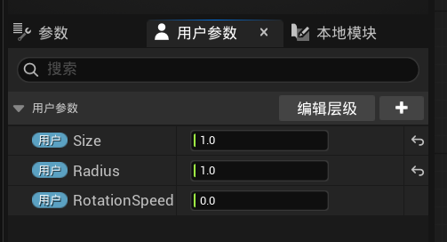

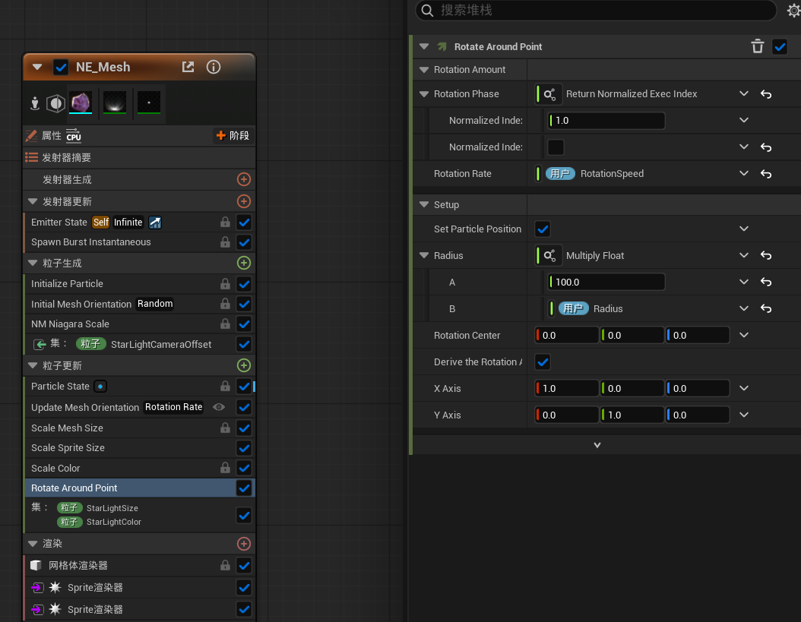

### 5.13 从身体内部扩散并旋转：用参数随时间改变轨道

三个参数提供外部控制入口。把石头从身体内展开的核心是让 **Radius 从 0 连续增加**，同时维持四个不同相位并累积公转角度。例如可用归一化展开进度 `u` 计算：

```text
u = clamp(ElapsedTime / ExpandDuration, 0, 1)
a = u × u × (3 - 2 × u)                // 平滑起停的展开权重
User.Radius = lerp(0, TargetRadiusScale, a)
User.Size = lerp(0, TargetSizeScale, a)
User.RotationSpeed = lerp(0, TargetRotationSpeed, a)
```

这是参数驱动的计算示例，三个用户参数本身不会自动随时间变化。可由 Niagara 曲线或外部组件参数持续驱动；从蓝图控制时，目标应是 `NS_FlyStone` 的 Niagara Component，使用 Set Niagara Variable Float 写入对应的 `User.*` 参数。

当 Radius 接近零，四个位置贴近中心，但四个相位依然不同；随着半径增加，它们沿各自方位离开身体，同时因角度累计形成向外展开的旋转轨迹。需要完整的一致显隐时，还应考虑 CameraOffset 仍为 5、两个精灵的独立颜色与 Alpha，以及出生时的初始尺寸；仅把半径设零不会让所有绘制结果消失。

如果希望第一帧就位于身体内部，初始 Radius 和 Size 应在激活或重新初始化之前设好，并保证首次 Spawn / Update 使用到这些值。反复播放时，还要配合重置粒子及累计旋转状态；只把 RotationSpeed 归零，不会清掉已经积累的角度。

这条轨迹由 `Center + Radius(t) × 方向(Angle(t))` 每帧确定，属于受控轨道扩散。要表现具有惯性、脱离角色后继续飞走的石头，则需要明确切换位置控制方式并提供速度；持续由 Rotate Around Point 覆盖位置时，单独追加离心速度并不能保证最终呈现自由飞散。

### 5.14 常见现象与对应参数

| 现象 | 优先检查 |
| --- | --- |
| 四个粒子只看到三个方位 | Normalized Index Includes One 是否关闭，是否出现 0 与 1 相位重合 |
| 石头围绕脚下或错误位置 | Niagara 组件附着点、相对偏移、Local Space 与 Rotation Center 的空间 |
| 角色飞走，轨道留在场景原处 | 是否使用世界空间固定中心；中心是否逐帧跟随角色 |
| 四颗石头都不公转 | User.RotationSpeed 默认就是 0；还要检查模块是否在 Particle Update |
| 改 SpriteSize 时两层一起变大 | 两个 Sprite Size Binding 是否仍共享 Particles.SpriteSize |
| 改 SpriteSize 时十字闪光不变 | 第二层已读 StarLightSize，应修改它的表达式或 User.Size |
| 改 Color 或 Scale Color 时十字闪光不变 | 第二层 Color Binding 使用 StarLightColor，需要单独计算颜色与淡出 |
| 发光层被石头挡住 | 两个 Camera Offset Binding、偏移值与模型尺寸、材质深度测试及 Depth Fade |
| 调 CameraOffset 后石头也移动 | 是否仍共享默认 Particles.CameraOffset；Sprite 是否已切换到专用属性 |
| 闪光大小或颜色跳动 | Update 中随机输入是否使用 Every Frame；平滑变化需要连续函数或插值 |
| 施加速度、噪声后轨道仍被锁住 | Rotate Around Point 的 Set Particle Position 及与其他位置模块的先后顺序 |
| 声明了 User 参数但画面没有变化 | 参数是否真正接入输入；运行时是否设置到了正确 Niagara Component；读取发生在 Spawn 还是 Update |

## 6. 宝石发出 Ribbon：位置事件驱动另一个发射器

### 6.1 从宝石位置连续生成条带采样点

宝石拖尾位于 `NS_FlyStone` 内独立的 `NE_Ribbon` 发射器中。Mesh 发射器提供每颗宝石的位置，Ribbon 发射器把接收到的位置变成新粒子的出生位置，再将同一来源的历史粒子连接为条带：

```text
NE_Mesh：四颗宝石持续公转
  → Particle Update：Generate Location Event
  → LocationEvent：位置、来源 ID、空间标记等事件载荷
  → NE_Ribbon：Event Handler，来源选择 NE_Mesh.LocationEvent
  → 每个事件生成 1 个粒子
  → Receive Location Event：应用位置、坐标变换和 Ribbon ID
  → Ribbon Renderer：同一 Ribbon ID 的采样点连接成一条拖尾
```

宝石是每条 Ribbon 的运动源，Ribbon 粒子记录宝石在不同时刻的位置。两个 Sprite Renderer 仍与 Mesh 共用宝石粒子；Ribbon 使用另一批独立粒子，拥有自己的寿命、宽度、颜色和运动更新。因此本系统的模拟粒子数量不再只有四个，还包括持续生成的 Ribbon 采样点。

宝石 Ribbon 的 **Spawn Per Unit 已禁用**，生成由事件处理器负责。继续开启原模板里的常规生成模块，会额外产生没有正确来源事件的粒子，可能出现在组件原点，或形成不属于四颗宝石的条带。

### 6.2 Generate Location Event：发送时间、开关与模块顺序

`NE_Mesh` 的 `Generate Location Event` 放在 Particle Update 的末尾，位于 Rotate Around Point 和 Solve Forces and Velocity 之后。事件读取的是执行到此处时的粒子位置；放在公转计算之前，会采集到公转更新前的位置。后面还有其他位置修改时，事件位置与最终显示位置也可能不一致。

| 参数 | 配置 | 含义 |
| --- | --- | --- |
| Event Type | `Send Rate` | 按时间间隔发送位置事件 |
| Event Send Rate | 本节截图为 `30.0`；保存的 NS_FlyStone 资产为 `120.0` | 每颗来源粒子的目标发送频率，单位为次/秒 |
| Event Generation Enabled | 开启 | 控制位置事件是否发送；不会代替发射器的激活和停用 |
| Use Event Probability | 关闭 | 界面中灰色的 `0.5` 不参与筛选，不能解释为只有一半事件会发送 |
| Delay Before Sending Events | 未启用延迟 | 灰色的 `0.5` 不表示当前一定延迟半秒才开始发送 |

发送速率作用于每颗宝石。按截图的 30 次/秒估算，四颗宝石的名义总量约为 120 个事件/秒；按资产的 120 次/秒估算，名义总量约为 480 个事件/秒。**这些是目标频率的估算，不是逐秒精确计数保证。** 本模块按模拟 Tick 判断发送条件，此 Send Rate 路径每颗粒子每次更新最多写入一个位置事件；低帧率下把发送速率调高，不能凭空补出多个真实历史采样位置。

Generate Location Event 发送的是模拟属性 `Particles.Position`。Sprite 的 StarLightCameraOffset 是显示阶段的偏移，不会写回这个位置，所以 Ribbon 接在宝石实际模拟位置上，不会自动沿用发光层向摄像机偏移的 5 个单位。

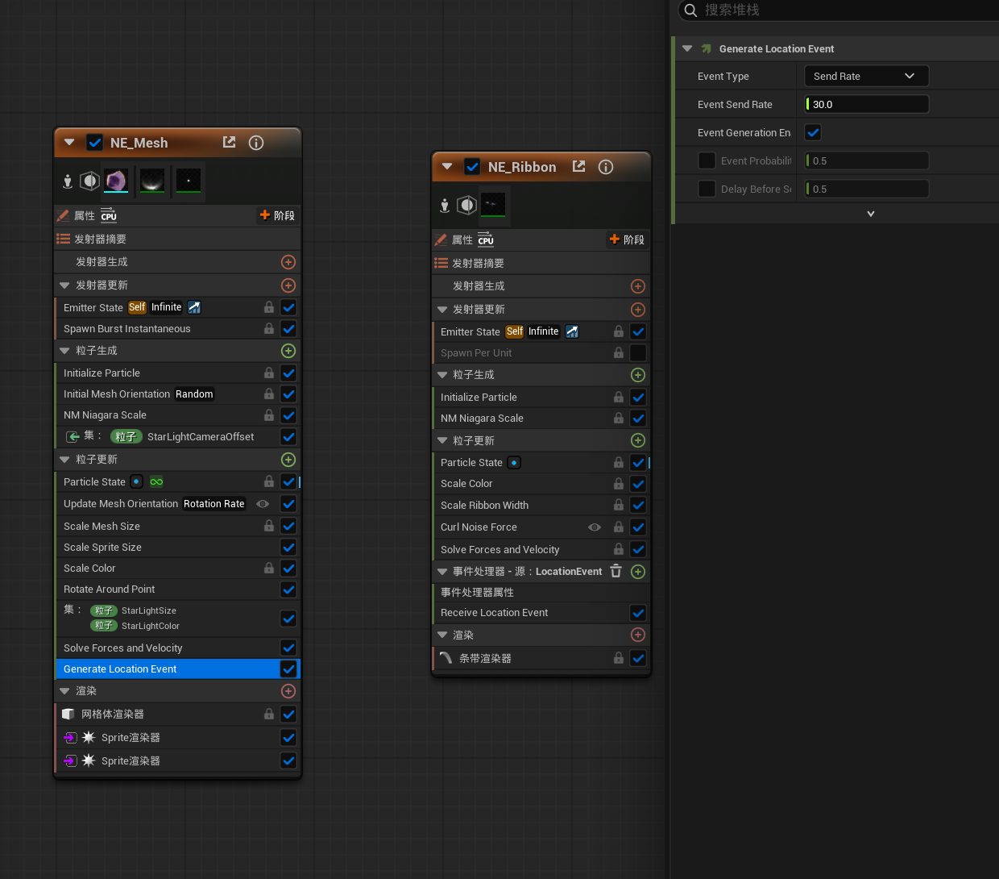

### 6.3 CPU 模拟与 Requires Persistent IDs

本例两个发射器均为 **CPU 模拟**。这种 Niagara Event Handler 事件链要求 CPU 模拟；Ribbon Renderer 本身能否用于其他模拟方式，与当前事件链能否用于 GPU 是不同的问题。[官方事件机制说明](https://dev.epicgames.com/documentation/unreal-engine/events-and-event-handlers-in-niagara-effects-for-unreal-engine?lang=en-US)

`NE_Mesh` 已开启 **Requires Persistent IDs**，为来源宝石提供 `Particles.ID`。这是 Niagara ID 类型，由 Index 与 Acquire Tag 两个整数构成，用于识别粒子身份；索引槽复用后，也能区分新旧粒子。它与第 5 节用于分配公转相位的 Execution Index 用途不同，不能直接拿执行顺序代替来源身份。

同一颗宝石的连续事件带有相同来源 ID，Receive Location Event 将其应用到接收粒子的 `Particles.RibbonID`。这样，一个 NE_Ribbon 发射器就能同时构建四条互不连接的 Ribbon。若四颗宝石的接收粒子都使用同一个默认 Ribbon ID，Renderer 会把不同宝石的点混在一条带上，出现跨宝石的长连接或交叉。

Ribbon ID 负责分组，组内的连接顺序由 Ribbon Renderer 的连接排序规则处理；它不决定宝石在圆周上的相位。设置持久 ID 也不会自动完成分组，还需要接收模块应用来源 ID，并让 Renderer 读取对应 Ribbon ID 属性。

### 6.4 Event Handler Properties：事件从哪里来、生成多少点

在 **NE_Ribbon** 上添加 Event Handler，然后选择 `NE_Mesh` 的 `LocationEvent` 为 Source，并在该事件组内添加 Receive Location Event。添加普通更新模块不会自动建立这条跨发射器连接。

| 事件处理器参数 | 值 | 作用 |
| --- | --- | --- |
| Source | 发射器 `NE_Mesh`，事件 `LocationEvent` | 指向系统内实际发出事件的宝石发射器 |
| Execution Mode | `Spawned Particles` | 为事件生成新粒子，并对事件生成的粒子执行接收脚本 |
| Max Events Per Frame | `0` | 不额外设置消费数量上限；这里的零不表示不处理事件 |
| Spawn Number | `1` | 每个被处理的位置事件生成一个 Ribbon 粒子 |
| Random Spawn Number | 关闭 | 每个事件的生成数量固定 |
| Update Attribute Initial Values | 开启 | 将事件脚本修改的属性同步到对应 Initial 值，供依赖初始属性的后续计算使用 |

`Max Events Per Frame` 是**接收端每帧消费的事件数量上限**，与发送端的“每秒发送频率”不同。UE 的处理逻辑只在该值大于零时截断事件数量，所以当前 0 表示不由此项限制。限制得过低时，一部分来源事件会被忽略，可能造成拖尾断点或不同宝石的采样数量不均。

Spawn Number 为 1 表示每次事件追加一个历史采样点，不是整个发射器只存在一个粒子。与 Spawned Particles 相比，Every Particle 模式会将事件脚本作用于已有粒子，不适合直接替代这里逐次留下新轨迹点的用途。[事件处理器参数参考](https://dev.epicgames.com/documentation/unreal-engine/add-event-handler-group-reference-for-niagara-effects-in-unreal-engine)

Update Attribute Initial Values 也不等于“每帧重置所有粒子”：它针对事件脚本实际修改的属性。例如接收事件若应用了颜色，后续按初始颜色缩放的模块就应以接收后的颜色为基础；当前颜色字段是否应用，还要看 Receive Location Event 自身的模式。

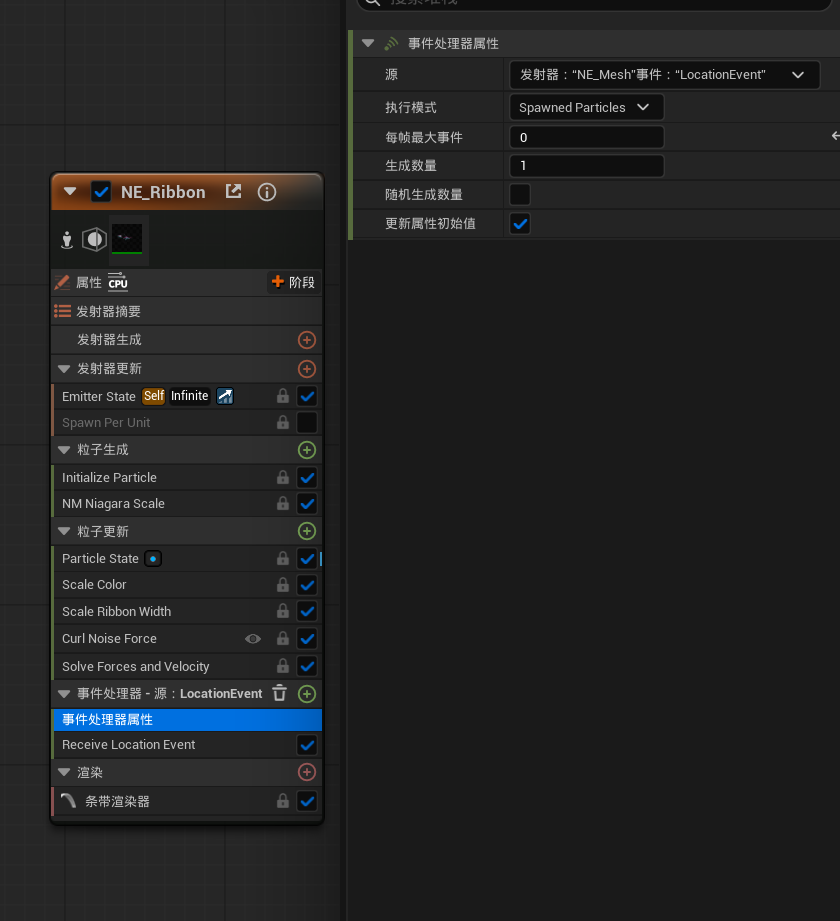

### 6.5 Receive Location Event：收到数据与应用属性的区别

保存资产中的接收模块使用以下模式：

| 载荷或选项 | 模式 | 对接收粒子的影响 |
| --- | --- | --- |
| Position (Vector 1) | `Apply` | 写入 Ribbon 粒子的 Position，让新采样点从宝石位置出生 |
| Coordinate Space Transform (Bool) | `Apply` | 根据来源的 Localspace 标记和接收端空间进行坐标转换 |
| Ribbon ID (Niagara ID) | `Apply` | 用来源宝石的 ID 设置 RibbonID，实现四条拖尾分组 |
| Ribbon UV Distance (Float 3) | `Apply` | 应用来源距离数据；实际纹理分布还取决于 Renderer 的 UV 模式 |
| Acceleration (Vector 3) | `Apply` | 参与接收位置的运动补偿，不代表接收端自动增加了持续生效的力模块 |
| Color (Linear Color) | `Output` | 提供事件输出，不直接覆盖接收粒子的 Color |
| Velocity (Vector 2) | `Output` | 提供事件输出，不直接把源速度赋给接收粒子的 Velocity |
| Normalized Age (Float 1) | `Output` | 提供事件输出，不直接让 Ribbon 与宝石共用归一化年龄 |
| Random Normalized Float (Float 2) | `Output` | 输出来源随机值，供事件组中其他计算读取 |
| Interpolate Spawned Positions | 开启 | 支持接收位置的运动插值；不会增加事件源的真实采样频率 |

**Output 表示数据可供后续事件模块读取，Apply 表示模块同时将数据用于对应粒子属性。** 因此，拖尾从宝石发出并不意味着颜色、速度和年龄全部自动继承。当前 Ribbon 的颜色由自身 Initialize Particle 和 Scale Color 管理，寿命由自身生命周期配置管理。

插值和补偿依赖事件载荷中实际提供的位置、速度、加速度。宝石的公转由 Rotate Around Point 直接改位置，不能据此认定源 Velocity 一定包含完整公转切线速度；尤其不能将提高 Spawn Number 当成增加真实轨迹采样。对高速或急转轨迹，应结合真实事件频率判断平滑程度。

### 6.6 Mesh 本地空间、Ribbon 世界空间如何衔接

资产中的 **NE_Mesh 开启 Local Space，NE_Ribbon 关闭 Local Space**。事件载荷包含来源是否处于本地空间的标记，Receive Location Event 的 Coordinate Space Transform 会据此把位置转换到接收端空间。

本例可以理解为：

```text
宝石本地 Position
  → 依据 Niagara 组件变换转换为世界位置
  → 新 Ribbon 粒子的世界位置
```

这样宝石随角色组件移动和旋转，而已经生成的 Ribbon 点留在世界中记录此前的路径，再由自身的速度、噪声等模块继续更新。角色向前飞时，拖尾可以留下空间中的飞行轨迹；若 Ribbon 也在本地空间，历史采样点还会整体跟着角色组件运动，视觉结果更接近随身体一起移动的环形尾迹。

两种空间配置都可以有用途，关键是位置载荷必须按来源和接收端的空间转换。不能把宝石本地位置的裸数值直接写到世界空间接收端，否则角色离世界原点越远，Ribbon 与宝石的错位越明显；也不应在接收模块已经转换后再重复转换。

### 6.7 Ribbon 的寿命、宽度与采样密度

宝石 Ribbon 的堆栈保留了 Initialize Particle、NM Niagara Scale、Particle State、Scale Color、Scale Ribbon Width、Curl Noise Force、Solve Forces and Velocity，新增事件组负责从宝石位置生成粒子。其 Renderer 使用 `/Game/Effect/MaterialInstance/Ribbon/EF_MI_Ribbon_soft2`。

保存资产中，Ribbon 的初始寿命为 **0.2 秒**，初始宽度计算为 **`45 × User.Size`**，之后由 Scale Ribbon Width 调节宽度。宽度中的 User.Size 在 Spawn 阶段读取，因此修改它会影响新生点；已有点能否立即跟着变化，还取决于 Update 阶段是否再次读取该参数。它与第 5 节中每帧更新的宝石、精灵大小不能简单等同。

生成点需要至少形成相邻采样关系才能连接成带。发送频率高，轨迹采样一般更密；寿命长，保留的历史路径一般更长：

```text
每条 Ribbon 的存活点数 ≈ 实际事件频率 × 每事件生成数量 × 粒子寿命
沿轨迹的点间距 ≈ 宝石世界运动速度 / 实际事件频率
```

以每事件 1 点、寿命 0.2 秒估算，实际达到 30 次/秒时，每颗宝石约保留 6 个点；实际达到 120 次/秒时约 24 个点。事件离散发送、首尾出生与死亡时刻、帧率都会使实际数量变化，不能直接把名义发送速率当成实际频率。

Ribbon Renderer 的曲面细分可以改善点之间的显示，但不能补回没有采样到的急转轨迹。Curl Noise Force 会让历史点继续偏离原始路径，Solve Forces and Velocity 将力转为运动，所以这里的拖尾同时包含宝石运动留下的路径和粒子出生后的扰动。

### 6.8 宝石 Ribbon 的问题定位

| 现象 | 检查项 |
| --- | --- |
| 完全没有拖尾 | 两端是否为 CPU；源是否开启 Persistent IDs；事件开关是否开启；Source 是否为正确的 NE_Mesh.LocationEvent |
| Ribbon 从角色原点出生 | 是否仍启用常规 Spawn 模块；Position 是否为 Apply；事件组是否真正执行 |
| 四颗宝石之间出现跨接长条 | 来源 ID 是否有效；Receive Location Event 是否应用 Ribbon ID；Renderer 是否读取 Particles.RibbonID |
| Ribbon 与角色距离越远偏差越大 | 来源与接收端的 Local Space 配置，以及 Coordinate Space Transform 是否正确应用 |
| 快速旋转时条带折线明显 | 实际事件频率、帧率、宝石速度、寿命；不要只依赖提高 Renderer 细分 |
| 拖尾不跟着宝石变色 | 当前 Color 为 Output；接收颜色不会自动覆盖 Ribbon.Color，也不会读取 StarLightColor |
| 停止飞行后仍有残留 | 来源是否还在发送事件、发射器停用响应和 Ribbon 寿命；组件销毁会直接结束剩余绘制 |

## 7. 宝石系统的创建、参数驱动与回收

### 7.1 状态通知驱动角色上的特效事件

`AB_Nyx` 的 FlyingState 中，`Start` 状态的 **Entered State Event** 设置为 `RunStart`。动画蓝图事件图表中的处理链为：

```text
进入 Start 状态
  → AnimNotify_RunStart
  → Character.CE_RunStart

Start → MoveLoop 过渡开始
  → AnimNotify_FlyStartToLoop
  → Fly Trail.Activate

MoveLoop → MoveEnd 过渡开始
  → AnimNotify_FlyLoopToEnd
  → Fly Trail.Deactivate
  → Character.CE_RunEnd

Start → Idle/Hover 过渡开始
  → AnimNotify_RunStop
  → Character.CE_RunStop（取消起飞，不触发正常结束冲击）
```

宝石在进入起飞状态时开始展开，骨骼拖尾在进入移动循环的过渡开始时激活，两者的开始时点不同。这里的 RunStart 是状态进入通知，FlyStartToLoop、FlyLoopToEnd 与 RunStop 是各自过渡的开始通知；它们都能在动画蓝图中形成 AnimNotify 事件入口，但触发条件取决于通知所在位置。快速松开飞行输入时可能直接从 Start 返回 Idle/Hover，必须有独立的 RunStop 收尾入口，详见第 9.6 节。

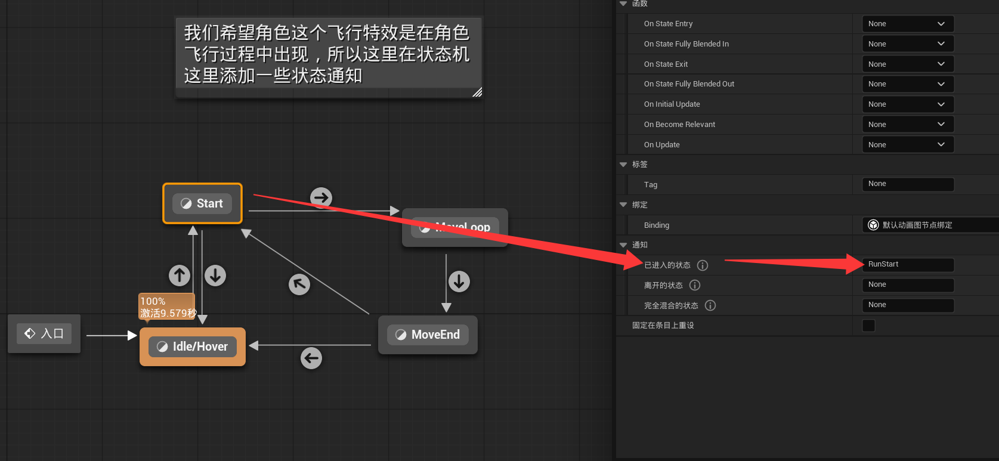

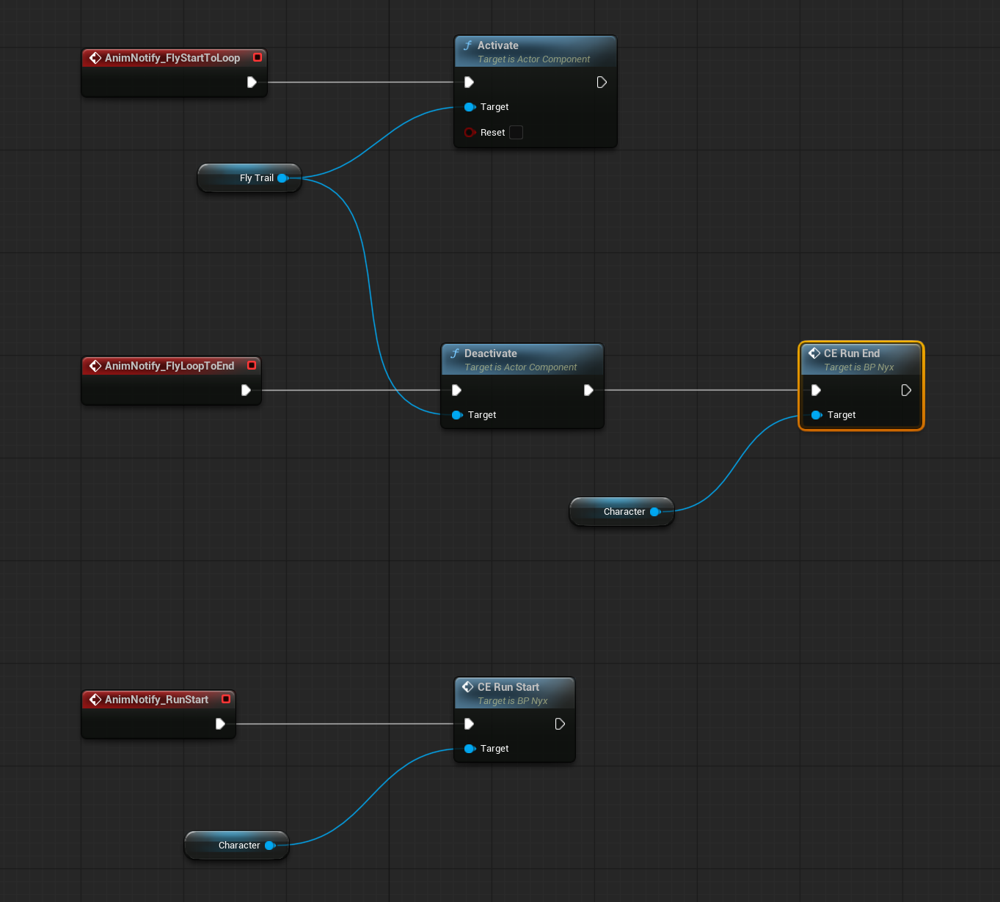

### 7.2 Spawn System Attached 与开始时的 Timeline

`BP_Nyx.CE_RunStart` 的执行链为：

```text
CE_RunStart
  → 初始化 MPC_RediaBlur.UV_Offset
  → 停止相关收尾 Timeline，调用 CameraPostProcess 挂载后处理
  → Spawn System Attached（NS_FlyStone）
  → 将返回的 Niagara Component 保存到 Fly Particle（FlyParticle）
  → Timeline_RunStart.Play from Start
  → Update：Set Float Parameter(Radius)
  → Set Float Parameter(RotationSpeed)
  → Set Scalar Parameter Value（MPC 的 BlurIntensity）
  → Set Vector Parameter Value（MPC 的 UV_Offset）
```

| 创建参数 | 配置 |
| --- | --- |
| System Template | `NS_FlyStone`，同一个组件内运行宝石与 Ribbon 两个发射器 |
| Attach to Component / Attach Point | 角色 Mesh / `Bip001-Pelvis` |
| Location | Get Socket Transform 的世界位置，插槽同为 Bip001-Pelvis |
| Rotation | Get Actor Rotation 的世界旋转 |
| Location Type | `Keep World Position` |
| Auto Activate / Auto Destroy | 开启自动激活；关闭自动销毁 |
| Pooling Method / Pre Cull Check | `None` / 开启 |

Keep World Position 使传入的位置、旋转按世界变换处理，附着后由父组件关系继续带动组件。位置取骨盆插槽、旋转取角色朝向，意味着初始轨道朝向使用角色旋转，而非直接使用插槽的旋转输出；它也不会锁定组件以后一直保持世界朝向。

Timeline 的 Radius 与 RotationSpeed 两条 Float 轨道在 Update 中依次写入同一个 Fly Particle。截图节点类型是 **Set Float Parameter（FXSystemComponent）**，参数名使用 `Radius`、`RotationSpeed`；NS_FlyStone 的用户参数重定向将它们对应到 `User.Radius`、`User.RotationSpeed`。

前两条轨道分别改变 `100 × User.Radius` 的轨道半径与公转圈速；新增 Blur、V_Offset 轨道通过 MPC 控制镜头后效的强度和中心。Timeline_RunStart 的时长为 0.8 秒，具体曲线与相机动作的配合见第 9 节。起飞 Update 中没有设置 Niagara Size，因此不能把第 5.13 节的 Size 动画计算示例当成起飞分支实际执行的操作；快速取消分支则明确写入 Size。

Auto Activate 开启，说明组件创建时即可运行，随后才通过 Timeline 写参数。若需要严格控制第一帧的展开位置，应核对首次模拟前实际使用到的参数值；在创建之后接 Timeline，并不天然保证首次 Spawn 已取得期望的起始半径。

### 7.3 结束时收拢、停用和销毁

正常结束使用两个独立 Timeline，Sequence 在同一次事件中启动两条时间线：

```text
CE_RunEnd
  → MPC.UV_Offset 恢复为中心位置
  → Sequence
      Then 0 → Timeline_RunEnd.Play from Start（0.4 秒）
                 Update：设置 FlyParticle.Radius、RotationSpeed
                 Finished：Deactivate → Delay(0.2 秒) → Destroy Component
      Then 1 → Timeline_RunendPP.Play from Start（1.5 秒）
                 Update：写 MPC.BlurIntensity
                 Finished：清除相机后处理材质
```

Timeline_RunEnd 的 Radius 和 RotationSpeed 均已接入 Set Float Parameter。它管理宝石运动和组件回收；较长的 Timeline_RunendPP 只管理 MPC 与相机后处理，不会在组件销毁后继续向它写参数。Sequence 先执行 Then 0，再执行 Then 1，但启动一条 Timeline 不会等待其播完，所以两条时间线会并行推进。

Deactivate 请求停用，实际是否允许已有粒子继续模拟、是否停止位置事件，还要结合 Niagara 系统及发射器的 Inactive Response。Delay 的 0.2 秒与当前 Ribbon 初始寿命相同，可以为残余条带留出消退时间；它不保证任何停用配置下都能自然排空。Destroy Component 会明确结束该组件内宝石、精灵和 Ribbon 的剩余模拟与绘制。

Fly Trail 与 Fly Particle 是不同组件引用：前者对应骨骼采样拖尾，后者对应带宝石 Ribbon 的 NS_FlyStone。开始时创建 Fly Particle，结束时显式销毁，与第 3 节中保存 Fly Trail 并反复启停的控制方式不同。

若在结束后的延迟期间又开始一次飞行，FlyParticle 变量可能已指向新组件；延迟后的销毁应确保操作的是本次结束所对应的旧组件。这个细节来自“共享变量在 Delay 后重新读取”的执行方式，会直接影响连续起停时的特效生命周期。

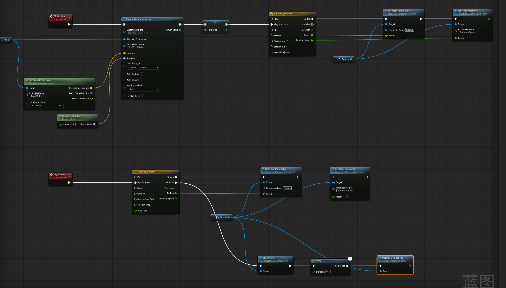

## 8. 飞行屏幕后处理：径向模糊与径向色差

### 8.1 Post Process 材质的输入、输出和挂载

这部分效果通过对已渲染的场景颜色进行 UV 重采样实现，不需要改变角色、宝石或场景模型的位置。它会处理输入图像中已经存在的角色、背景和发光特效，制造高速飞行的放射状拉伸感。

`EF_M_PP_RadiaBlur` 的 Material Domain 为 **Post Process**，混合位置为 **Scene Color After Tonemapping**，Blendable Priority 为 `0`，Is Blendable 开启。材质使用 `SceneTexture:PostProcessInput0` 读取当前阶段的输入颜色，将最终 RGB 接到 **Emissive Color（自发光颜色）**。

这里的 Emissive Color 是后处理输出图像的接口，不代表给场景添加光源，也不等同于表面材质的发光照明。该材质不通过 Base Color、Roughness 等表面属性计算画面。PostProcessInput0 表示此后处理阶段收到的颜色；它可能已经包含前面其他后处理的结果，不应一律称为未经处理的原始 SceneColor。

截图中将径向模糊资源加入 PostProcessVolume 的 **Post Process Materials** 数组，条目权重为 `1.0`。体积是否影响当前镜头，还取决于摄像机位置、Blend Radius、Blend Weight 和 Infinite Extent（Unbound）等配置；材质条目有内容，并不能单独保证任意位置的摄像机都受到它影响。

`EF_PP_RadiaBlur` 文件是指向 `EF_M_PP_RadiaBlur` 的资产重定向器，不是另一套独立模糊实现。材质自身保留局部强度参数，并读取 `MPC_RediaBlur` 中的全局强度与中心坐标，完整控制关系见第 8.14～8.16 节；角色蓝图中的动态挂载见第 9 节。

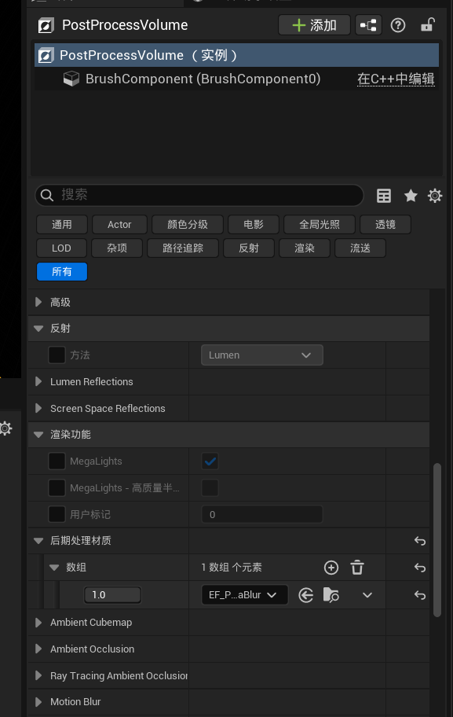

### 8.2 Blendable Location：选择的是处理阶段与目标缓冲

**Blendable Location（可混合位置）决定材质插入渲染管线的位置，以及该位置可读取、修改的图像内容。** 它不会直接控制模糊强度，也不等于材质的透明混合模式。切换位置之后，即使节点和参数相同，画面亮度、透明特效、景深、Bloom 和噪点表现也可能变化。

UE 5.8 的有效选项如下。表中的场景颜色指对应阶段的图像，不表示所有透明层都已经合成进去；具体执行还受渲染路径和功能开关影响。

| 可混合位置 | 处理内容与输入 | 对场景和特效的影响 |
| --- | --- | --- |
| **Scene Color Before DOF** | 透明折射扰动之后、景深之前的场景颜色；Input0 不含 AfterDOF 透明层，Input1 提供该透明层 | 径向模糊的结果还会继续经过景深、后续透明合成、时域处理、Bloom 与色调映射。适合希望效果进入较早图像处理的情况；不能据此期待尚未合成的辉光或精灵也一起被模糊 |
| **Scene Color After DOF** | 景深之后、AfterDOF 透明层合成之前的场景颜色；Input0 仍不含该透明层 | 输入中的背景景深已形成，此材质不再先于该次景深。AfterDOF 的 Niagara 精灵可能随后清晰地叠加到模糊背景上，造成“场景模糊而粒子不模糊”的差异 |
| **Translucency After DOF** | 修改尚未合入场景颜色的 AfterDOF 透明层；Input0 为景深后的场景颜色，Input1 为透明层 | 目标是透明缓冲，适合专门处理这类精灵、透明网格或雾层。它不是对整个场景做径向模糊的等价入口；还要正确处理透明颜色及 Alpha 的合成语义 |
| **SSR Input** | 修改 TAA/TSR 之后、供下一帧屏幕空间反射使用的历史输入；Input0 为对应时域输出 | 面向 SSR 反射历史，可用于反射背景等处理。不能把它当成普通的当前帧全屏镜头滤镜；采用 Lumen 等反射路径时也不能假定效果与 SSR 相同 |
| **Scene Color Before Bloom** | Bloom 之前的线性场景颜色；Input0 为前序场景结果 | 已合成的透明特效会随场景参与处理；模糊、分色后的高亮还可进入随后的 Bloom 和色调映射。适合让宝石亮部和放射拖影进一步形成光晕，但其亮度与颜色会继续被后续流程改变 |
| **Replacing the Tonemapper** | 替换引擎色调映射阶段；输入仍是线性颜色，Input0 为前序场景颜色，Input1 为 AfterDOF 透明层 | 接管了正常色调映射输出的职责，需要考虑曝光、颜色映射、输出色彩空间及原管线功能的衔接。普通径向模糊不需要为获得强度而替换 Tonemapper |
| **Scene Color After Tonemapping** | 色调映射之后的场景颜色；Input0 为前序结果，Input1 可提供 AfterDOF 透明层 | 直接处理已经形成的画面外观，当前材质使用此位置。已有 Bloom 可以被拉伸、分色，但此处新增的亮部不会再回到已经执行过的 Bloom 中产生一轮光晕；也不能指望前面的 TAA/TSR 替此处的新噪点做历史累积 |

前三项处于渲染分辨率阶段，使用线性颜色。SSR Input、Before Bloom、Replacing the Tonemapper 和 After Tonemapping 在 TSR/TAAU 路径中运行于显示分辨率，否则按渲染分辨率执行。实际纹理尺寸仍应以当前输入为准；透明层还可能拥有独立的分辨率设置。

After Tonemapping 的颜色格式取决于输出配置，例如 SDR、HDR 或线性输出，**不能无条件将“色调映射之后”理解为固定的 8 位 LDR/sRGB 图像**。同样，移动端、外部升频器和自定义渲染扩展的流程不能完全按一条桌面管线推断。

上述选项以本项目 UE 5.8 的 `BlendableInterface.h` 和渲染器实现为准，名称也可对照[官方 EBlendableLocation 枚举](https://dev.epicgames.com/documentation/en-us/unreal-engine/API/Runtime/Engine/EBlendableLocation)。旧教程中的 Before Translucency、Before Tonemapping、After Tonemapping 已是兼容旧资产的隐藏名称，分别对应 Before DOF、After DOF、After Tonemapping；不能仅按旧名字推断它位于所有透明合成之前或之后。

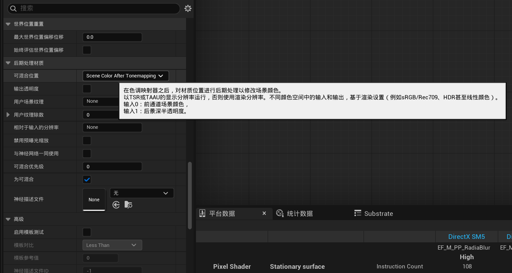

### 8.3 混合位置对飞行画面的具体影响

选择位置时，需要分别判断以下关系：

1. **透明特效是否已经合成。** 宝石本体、Additive 精灵、Ribbon 和折射材质不一定处于同一透明渲染阶段。Input0 中没有的层，重复采样再多次也不会被一起模糊。要让背景和已合成的飞行特效形成统一放射感，Before Bloom 或当前 After Tonemapping 的场景入口更直接。
2. **高亮是在 Bloom 前被拉伸，还是拉伸已经生成的 Bloom。** Before Bloom 改变后续提取的高亮分布；After Tonemapping 处理的是已合成光晕的画面。两者都能看到亮条，但不具有相同的光晕形成过程。
3. **噪点产生于时域处理之前还是之后。** Before DOF、After DOF 通常早于桌面管线的 TAA/TSR；Before Bloom 和当前 After Tonemapping 通常已在其后。把抖动节点命名中的 TemporalAA 当成自动降噪开关，会错误估计当前全屏质量。提前处理可以让后面的时域算法看到噪点，同时也可能引入运动中的拖影或历史拒绝，必须观察动态画面。
4. **是否改变了颜色处理和像素数量。** 在线性高动态范围阶段平均高亮，与对已映射的颜色平均，数学结果不同；显示分辨率上的全屏多次采样还会随输出分辨率增加成本。

可以用以下关系理解颜色差异。设 `T` 为色调映射函数，`C1、C2` 为两个线性颜色：

```text
T((C1 + C2) / 2) 通常不等于 (T(C1) + T(C2)) / 2
```

因此更换 Blendable Location 后，亮部的拖影和颜色饱和度可能一起改变，不能只重新匹配 BlurIntensity 就保证画面完全一致。

Blendable Priority 用于**同一位置内**不同后处理材质的排序，较小值先执行；它不能把 After Tonemapping 材质移动到 Before Bloom。PostProcessVolume 的 Priority 主要涉及多个体积的设置混合，也不能替代材质的管线位置。相同父材质的实例可以按参数混合，多个不同材质则可能形成先后处理，后一个阶段读到前一个阶段的输出。[后处理材质与混合说明](https://dev.epicgames.com/documentation/unreal-engine/post-process-materials-in-unreal-engine?lang=en-US)

### 8.4 单次采样：将画面沿中心方向放大或缩小

第一版从 TexCoord 取得屏幕 UV，减去 `0.5` 得到以画面中心为原点的方向，再乘模糊强度及抖动值，加回原始 UV：

```text
u = TexCoord.xy
c = (0.5, 0.5)
d = u - c
j = DitherTemporalAA(...)
SampleUV = u + d × BlurIntensity × j
Color = PostProcessInput0(SampleUV)
```

Subtract 的 B 接标量 `0.5` 时，运算会作用到 U、V 两个分量，相当于减 `(0.5,0.5)`。中心处 `d = 0`，位置不变；离中心越远，偏移越大。因此这里使用的是带长度的径向向量，没有 Normalize，强度天然向屏幕外侧增加。

如果 `j` 固定，单次采样只会得到一个围绕中心缩放的图像，并不会凭空形成连续模糊。加入逐像素变化的抖动后，各像素从不同径向位置取色，视觉上接近稀疏的径向模糊估计，但单帧中会暴露颗粒、斜纹和不连续的高亮采样。

还要区分**采样方向**和**图像显示的拉伸方向**：从更外侧取样，会把外侧内容显示到当前像素；从更靠中心处取样，则会把中心附近内容显示到外侧像素。不能只看 UV 前面的正负号，就直接把它称为向外或向内飞散。

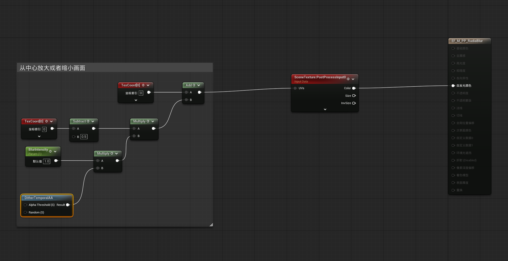

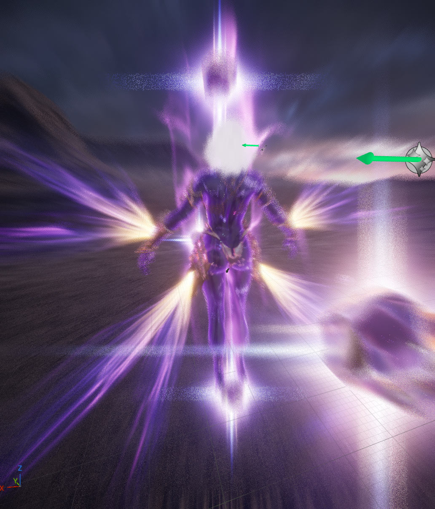

### 8.5 DitherTemporalAA 在这里提供采样抖动

本材质把 DitherTemporalAA 的 Result 接到 UV 偏移计算中，没有将它用作透明度裁剪。引擎函数结合屏幕像素位置、时域采样索引和噪声纹理计算标量扰动；Alpha Threshold 与 Random 未连接时，分别采用该函数定义的默认预览值 `0.5` 与 `1.0`。

它的名字不意味着函数内部已经为模糊结果保存历史、重投影或累计多帧颜色。这里的角色是提供随像素和时间变化的采样位置，**模糊颜色仍由本材质自己读取和平均**。当前材质放在 After Tonemapping，前面的时域处理已经执行，不能依赖它自动消除这一阶段新生成的抖动颗粒。

第一版可以用于短时、局部、高速变化的技能演出，因为颗粒有时会成为表现的一部分；全屏效果覆盖角色轮廓、地面纹理和大面积背景，持续暴露同样的采样缺陷，因此需要更密的采样。这里的质量限制来自采样与显示方式，并非“单次采样只能用于技能”的引擎规则。

### 8.6 两次采样：不同偏移相加后除以二

第二版沿同一径向方向建立两路取样，第二路的抖动值加上 DitherAdd，然后将颜色相加并除以 2：

```text
t0 = j
t1 = j + DitherAdd
C0 = P(u + d × BlurIntensity × t0)
C1 = P(u + d × BlurIntensity × t1)
Color = (C0 + C1) / 2
```

这里 `P` 表示读取同一份 PostProcessInput0。它是**同一个材质 Pass 内的两次取样平均**，不是把后处理体积执行两遍，也不是第二路读取第一路已经模糊过的图像。

除以样本数使权重之和为 1，避免把相加造成的整体增亮误认为质量提升。只增加 Add 而不归一化，会同时改变画面能量和高亮表现。

两路需要具有不同的采样位置。截图里的 **DitherAdd 默认显示为 `0`**：如果运行时也保持零，其他输入又相同，两次采样将完全重合，平均后等于原先的一次采样，不会仅因复制节点而减少噪点。调成非零偏移后，才真正扩大了径向采样覆盖。

与单次结果相比，两路有效采样可以减少稀疏取样造成的颗粒和高亮漏采，但两路共用同一个 `j`，不是两组相互独立的随机变量，不能直接套用独立噪声平均的降噪比例。

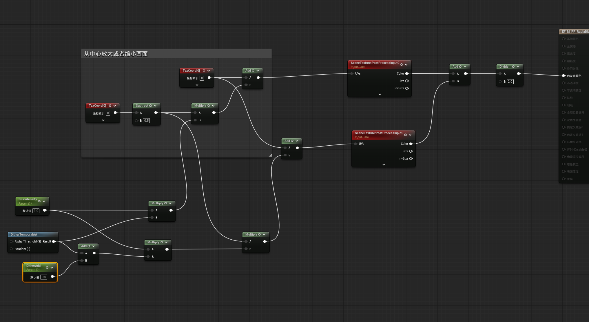

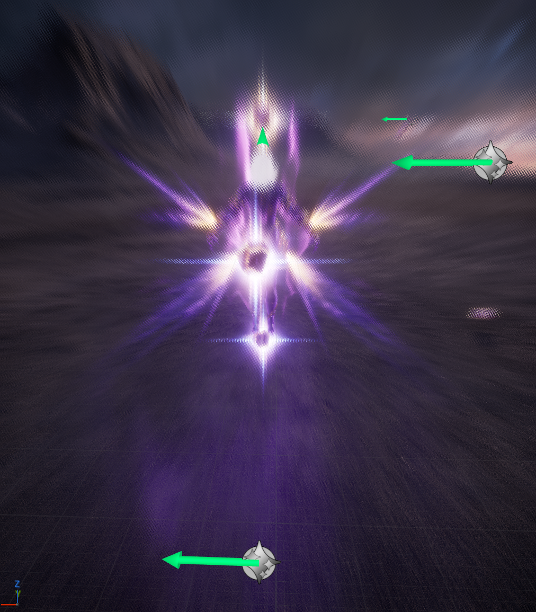

### 8.7 四次采样封装为 EF_MF_BlurRadial

保存资产中的材质函数将四个场景颜色样本相加，最后除以 `4`。它以同一个抖动值为起点，连续叠加 `0.15` 形成四个采样系数，完整计算为：

```text
u = TexCoord.xy
c = UVOffset
d = u - c
k = -0.1 × BlurIntensity
t_i = j + 0.15 × i                      // i = 0、1、2、3
SampleUV_i = UVs + d × k × t_i
SceneColor = Σ P(SampleUV_i) / 4
```

四个系数为 `j、j+0.15、j+0.30、j+0.45`。它们共用随机起点，并沿同一方向拉开，不是四个独立随机样本，也不是四个渲染 Pass。当前计算没有对系数取 Frac 或限制到 0～1，因此不能把四个位置固定描述为某段单位区间的四等分。

`-0.1` 同时控制偏移方向与数值量级。正 BlurIntensity 通常让样本朝中心侧移动，使图像内容呈向外拉伸的拖影；BlurIntensity 的符号改变时方向反转。相同强度下，四个样本可以覆盖更多位置，但不会自动解决任意长距离模糊的稀疏采样。

| 函数接口 | 类型与默认来源 | 作用 |
| --- | --- | --- |
| `UVs` | Vector2；未连接时使用内部 TexCoord 的预览输入 | 四路采样的共同基础 UV，允许主材质为 R、G、B 传入不同坐标 |
| `UVOffset` | Vector2；未连接时预览输入为 `(0.5,0.5)` | 内部径向方向 `TexCoord - UVOffset` 的中心 |
| `BlurIntersity` | 接口沿用资产拼写；类型为 Vector3，预览输入为标量 `0.1` | 本例调用处传入标量 BlurIntensity，按统一强度参与计算；不是三个颜色通道的最终输出颜色 |
| `SceneColor` | 函数输出 | 四个场景颜色采样的平均结果 |

**预览默认值只在对应输入未连接且允许使用预览值时生效。** 主材质已经连接 UVOffset 时，函数里的 `(0.5,0.5)` 不会替它覆盖调用端的其他值。当前输入读取 MPC 的 UV_Offset 并取 R、G，其集合默认值为 `(0.5,0.5,0,0)`，因此默认围绕画面中央展开；运行时可随 V_Offset 曲线移动中心。

还有一个接口细节：函数内部的方向由**内部 TexCoord 减 UVOffset**计算，UVs 只负责基础采样位置。主材质改变某路 UVs 时，函数不会自动用该路 UVs 重新计算一套径向方向；这会影响与色差偏移叠加后的准确公式。

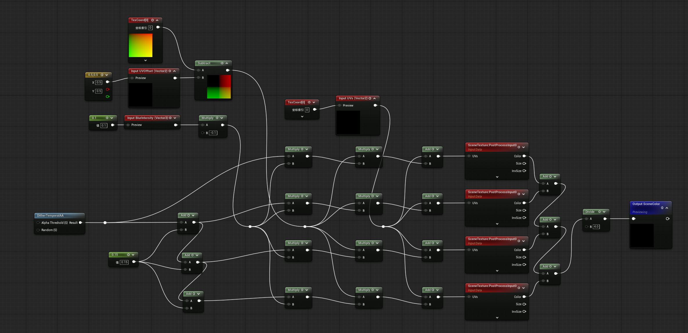

### 8.8 RGB 分离：为三个通道分别提供采样位置

图中称为“色相偏移”的效果，具体使用 **Chromatic Aberration / RGB 色差分离** 的思路：三个颜色通道从不同 UV 位置读取，再组合回 RGB。它与 HueShift 改变同一像素色相的运算不同，主要表现是高反差边缘附近出现红、绿、蓝的空间错位。

第一版色差将 CA_Intensity 乘 `0.001`，得到小幅偏移。标量加到 Vector2 UV 上会同时改变 U、V，可理解为：

```text
a = CA_Intensity × 0.001
UV_R = u
UV_G = u + (a,a)
UV_B = UV_G + (a,a) = u + (2a,2a)
```

这时是统一斜向分离，没有根据距中心的位置改变方向或强度。例如 `a = 0.0005` 时，在 1920×1080 图像上，单级偏移约为横向 0.96 像素、纵向 0.54 像素；同一个 UV 数值并不代表横纵相同的像素距离。

主材质分别调用三次 EF_MF_BlurRadial，取各路的对应通道：

```text
R = BlurRadial(UV_R).R
G = BlurRadial(UV_G).G
B = BlurRadial(UV_B).B
FinalRGB = AppendMany(R,G,B).RGB
```

Component Mask 负责取出对应标量通道，AppendMany 负责将三个标量重新组成 RGB，并将 RGB 输出接到 Emissive Color。Mask 和重组顺序都影响结果：把采样的 B 放到输出 R、把 R 放到输出 B，会额外交换红蓝颜色，不能只把它理解为改变色差方向。

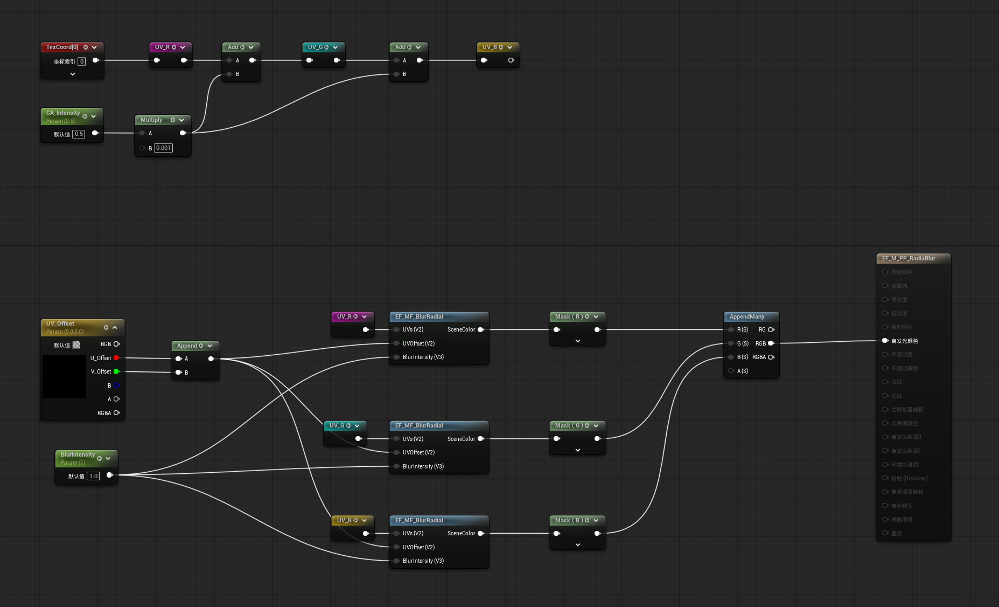

### 8.9 从均匀偏移改为径向延展

为使色差围绕画面中心向外展开，主材质增加了 `CenterUV = TexCoord - 0.5`，用它调制色差偏移。设 `q` 为 CA 节点输出，`d_CA = u - (0.5,0.5)`，按截图 10 和保存资产的真实连接关系：

```text
UV_R = u
UV_G = UV_R + d_CA × q
UV_B = UV_G + d_CA × (q + q)
     = u + 3 × d_CA × q
```

**蓝通道相对原始 UV 的总偏移是三倍 q。** 因为它的 Add 节点 A 已经来自 UV_G，再加两倍偏移，不能直接写成 `u + 2 × d_CA × q`。因此三路实际采用 `0、1、3` 的偏移系数，并非等间距的 `0、1、2`。

`d_CA` 没有 Normalize：画面中心为零，边缘偏移增大，四个象限的偏移方向也随之改变。这使色差呈现放射状延展，而不是整幅图向某个斜方向平移。它是采样位置的径向变形，没有给场景模型增加真实位移。

色差中心固定使用 `(0.5,0.5)`，模糊中心则使用函数参数 UVOffset；二者只有在 UV_Offset 的 R、G 也为 0.5 时才重合。修改模糊中心不会自动移动色差中心。

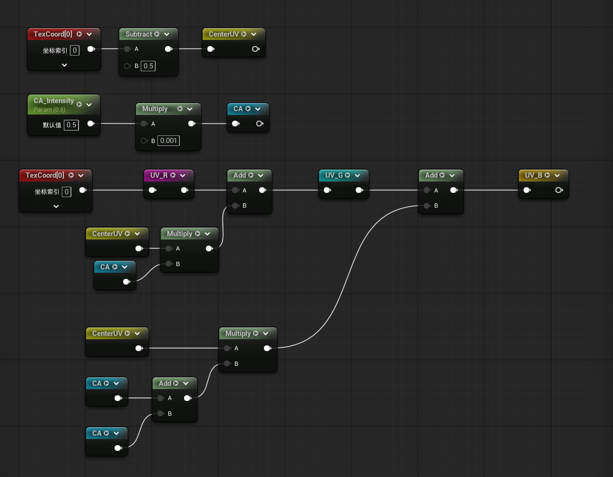

### 8.10 偏移正负、通道次序与实际实例参数

截图中的 CA 节点把倍率从早期的 `+0.001` 改成 `-0.01`，这一阶段的计算为：

```text
q = CA_Intensity × (-0.01)
```

同一个 CA_Intensity 下，这次改动同时**反转采样偏移方向，并将幅度扩大 10 倍**。正 CA_Intensity 对应负 q，G、B 的采样位置更靠中心侧，显示内容更向外展开；负 CA_Intensity 会使 q 为正，采样及可见延展方向随之反转。最终红蓝边缘的排列还取决于输出通道是否交换。加入 Mask 和材质参数集后的资产使用 `-0.1` 倍率，并乘入全局强度与遮罩；当前完整公式见第 8.14 节。

截图中的通道重组示意包含 R/B 对调的画面；保存的 EF_M_PP_RadiaBlur 则使用 **R 取 R、G 取 G、B 取 B** 的标准输出。记录公式时要同时核对 UV 来源、Mask 通道和 AppendMany 输入，而不能只依赖分支旁的 UV_R、UV_B 名字。

| 参数及来源 | 默认值 | 作用 |
| --- | --- | --- |
| BlurIntensity | `1.0` | 模糊强度倍率，与 MPC 系数、Mask 相乘后输入模糊函数 |
| CA_Intensity | `0.3` | 色差强度倍率，与 MPC 系数、Mask 相乘后再乘 `-0.1` |
| UV_Offset.R（MPC） | `0.5` | 模糊与保护遮罩中心的 U 坐标 |
| UV_Offset.G（MPC） | `0.5` | 模糊与保护遮罩中心的 V 坐标 |
| MaskRadius | `0.4` | 中心弱、外围强的遮罩过渡范围 |

父材质节点上的 Param 默认值不等于所有运行时实例的有效值；函数预览强度 0.1 也不等于主材质传入的有效强度。调试时应同时确认后处理引用的材质、局部参数和当前 World 中 MPC 的值。

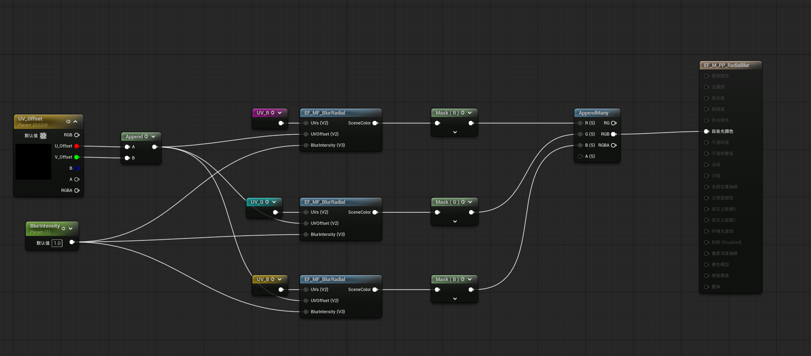

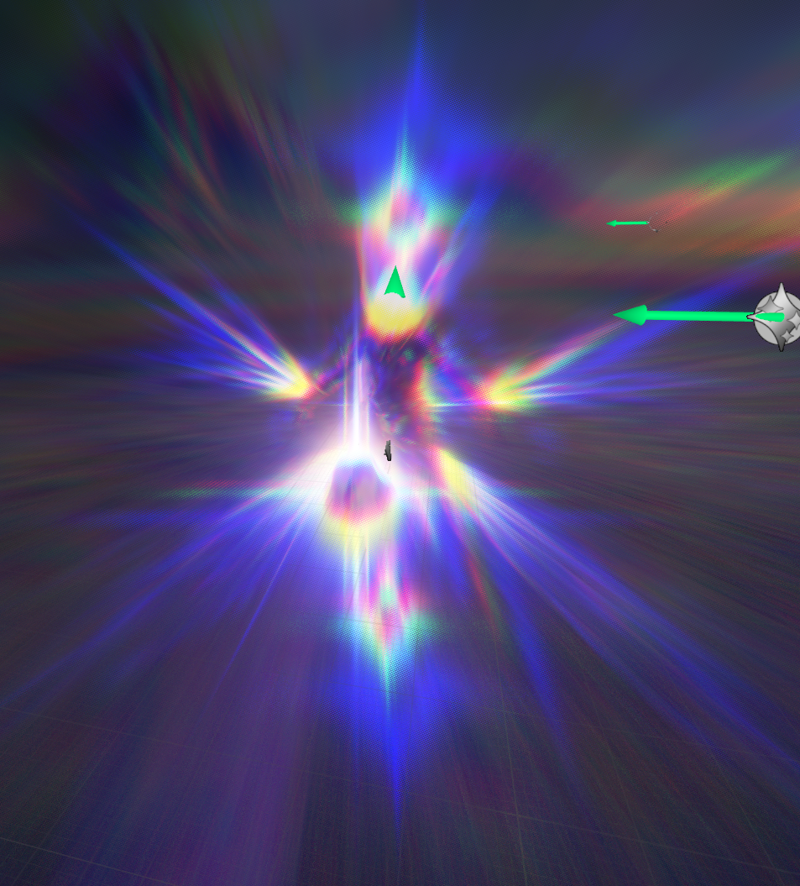

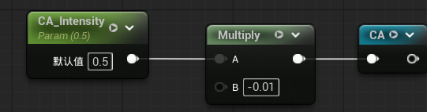

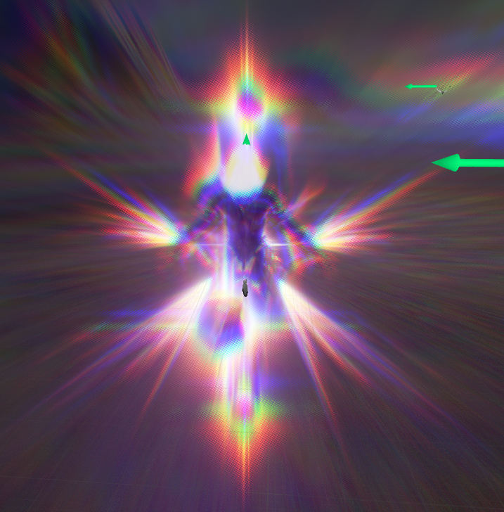

### 8.11 与内置 Chromatic Aberration 的关系

PostProcessVolume 本身提供 Chromatic Aberration 的 Intensity 与 Start Offset，用于镜头边缘的色散效果。截图中这两项的覆盖复选框未勾选，灰色数值不能当成该体积正在主动设置的参数；其他体积或相机是否启用了它，还需看最终叠加设置。[内置色差效果说明](https://dev.epicgames.com/documentation/unreal-engine/scene-fringe-chromatic-aberration?application_version=4.27)

自定义材质里的 CA_Intensity 是另一套参数，与内置 Intensity 没有数值上的一一对应。自定义实现允许将通道位置和四次径向模糊放在同一条计算链中；如果内置色差也在最终后处理中开启，两者可能叠加，画面边缘的分离强度就不能只由 CA_Intensity 解释。

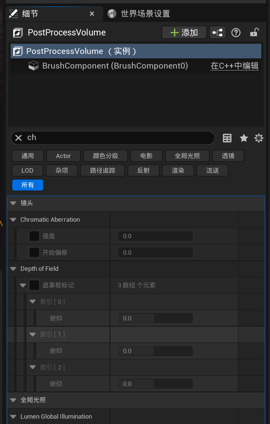

### 8.12 全屏采样的质量、UV 与性能边界

每次 EF_MF_BlurRadial 调用包含四个场景颜色采样，三路 RGB 调用在结构上合计 **12 次场景颜色采样请求**。函数封装便于复用，不会自动把这些场景取样缩减成一次；具体 GPU 指令、共享表达式消除和纹理取样成本仍以目标平台编译结果及 GPU 测量为准。DitherTemporalAA 本身还使用了噪声纹理，不能把 12 当作整个着色器的完整纹理开销。

四次平均改善的是每个输出像素的径向取样覆盖。增加输出分辨率会增加被处理像素数；增加 BlurIntensity 会拉大采样间距，并不增加样本数量，因此较大强度仍可能出现分层、断续和颗粒。截图中的早期指令统计也不能直接作为加入三路色差后的最终性能数据。

保存函数中的 SceneTexture 节点未启用 Filtered，使用默认点采样。点采样与多次径向平均是两层不同的问题：多取几个点不等于每个样本内部已经采用双线性过滤。支持过滤的场景颜色输入可按目标画质评估 Filtered，但不能假定所有 SceneTexture 类型都允许相同过滤方式。

UV 方面还要分别处理以下细节：

- **视口坐标与底层纹理坐标。** TexCoord、ScreenPosition 的 ViewportUV、SceneTextureUV 和 Render Target 的有效区域不应在 Custom HLSL 中随意混用。编辑器多视口、动态分辨率或升频会使输入纹理大小与当前视口不同；标准 SceneTexture 节点会生成相应转换和边界处理，自定义采样则需要正确处理这些步骤。
- **当前阶段的纹素尺寸。** 需要按像素定义偏移时，可用 PostProcessInput0 的 Size / InvSize，不能默认 ViewSize 永远等于升频后的输入尺寸。[时域升频与后处理尺寸说明](https://dev.epicgames.com/documentation/en-us/unreal-engine/temporal-upscalers-in-unreal-engine)
- **边缘越界。** 较大的模糊或 CA 偏移可能让取样走出有效区域。Clamp 可以避免读取无效区域，但会重复边缘颜色，仍可能产生拉边；它不会补回屏幕外不存在的图像内容。
- **中心与宽高比。** 当前中心按归一化 UV 表达。需要圆形半径遮罩或等像素距离的径向权重时，应考虑画面宽高比；仅用归一化 UV 的欧氏距离，可能得到屏幕上的椭圆范围。

当前颜色读取只包含屏幕输入图像，径向模糊不是基于速度缓冲的物理运动模糊，也不会补出被角色遮挡的背景。角色和场景之间可以被一起混合，薄轮廓附近可能出现颜色外溢。中心保护由主材质中的 SphereMask 控制模糊和色差的采样偏移，详见第 8.13 节；它没有使用角色深度或模板缓冲来精确识别角色轮廓。

关闭效果时也应区分局部强度和全局系数：**材质局部 BlurIntensity 为 0 只让每一路模糊函数回到其基础 UV 取样，局部 CA_Intensity 非零且全局系数非零时，RGB 仍可来自不同位置。** 标准 RGB 重组下，将两种局部强度都归零，或将共用的 MPC BlurIntensity 归零，都可以回到同位置的原图取样。

| 现象 | 对应检查 |
| --- | --- |
| 两次取样几乎没有改善 | 两路 UV 是否确实不同，DitherAdd 是否仍为 0，颜色是否按样本数归一化 |
| 全屏仍有斜纹或颗粒 | 单帧样本数、抖动幅度、点采样，以及材质是否位于 TAA/TSR 之后 |
| 角色模糊而部分精灵清晰 | Blendable Location 与精灵材质的透明渲染阶段；输入中是否已包含该透明层 |
| 改到 Before Bloom 后亮度和光晕变化 | 模糊结果进入了后续 Bloom 和色调映射，比较的是不同颜色处理顺序 |
| 模糊中心偏到角落 | 调用端 UV_Offset 是否实际为 `(0.5,0.5)`；函数预览默认值是否被连接覆盖 |
| 修改模糊中心后，色差仍绕屏幕中央 | 色差 CenterUV 固定减 0.5，未与 UV_Offset 共用中心 |
| 蓝通道分离比预想更远 | UV_B 从 UV_G 再加两倍 q，最终相对原图是三倍偏移 |
| 关闭 BlurIntensity 后仍然有彩边 | CA_Intensity 与内置 Chromatic Aberration 是否仍在生效 |
| 原本红色物体变成蓝色 | Component Mask 和 AppendMany 是否进行了 R/B 通道互换 |

### 8.13 SphereMask 与 OneMinus：中心清晰、外围增强

中心保护遮罩由主材质计算，节点链为：

```text
TexCoord.xy ──────────→ SphereMask.A
MPC.UV_Offset.RG ─────→ SphereMask.B（默认 0.5,0.5）
MaskRadius ───────────→ SphereMask.Radius
SphereMask → OneMinus（1-x）→ 命名重路由 Mask
```

| 输入或节点 | 配置与作用 |
| --- | --- |
| A | 当前像素的二维 UV 位置 |
| B | 截图使用标量 0.5 扩展为屏幕中心；当前材质读取 MPC.UV_Offset.RG，以便随曲线移动保护中心 |
| Radius | 局部 Scalar Parameter `MaskRadius`，默认 `0.4`；单位为归一化 UV 距离 |
| Hardness | 截图为 0，资产的 HardnessPercent 为 0%，使用软过渡 |
| SphereMask 输出 | 中心高、外围低 |
| OneMinus 输出 | 将前者翻转为中心低、外围高，作为特效强度权重 |
| 命名重路由 Mask | 便于在模糊和色差两条分支中读取同一权重；它不是 Component Mask 节点 |

SphereMask 虽然以 Sphere 命名，但这里的 A、B 是 Vector2，因此计算的是 UV 平面中的距离范围。设中心为 `c = MPC.UV_Offset.RG`，`r = length(u - c)`，`R = MaskRadius`，并将硬度记为 0～1 的 `h`，其计算可理解为：

```text
S = saturate((1 - r / max(R,ε)) / max(1-h,ε))
Mask = 1 - S
```

这里 ε 是避免除零的小正数。**Hardness = 0 时，公式化简为 `Mask = saturate(r / R)`。** 默认 R 为 0.4 时，权重沿距离变化如下：

| 距中心的 UV 距离 r | Mask | 对模糊和色差强度的影响 |
| --- | --- | --- |
| `0.0` | `0.0` | 关闭该像素处的采样偏移 |
| `0.1` | `0.25` | 有效强度为外围强度的四分之一 |
| `0.2` | `0.5` | 有效强度为外围强度的一半 |
| `0.4` 及更远 | `1.0` | 使用完整外围强度 |

因此 Radius 为 0.4 并不表示“半径 0.4 内完全清晰、圆外才模糊”：当前硬度为零，权重从中心开始连续增加，角色附近只是得到更弱的效果。径向方向向量本身也在中心趋近零，再与 Mask 相乘，会进一步压低近中心区域的偏移。

若需要有一块严格不受影响的中心区域，硬度与半径要共同考虑。在 `0≤h<1` 时，`r≤R×h` 的区域中 Mask 为 0，`R×h～R` 为渐变区。例如 R=0.4、h=0.8 时，内侧约 0.32 的 UV 半径完全关闭偏移，0.32～0.4 之间渐变。硬度接近 1 时边界变硬，容易显出效果分界。

增加 MaskRadius 会让同一位置的权重降低，弱化效果的区域扩大；减小半径则更快达到完整强度。将半径设为零不是关闭后效的方法，它会让过渡范围收缩到中心附近；关闭应使用强度系数。

截图中保护中心固定为 `(0.5,0.5)`；当前资产已让 Mask 与模糊函数共同读取 MPC.UV_Offset.RG，因此蓝图移动中心时两者一起变化。它仍不自动识别或跟踪角色轮廓；色差分支的 CenterUV 还保持 `TexCoord-0.5`。归一化 UV 距离会受屏幕宽高比影响，在宽屏上显示为椭圆形范围。

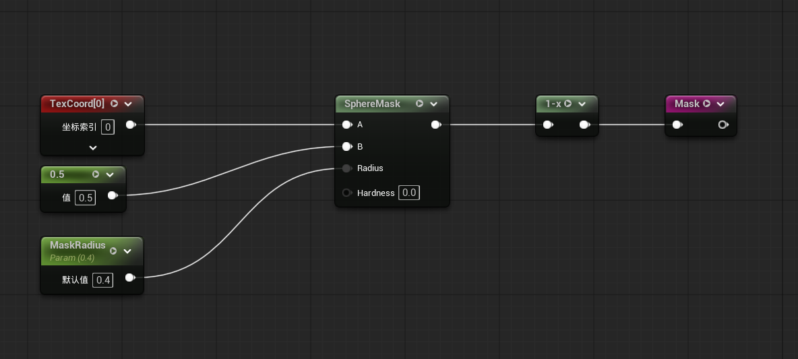

### 8.14 Mask 同时控制模糊和色差的实际计算链

主材质将 Mask 乘入**两条采样偏移分支**，没有在末端使用 `Lerp(原图,处理图,Mask)`。两种接法都能削弱中心效果，但画面含义不同：乘强度会缩短中心像素的取样距离；最终 Lerp 则混合完整强度的处理结果和原图，可能保留长拖影与原图的重叠。

设：

```text
W = MPC_RediaBlur.BlurIntensity
B = 材质局部 BlurIntensity
A = 材质局部 CA_Intensity
M = Mask
```

保存资产中的完整偏移公式为：

```text
有效模糊强度 = W × B × M
k = -0.1 × 有效模糊强度

q = -0.1 × W × A × M
UV_R = u
UV_G = u + (u-0.5) × q
UV_B = UV_G + (u-0.5) × (q+q)
     = u + 3 × (u-0.5) × q

各通道的第 i 个模糊采样：
SampleUV_i = UV_该通道 + (u-UVOffset) × k × (j+0.15×i)
```

四次采样取平均和 RGB 重组保持第 8.7～8.9 节的结构。两个 `-0.1` 分别属于模糊函数内部的距离倍率、主材质色差分支的距离倍率；它们作用在不同分支，不应串乘成同一项。

当 M 为零时，两条分支都没有偏移，RGB 从同一位置取样，可以保持中心像素清晰。只把 Mask 接到模糊强度、遗漏色差分支，会出现“模糊减弱但角色周围仍有彩边”的结果。

这仍是按屏幕位置降低偏移，不是基于角色身份的排除遮罩。外围像素的取样路径仍可能经过角色附近；Mask 不能保证消除所有轮廓外溢，也不能恢复场景本来已经存在的景深、运动模糊或 Bloom。

### 8.15 MPC_RediaBlur：以一个全局系数控制整套后效

材质参数集路径为 `/Game/Effect/Common/Material/Other/MPC_RediaBlur`，包含强度标量与中心向量：

| 参数 | 类型 | 默认值 | 材质中的用途 |
| --- | --- | --- | --- |
| `BlurIntensity` | Scalar | `1.0` | 作为 W，同时乘入局部模糊强度和局部色差强度 |
| `UV_Offset` | Vector | `(0.5,0.5,0,0)` | 取 R、G，作为模糊与保护遮罩的中心 |

主材质中用于强度的两个 Collection Parameter 节点都选择同一个 Collection 和 BlurIntensity 参数名，读取的是同一个值，并不是两份独立的模糊参数。UV_Offset 则由另两个集合参数节点供给中心计算。通过共享强度系数，飞行开始时模糊与色差一起增强，结束时一起恢复原图。

需要区分名称相同的两个参数来源：

| 参数来源 | 修改方式 | 影响范围 |
| --- | --- | --- |
| 普通 Scalar Parameter `BlurIntensity` | 材质默认值或该材质的实例参数 | 模糊分支的局部倍率 B |
| 普通 Scalar Parameter `CA_Intensity` | 材质默认值或该材质的实例参数 | 色差分支的局部倍率 A |
| Collection Parameter `MPC_RediaBlur.BlurIntensity` | 修改对应 World 的材质参数集实例 | 所有读取该集合参数的材质；本材质用它同时控制模糊和色差 |

MPC 是共享参数来源，不是创建材质实例的替代节点，也不会自动把普通 Scalar Parameter 变成集合参数。材质必须放置 Collection Parameter 节点，并将其接入实际计算；只在蓝图里写同名参数，不会自动改变未读取它的材质。[材质参数集官方说明](https://dev.epicgames.com/documentation/en-us/unreal-engine/using-material-parameter-collections-in-unreal-engine)

MPC 的运行时实例按 World 管理。在同一 World 中，多份材质、多个后处理体积或视图若读取同一参数，会一起响应；它不天然提供每个角色或每台摄像机独立的强度。不同 PIE World 可以有各自的运行时值，MPC 更新也不等于网络状态自动复制。

### 8.16 蓝图写入参数集与强度归零

蓝图控制集合标量时，使用 **Kismet Material Library 的 Set Scalar Parameter Value**，配置为：

```text
Set Scalar Parameter Value
  Collection      = MPC_RediaBlur
  Parameter Name  = BlurIntensity
  Parameter Value = 后效强度 W
```

该节点通过 World Context 找到当前世界的集合实例，不需要 Niagara Component 或动态材质实例作为 Target。不要与 Niagara 的 Set Float Parameter、材质实例上的 Set Scalar Parameter Value 混淆：它们写入不同的数据来源，即使参数名相同也不会互通。[集合标量设置节点](https://dev.epicgames.com/documentation/unreal-engine/BlueprintAPI/Rendering/Material/SetScalarParameterValue?lang=en-US)

强度可由 Timeline、曲线或角色状态给出。以 0～1 的曲线作为 W 时，0 表示关闭两条偏移分支，1 表示恢复局部参数定义的完整效果；大于 1 会继续放大偏移，并非自动截断。节点不会自行识别角色是否正在飞行，也不会自行在结束时归零。

当前集合资产的默认值是 1，所以未被运行时覆盖时，该控制系数允许效果生效。若希望非飞行状态没有模糊与色差，状态逻辑需要明确写入 W=0；结束时也应回到零，而不是只把材质局部 B 归零。多个逻辑同时写同一个集合参数时，最终以实际执行的写入为准，起飞与收尾曲线需要避免互相覆盖。

集合资产中的默认值、当前 World 的运行时值和普通材质参数是不同层次。蓝图写入改变的是当前世界实例，不是把该值永久保存为集合资产的新默认值。

Mask 和 W 归零控制的是画面效果，**不保证自动跳过整个全屏材质 Pass 或所有场景颜色采样**。现有结构仍包含三个四次采样的函数调用，不能把中心保护或强度归零直接当成关闭计算成本。

| 现象 | 优先检查 |
| --- | --- |
| 中心角色减弱了模糊，但仍有彩边 | Mask 是否同时乘入 CA 分支；内置 Chromatic Aberration 是否另行开启 |
| Radius 内仍有一些模糊 | Hardness=0 时没有整块零权重内圈，Mask 从中心连续增加 |
| 把 MaskRadius 设为 0 后效果反而扩大 | 半径控制过渡范围，不是开关；用 MPC 的 W=0 关闭 |
| 修改普通 BlurIntensity 后色差不变 | 修改的是局部 B；要同时控制两条分支应写 MPC 的同名参数 |
| 蓝图写了值，但材质没有响应 | 节点类型、Collection 引用、Parameter Name、World Context，以及 Collection Parameter 是否已接入计算 |
| 改一个角色，其他视图也受到影响 | 同一 World 中 MPC 参数共享，不能按角色或摄像机独立存储 |
| 结束飞行后仍保留后效 | MPC 默认值为 1；检查退出状态是否写零，以及其他 Timeline 是否又写回非零值 |

## 9. 模糊材质与角色动作、相机动画连接

### 9.1 起飞、持续飞行、正常结束与取消起飞

角色的屏幕后效不仅由“是否飞行”这个开关决定，还需要按动作阶段调整。加速起飞时镜头快速靠近角色，模糊与色差短暂增强；镜头复原后保留较弱的持续效果。正常结束则配合宝石运动与冲击表现再次增强，随后归零。短按后立刻松开的取消分支只做收尾，不播放正常结束的冲击节奏。

| 阶段 | 控制入口 | 主要行为 |
| --- | --- | --- |
| 开始加速 | Start 状态进入通知 RunStart → CE_RunStart | 创建宝石组件、挂载相机后处理，启动起飞参数曲线 |
| 持续飞行 | 起飞 Timeline 到达末端后 | 宝石继续模拟，MPC 保持曲线末端的持续强度 |
| 正常结束 | MoveLoop → MoveEnd 的 FlyLoopToEnd → CE_RunEnd | 宝石运动与后处理各自运行；配合冲击时刻安排 Blur 峰值，最后清理 |
| 起飞中取消 | Start → Idle/Hover 的 RunStop → CE_RunStop | 停止起飞曲线，收拢并缩小宝石，降低 Blur；不复用正常结束冲击分支 |

后效实际读取的全局强度仍是 `MPC_RediaBlur.BlurIntensity`。Timeline 的 Blur 轨道只是数值来源，它不会自动成为材质参数，必须在 Update 执行时调用集合参数设置节点。

### 9.2 摄像机通知：拉近表现来自哪些参数

起飞动画 `/Game/Characters/AO_Nyx/Animations/Self/Nyx_Skeletal_Skill_R_RunStart` 使用 `BPANS_SetSpringCamera` 动画通知状态，控制相机接近与复原。截图及动画通知实例的参数如下：

| 参数 | Begin | End | 含义 |
| --- | --- | --- | --- |
| Target Length | `300` | `300` | 弹簧臂目标长度，两端相同 |
| Target Socket Offset | `(150,0,60)` | `(0,0,50)` | 通过弹簧臂端部偏移改变镜头位置，形成接近角色与复原的构图 |
| Lerp Speed | `15` | `5` | 开始响应快、复原响应相对慢；是插值速率，不是固定播放秒数 |
| Target Camera Rotation | `(0,0,0)` | `(0,0,0)` | 两端相机目标旋转 |
| Target Camera Speed | `5` | `5` | 相机旋转相关插值速率 |

这一配置的两端弹簧臂长度都是 300，所以不能把画面的“快速拉近”简单解释为弹簧臂由长变短，也不能仅凭这种视觉表现判断它改变了 FOV。这里显著变化的是 Socket Offset。

相机通知随动画播放进入和退出，角色 Timeline 则从 CE_RunStart 启动后按自己的时间推进。二者在同一动作阶段开始，并不代表它们自动逐帧锁定。调整动画播放速率、通知区间、插值速率或 Timeline Play Rate，都可能改变镜头接近与模糊峰值的相对时刻。匹配时应观察实际镜头运动，并相应调整 Blur 关键点的时间，而不是只让两条曲线总长度相等。

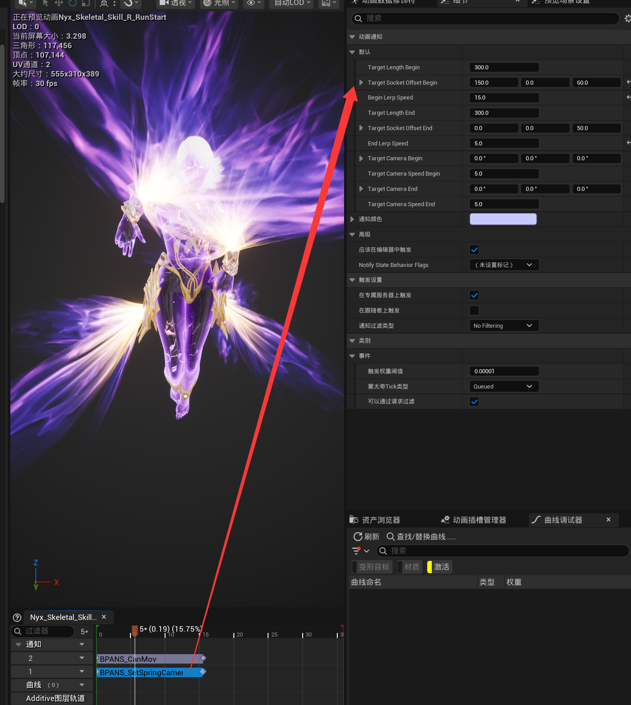

### 9.3 起飞 Blur 曲线：快速脉冲后保留持续强度

起飞参数链为：

```text
CE_RunStart
  → 初始化 MPC.UV_Offset
  → 停止相关收尾 Timeline
  → CameraPostProcess：将飞行后处理材质加入相机配置
  → 创建 NS_FlyStone，保存为 FlyParticle
  → Timeline_RunStart.Play from Start
      Update → 设置宝石 Radius、RotationSpeed
             → Set Scalar Parameter Value：MPC_RediaBlur.BlurIntensity = Blur
             → Set Vector Parameter Value：MPC_RediaBlur.UV_Offset
```

截图展示的是曲线调整过程；保存资产中的 `Timeline_RunStart` 长度为 **0.8 秒**，Blur 关键点为：

| 时间 / 秒 | Blur 关键点值 | 曲线作用 |
| --- | --- | --- |
| `0.00` | 约 `0.4866` | 起飞开始时的初始强度 |
| `0.06` | `4.0` | 很短时间内增强，配合镜头迅速靠近 |
| `0.30` | `0.1` | 从起飞脉冲快速回落 |
| `0.42` | `0.1` | 保留较弱区间 |
| 约 `0.6003` | `2.0` | 保存曲线中另有一次增强 |
| `0.80` | `0.75` | 结束在非零值，作为持续飞行的后效强度 |

这里记录的是关键点，不是保证曲线的数学最大值或最小值。Cubic 插值及手动切线可以让关键点之间出现过冲；需要平稳平台时，还要检查插值模式、切线和相邻关键点的斜率。

Blur 直接写入集合参数 W，不作为 Lerp 的 Alpha 使用，所以数值可以大于 1。它会通过第 8.14 节的计算同时放大模糊和色差；4.0 不是“四次采样”，0.75 也不是“四分之三的不透明度”。

非循环 Timeline 播完后，最后一次写入的集合值仍然存在。Timeline Finished 不会自动把材质恢复成默认值，因此末端为 0.75 可以保留持续效果；需要关闭时必须由结束或取消逻辑写零，或移除对应后处理配置。

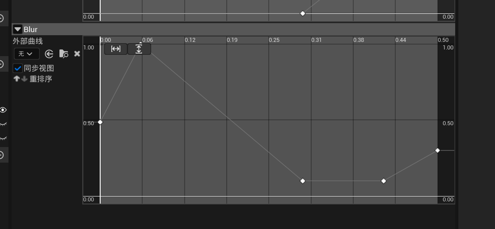

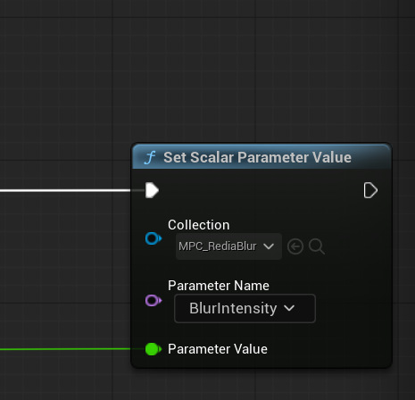

### 9.4 正常结束：0.4 秒宝石运动与 1.5 秒后处理分开推进

结束冲击的画面余韵比宝石运动所需时间更长，因此正常结束使用两条独立 Timeline：

| Timeline | 长度 | Update 写入目标 | Finished 的工作 |
| --- | --- | --- | --- |
| `Timeline_RunEnd` | `0.4 秒` | Niagara 组件的 Radius、RotationSpeed | 停用宝石组件，Delay 0.2 秒后销毁 |
| `Timeline_RunendPP` | `1.5 秒` | MPC 的 BlurIntensity | 调用 CameraPostProcess 清理相机附加后处理 |

`CE_RunEnd` 通过 Sequence 启动两者。Sequence 是按执行顺序调用 Then 0、Then 1，不会等待第一条 Timeline 播完再启动第二条。两者拥有各自的 Update 和 Finished，不再强行共享一个总时长。

保存资产中，正常结束的 Radius 从 `1.0` 开始，`0.1 秒` 到 `3.0`，`0.4 秒` 回到 `0`；RotationSpeed 从 `0.7` 增至 `0.1 秒` 的 `2.5`。这段短曲线同时包含向外张开、加速旋转和随后收回的运动，不是简单将半径匀速减零。

后处理曲线的关键点为：

| 时间 / 秒 | Blur 关键点值 | 表现节奏 |
| --- | --- | --- |
| `0.00` | 约 `1.6548` | 正常结束阶段的起始值 |
| `0.30` | `0.1` | 先减弱 |
| `0.35` | `0.1` | 短暂保持弱效果 |
| `0.40` | `2.5` | 与短 Timeline 的结束时刻对齐，配合冲击表现再次增强 |
| `1.50` | `0.0` | 持续衰减并恢复清晰 |

截图中的峰值还体现了调整过程，以上表格以保存的曲线关键点为准。运动、冲击和 Blur 的节奏要按表现发生的时间对齐，不能仅凭某条时间线叫 RunEnd 就默认所有效果都应在它的 Finished 时一起结束。

在默认 Play Rate=1 的情况下，宝石 Timeline 约 0.4 秒结束，随后 0.2 秒的清理延迟使组件约在 0.6 秒被销毁；Blur 可以继续到 1.5 秒。后处理 Update 只写 MPC，不再依赖已经被销毁的 Niagara 组件，这就是拆分后能够避免“特效消失后仍不断写组件参数”的原因。

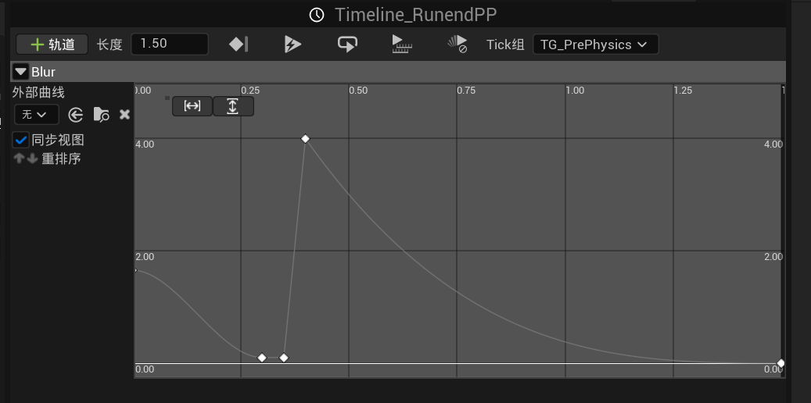

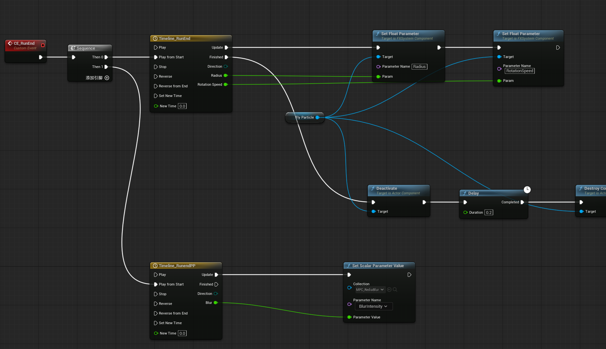

### 9.5 Event Track 的用法，以及为何最终没有用它管理这次销毁

另一种安排是将原 Timeline 长度增加到 **1.5 秒**，保留较短的宝石参数曲线，并在约 0.4 秒添加一个事件轨道 `Deactive`。它说明了 Timeline 事件轨道的基本操作：

1. 在 Timeline 中添加 Event Track，为其命名。
2. 在希望触发行为的时间位置添加关键点。
3. 回到蓝图，Timeline 节点会出现与轨道同名的执行输出引脚，将它连接到需要执行一次的逻辑。

Event Track 关注的是**经过关键点的时间**，不是图上关键点的纵坐标值。图中事件点落在 Y=0，不表示它输出零强度；它提供的是执行脉冲。Float Track 则在 Update 中提供连续数值，两者用途不同。[Timeline 编辑与轨道说明](https://dev.epicgames.com/documentation/unreal-engine/editing-timelines-in-unreal-engine?lang=en-US)

延长 Timeline Length 不会按比例拉伸原有关键点的时间。宝石曲线在 0.4 秒已经达到末值，如果总时间改成 1.5 秒，它的 Update 仍可继续输出末值，直到时间线结束。事件轨道在中间触发也不会自动停止 Update。

所以“0.4 秒事件 → Deactivate → Delay → Destroy Component”，同时还保留“1.5 秒 Timeline.Update → 设置这个组件参数”，会留下销毁后继续访问组件的区间。事件轨道本身没有问题，问题在于对象生命周期比继续写入它的时间线更短。

本例最终采用第 9.4 节的双 Timeline。下面的事件轨道截图用于说明中途执行事件的方法，不代表保存资产仍用这条事件输出管理宝石销毁。Finished 只在相应时间线完成时触发；Stop 是停止播放，不能把 Stop 当成必然执行 Finished 清理的操作。[Timeline 节点说明](https://dev.epicgames.com/documentation/unreal-engine/timelines-nodes-in-unreal-engine?lang=en-US)

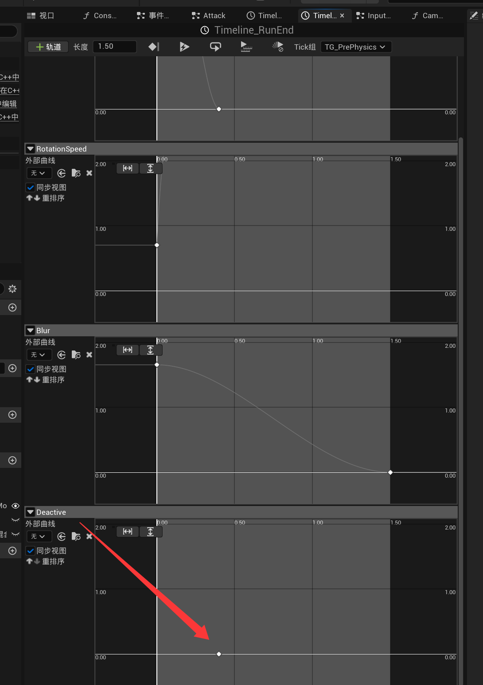

### 9.6 快速松手：为 Start → Idle/Hover 设置 RunStop 通知

只按下飞行后立即松开时，角色可能尚未进入 MoveLoop 就从 Start 返回 Idle/Hover。若只在 MoveLoop → MoveEnd 上设置结束通知，这条路径不会触发 CE_RunEnd，而 Start 的进入通知已经创建了宝石组件，于是角色回到待机后仍有宝石持续环绕。

修复入口位于 **Start → Idle/Hover 这条过渡的 Start Transition Event**，通知名为 `RunStop`。动画蓝图接收后调用角色的独立取消事件：

```text
Start → Idle/Hover 过渡开始
  → AnimNotify_RunStop
  → Character.CE_RunStop
```

截图中过渡混合时长为 `0.2 秒`，模式为 Hermite-Cubic InOut。通知发生在过渡开始时，收尾可以与回到 Idle/Hover 的动画混合同时推进。

把通知放在这条具体过渡上，才能表达“起飞取消”。Start 正常过渡到 MoveLoop 时也会离开 Start，因此仅把相同收尾放到 Start 的状态离开通知上，会连正常起飞路径一起触发。状态机里不同退出路径的视觉语义应由各自的过渡通知表达。

CE_RunStop 不调用 CE_RunEnd：正常结束允许冲击表现，起飞取消只回收已生成的环绕宝石并清除后效。即使两条路径最终都回到待机，也不意味着它们应执行相同的特效时间线。

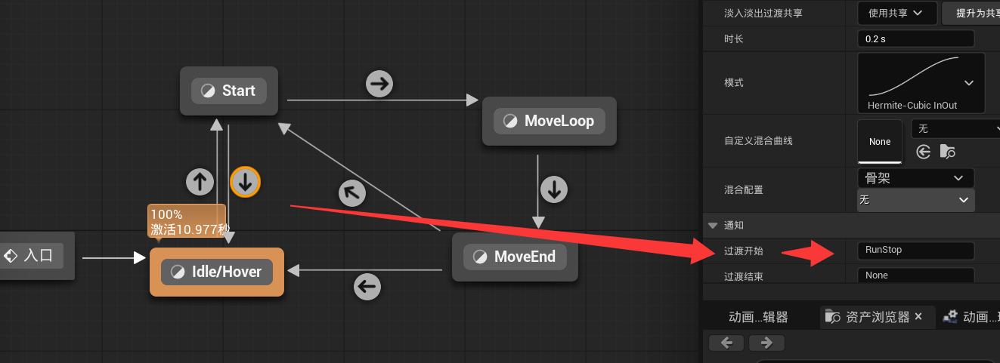

### 9.7 取消曲线：收拢、缩小与 Blur 共同归零

`CE_RunStop` 的实际执行链为：

```text
CE_RunStop
  → MPC.UV_Offset 恢复为 (0.5,0.5)
  → Timeline_RunStart.Stop
  → Timeline_RunStop.Play from Start（0.6 秒）
      Update → FlyParticle.Set Float Parameter(Radius = Size轨道)
             → FlyParticle.Set Float Parameter(Size = Size轨道)
             → MPC.Set Scalar Parameter Value(BlurIntensity = Size轨道)
      Finished → Destroy Component(FlyParticle)
               → CameraPostProcess：清理相机附加后处理
```

取消 Timeline 的 Float 轨道名为 `Size`，曲线从 `t=0、值=1` 下降到 `t=0.6、值=0`。虽然叫 Size，它实际被接到三个目标：

| 目标 | 当轨道值 s 从 1 降到 0 时的作用 |
| --- | --- |
| Niagara `User.Radius` | 按 `100 × s` 收拢宝石轨道，中心向角色体内靠近 |
| Niagara `User.Size` | 缩小宝石 Mesh 与精灵；已有 Ribbon 点的宽度响应仍取决于 Spawn/Update 读取位置 |
| MPC `BlurIntensity` | 同时降低径向模糊和色差强度 |

三个 Set 节点在同一帧依次写入同一条曲线的值，视觉上是**同步收拢、缩小和减弱后效**。连线上的先后顺序不等于先用一段时间完成收拢，再开始缩小，再开始降 Blur。若要严格分段，需要各自的曲线时间安排，而不是只改变这三个设置节点的排列。

在播放取消曲线之前 Stop 起飞 Timeline，可以避免它继续写入增大的 Radius 和 Blur，与收尾曲线争用相同参数。Stop 不会自动把起飞参数清零，实际归零由取消曲线完成。

取消曲线起点固定为 1，因此中断时如果当前实际参数不是 1，切入时可能出现数值跳变。曲线起点、当前参数值与动作中断时刻是连续性问题；“宝石不会残留”与“任意时间中断都无跳变”是两个需要分别验证的行为。

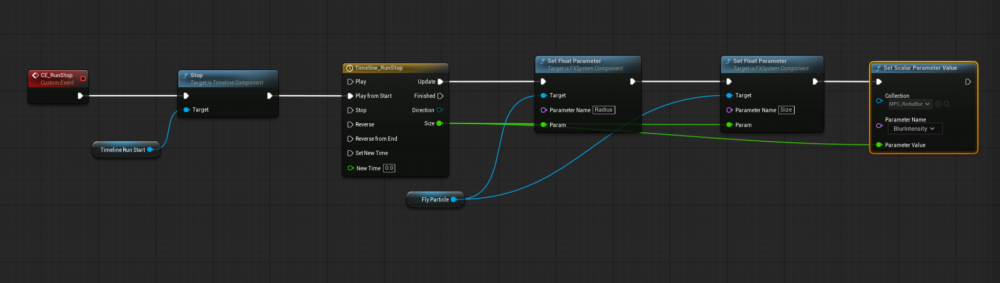

### 9.8 相机挂载与动态中心：MPC 不只控制强度

角色的 `CameraPostProcess` 函数通过 Camera 的 PostProcessSettings 配置 Weighted Blendables。CE_RunStart 在创建宝石前挂载飞行后处理；正常结束的后处理 Timeline 完成、或取消 Timeline 完成后，再以空的材质配置调用该函数，清理相机附加的后处理。

挂载和参数写入是两个环节：材质没有进入当前视图的后处理链时，只写 MPC 不会让它自动显示。清理相机配置也不等于删除场景 PostProcessVolume 中的材质；如果其他来源仍在读取同一 MPC，强度值仍会影响它们。

MPC 新增 Vector 参数 `UV_Offset`。起飞 Timeline 的 `V_Offset` 轨道用于写入其 G 分量，R 保持 0.5：

```text
MPC.UV_Offset = (0.5, V_Offset, 0, 1)
```

保存曲线的两个关键点为 `0.5 秒 → 0.5`、`0.8 秒 → 0.7`。这让起飞后半段的模糊与保护遮罩中心沿屏幕 V 方向移动，以匹配镜头变化后的角色构图。标准屏幕 UV 的 V 增大指向画面下方；它是手工曲线驱动的中心位置，不是自动追踪角色的屏幕投影。

正常结束与取消入口都会将中心复位到 `(0.5,0.5)`。当前模糊函数与 SphereMask 读取 MPC 的 RG，因此会一起移动；色差分支仍使用固定 `TexCoord-0.5`，并没有因此获得完全相同的动态中心。主材质图中保留的普通 UV_Offset 参数不等于这条集合输入，实际效果取决于连接到函数和 SphereMask 的数据来源。

曲线播放结束后仍保留的 MPC 值、相机材质是否仍挂载、Niagara 组件是否仍有效，是三个独立状态。双 Timeline 让后效余韵和组件寿命分别结束；中断逻辑则负责停止不应继续写参数的时间线。已有 Delay 跨越再次起飞的组件引用问题仍应单独按第 7.3 节检查，不能仅因拆分时间线就认定已自动解决。

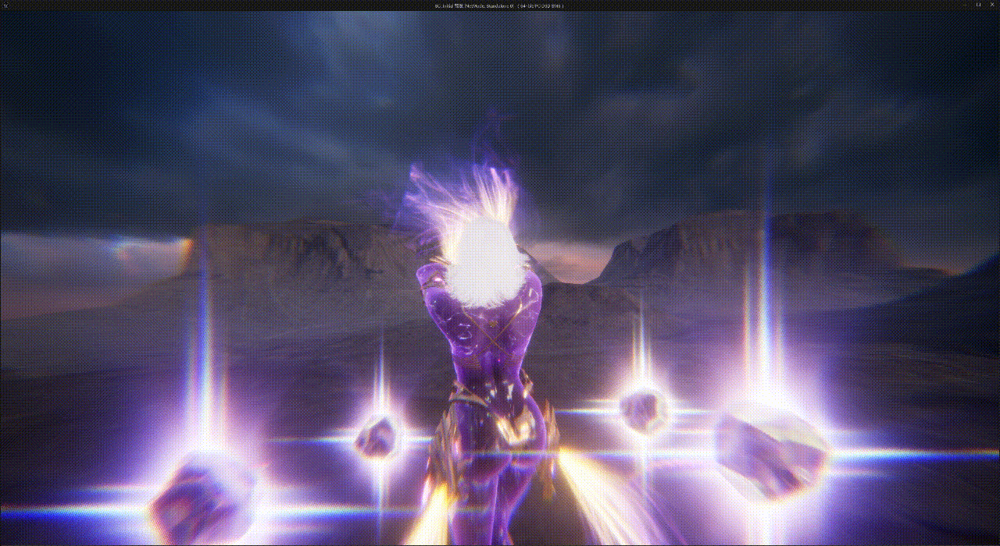
