# 闪烁特效

闪烁技能首先需要实现角色的溶解与显现。本阶段使用灰度噪声和 Step 构建裁切遮罩，再通过两次 Step 的差提取溶解亮边，最后修正亮边的渐变方向及随溶解进度产生的亮度偏移，实现外侧亮、向角色内部逐渐变暗的过渡。

## 1. 角色溶解的材质设置

本次针对角色原本不透明的表面制作溶解，不复用项目中已有的 `/Game/Effect/Common/MaterialFunction/EF_MF_Dissolve`，而是直接使用阈值比较生成二值遮罩。

这里的“不透明材质溶解”描述的是角色表面的效果需求。实际节点截图中，材质的 **Blend Mode 为 Masked**，通过 **Opacity Mask（不透明蒙版）**决定像素保留或裁切。纯 Opaque 模式不能直接通过这一输入裁切像素。[Opacity Mask 官方说明](https://dev.epicgames.com/documentation/en-us/unreal-engine/material-inputs-in-unreal-engine#opacitymask)

截图中的预览材质使用 `Surface / Masked / Unlit`，便于单独观察遮罩和自发光。接回角色材质时，保留角色所需的基础颜色、法线等表面属性，并合入溶解遮罩与亮边自发光。

后文统一使用以下符号：

| 参数或符号 | 含义 |
| --- | --- |
| `N` | 噪声纹理的灰度值，截图取 Texture Sample 的 R 通道 |
| `D` | 原始 `Dissolve` 参数，约定 1 为不溶解、0 为溶解结束 |
| `T = 1 - D` | 送入 Step 比较的溶解阈值 |
| `W` | `DissolveEdgeWidth`，两次比较之间的阈值差，控制亮边宽度 |
| `C` | `DissolveEdgeColor`，亮边颜色 |

`W` 控制的是噪声灰度区间的宽度，实际显示的空间宽度还取决于纹理局部的灰度变化速度。

## 2. 使用 Step 实现溶解核心

### 2.1 If 与 Step 的比较

最初用 If 将噪声灰度与溶解阈值比较：噪声大于或等于阈值时输出 1，小于阈值时输出 0。输出接入 Opacity Mask，就能让噪声中较暗的区域先消失。

```text
Texture Sample.R → If.A
溶解阈值          → If.B
1                 → If 的 A > B 与 A == B
0                 → If 的 A < B
If 输出           → Opacity Mask
```

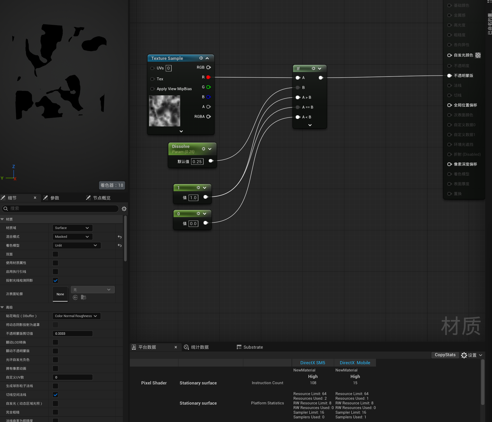

本次只需要 0 和 1 两种结果，因此用 Step 替换 If。UE 材质编辑器中的 Step 将 **X 与 Y 比较：X 小于 Y 时输出 0，否则输出 1**。连接时，噪声接 X，阈值接 Y。[Step 官方说明](https://dev.epicgames.com/documentation/en-us/unreal-engine/math-material-expressions-in-unreal-engine#step)

```text
Texture Sample.R → Step.X
溶解阈值          → Step.Y
Step 输出         → Opacity Mask
```

两种方式都能完成这里的二值溶解。If 可以为不同比较结果指定具体输出值；本次不需要这项灵活性，选择 Step 即可。

截图中的平台统计如下，均为 `High` 质量的 `Pixel Shader / Stationary surface`：

| 平台 | If 版本指令数 | Step 版本指令数 | 变化 |
| --- | ---: | ---: | --- |
| DirectX SM5 | 108 | 108 | 相同 |
| DirectX Mobile | 15 | 11 | 减少 4 条，约 26.7% |

这个示例中 Step 在 Mobile 上的编译指令更少。性能收益应以目标平台的编译和运行结果为准，不能把这组指令差当成所有材质中的固定差值。

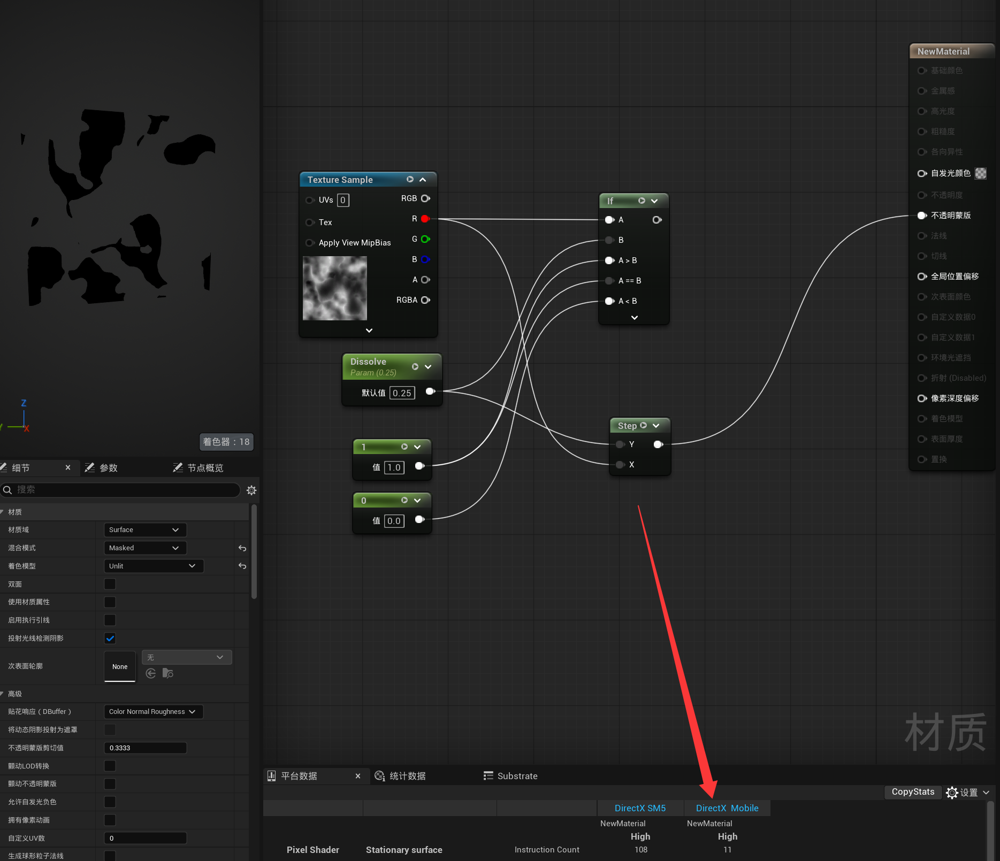

### 2.2 用 OneMinus 统一参数方向

直接增大 Step 的阈值，会让更多像素被裁掉。为了符合操作习惯，将对外的 `Dissolve` 参数先做一次 `1-x`：

```text
T = 1 - D
Dissolve → OneMinus → Step.Y
```

这样 `D` 从 1 减小到 0 时，阈值 `T` 从 0 增大到 1，溶解逐渐加深；反向调整则逐渐显现。后续两条 Step 分支都使用这一反相后的阈值。

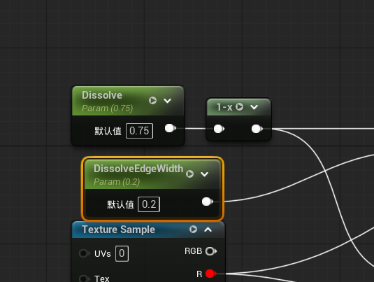

## 3. 两次 Step 相减提取亮边

溶解核心只有保留和裁切两种结果。要得到边缘带，再建立一条阈值降低 `W` 的 Step 分支：阈值较低的分支溶解较少，保留范围更大；阈值较高的分支溶解较多，保留范围更小。

用大范围减去小范围，剩下的就是两条边界之间的区域。

```text
DissolveMin = Step 节点（X = N，Y = T - W）  // 溶解少，保留范围大
DissolveMax = Step 节点（X = N，Y = T）      // 溶解多，保留范围小
EdgeMask    = DissolveMin - DissolveMax
```

这里的 `DissolveMin` 和 `DissolveMax` 沿用截图中的命名，表示两种溶解程度，不是数学 Min、Max 节点。相减顺序必须是 **溶解少的结果减去溶解多的结果**。

按上述比较关系推导，亮边对应的灰度区间为：

```text
T - W ≤ N < T
```

初步将 `EdgeMask × C` 接入 Emissive Color，便能得到一圈纯色亮边。截图早期直接用 Dissolve 作为阈值，加入 OneMinus 后，提取亮边的原理保持一致。

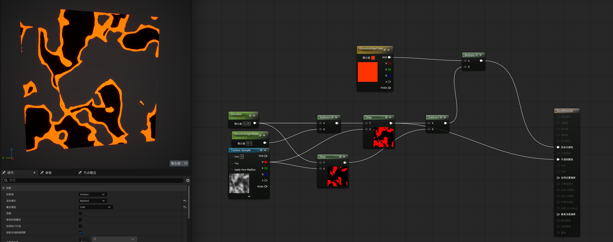

**最终截图将 DissolveMin 接入 Opacity Mask。** 因此实际保留的表面包括亮边带，以及亮边内侧未溶解的区域。如果在这套区间定义下改接 DissolveMax，亮边所在的区域就会被裁掉。

此时亮边内部几乎是统一亮度，带状区域的边界很硬，还没有“最外侧最亮、向内逐渐变暗”的层次。

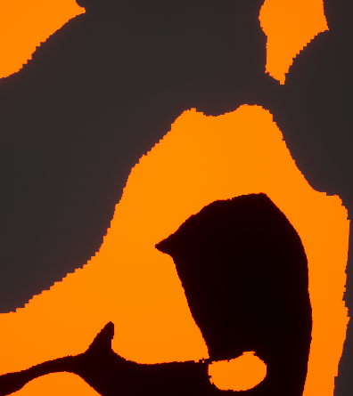

## 4. 利用噪声灰度制作边缘渐变

### 4.1 将噪声与亮边相乘

噪声纹理本身包含连续灰度，而 EdgeMask 只负责选出边缘区域。先预览两者的乘积：

```text
初步渐变 = N × EdgeMask
```

这会保留亮边区域内原有的灰度信息，使纯色带出现亮暗变化。

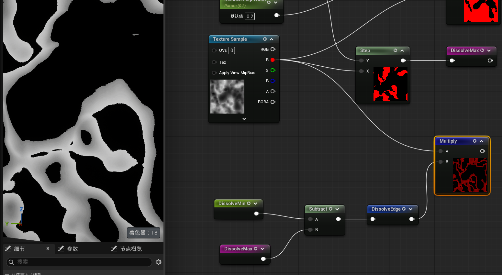

但直接使用 `N`，渐变方向与目标相反：靠近已溶解区域的外侧偏暗，靠角色内部的一侧反而更亮。

原因是暗处先溶解。在亮边区间 `T-W ≤ N < T` 中，外侧的噪声值更小，向内的噪声值更大；直接乘噪声就会得到“外暗内亮”。

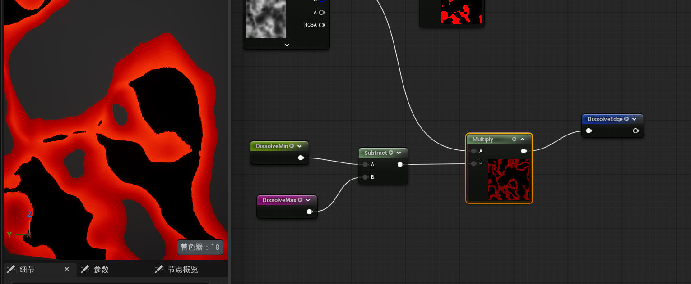

### 4.2 反相噪声改变渐变方向

给噪声灰度再加一个 OneMinus：

```text
反相噪声 Q = 1 - N
初步亮边   = Q × EdgeMask
```

外侧较小的噪声值被反相为较大的亮度值，内侧则相反，渐变方向就变为外亮内暗。

这里有两次不同用途的 `1-x`：**`1-D` 用于统一溶解参数方向，`1-N` 用于反转边缘亮度方向。**

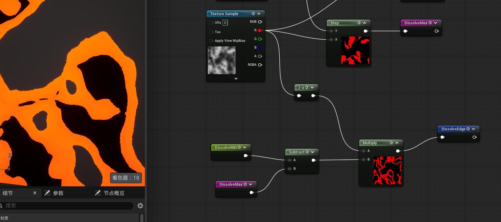

虽然方向正确了，但反相噪声的亮度仍随着溶解进度整体变化。溶解初期边缘偏亮，灰度层次不明显；溶解后期边缘整体变暗，渐变才更容易看出来。

## 5. 使用 Lerp 检查亮度随进度的变化

用颜色代替灰度观察数值分布，可以更直观地判断问题。调试时让较暗的值显示红色、较亮的值显示蓝色：

```text
Lerp.A     = 红色
Lerp.B     = 蓝色
Lerp.Alpha = 1 - N
```

再用边缘遮罩限制显示区域。Alpha 越接近 0 越偏红，越接近 1 越偏蓝。[Lerp 官方说明](https://dev.epicgames.com/documentation/en-us/unreal-engine/math-material-expressions-in-unreal-engine#linearinterpolate)

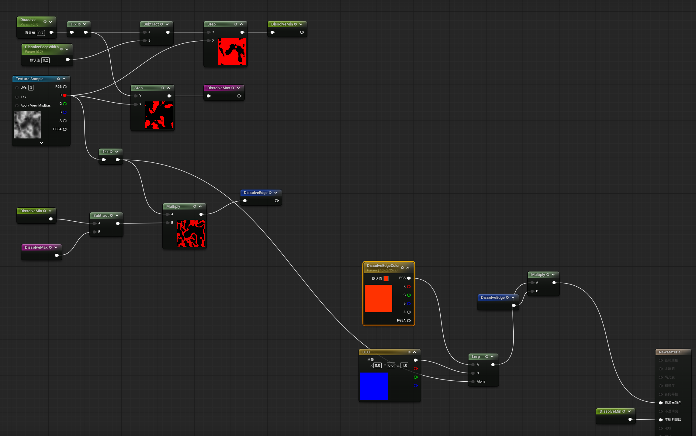

调节 Dissolve 后可以观察到：

| 阶段 | 截图参数 | 调试颜色 | 对应现象 |
| --- | --- | --- | --- |
| 溶解初期 | `D = 0.95` | 偏蓝 | 反相噪声数值整体较高 |
| 溶解后期 | `D = 0.25` | 偏红、偏紫红 | 反相噪声数值整体降低 |

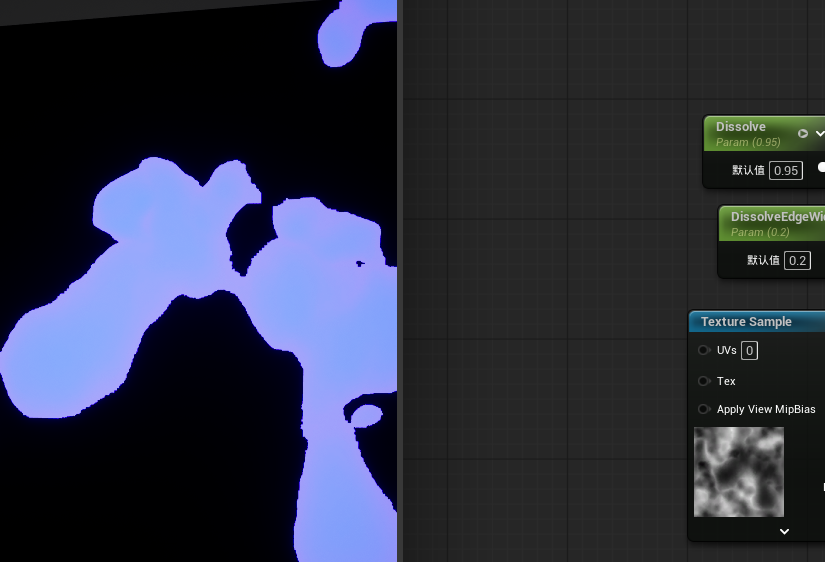

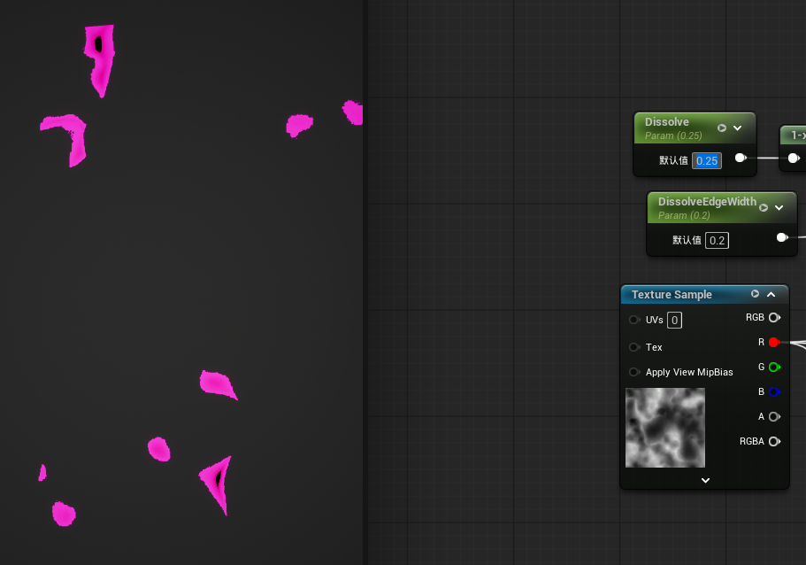

这说明随着阈值移动，亮边取到的是噪声中不同的灰度区间。纹理没有随时间改变，但当前被选中的边缘灰度发生了整体偏移，并不是只有溶解后期才存在灰度信息。

## 6. 减去原始 Dissolve 抵消亮度偏移

为了让边缘渐变在不同溶解进度下保持一致，从反相噪声中减去**未经 OneMinus 的原始 Dissolve 参数**：

```text
G = (1 - N) - D
  = T - N
```

这个计算将绝对噪声灰度转换为相对于当前阈值的差值。按亮边区间推导，`G` 的范围为：

```text
外侧边界：N = T - W  → G = W，亮度最高
向内过渡：N 逐渐增大 → G 逐渐减小
内侧边界：N 接近 T   → G 接近 0，逐渐变暗
```

只要 `W` 固定，完整亮边区间中的 `G` 就保持在 `0～W`，不再随 `D` 整体偏亮或偏暗。这里减去的是 `D`，如果误接反相后的 `T`，就无法得到上述相对梯度。

例如保持 `W = 0.2`，取亮边上相同的三个相对位置：

| 原始 D | 阈值 T | 外侧 N 与 G | 中间 N 与 G | 接近内侧 N 与 G |
| --- | --- | --- | --- | --- |
| 0.65 | 0.35 | `N=0.15，G=0.20` | `N=0.25，G=0.10` | `N=0.34，G=0.01` |
| 0.25 | 0.75 | `N=0.55，G=0.20` | `N=0.65，G=0.10` | `N=0.74，G=0.01` |

两种进度下的渐变结果一致。接着将 `G` 乘以亮边颜色，形成截图中的 `DissolveColorGradient`：

```text
DissolveColorGradient = G × DissolveEdgeColor
```

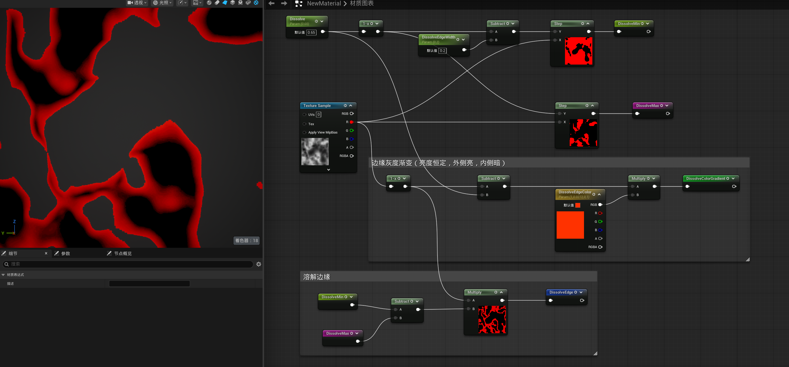

## 7. 最终节点整理与输出

### 7.1 按截图保留的连接

最终节点分为两组：一组提取溶解边缘，另一组计算颜色渐变。截图中的 `DissolveEdge` 在 Step 差值之外，还保留了前面测试时的反相噪声乘法。

```text
N = Texture Sample.R
D = Dissolve
W = DissolveEdgeWidth
T = 1 - D

DissolveMin = Step 节点（X = N，Y = T - W）
DissolveMax = Step 节点（X = N，Y = T）
EdgeMask    = DissolveMin - DissolveMax

DissolveEdge          = EdgeMask × (1 - N)
DissolveColorGradient = ((1 - N) - D) × DissolveEdgeColor

Emissive Color = DissolveColorGradient × DissolveEdge
Opacity Mask   = DissolveMin
```

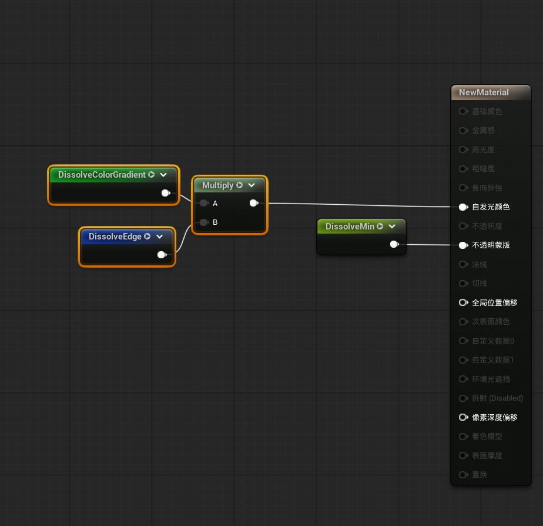

上述连接复现截图效果。**保持范围稳定的是补偿后的梯度 `G`；额外乘上的 `1-N` 仍会影响最终发光强度。** 如果目标是让同一边缘相对位置的发光值也不随进度改变，可以仅使用二值 EdgeMask 限定渐变：

```text
Emissive Color = EdgeMask × G × DissolveEdgeColor
```

这属于在截图连接基础上的进一步整理。若还希望边缘宽度改变时峰值亮度保持独立，可将 `G` 除以大于零的 `W` 后限制到 0～1，再单独乘发光强度；截图本身没有进行这一步归一化。

### 7.2 参数端点与检查要点

`D=1` 不溶解、`D=0` 完全消失是对外参数的目标约定。按截图最终的 `Opacity Mask = DissolveMin`，当 `D=0` 时阈值实际为 `1-W`，仍可能保留噪声高值区域及尾部亮边。需要严格完全消失时，应额外处理终点遮罩，或重新映射阈值使其越过噪声最大值；重新映射后，渐变应统一使用实际阈值计算 `G=T-N`。

制作完成后重点检查以下连接：

- 噪声接 Step.X，比较阈值接 Step.Y；较暗的区域应先溶解。
- `DissolveMin - DissolveMax` 的顺序正确，亮边由保留范围较大的结果减去较小的结果。
- 最终 Opacity Mask 接 DissolveMin，确保亮边带处于可见区域。
- 渐变补偿使用 `(1-N)-D`，其中 D 是原始参数；红蓝 Lerp 只用于调试。
- 对比溶解初期、中期、后期的边缘层次，并单独确认完全显现和完全消失两个端点。
